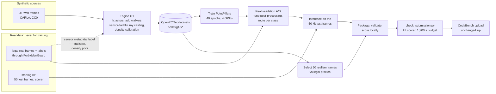
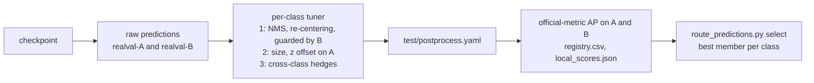
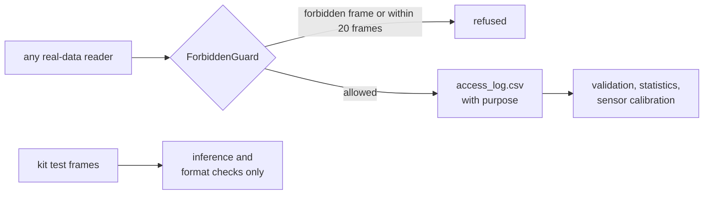
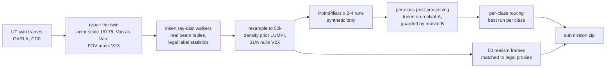

# UrbanTwin Sim2Real 2026: developer guide

Entry for the **UCF UrbanTwin Sim2Real LiDAR Challenge** at the IEEE BigData Cup 2026 ([website](https://urbanity-lab.github.io/bdc2026-urbantwin-sim2real/)), both tracks. This README is the one place to follow the whole process as a developer: set up, prepare data, generate synthetic data, train, validate, run inference, evaluate and submit. Each section links to the detailed track documents and to the plan and design documents in [`docs/`](docs).

**Contents.** Develop: [1 Objective](#1-objective) · [2 How the system works](#2-how-the-system-works) · [3 Repository layout](#3-repository-layout) · [4 Prerequisites](#4-prerequisites) · [5 Setup](#5-setup) · [6 Developer workflow](#6-developer-workflow-end-to-end) · [7 Tracks](#7-tracks) · [8 Local evaluation and packaging](#8-local-evaluation-and-packaging) · [9 Integrity](#9-integrity-rules-and-decision-records) · [10 Contributing](#10-contributing). Strategy and results: [11 Strategy](#11-strategy) · [12 CodaBench submissions](#12-codabench-submissions-by-strategy) · [13 Next steps](#13-next-steps). Reference: [14 Documentation index](#14-documentation-index) · [15 References](#15-references)

**Status (2026-10-06):** the first CodaBench submissions (strategy S1, Section 11) rank **first on both development leaderboards**: Track 1 LUMPI combined **0.4728** (next 0.2769), Track 2 V2X-Real combined **0.7665** (next 0.6114). Results, links to the models and the submitted files: [Section 12](#12-codabench-submissions-by-strategy).

---

## 1. Objective

Build synthetic roadside LiDAR data and a 3D object detector **trained on synthetic data only**. The detector is scored on held-out real frames, and the synthetic data is scored on how real it looks.

| | Track 1 | Track 2 |
|---|---|---|
| Real dataset | LUMPI (Leibniz University Hannover; 5 roadside lidars merged) | V2X-Real infrastructure lidar (UCLA; Ouster OS1-64) |
| CodaBench | [16684](https://www.codabench.org/competitions/16684/) | [16685](https://www.codabench.org/competitions/16685/) |
| Classes | Person, Car, Bicycle, Motorcycle, Bus, Truck, Van, Unknown (7 with test GT) | vehicle, pedestrian, truck |
| Organizer synthetic data | UT-LUMPI (CARLA digital twin, CC0) | UT-V2X-Real-IC (CARLA digital twin, CC0) |
| Detailed docs | data: [`data-lumpi-track/README.md`](data-lumpi-track/README.md) · models: [`model-lumpi-track/README.md`](model-lumpi-track/README.md) | data: [`data-v2x-track/README.md`](data-v2x-track/README.md) · models: [`model-v2x-track/README.md`](model-v2x-track/README.md) |

**What you submit per track** (one zip): `synthetic/0001.bin ... 0050.bin` (50 synthetic frames, float32 N x 3, each at most 1.5 MB), `predictions.json` (boxes `[x, y, z, dx, dy, dz, heading]`, score and class for each of the 50 released real test frames) and a signed declaration.

**Score** (exact formula from the kit's `scoring_program`; details in [Section 8](#8-local-evaluation-and-packaging)):

```
combined = 0.6 * clip(mAP_3D@0.5 / 0.7)  +  0.4 * R          R = 1 - mean( clip((CD-2)/28), clip(MMD/0.5), clip(EMD/5), clip(FPD/50) )
         ~ 0.857 * mAP + 0.4 * R   (while mAP <= 0.7)
```

**Dates** (CodaBench phases; deadlines are 00:00 UTC = 17:00 PDT the day before):

| Phase | Window | Submissions | Leaderboard |
|---|---|---|---|
| Development | Jul 1 - Oct 31, 2026 00:00 UTC (Oct 30, 17:00 PDT) | 5 per day, 100 in total | public |
| Final | Nov 1 - Nov 15, 2026 00:00 UTC (Nov 14, 17:00 PDT) | **1 per day, 5 in total** (development submissions do not carry over) | hidden until close |
| Report | 4-8 page challenge report due Nov 15, 2026 | | winners announced Nov 25; conference Dec 14-17, Phoenix |

**Targets and status:** the ECCV 2026 edition used the same scorer and test data; its winners scored V2X 0.746 and LUMPI 0.479. Targets: V2X 0.80, LUMPI 0.53. Strategy S1 scored V2X 0.7665 (above the ECCV winner) and LUMPI 0.4728 (0.007 below it, from realism). Local estimates: [Section 8.4](#84-local-results-of-the-selected-models); leaderboard: [Section 12](#12-codabench-submissions-by-strategy). Facts and rules: [`docs/01-CHALLENGE-FACTS.md`](docs/01-CHALLENGE-FACTS.md); strategy and where the points are: [`docs/02-STRATEGY.md`](docs/02-STRATEGY.md).

## 2. How the system works

### 2.1 Big picture



The architecture, data contracts and code map are in [`docs/03-ARCHITECTURE.md`](docs/03-ARCHITECTURE.md); the module-by-module build plan is [`docs/04-IMPLEMENTATION-GUIDE.md`](docs/04-IMPLEMENTATION-GUIDE.md).

### 2.2 Where the points are

| Lever | Why it matters | Where in this repo |
|---|---|---|
| Classes missing from the synthetic data | UT-LUMPI has no Person (1/7 of the LUMPI score); UT-V2X has no walking pedestrian (62% of V2X test objects) | engine G1 walkers: [`common/bdc26/render/`](common/bdc26/render), [`data-lumpi-track/README.md`](data-lumpi-track/README.md) Section 8.7 |
| Box conventions | UT-LUMPI actors are 0.78x real size (cannot reach IoU 0.5); annotators' boxes differ from CARLA's | actor scale fix ([`common/bdc26/prep.py`](common/bdc26/prep.py)); size calibration in post-processing |
| Sensor faithfulness | real density, beam pattern, field of view, null returns | per-sensor ray casting with real beam tables; V2X FOV mask; 31% nulls in V2X frames |
| Post-processing per class | NMS IoU, re-centering, size, hedged duplicates move AP a lot | [`common/tools/tune_postprocess.py`](common/tools/tune_postprocess.py) on real validation |
| Realism | 40% of the score; raw UT-LUMPI frames reach only R 0.59 | calibrated background density ([`common/bdc26/density.py`](common/bdc26/density.py)) and frame selection |

Full ranking with gates and risks: [`docs/02-STRATEGY.md`](docs/02-STRATEGY.md).

### 2.3 Validation and selection loop



realval-A is real data from the same recording as the test frames (LUMPI Measurement4; V2X scenes split by name) and is used for every choice; realval-B is a second split that only checks the choices.

### 2.4 Integrity by construction



Rules and the decision records: [Section 9](#9-integrity-rules-and-decision-records). The named end-to-end recipe built from these parts is strategy S1 ([Section 11](#11-strategy)).

## 3. Repository layout

```
utsim2real-bdc26/
├── README.md                    this developer guide
├── requirements.txt             pinned Python requirements (Python 3.10, CUDA 12.1 wheels)
├── common/                      the only shared code folder
│   ├── bdc26/                   Python package (see Section 10.1 code map)
│   ├── tools/                   command-line tools (train, predict, evaluate, tune, route, select, package, check)
│   ├── env/                     bdc26.env (paths), activate.sh, setup_venv_ut.sh, setup_bdc_train.sh (conda alternative)
│   ├── tests/                   pytest suite (synthetic fixtures; parity with the official scorer)
│   └── kit/                     place the downloaded starting kits here (git-ignored)
├── data-lumpi-track/            Track 1 data: track.yaml, fetch/prepare scripts, README.md (detailed data guide)
├── data-v2x-track/              Track 2 data: same structure
├── model-lumpi-track/           Track 1 models: README.md (approaches, selected model, lifecycle), registry.csv,
│   └── <model>/                 model.yaml, README.md, train/, validation/, test/, submissions/<date>_<tag>/
├── model-v2x-track/             Track 2 models: same structure
└── docs/                        plan of record (01-07), decisions/, reference/papers/
```

Large data lives outside git under `$BDC_DATA` (default `<repo>/../bdc26-data`); checkpoints, predictions and zips are in git-ignored `output/` and `submissions/*/submission.zip` (uploaded zips are attached to the GitHub release of the matching tag, Section 12).

```
$BDC_DATA/
├── third_party/OpenPCDet/       OpenPCDet 233f849 (built by setup_venv_ut.sh)
├── logs/                        download, build, training and evaluation logs
├── lumpi-track/ {kit, ut, real, pcdet, gen}/
└── v2x-track/   {kit, ut, real, pcdet, gen}/
```
The per-track layout and every dataset version: [`data-lumpi-track/README.md`](data-lumpi-track/README.md) Sections 3 and 9, [`data-v2x-track/README.md`](data-v2x-track/README.md) Sections 3 and 9.

## 4. Prerequisites

| Item | Requirement | Tested |
|---|---|---|
| OS | Linux x86_64 | Ubuntu 20.04, kernel 5.4 |
| GPU | NVIDIA, 24 GB or more per GPU for the given batch sizes (4 GPUs per training run) | 8 x RTX A6000 48 GB |
| Driver / CUDA | driver >= 530 (CUDA 12.1 wheels); a CUDA 12.x toolkit with `nvcc` to build OpenPCDet's ops (`CUDA_HOME`) | driver 570, CUDA 12.8 |
| Python | 3.10 (`python3.10 -m venv`) | 3.10.13 |
| Tools | git, curl, a C++17 compiler (gcc 9+) | gcc 9.4 |
| Disk | about 250 GB for data, datasets and checkpoints (UT 70 GB, real 21 GB, datasets 50 GB, checkpoints 2 GB per run, venv 5 GB) | 1.2 TB free |
| RAM / CPU | 64 GB+; generation scripts use 32-64 worker processes | 503 GB, 255 cores |
| Accounts | CodaBench login (starting kits, uploads); licence acceptance for real LUMPI (CC BY-NC 3.0) and V2X-Real (UCLA Academic) | |

## 5. Setup

### 5.1 Python environment (`.venv_ut`)
```bash
git clone <this repository> utsim2real-bdc26 && cd utsim2real-bdc26
python3.10 -m venv .venv_ut                      # git-ignored
bash common/env/setup_venv_ut.sh                 # about 15 min: pip install -r requirements.txt, clone + build OpenPCDet, pip install -e common
source common/env/activate.sh                    # every later shell: sets paths and activates .venv_ut
python -m pytest -q common/tests                 # 38 tests, including bit-for-bit parity with the official scorer
```
[`requirements.txt`](requirements.txt) pins the tested stack: torch 2.1.2+cu121, spconv-cu121 2.3.8, numpy 1.23.5 (OpenPCDet needs < 1.24), numba 0.58.1, POT 0.9.7, shapely 2.0.6 and the OpenPCDet runtime dependencies. [`setup_venv_ut.sh`](common/env/setup_venv_ut.sh) clones OpenPCDet at commit 233f849 into `$BDC_THIRD_PARTY`, makes its Argo2 import optional, builds the CUDA ops (`setup.py develop`), installs this repo's `bdc26` package in editable mode, checks the GPU and the IoU op, and marks the venv ready. [`activate.sh`](common/env/activate.sh) then prefers `.venv_ut`; set `BDC_PYENV=conda` to use the conda alternative ([`setup_bdc_train.sh`](common/env/setup_bdc_train.sh), environment `bdc-train`).

### 5.2 Paths
[`common/env/bdc26.env`](common/env/bdc26.env) (sourced by `activate.sh`) sets `BDC_REPO`, `BDC_DATA` (data root, default `<repo>/../bdc26-data`), `BDC_THIRD_PARTY`, `PCDET_ROOT`, `PYTHONPATH=common`, `CUDA_HOME` and `TORCH_CUDA_ARCH_LIST`. Override any of them with `export` before sourcing.

### 5.3 Starting kits
Download both kits from the CodaBench Files tabs and place them in [`common/kit/`](common/kit) (git-ignored) as `lumpi_starting_kit.zip` and `v2x_real_starting_kit.zip`; Section 6.1 ingests them.

## 6. Developer workflow (end to end)

Run every command from the repository root after `source common/env/activate.sh`. Use `CUDA_VISIBLE_DEVICES` to choose GPUs; run long jobs with `nohup` and logs in `$BDC_DATA/logs/`. Each step links to its detailed section.

### 6.1 Get the data
| Step | Track 1 (LUMPI) | Track 2 (V2X-Real) |
|---|---|---|
| Synthetic (CC0) | `python data-lumpi-track/fetch_ut.py` | `python data-v2x-track/fetch_ut.py` |
| Starting kit | `python data-lumpi-track/ingest_kit.py common/kit/lumpi_starting_kit.zip` | `python data-v2x-track/ingest_kit.py common/kit/v2x_real_starting_kit.zip` |
| Real data (licence) | `python data-lumpi-track/fetch_real.py --accept-licence --meta --labels`, then `--lidar Measurement4 --range 0:6400:5` (and M5, M6) | `python data-v2x-track/fetch_real.py --accept-licence --points`, then `python data-v2x-track/resolve_test_ids.py`, then `fetch_real.py --accept-licence --labels` |
| Details | [`data-lumpi-track/README.md`](data-lumpi-track/README.md) Sections 2, 7, 8.1-8.3 | [`data-v2x-track/README.md`](data-v2x-track/README.md) Sections 2, 6, 7 |

### 6.2 Prepare datasets
| Step | Track 1 | Track 2 |
|---|---|---|
| Baseline UT dataset | `python data-lumpi-track/prepare_ut.py --name ut-v1` | `python data-v2x-track/prepare_ut.py --name ut-v1` |
| Real validation + realism proxies | `python data-lumpi-track/prepare_realval.py` | `python data-v2x-track/prepare_realval.py --stride 5` |
| G1 corpus (selected) | see the block below | `OMP_NUM_THREADS=1 python data-v2x-track/prepare_g1.py --name g1-v3 --walker v2 --placement prior --walkers 16 --density-gain 2.5 --fov-mask --workers 48` |
| Details | [`data-lumpi-track/README.md`](data-lumpi-track/README.md) Sections 8.4-8.7, 9 | [`data-v2x-track/README.md`](data-v2x-track/README.md) Sections 7-9 |

Track 1 G1 corpora (the density prior is fitted on the uncalibrated `g1-v1`):
```bash
export OMP_NUM_THREADS=1                      # generation is CPU-bound: one BLAS thread per worker
python data-lumpi-track/prepare_g1.py --name g1-v1 --workers 64
python common/tools/fit_density_prior.py --track lumpi --real pcdet/realval-v1 --syn pcdet/g1-v1 --out gen/density_prior_v1.npz
python data-lumpi-track/prepare_g1.py --name g1-v2 --density-prior gen/density_prior_v1.npz --workers 64
python data-lumpi-track/prepare_g1.py --name g1-v3 --walker v2 --density-prior gen/density_prior_v1.npz --workers 64
```
Generation scripts are CPU-bound: always run them with `OMP_NUM_THREADS=1` (otherwise each worker's BLAS spawns a thread per core).

### 6.3 Train
```bash
CUDA_VISIBLE_DEVICES=0,1,2,3 bash model-lumpi-track/pointpillars-g1/train/train.sh 4 run1 --fix_random_seed --workers 6
CUDA_VISIBLE_DEVICES=4,5,6,7 bash model-v2x-track/pointpillars-g1v3/train/train.sh 4 run1 --fix_random_seed --workers 6
```
`train.sh NGPUS TAG [OpenPCDet train.py flags]` builds missing OpenPCDet infos, then trains (about 1 h for V2X, 2 h for LUMPI on 4 A6000s). Checkpoints: `<model>/train/output/pcdet_model/<TAG>/ckpt/`. Configs, anchors and hyperparameters: [`model-lumpi-track/README.md`](model-lumpi-track/README.md) Section 3, [`model-v2x-track/README.md`](model-v2x-track/README.md) Section 3.

### 6.4 Validate on real data and tune post-processing
```bash
CUDA_VISIBLE_DEVICES=0 bash model-lumpi-track/pointpillars-g1/validation/tune_and_eval.sh \
    model-lumpi-track/pointpillars-g1/train/output/pcdet_model/run1/ckpt/checkpoint_epoch_40.pth
```
Raw predictions on realval-A/B, per-class tuning (Section 2.3) into `test/postprocess.yaml`, official-metric evaluation on A and B, a row in `model-<track>/registry.csv` and `validation/results/local_scores.json`. Add `--eval-only` to re-score with the current `postprocess.yaml`. Details: [`model-lumpi-track/README.md`](model-lumpi-track/README.md) Section 6.3.

### 6.5 Combine models per class
```bash
python common/tools/route_predictions.py select model-lumpi-track/routed-g1
```
Per class, the member with the best realval-A AP (near-ties broken by realval-B) is written into the routed model's `model.yaml`. Details: [`model-lumpi-track/README.md`](model-lumpi-track/README.md) Section 6.4.

### 6.6 Ablations
Train the comparison model (for example `pointpillars-ut`, UT data without G1) and run 6.4 for it; the comparison tables live in each track's model README (Section 7). Every evaluation is a row in `registry.csv`.

### 6.7 Choose the realism frames
```bash
python common/tools/select_realism_frames.py --track lumpi --syn pcdet/g1-v2 --split val \
    --fit-ref pcdet/realism-proxy-1 --fit-ref pcdet/realism-proxy-2 --fit-ref pcdet/realism-proxy-3 \
    --test-ref pcdet/realism-proxy-4 --test-ref pcdet/realism-proxy-5 --out model-lumpi-track/routed-g1/test/synthetic_ids.txt
```
Picks 50 frames of the generator's val split (never trained on) whose pooled point distribution best matches legal real proxies 1-3, and reports the official realism score on held-out proxies 4-5 (V2X frames are scored with the 31% nulls the packager adds).

### 6.8 Inference, packaging and local scoring
```bash
CUDA_VISIBLE_DEVICES=0 bash model-lumpi-track/routed-g1/test/make_submission.sh first
CUDA_VISIBLE_DEVICES=4 bash model-v2x-track/routed-g1/test/make_submission.sh first
# a single model instead: bash model-<track>/<model>/test/make_submission.sh <ckpt> <tag> [team]
```
Predicts the 50 kit frames, packages `submission.zip`, validates it against the published spec and prints the local realism and combined estimates. The team name in `declaration.txt` defaults to `$BDC_TEAM` (`KarmaRV`, set in [`common/env/bdc26.env`](common/env/bdc26.env)); pass a third (single model) or second (routed) argument to override it. Packaging rules: Section 8.5.

### 6.9 Check, upload and record
Check the zip exactly as the server will see it, including a run of the kit's own scorer under the server's 1,200 s limit (about 2 minutes and 6 GB of memory):
```bash
python common/tools/check_submission.py --track lumpi model-lumpi-track/routed-g1/submissions/<date>_<tag>/submission.zip --official
```
To change only the team line of an existing zip, add `--set-team <name>` (every other member is copied byte for byte and `manifest.json` is updated). **Upload the zip file unchanged** (renaming is fine): never unzip it, edit it and compress it again (Section 8.7). If your browser runs on another machine, copy the file and compare its checksum with `zip_md5` in `manifest.json` before uploading:
```bash
md5sum submission.zip
```
Upload it on the CodaBench Submit tab (Track 1: competition 16684, Track 2: 16685), then save the server's scores as `submissions/<date>_<tag>/codabench_<id>.json` (the `scores` dict printed on the `[scoring] DONE` line, plus the uploaded file name and date; see the existing records) and record it:
```bash
python common/tools/package_submission.py model-lumpi-track/routed-g1 --tag first --record <codabench_id> model-lumpi-track/routed-g1/submissions/<date>_first/codabench_<codabench_id>.json
```
This stores the CodaBench id and the leaderboard numbers in the submission's `manifest.json` and appends a `leaderboard` row (combined, mAP, R, per-class AP) to `registry.csv`. Then add the row to the submission log in the track's model README (Section 9 there), attach the zip to the GitHub release of the tag, and list the submission under its strategy in [Section 12](#12-codabench-submissions-by-strategy).

## 7. Tracks

### 7.1 Track 1: LUMPI
- **Data** ([`data-lumpi-track/README.md`](data-lumpi-track/README.md)): UT-LUMPI was simulated with the real Measurement4 rig (beam residual 0.03 deg), so walkers are ray-cast with the five real lidars and inserted with per-sensor occlusion; actors are rescaled by 1/0.78; UT Van is trained as the challenge Van (LUMPI id 6); the background is resampled toward the real spatial density.
- **Model** ([`model-lumpi-track/README.md`](model-lumpi-track/README.md)): `routed-g1`, per-class routing of two PointPillars models (walker v1 and v2); approaches compared with pros and cons in Section 2 there.
- **Results:** local [Section 8.4](#84-local-results-of-the-selected-models), leaderboard [Section 12](#12-codabench-submissions-by-strategy).

### 7.2 Track 2: V2X-Real
- **Data** ([`data-v2x-track/README.md`](data-v2x-track/README.md)): the challenge's forbidden frames all come from V2X-Real train scenes (resolved by point matching and a monotone-subset argument); walkers are ray-cast with the measured OS1-64 beam table at legal real walker positions and calibrated to the real point counts at every range; UT points outside the real field of view are masked; realism frames carry 31% (0,0,0) nulls like the test frames.
- **Model** ([`model-v2x-track/README.md`](model-v2x-track/README.md)): `routed-g1`, per-class routing of PointPillars models (vehicle from `g1v2`, pedestrian from the walker-calibrated `g1v3`, truck from the UT-only baseline); approaches compared with pros and cons in Section 2 there.
- **Results:** local [Section 8.4](#84-local-results-of-the-selected-models), leaderboard [Section 12](#12-codabench-submissions-by-strategy).

## 8. Local evaluation and packaging

Everything here runs on our own machine before an upload: the two metrics exactly as the server computes them, the local estimates and how far to trust them, the local results of the selected models, the packaging rules, the pre-upload check and what to do when an upload fails. Leaderboard results are in [Section 12](#12-codabench-submissions-by-strategy).

### 8.1 Detection metric

As the scorer computes it (`scoring_program/detection_eval.py`, reproduced by [`common/bdc26/evalap.py`](common/bdc26/evalap.py) and checked by [`common/tests/test_official_parity.py`](common/tests/test_official_parity.py)):
- per class and IoU threshold (0.5 primary, 0.7 reported): in each frame, predictions sorted by score each take the unused GT with the highest IoU and count as true positives if IoU >= threshold; predictions in frames without GT of the class are false positives; AP = mean over 40 recall points of the interpolated precision (R40 [R14]; R11 reported);
- 3D IoU = oriented BEV polygon intersection x z overlap / union volume; class names match case-insensitively; a missing `class` defaults to "Car"; classes without test GT are excluded from the mean; no difficulty filter, no cap on the number of boxes. (The Evaluation page calls this "KITTI 40-point AP"; the matching is VOC-style, as the shipped code shows.)
- Consequences: never threshold scores aggressively (adding low-scored boxes cannot lower AP); per-class NMS matters (duplicates are false positives); the same box may be emitted under several classes (hedges), since per-class AP is independent.

### 8.2 Realism metric

`scoring_program/metrics.py`, reproduced bit-for-bit by [`common/bdc26/realism.py`](common/bdc26/realism.py): concatenate the 50 frames per side, mask to the range (inclusive; (0,0,0) points are inside), one RNG with seed 1234 draws 10,000 synthetic then 10,000 real points, then CD (squared L2) and EMD = sqrt(W1) [R15] (POT [R18], 10M iterations, converged), unbiased RBF MMD with a median-heuristic bandwidth [R16], and FPD (Gaussian Frechet distance on xyz [R17]). The real reference is 50 held-out frames we never see; locally we score against 5 sets of 50 legal real frames (`pcdet/realism-proxy-*`).

```
R = 1 - mean( clip((CD-2)/28), clip(MMD/0.5), clip(EMD/5), clip(FPD/50) )
```
With our frames the CD and MMD terms are almost zero, so EMD carries 76% (LUMPI) and 89% (V2X) of the remaining realism loss on the leaderboard (Section 12.3). Sensitivity of each term: [`docs/01-CHALLENGE-FACTS.md`](docs/01-CHALLENGE-FACTS.md) Section 4.

### 8.3 Local estimates and how far to trust them

| Number | Tool | Meaning |
|---|---|---|
| realval-A mAP | `tune_and_eval.sh`, [`eval_predictions.py`](common/tools/eval_predictions.py) | official metric on legal real frames of the test recording; also the selection split, so optimistic |
| realval-B mAP | same | a second real split never used for selection (LUMPI: other measurements with a different Person box convention) |
| R (held-out proxies) | [`score_realism.py`](common/tools/score_realism.py), [`select_realism_frames.py`](common/tools/select_realism_frames.py) | official realism score against legal frames not used for any choice |
| combined estimate | `make_submission.sh` | `0.6 * clip(mAP_A / 0.7) + 0.4 * R` |

Calibration from the first leaderboard results (Section 12.4): realism transfers (V2X +0.001, LUMPI -0.014); detection does not fully. Leaderboard mAP was 0.81 x realval-A and 0.89 x realval-B on V2X, and 0.52 x realval-A and 0.82 x realval-B on LUMPI. **Use the realval-B mAP for the combined estimate, and expect it to be optimistic on LUMPI.**

### 8.4 Local results of the selected models

All numbers use the official metric on legal real validation; realism is the official score against held-out legal proxies. Per-class tables, ablations and every run: [`model-lumpi-track/README.md`](model-lumpi-track/README.md) Section 7, [`model-v2x-track/README.md`](model-v2x-track/README.md) Section 7, and `model-<track>/registry.csv`.

| Track | Selected model | realval-A mAP | realval-B mAP | Realism R (proxies 4 / 5) | Combined estimate (A / B) | Leaderboard combined |
|---|---|---|---|---|---|---|
| 1 LUMPI | [`routed-g1`](model-lumpi-track/routed-g1) | **0.260** | 0.166 | 0.906 / 0.905 | 0.585 / 0.505 | **0.4728** (965614) |
| 2 V2X-Real | [`routed-g1`](model-v2x-track/routed-g1) | **0.572** | 0.520 | 0.919 / 0.919 | 0.858 / 0.814 | **0.7665** (965633) |

What moved the numbers (Track 1): synthetic walkers (Person 0 -> 0.341; mAP 0.168 -> 0.253), UT Van trained as Van (0.034 -> 0.122), per-class post-processing (+0.043), routing two runs (+0.007), background density calibration and frame selection (realism 0.59 -> 0.905). Track 2: walkers (pedestrian 0 -> 0.118, 0.173 with the v2 body), walker calibration on legal real walkers and the OS1-64 field-of-view mask (pedestrian 0.173 -> 0.266; realism 0.901 -> 0.919), per-class routing (vehicle from `g1v2`, pedestrian from `g1v3`, truck from the UT-only baseline at 0.822: +0.045 over the best single model).

### 8.5 Packaging rules

| Rule (kit `submission_format.md`, scorer `score.py`) | How the packager ([`common/bdc26/submit.py`](common/bdc26/submit.py)) handles it |
|---|---|
| exactly 50 `synthetic/*.bin`, float32 N x 3 (N x 4 accepted), each <= 1,500,000 bytes, total < ~75 MB | writes 50 x 50,000 points (600 KB each); validation errors stop packaging |
| `predictions.json`: exactly the 50 test IDs as keys (empty lists allowed); boxes of 7 floats, positive extents; score in [0, 1]; valid class strings (others are discarded) | built from the routed or single-model predictions; every test ID present; classes from the track config |
| declaration.pdf (signed) or declaration.txt containing the verbatim statement | `declaration.txt` with the statement, `Team: $BDC_TEAM` and the date; validation fails on an empty team (sign the kit's `declaration_template.pdf` if you prefer the PDF) |
| the scorer reads `synthetic/`, `predictions.json` and `declaration.*` at the zip root | the packager writes exactly these entries; `check_submission.py` rejects anything else (a nested folder, `__MACOSX/`, `.DS_Store`) |
| V2X: the real frames contain 31% (0,0,0) nulls | packager injects them (`track.yaml` `resample.null_fraction`) |

Each submission is a folder `model-<track>/<model>/submissions/<date>_<tag>/` with `manifest.json` (model, checkpoints, route, frames, local scores, validation result, CodaBench attempts, id and leaderboard numbers after `--record`), `synthetic_ids.txt` and, after an upload, `codabench_<id>.json` (the scores and scoring log the server printed). The zip itself is git-ignored; uploaded zips are attached to the matching GitHub release (Section 12.1).

### 8.6 Server cost and the pre-upload check

Both competitions use CodaBench's shared default queue (`queue: null` in the public API), Docker image `codalab/codalab-legacy:py312`, and a 1,200 s execution limit per phase. The worker unzips the upload into `/app/input/res`, `run.sh` pip-installs numpy, scipy, shapely and POT, then `score.py` validates and scores. On a validation error the scorer prints `[scoring] FATAL: <reason>`, writes a `scores.json` with zeros and `Infinity` for CD, MMD, EMD and FPD, writes the reason into `detailed_results.html`, and exits 0.

[`check_submission.py`](common/tools/check_submission.py) `--official` runs the kit's own scorer on a zip with a legal stand-in reference (realism-proxy-4 frames; realval labels placed under the test IDs, so the detection loops do a realistic amount of work) and reports validity, realism, wall time and peak memory. On the `2026-10-02_first` zips: Track 1 134 s, Track 2 95 s, 5.9 GB peak each. Memory is the same for every participant (the realism metrics subsample 10,000 points per side; the dense MMD matrices dominate). Time grows with the number of predicted boxes (pure-Python IoU loops; Track 1 17,095 boxes, Track 2 18,728); a per-class box cap would cut it but costs mAP (cap 100: -0.0005 LUMPI, -0.0013 V2X on realval-A), so it stays off.

### 8.7 When a CodaBench submission fails or hangs

| Symptom on the Submissions page | Most likely cause | What to do |
|---|---|---|
| Failed within minutes, or a score row of zeros | validation (declaration, `synthetic/`, prediction IDs) | read the scoring stdout (`FATAL:` line) and `detailed_results.html`; fix with the packager, never by hand |
| Failed with no message after hours in the queue | as above, but the `Infinity` fields of the error `scores.json` may not be storable, so the reason never reaches the leaderboard; or the worker died | collect the logs (below); re-check the exact uploaded file with `check_submission.py` |
| Running or "Preparing submission..." for more than a day with no log at all | no worker ever ran it, or the worker was lost mid-run | cancel, upload the same checked zip once more; if it hangs again, write to the organizers with the submission ids |
| Failed after about 20 minutes | the 1,200 s execution limit | compare with the `--official` wall time; only then consider the box cap |

Debug data to collect for every failed or stuck submission: the submission id; the status tooltip (the "?" icon next to the status); the expanded submission row (scoring stdout and stderr, detailed results, and the output files if the page offers them); the exact file that was uploaded (copy it to the server and run `unzip -l` and `check_submission.py --official` on it); its name, size and checksum; how it was made. History: the 2026-10-02 attempts 957399 and 957439 were hand-edited copies of the packaged zips and never scored; the packaged zips uploaded unchanged on 2026-10-06 scored at the first try ([`docs/decisions/2026-10-06-codabench-submission-failures.md`](docs/decisions/2026-10-06-codabench-submission-failures.md)).

### 8.8 Submission budget and plan

Development phase 5 per day / 100 in total, public leaderboard; final phase **1 per day / 5 in total, hidden leaderboard, development submissions do not carry over**. Use development submissions to confirm that local estimates transfer, never to tune against the leaderboard (probing the realism reference is forbidden). Plan the 5 final submissions in advance from local estimates; the schedule is in [`docs/05-SCHEDULE-AND-RUNBOOK.md`](docs/05-SCHEDULE-AND-RUNBOOK.md). The 4-8 page report (due Nov 15) must disclose the real-data uses in [Section 9](#9-integrity-rules-and-decision-records).

## 9. Integrity rules and decision records

The code enforces:
- the detector is trained on synthetic data only (training data are `pcdet/ut-*` and `pcdet/g1-*` built from UT frames; real datasets are named `realval-*` and `realism-proxy-*` and no training config points at them);
- every real-data reader goes through `bdc26.guard.ForbiddenGuard`: the 100 forbidden frames plus self-exclusion windows (LUMPI Measurement4 6400-8199; V2X +/-20 frames around each forbidden frame in its scene or in each candidate scene); every allowed access is logged with its purpose in `$BDC_DATA/<track>/real/access_log.csv`;
- the 50 test frames are read only for inference and format checks; nothing is fitted to any kit data; no reference bundles are downloaded; no realism probing; no warping of submitted frames toward real statistics.

Uses of legal real data (allowed by the Rules tab: "hyperparameter selection or domain adaptation, provided no forbidden frame is touched"), all to be disclosed in the report:

| Use | Record |
|---|---|
| Downloading real data on the entrant's instruction; licence sign-off still open | [`docs/decisions/2026-09-30-real-data-download.md`](docs/decisions/2026-09-30-real-data-download.md) |
| Validation, post-processing selection, routing | [Section 8](#8-local-evaluation-and-packaging) |
| Sensor metadata (LUMPI poses and beam tables; measured OS1-64 beam table); label statistics for the generator (walker placement and box sizes) | [`docs/decisions/2026-09-30-g1-generator.md`](docs/decisions/2026-09-30-g1-generator.md) |
| Background density prior from unlabeled frames (gray area: "domain adaptation"; disclose and ask the organizers) | same |
| Research-phase exposure before the guard existed, and its follow-up check | [`docs/decisions/2026-09-30-research-exposure.md`](docs/decisions/2026-09-30-research-exposure.md) |

All decision records: [`docs/decisions/`](docs/decisions). Open questions for the organizers: [`docs/01-CHALLENGE-FACTS.md`](docs/01-CHALLENGE-FACTS.md) Section 10.

## 10. Contributing

### 10.1 Code map (`common/bdc26/`)

| Module | What it does |
|---|---|
| [`config.py`](common/bdc26/config.py) | `load_track("lumpi"|"v2x")`: the track config (`data-<track>/track.yaml`) plus paths (`kit`, `ut`, `real`, `pcdet`, `gen`, `model_dir`) |
| [`guard.py`](common/bdc26/guard.py) | `ForbiddenGuard`: blocks forbidden frames and windows, logs allowed access |
| [`io/`](common/bdc26/io) | `fetch.py` (parallel, resumable downloads, remote zips), readers `ut.py`, `lumpi.py`, `v2x.py`, `kit.py` |
| [`frames.py`](common/bdc26/frames.py), [`boxes.py`](common/bdc26/boxes.py), [`classmap.py`](common/bdc26/classmap.py) | range masks, organizer-style resampling, null handling (`with_nulls`); box geometry, points in boxes, actor scaling; class maps |
| [`prep.py`](common/bdc26/prep.py), [`pcdet_export.py`](common/bdc26/pcdet_export.py) | UT frame -> training frame (class map, inserter hook, scale fix, resampling, calibrated density); OpenPCDet dataset writer with provenance card |
| [`render/pedsim.py`](common/bdc26/render/pedsim.py), [`render/g1.py`](common/bdc26/render/g1.py), [`density.py`](common/bdc26/density.py) | engine G1: walker model, sensors, analytic ray casting, ray-consistent insertion, placement; background density prior |
| [`detect/pcdet_dataset.py`](common/bdc26/detect/pcdet_dataset.py), [`detect/postprocess.py`](common/bdc26/detect/postprocess.py) | OpenPCDet dataset adapter; per-class post-processing (NMS, re-centering, size, z, hedges) |
| [`evalap.py`](common/bdc26/evalap.py), [`realism.py`](common/bdc26/realism.py) | the official detection and realism metrics (plus the KITTI variant for reference) |
| [`submit.py`](common/bdc26/submit.py), [`registry.py`](common/bdc26/registry.py) | packaging and validation; experiment log |

Tools ([`common/tools/`](common/tools)): `pcdet_build_infos`, `pcdet_train`, `pcdet_predict`, `eval_predictions`, `tune_postprocess`, `route_predictions`, `fit_density_prior`, `select_realism_frames`, `score_realism`, `package_submission`, `check_submission`, `new_model`, `write_model_readmes`. Each has a docstring with usage.

### 10.2 Conventions
- **Track facts live in `data-<track>/track.yaml`**, never as constants in code.
- **Dataset versions are immutable:** a version used by a model is never rebuilt in place; build a new name and record it in the track's data README (Section 9) with the command that built it. Every dataset folder carries a `dataset.yaml` provenance card.
- **A model is a folder** (`python common/tools/new_model.py <track> <name> --from <model>`): `model.yaml` names its training data and real validation set; outputs stay in git-ignored `output/` folders; decisions go to `registry.csv` and the model README.
- **A strategy is named** (Section 11) and every CodaBench submission is listed under its strategy (Section 12) with links to the model folder, the uploaded file and the server's scores.
- **Real data only through the guard**, with a purpose string; any new use of real data gets a decision record in `docs/decisions/` before it influences a submission.
- **Evaluate with the official metric** (`bdc26.evalap.evaluate`, `bdc26.realism.score`); never report KITTI-style numbers as challenge numbers.
- **Style:** match the surrounding code (type hints, numpy, short docstrings that explain why); no new dependencies without adding them to `requirements.txt`.

### 10.3 Typical contributions
| Task | Where | Check |
|---|---|---|
| New generator feature (actor type, sensor effect) | `common/bdc26/render/`, an option in `data-<track>/prepare_g1.py` | a statistic against legal real data (as in the walker calibration tables), a new dataset version |
| New detector | a new model folder; `train/pcdet_model.yaml` | `tune_and_eval.sh`, then add it as a member of a routed model |
| New post-processing knob | `common/bdc26/detect/postprocess.py`, a grid in `common/tools/tune_postprocess.py` | realval-A gain that holds on realval-B |
| Bug fix in metrics or packaging | `evalap.py`, `realism.py`, `submit.py` | `pytest common/tests` including the official-parity tests |
| New strategy | a new row in Section 11 and its model folders | local estimate with realval-B (Section 8.3) before any upload |

### 10.4 Running long jobs on the shared server
- Check `nvidia-smi` and `df -h` before starting; pin GPUs with `CUDA_VISIBLE_DEVICES` (LUMPI 0-3 and V2X 4-7 match the NUMA nodes).
- Generation: `OMP_NUM_THREADS=1` with many workers. Training: `--workers 6` data loaders per GPU.
- Stop jobs by PID, not by pattern; never edit a shell script while a run of it is executing (bash reads scripts incrementally).
- Tests: `python -m pytest -q common/tests` before every commit.

## 11. Strategy

A strategy is the whole recipe that produces one submission per track: how the synthetic data is made, which detector is trained on it, how the outputs are tuned and combined, and how the 50 realism frames are chosen. Each has a short code (`S1`, `S2`, ...) used in Section 12, in `manifest.json` notes and in the report. The full analysis of where the points are, the ranked levers and the decision gates is in [`docs/02-STRATEGY.md`](docs/02-STRATEGY.md).

### 11.1 S1 "Calibrated Twin, Routed Pillars" (2026-10-02, submitted 2026-10-06)

**Idea in one sentence:** keep the organizers' CARLA digital twins [R1] as the base, repair what they get wrong for the real sensors and the real annotators (missing walkers, actor scale, field of view, point density), train a plain PointPillars detector [R5] on that synthetic data only, then calibrate box conventions per class on legal real validation and route each class to the best of a few training runs.



| Component | Track 1 LUMPI | Track 2 V2X-Real | Research basis |
|---|---|---|---|
| Base synthetic data | UT-LUMPI, simulated with the real Measurement4 rig (beam residual 0.03 deg) | UT-V2X-Real-IC | UrbanTwin [R1]; twin fidelity beats generic maps |
| Box and size conventions | actors rescaled by 1/0.78 (UT actors are 0.78 x real size); UT Van trained as the challenge Van | walker boxes from legal label statistics; vehicle and truck sizes calibrated in post-processing | size statistics dominate sim-to-real transfer [R7, R8] |
| Missing classes | articulated walkers ray-cast with the five real lidars, ray-consistent occlusion, positions and sizes from legal Person label rows; walker v2 body matched to real cluster spread | walkers ray-cast with the measured OS1-64 beam table at legal real walker positions; point counts matched per range (gain 2.5); UT points outside the real FOV masked | occlusion-correct object insertion [R9, R10, R11]; range-dependent density [R12] |
| Background and density | 3D real/synthetic density ratio (8 x 8 x 2.5 m cells) from 400 unlabeled legal frames (gray area, disclosed) | 31% (0,0,0) nulls like the real frames; organizer-style 50k resampling | statistical sensor model in place of a learned ray-drop [R13] |
| Detector | PointPillars, 0.15625 m pillars, xyz only, OpenPCDet [R6] 233f849, 40 epochs on 4 GPUs; members `pointpillars-g1` (data `g1-v2`) and `pointpillars-g1v3` (`g1-v3`) | same detector; members `pointpillars-ut` (`ut-v1`), `pointpillars-g1v2` (`g1-v2`), `pointpillars-g1v3` (`g1-v3`) | PointPillars was the ECCV 2026 winner's detector on both tracks [R19] |
| Post-processing (per class) | NMS IoU, re-centering on interior points, size and z offset, cross-class hedges; tuned on realval-A, kept only if realval-B agrees | same | per-class NMS and size calibration were the ECCV winner's largest gains [R19] |
| Routing | Person, Motorcycle, Bus, Truck from `g1v3`; Car, Bicycle, Van from `g1` | vehicle from `g1v2`, pedestrian from `g1v3`, truck from `ut` | training variance on identical data is large (truck 0.64-0.82) |
| Realism frames | 50 frames of the `g1-v2` val split chosen by pooled-moment matching to legal proxies 1-3; scored on held-out proxies 4-5 | 50 frames of `g1-v3` val, same selection | official CD/MMD/EMD/FPD [R15-R18] |
| Not used | no real points copied, no warping of submitted frames, no self-training, no test-time adaptation, no ensembling across architectures | same | Section 9 |

Detailed design: engine G1 in [`docs/decisions/2026-09-30-g1-generator.md`](docs/decisions/2026-09-30-g1-generator.md), [`data-lumpi-track/README.md`](data-lumpi-track/README.md) Section 8.7 and [`data-v2x-track/README.md`](data-v2x-track/README.md) Sections 7-9; detector configuration, tuner and routing in [`model-lumpi-track/README.md`](model-lumpi-track/README.md) Sections 3 and 6 and [`model-v2x-track/README.md`](model-v2x-track/README.md) Sections 3 and 6; architecture in [`docs/03-ARCHITECTURE.md`](docs/03-ARCHITECTURE.md).

**What S1 shows (Section 12.4):** the realism recipe transfers to the hidden reference (V2X R 0.920, LUMPI 0.891), and synthetic walkers plus per-class calibration put detection above the ECCV 2026 winners on both tracks (mAP 0.465 vs 0.438 V2X, 0.136 vs 0.133 LUMPI). The weak points are LUMPI realism (EMD), LUMPI Person, Bicycle and Truck on the test window, and V2X pedestrians.

### 11.2 Adding a strategy

Write the new strategy as a new subsection with the same table (component, per track, research basis), give it the next code, build it as new model folders, and estimate it locally with the realval-B mAP before any upload (Section 8.3). Candidate directions, ranked by the gaps in Section 12.4, are in [Section 13](#13-next-steps) and [`docs/02-STRATEGY.md`](docs/02-STRATEGY.md).

## 12. CodaBench submissions by strategy

Scores are the server's own output (scoring log and `scores.json` fields), stored with each submission as `codabench_<id>.json`. Leaderboards: [Track 1](https://www.codabench.org/competitions/16684/#/results-tab), [Track 2](https://www.codabench.org/competitions/16685/#/results-tab). The uploaded zips are the packaged zips unchanged (only renamed), attached to the GitHub release [`0.1`](https://github.com/karmarv/utsim2real-bdc26/releases/tag/0.1); the code that built them is the tree at tag [`0.1`](https://github.com/karmarv/utsim2real-bdc26/tree/0.1).

### 12.1 Submissions

| Strategy | Track | CodaBench id (date) | Model | Submission file | Server record | Combined | mAP 3D@0.5 | Realism R | Rank (2026-10-06) |
|---|---|---|---|---|---|---|---|---|---|
| S1 Calibrated Twin, Routed Pillars | 1 LUMPI | 965614 (2026-10-06 16:37 CDT) | [`routed-g1`](model-lumpi-track/routed-g1) ([at 0.1](https://github.com/karmarv/utsim2real-bdc26/tree/0.1/model-lumpi-track/routed-g1)) | [`submission_lumpi_karmarv.zip`](https://github.com/karmarv/utsim2real-bdc26/releases/download/0.1/submission_lumpi_karmarv.zip) (md5 `ea2c7639...`; [manifest](model-lumpi-track/routed-g1/submissions/2026-10-02_first/manifest.json)) | [`codabench_965614.json`](model-lumpi-track/routed-g1/submissions/2026-10-02_first/codabench_965614.json) | **0.4728** | 0.1357 | 0.8912 | **1** of 31 participants (next 0.2769) |
| S1 Calibrated Twin, Routed Pillars | 2 V2X-Real | 965633 (2026-10-06 17:07 CDT) | [`routed-g1`](model-v2x-track/routed-g1) ([at 0.1](https://github.com/karmarv/utsim2real-bdc26/tree/0.1/model-v2x-track/routed-g1)) | [`submission_v2x_karmarv.zip`](https://github.com/karmarv/utsim2real-bdc26/releases/download/0.1/submission_v2x_karmarv.zip) (md5 `5343da99...`; [manifest](model-v2x-track/routed-g1/submissions/2026-10-02_first/manifest.json)) | [`codabench_965633.json`](model-v2x-track/routed-g1/submissions/2026-10-02_first/codabench_965633.json) | **0.7665** | 0.4648 | 0.9203 | **1** of 34 participants (next 0.6114) |

Not scored: 957399 (Track 1, Failed) and 957439 (Track 2, cancelled), hand-edited copies of the same zips (Section 8.7). Checkpoints are not in git; the model folders hold the configs, post-processing, route and the commands to rebuild them.

### 12.2 Detection per class (3D AP@0.5, R40)

Track 1 LUMPI (mean over the 7 classes with test GT; Unknown has none):

| | mAP | Person | Car | Bicycle | Motorcycle | Bus | Truck | Van |
|---|---|---|---|---|---|---|---|---|
| S1 leaderboard (965614) | **0.1357** | 0.117 | 0.633 | 0.053 | 0.001 | 0.000 | 0.028 | 0.118 |
| S1 local realval-A | 0.260 | 0.340 | 0.874 | 0.265 | 0.008 | 0.011 | 0.200 | 0.122 |
| S1 local realval-B | 0.166 | 0.134 | 0.770 | 0.102 | 0.015 | 0.012 | 0.131 | 0.001 |
| ECCV 2026 winner (same test set) | 0.133 | 0.149 | 0.643 | 0.078 | 0.020 | 0.000 | 0.011 | 0.032 |

Other LUMPI metrics: mAP 3D@0.7 0.0500, BEV@0.5 0.1533, 3D@0.5 R11 0.1519; detection term 0.1938.

Track 2 V2X-Real:

| | mAP | vehicle | pedestrian | truck |
|---|---|---|---|---|
| S1 leaderboard (965633) | **0.4648** | 0.585 | 0.235 | 0.574 |
| S1 local realval-A | 0.572 | 0.627 | 0.266 | 0.822 |
| S1 local realval-B | 0.520 | 0.662 | 0.226 | 0.673 |
| ECCV 2026 winner (same test set) | 0.438 | 0.592 | 0.189 | 0.533 |

Other V2X metrics: mAP 3D@0.7 0.0556, BEV@0.5 0.5696, 3D@0.5 R11 0.4697; detection term 0.6640.

### 12.3 Realism

| | CD | MMD | EMD | FPD | R |
|---|---|---|---|---|---|
| LUMPI S1 leaderboard | 1.690 | 0.00187 | 1.647 | 5.095 | **0.891** |
| LUMPI S1 local (proxy 4) | 1.629 | 0.00117 | 1.530 | 3.447 | 0.906 |
| LUMPI ECCV winner / other IEEE entries | | | | | 0.913 / 0.473 |
| V2X S1 leaderboard | 2.215 | 0.00329 | 1.414 | 1.092 | **0.920** |
| V2X S1 local (proxy 4) | 2.181 | 0.00384 | 1.441 | 1.126 | 0.919 |
| V2X ECCV winner | | | | | 0.925 |

On the server, both sides pooled 2,500,000 points before subsampling (50 x 50,000), so the packaged density was used as intended. Loss split (each term's share of 1 - R): LUMPI EMD 76%, FPD 23%; V2X EMD 89%, FPD 7%, CD 2%, MMD 2%. The other IEEE LUMPI entries share identical realism values (CD 10.25, EMD 3.39, FPD 119.5: the kit's dummy frames), so realism alone separates S1 from the rest of the current field.

### 12.4 What transferred and what did not

| Finding | Evidence | Implication for the next strategy |
|---|---|---|
| Realism transfers | V2X R 0.920 vs 0.919 local; LUMPI 0.891 vs 0.906 (FPD 5.1 vs 3.4, EMD 1.65 vs 1.53) | proxy selection works; LUMPI frames are slightly too "average": static structure of the test window is missing (the ECCV winner found 35% of the LUMPI reference mass where the twin has no geometry [R19]) |
| V2X detection transfers well except trucks | vehicle 0.585 (B 0.662), pedestrian 0.235 (B 0.226), truck 0.574 (A 0.822, B 0.673) | the truck route (the UT-only run, best on A at 0.822) lost the most; route on A and B jointly and add truck size modes |
| LUMPI detection transfers poorly outside Car and Van | Person 0.117 (A 0.340), Bicycle 0.053 (A 0.265), Truck 0.028 (A 0.200); Van 0.118 (A 0.122) | realval-A (Measurement4 frames 0-6399) precedes the excluded last 20% of the recording, which holds the forbidden frames (6497-8109) and presumably the test frames; post-processing tuned on A partly fits A; 50 test frames make rare classes noisy (read n_gt per class on the detailed-results page) |
| LUMPI combined is below the ECCV winner despite higher mAP | 0.4728 vs 0.4793: R 0.891 vs 0.913 | +0.022 R is worth +0.009 combined; LUMPI realism is the cheapest gap to close |
| Local combined estimates were optimistic | estimate A / B / leaderboard: LUMPI 0.585 / 0.505 / 0.473; V2X 0.858 / 0.814 / 0.767 | report the realval-B estimate; treat LUMPI realval-A as an upper bound |

## 13. Next steps

Prioritized by the gaps in Section 12.4; module numbers refer to [`docs/04-IMPLEMENTATION-GUIDE.md`](docs/04-IMPLEMENTATION-GUIDE.md), dates to [`docs/05-SCHEDULE-AND-RUNBOOK.md`](docs/05-SCHEDULE-AND-RUNBOOK.md).

1. **Read the per-class GT counts** (`n_gt`, `n_pred`) on both detailed-results pages and add them to `codabench_<id>.json`, to tell noise from real gaps on rare classes.
2. **LUMPI realism (M9):** static clutter and parked-car rows in the generator (engine G2), so the frames cover the reference mass the twin lacks; target R >= 0.91 on held-out proxies with FPD below 4.
3. **Selection that transfers:** tune post-processing and routes on realval-A and realval-B jointly (LUMPI Person, Bicycle, Truck; V2X truck), and report the realval-B combined estimate.
4. **Detector routing by class (M10):** SECOND [R21] or CenterPoint [R22] for Person, Bicycle and pedestrians; keep PointPillars for vehicles; truck size modes and the Bus convention (M7).
5. **Inference (M11):** test-time augmentation per class and weighted box fusion [R23] of routed members.
6. **Organizer email** ([`docs/01-CHALLENGE-FACTS.md`](docs/01-CHALLENGE-FACTS.md) Section 10): the density prior, the research-phase exposure, label statistics for the generator.
7. **Final phase plan** (5 submissions, 1 per day from Nov 1) and the report; each final submission is a named strategy in Section 11.

## 14. Documentation index

| Document | Purpose |
|---|---|
| [`docs/README.md`](docs/README.md) | index of the plan of record and the decisions log |
| [`docs/01-CHALLENGE-FACTS.md`](docs/01-CHALLENGE-FACTS.md) | verified rules, exact scoring, submission spec, leaderboard and competitor intelligence, organizer questions |
| [`docs/02-STRATEGY.md`](docs/02-STRATEGY.md) | where the points are, targets per class, ranked levers, decision gates, risks |
| [`docs/03-ARCHITECTURE.md`](docs/03-ARCHITECTURE.md) | system design: generation engines, detection, evaluation, data contracts, code map with build status |
| [`docs/04-IMPLEMENTATION-GUIDE.md`](docs/04-IMPLEMENTATION-GUIDE.md) | modules M0-M12: goal, code location, steps, acceptance tests, pitfalls |
| [`docs/05-SCHEDULE-AND-RUNBOOK.md`](docs/05-SCHEDULE-AND-RUNBOOK.md) | calendar to the final phase, daily loop, compute and submission budget |
| [`docs/06-LEARNING-PATH.md`](docs/06-LEARNING-PATH.md) | beginner-to-state-of-the-art curriculum tied to the modules |
| [`docs/07-LITERATURE.md`](docs/07-LITERATURE.md) | reading list by module, citation audit, licence register |
| [`docs/decisions/`](docs/decisions) | dated decision records |
| [`docs/reference/papers/`](docs/reference/papers) | the organizers' UrbanTwin and LiGuard papers |
| [`data-lumpi-track/README.md`](data-lumpi-track/README.md), [`data-v2x-track/README.md`](data-v2x-track/README.md) | per-track data guides |
| [`model-lumpi-track/README.md`](model-lumpi-track/README.md), [`model-v2x-track/README.md`](model-v2x-track/README.md) | per-track model guides and submission logs; each model folder has its own README |
| `model-<track>/<model>/submissions/<date>_<tag>/` | `manifest.json`, `synthetic_ids.txt` and the server's `codabench_<id>.json` for every submission |

## 15. References

arXiv identifiers as audited in [`docs/07-LITERATURE.md`](docs/07-LITERATURE.md) (which lists many more, by module).

| | Work | Used for |
|---|---|---|
| R1 | UCF Urbanity Lab, UrbanTwin papers: arXiv 2509.02903, 2509.02904, 2509.06781 (OJ-ITS 2026); PDFs in [`docs/reference/papers/`](docs/reference/papers) | the twin datasets, the challenge's metrics and protocol |
| R2 | LiGuard, the organizers' LiDAR framework ([`docs/reference/papers/`](docs/reference/papers)) | data conventions |
| R3 | Busch et al., LUMPI: The Leibniz University Multi-Perspective Intersection Dataset, IEEE IV 2022 | Track 1 real data and sensor rig |
| R4 | Xiang et al., V2X-Real, arXiv 2403.16034 (ECCV 2024) | Track 2 real data |
| R5 | Lang et al., PointPillars, arXiv 1812.05784 (CVPR 2019) | detector |
| R6 | OpenPCDet, github.com/open-mmlab/OpenPCDet (commit 233f849) | training and inference framework |
| R7 | Wang et al., Train in Germany, Test in the USA (statistical normalization), arXiv 2005.08139 (CVPR 2020) | object size conventions across domains |
| R8 | PCGen, arXiv 2210.08738 | annotator box conventions for pedestrians |
| R9 | Fang et al., LiDAR-Aug, CVPR 2021 | rendering-based insertion with occlusion |
| R10 | DR.CPO, arXiv 2303.12743 | occlusion-correct whole-body object insertion |
| R11 | Real3D-Aug, arXiv 2206.07634 (CVWW 2023) | placement with occlusion |
| R12 | Huch et al., arXiv 2303.01899 (IEEE T-IV 2023) | size of the sim-to-real gap; range noise |
| R13 | Manivasagam et al., LiDARsim, arXiv 2006.09348 (CVPR 2020) | sensor simulation and ray-drop (blueprint for engine G2) |
| R14 | Simonelli et al., Disentangling Monocular 3D Object Detection, arXiv 1905.12365 (ICCV 2019) | 40-point interpolated AP |
| R15 | Achlioptas et al., arXiv 1707.02392 (ICML 2018) | Chamfer and Earth Mover's distances for point clouds |
| R16 | Gretton et al., A Kernel Two-Sample Test, JMLR 2012 | MMD |
| R17 | Heusel et al., arXiv 1706.08500 (NeurIPS 2017) | Frechet distance |
| R18 | Flamary et al., POT: Python Optimal Transport, JMLR 2021 | EMD solver |
| R19 | ECCV 2026 edition winner reports, github.com/amanupg/urbantwin-sim2real-{v2x,lumpi} (read only, no licence) | per-class NMS, size calibration, realism findings |
| R20 | Luo et al., arXiv 2609.07608 (V2X), 2609.07590 (LUMPI), ECCV 2026 edition runner-up | 50k validation, per-class expert fusion |
| R21 | Yan et al., SECOND, Sensors 2018 | next detector for small classes |
| R22 | Yin et al., CenterPoint, arXiv 2006.11275 (CVPR 2021) | next detector for small classes |
| R23 | Solovyev et al., Weighted Boxes Fusion, arXiv 1910.13302 | ensembling routed members |

## Licence

Code: Apache 2.0 ([`LICENSE`](LICENSE)). Data keeps its own licence (UT twins CC0; LUMPI CC BY-NC 3.0; V2X-Real UCLA Academic licence).
