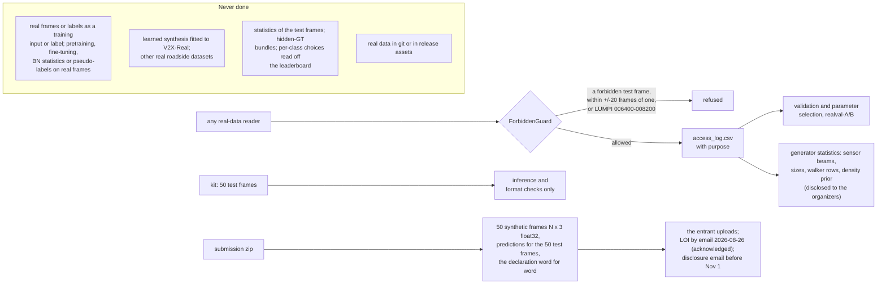

# UrbanTwin Sim2Real 2026: developer guide

Entry for the **UCF UrbanTwin Sim2Real LiDAR Challenge** at the IEEE BigData Cup 2026 ([website](https://urbanity-lab.github.io/bdc2026-urbantwin-sim2real/)), both tracks. This README is the one place to follow the whole process as a developer: set up, prepare data, generate synthetic data, train, validate, run inference, evaluate and submit. Each section links to the detailed track documents and to the plan and design documents in [`docs/`](docs).

**Contents.** Develop: [1 Objective](#1-objective) · [2 How the system works](#2-how-the-system-works) · [3 Repository layout](#3-repository-layout) · [4 Prerequisites](#4-prerequisites) · [5 Setup](#5-setup) · [6 Developer workflow](#6-developer-workflow-end-to-end) · [7 Tracks](#7-tracks). Strategy and results: [8 Strategy and next steps](#8-strategy-and-next-steps) · [9 CodaBench submissions](#9-codabench-submissions). Reference: [10 Documentation index](#10-documentation-index). Citations [Rn] open their entry in [`docs/07-LITERATURE.md`](docs/07-LITERATURE.md#6-named-references-r1-r42).

**Status (2026-10-28):** S7 is the entry on both tracks, **rank 1 on both**, and both latest uploads are the S7.6 packages: Track 1 LUMPI **0.5228** (1014495, S7.6; next Raj Patil 0.4960), Track 2 V2X-Real **0.8982** (1014682, S7.6, identical in every metric to 1001919, S7 step 1, which stays the listed row; next Raj Patil 0.7937). The S7.6 zips are F1 for the final phase. S6 (variance-controlled final portfolio: seed bags, the LUMPI Van judge, and on V2X seed-bag fusions chosen by the pooled A+B condition; [`docs/02-STRATEGY.md` Sections 8.6-8.6.2](docs/02-STRATEGY.md#86-s6-variance-controlled-final-portfolio-re-planned-2026-10-15)) is release 6.0, whose assets carry the weights of the S6 entries and of the V2X S7 versions (1001919 and 1014682); release 7.0 (published 2026-10-28) carries the weights of all three S7 versions, including the five newer PV-RCNN++ checkpoints of the LUMPI entry (Section 6.11; the tag map: [`RELEASES.md`](RELEASES.md#release-map-tags-leaderboard-submissions-weights)). Submissions: [Section 9](#9-codabench-submissions); register, gates and calendar: [`docs/decisions/README.md`](docs/decisions/README.md).

---

## 1. Objective

Build synthetic roadside LiDAR data and a 3D object detector **trained on synthetic data only**. The detector is scored on held-out real frames, and the synthetic data is scored on how real it looks.

| | Track 1 | Track 2 |
|---|---|---|
| Real dataset | LUMPI (Leibniz University Hannover; 5 roadside lidars merged) | V2X-Real infrastructure lidar (UCLA; Ouster OS1-64) |
| CodaBench | [16684](https://www.codabench.org/competitions/16684/) | [16685](https://www.codabench.org/competitions/16685/) |
| Classes | Person, Car, Bicycle, Motorcycle, Bus, Truck, Van, Unknown (7 with test GT) | vehicle, pedestrian, truck |
| Organizer synthetic data | UT-LUMPI (CARLA digital twin, CC0) | UT-V2X-Real-IC (CARLA digital twin, CC0) |
| Detailed docs | data: [`data-lumpi-track/README.md`](data-lumpi-track/README.md) · models: [`model-lumpi-track/README.md`](model-lumpi-track/README.md) | data: [`data-v2x-track/README.md`](data-v2x-track/README.md) · models: [`model-v2x-track/README.md`](model-v2x-track/README.md) |

**What you submit per track** (one zip): `synthetic/0001.bin ... 0050.bin` (50 synthetic frames, float32 N x 3, each at most 1.5 MB), `predictions.json` (boxes `[x, y, z, dx, dy, dz, heading]`, score and class for each of the 50 released real test frames) and a signed declaration.

**Score** (exact formula from the kit's `scoring_program`; details in [`model-lumpi-track/README.md`](model-lumpi-track/README.md#10-local-evaluation-and-packaging) Section 10):

```
combined = 0.6 * clip(mAP_3D@0.5 / 0.7)  +  0.4 * R          R = 1 - mean( clip((CD-2)/28), clip(MMD/0.5), clip(EMD/5), clip(FPD/50) )
         ~ 0.857 * mAP + 0.4 * R   (while mAP <= 0.7)
```

**Dates** (CodaBench phases; deadlines are 00:00 UTC = 17:00 PDT the day before):

| Phase | Window | Submissions | Leaderboard |
|---|---|---|---|
| Development | Jul 1 - Oct 31, 2026 00:00 UTC (Oct 30, 17:00 PDT) | 5 per day, 100 in total | public |
| Final | Nov 1 - Nov 15, 2026 00:00 UTC (Nov 14, 17:00 PDT) | **1 per day, 5 in total** (development submissions do not carry over) | hidden until close |
| Report | 4-8 page challenge report due Nov 15, 2026 | | winners announced Nov 25; conference Dec 14-17, Phoenix |

**Targets and status:** the ECCV 2026 edition used the same scorer and test data; its winners scored V2X 0.746 and LUMPI 0.479. Targets were V2X 0.80 and LUMPI 0.53; S7 scores V2X 0.8982 and LUMPI 0.5228. Leaderboard: [Section 9](#9-codabench-submissions); local results: the track model READMEs Section 7. Facts and rules: [`docs/01-CHALLENGE-FACTS.md`](docs/01-CHALLENGE-FACTS.md); strategy and where the points are: [`docs/02-STRATEGY.md`](docs/02-STRATEGY.md).

## 2. How the system works

### 2.1 Big picture

The system as built for the S7 entries (2026-10-27); every arrow is implemented and named in Sections 6.1-6.11.

```mermaid
flowchart LR
  subgraph SYN["Synthetic sources"]
    UT["UT twin frames<br/>CARLA, CC0"]
  end
  subgraph REAL["Real data: never a training input or a training label"]
    RL["legal real frames + labels<br/>through ForbiddenGuard,<br/>every read logged with its purpose"]
    KIT["starting kit: 50 test frames,<br/>scorer; inference and<br/>format checks only"]
  end
  UT --> GEN["Generator, prepare_g1.py<br/>G1: actor scale fix, walkers ray-cast<br/>with the real sensors, occlusion<br/>G2-lite: real-size actors, riders,<br/>static clutter, density prior"]
  RL -.->|"statistics only: beam tables, sizes,<br/>walker rows, density prior (disclosed)"| GEN
  GEN --> DS[("corpora pcdet/g1-v4 LUMPI,<br/>g1-v5 V2X, + generator draws")]
  DS --> TR["train on synthetic only<br/>PointPillars, CenterPoint,<br/>Voxel R-CNN, PV-RCNN++<br/>40 epochs, seeds, no pretraining"]
  TR --> MEM["members: per-class post-processing,<br/>8-view TTA, seed and draw bags"]
  MEM --> SELV["portfolio on realval-A/B<br/>route, fuse, score floors;<br/>V2X tail copies, sparse demotion;<br/>gates, Section 2.3"]
  RL --> SELV
  SELV --> INF["inference on the<br/>50 kit test frames"]
  KIT --> INF
  DS --> FR["50 realism frames<br/>selected against legal proxies"]
  INF --> PKG["package + declaration,<br/>validate, kit scorer check<br/>1,200 s budget"]
  FR --> PKG
  PKG --> UP["the entrant uploads the unchanged zip<br/>development 5 a day, 100 in total;<br/>final 1 a day, 5 in total"]
  UP --> REC["record: server record, registry,<br/>register, track READMEs"]
  REC --> REL["release tag: weights as assets,<br/>reproduction scripts, RELEASES.md"]
```



The architecture, data contracts and code map are in [`docs/03-ARCHITECTURE.md`](docs/03-ARCHITECTURE.md); the module-by-module build plan is [`docs/04-IMPLEMENTATION-GUIDE.md`](docs/04-IMPLEMENTATION-GUIDE.md).

### 2.2 Where the points are

| Lever | Why it matters | Where in this repo |
|---|---|---|
| Classes missing from the synthetic data | UT-LUMPI has no Person (1/7 of the LUMPI score); UT-V2X has no walking pedestrian (62% of V2X test objects) | engine G1 walkers: [`common/bdc26/render/`](common/bdc26/render), [`data-lumpi-track/README.md`](data-lumpi-track/README.md) Section 8.7 |
| Box conventions | UT-LUMPI actors are 0.78x real size (cannot reach IoU 0.5); annotators' boxes differ from CARLA's | actor scale fix ([`common/bdc26/prep.py`](common/bdc26/prep.py)); size calibration in post-processing |
| Sensor faithfulness | real density, beam pattern, field of view, null returns | per-sensor ray casting with real beam tables; V2X FOV mask; 31% nulls in V2X frames |
| Post-processing per class | NMS IoU, re-centering, size, hedged duplicates move AP a lot | [`common/tools/tune_postprocess.py`](common/tools/tune_postprocess.py) on real validation |
| Realism | 40% of the score; raw UT-LUMPI frames reach only R 0.59 | calibrated background density ([`common/bdc26/density.py`](common/bdc26/density.py)) and frame selection |

Full ranking with gates and risks: [`docs/02-STRATEGY.md`](docs/02-STRATEGY.md).

### 2.3 Validation and selection loop

```mermaid
flowchart LR
  CK["member checkpoint"] --> RAW["raw predictions on<br/>realval-A and realval-B<br/>plain and 8-view TTA"]
  RAW --> TUNE["per-class tuner<br/>chosen on A, guarded by B<br/>test/postprocess.yaml"]
  TUNE --> BAG["seed and draw bags<br/>weighted box fusion"]
  BAG --> RT["select: best member per class<br/>class gate; LUMPI Van by the judge"]
  RT --> FU["fuse across architectures<br/>pooled A+B rule"]
  FU --> BU["score floors for the server cost<br/>bounded on the pooled frames"]
  BU --> V2["V2X: walker tail copies,<br/>sparse-box demotion"]
  V2 --> FC["final check on the final predictions<br/>pooled P(gain) >= 0.9, no split down<br/>by more than 0.005, train-split result"]
  FC --> UG{"upload gate<br/>projection >= +0.003"}
  UG -->|passed| PK["package and kit check:<br/>upload candidate"]
  UG -->|"not passed"| EN["the entry stays the<br/>submission-ready version"]
```



realval-A is real data from the same recording as the test frames (LUMPI Measurement4; V2X scenes split by name) and chooses; realval-B is a second split that checks every choice. From R3 on a change must also gain on the pooled A+B frames, and from 6.0 on the pooled condition is the gate on the final predictions. The thresholds and the pre-registered rules a-e are in [`docs/decisions/README.md` Section 3.2](docs/decisions/README.md#32-gates). Every choice is a complete system or a per-class scalar chosen on validation frames; no per-class choice is read off the leaderboard.

### 2.4 Integrity by construction

The competition rules as the code enforces them (the Rules, Terms and declaration, and the organizers' forum FAQ: [`docs/01-CHALLENGE-FACTS.md` Section 3](docs/01-CHALLENGE-FACTS.md#3-rules)):



Rules and the real-data uses per track: [`model-lumpi-track/README.md`](model-lumpi-track/README.md#11-integrity-rules-and-real-data-uses) and [`model-v2x-track/README.md`](model-v2x-track/README.md#11-integrity-rules-and-real-data-uses) Section 11. The named end-to-end recipes built from these parts are the strategies S1-S7 ([Section 8](#8-strategy-and-next-steps)); the entries are S7.

## 3. Repository layout

```
utsim2real-bdc26/
├── README.md                    this developer guide
├── requirements.txt             every directly imported package, pinned (Python 3.10, CUDA 12.1 wheels)
├── requirements-lock.txt        the full pinned set, transitive dependencies included (installed as constraints)
├── common/                      the only shared code folder
│   ├── bdc26/                   Python package (code map: model-lumpi-track/README.md Section 12.1)
│   ├── tools/                   command-line tools (train, predict, evaluate, tune, route, select, package, check)
│   ├── pipeline/                detached job queues, status, TensorBoard (Section 6.10)
│   ├── env/                     bdc26.env (paths), activate.sh, setup_venv_ut.sh, setup_bdc_train.sh (conda alternative)
│   ├── tests/                   pytest suite (synthetic fixtures; parity with the official scorer)
│   └── kit/                     place the downloaded starting kits here (git-ignored)
├── data-lumpi-track/            Track 1 data: track.yaml, fetch/prepare scripts, README.md (detailed data guide)
├── data-v2x-track/              Track 2 data: same structure
├── model-lumpi-track/           Track 1 models: README.md (approaches, selected model, lifecycle), registry.csv,
│   └── <model>/                 model.yaml, README.md, train/, validation/, test/, submissions/<date>_<tag>/
├── model-v2x-track/             Track 2 models: same structure
├── paper-bigdata2026/           the challenge report (Nov 15) and the BigData Cup paper: outline, sources, checklist
├── docs/                        plan of record (01-07), decisions/, reference/papers/
└── releases/<tag>/weights.json  the release's weights: GitHub asset name, repository path, md5, versions (Section 6.11)
```

Large data lives outside git under `$BDC_DATA` (default `<repo>/../bdc26-data`); checkpoints, predictions and working zips are in git-ignored `output/` and `submissions/*/submission.zip`; the upload copy of every packaged version (`<track>_<strategy>_submission.zip`; the 1.0 entries as `submission_<track>.zip`) is committed next to its manifest, and the leaderboard entries are listed in [`RELEASES.md`](RELEASES.md).

```
$BDC_DATA/
├── third_party/OpenPCDet/       OpenPCDet 233f849 (built by setup_venv_ut.sh)
├── logs/                        download, build, training and evaluation logs
├── lumpi-track/ {kit, ut, real, pcdet, gen}/
└── v2x-track/   {kit, ut, real, pcdet, gen}/
```
The per-track layout and every dataset version: [`data-lumpi-track/README.md`](data-lumpi-track/README.md) Sections 3 and 9, [`data-v2x-track/README.md`](data-v2x-track/README.md) Sections 3 and 9.

## 4. Prerequisites

| Item | Requirement | Tested |
|---|---|---|
| OS | Linux x86_64 | Ubuntu 20.04, kernel 5.4 |
| GPU | NVIDIA, 24 GB or more per GPU for the given batch sizes (4 GPUs per training run) | 8 x RTX A6000 48 GB |
| Driver / CUDA | driver >= 530 (CUDA 12.1 wheels); a CUDA 12.x toolkit with `nvcc` to build OpenPCDet's ops (`CUDA_HOME`) | driver 570, CUDA 12.8 |
| Python | 3.10 (`python3.10 -m venv`) | 3.10.13 |
| Tools | git, curl, a C++17 compiler (gcc 9+) | gcc 9.4 |
| Disk | about 250 GB for data, datasets and checkpoints (UT 70 GB, real 21 GB, datasets 50 GB, checkpoints 2 GB per run, venv 5 GB) | 1.2 TB free |
| RAM / CPU | 64 GB+; generation scripts use 32-64 worker processes | 503 GB, 255 cores |
| Accounts | CodaBench login (starting kits, uploads); licence acceptance for real LUMPI (CC BY-NC 3.0) and V2X-Real (UCLA Academic) | |

## 5. Setup

### 5.1 Python environment (`.venv_ut`)
```bash
git clone <this repository> utsim2real-bdc26 && cd utsim2real-bdc26
python3.10 -m venv .venv_ut                      # git-ignored
bash common/env/setup_venv_ut.sh                 # about 15 min: pip install -r requirements.txt -c requirements-lock.txt, clone + build OpenPCDet, pip install -e common
source common/env/activate.sh                    # every later shell: sets paths and activates .venv_ut
python -m pytest -q common/tests                 # 70 tests, including bit-for-bit parity with the official scorer and the environment pins
```
`.venv_ut` is the one environment for generation, training and evaluation. [`requirements.txt`](requirements.txt) pins every package the code imports: torch 2.1.2+cu121, spconv-cu121 2.3.8, numpy 1.23.5 (OpenPCDet needs < 1.24), numba 0.58.1, Open3D 0.19.0 (engine G2-lite), POT 0.9.7.post1, shapely 2.0.6 and the OpenPCDet runtime dependencies; [`requirements-lock.txt`](requirements-lock.txt) pins the full set. After installing or upgrading a package, update both (the regeneration command is in `requirements.txt`); [`test_environment.py`](common/tests/test_environment.py) fails on any drift. [`setup_venv_ut.sh`](common/env/setup_venv_ut.sh) clones OpenPCDet at commit 233f849 into `$BDC_THIRD_PARTY`, makes its Argo2 import optional, builds the CUDA ops (`setup.py develop`), installs this repo's `bdc26` package in editable mode, checks the GPU and the IoU op, and marks the venv ready. [`activate.sh`](common/env/activate.sh) then prefers `.venv_ut`; set `BDC_PYENV=conda` to use the conda alternative ([`setup_bdc_train.sh`](common/env/setup_bdc_train.sh), environment `bdc-train`).

### 5.2 Paths
[`common/env/bdc26.env`](common/env/bdc26.env) (sourced by `activate.sh`) sets `BDC_REPO`, `BDC_DATA` (data root, default `<repo>/../bdc26-data`), `BDC_THIRD_PARTY`, `PCDET_ROOT`, `PYTHONPATH=common`, `CUDA_HOME` and `TORCH_CUDA_ARCH_LIST`. Override any of them with `export` before sourcing.

### 5.3 Starting kits
Download both kits from the CodaBench Files tabs and place them in [`common/kit/`](common/kit) (git-ignored) as `lumpi_starting_kit.zip` and `v2x_real_starting_kit.zip`; Section 6.1 ingests them.

## 6. Developer workflow (end to end)

Run every command from the repository root after `source common/env/activate.sh`. Use `CUDA_VISIBLE_DEVICES` to choose GPUs; run long jobs with `nohup` and logs in `$BDC_DATA/logs/`. Each step links to its detailed section.

### 6.1 Get the data
| Step | Track 1 (LUMPI) | Track 2 (V2X-Real) |
|---|---|---|
| Synthetic (CC0) | `python data-lumpi-track/fetch_ut.py` | `python data-v2x-track/fetch_ut.py` |
| Starting kit | `python data-lumpi-track/ingest_kit.py common/kit/lumpi_starting_kit.zip` | `python data-v2x-track/ingest_kit.py common/kit/v2x_real_starting_kit.zip` |
| Real data (licence) | `python data-lumpi-track/fetch_real.py --accept-licence --meta --labels`, then `--lidar Measurement4 --range 0:6400:5` (and M5, M6) | `python data-v2x-track/fetch_real.py --accept-licence --points`, then `python data-v2x-track/resolve_test_ids.py`, then `fetch_real.py --accept-licence --labels` |
| Details | [`data-lumpi-track/README.md`](data-lumpi-track/README.md) Sections 2, 7, 8.1-8.3 | [`data-v2x-track/README.md`](data-v2x-track/README.md) Sections 2, 6, 7 |

### 6.2 Prepare datasets
| Step | Track 1 | Track 2 |
|---|---|---|
| Baseline UT dataset | `python data-lumpi-track/prepare_ut.py --name ut-v1` | `python data-v2x-track/prepare_ut.py --name ut-v1` |
| Real validation + realism proxies | `python data-lumpi-track/prepare_realval.py` | `python data-v2x-track/prepare_realval.py --stride 5` |
| G1 corpus (selected) | see the block below | `OMP_NUM_THREADS=1 python data-v2x-track/prepare_g1.py --name g1-v3 --walker v2 --placement prior --walkers 16 --density-gain 2.5 --fov-mask --workers 48` |
| Details | [`data-lumpi-track/README.md`](data-lumpi-track/README.md) Sections 8.4-8.7, 9 | [`data-v2x-track/README.md`](data-v2x-track/README.md) Sections 7-9 |

Track 1 G1 corpora (the density prior is fitted on the uncalibrated `g1-v1`):
```bash
export OMP_NUM_THREADS=1                      # generation is CPU-bound: one BLAS thread per worker
python data-lumpi-track/prepare_g1.py --name g1-v1 --workers 64
python common/tools/fit_density_prior.py --track lumpi --real pcdet/realval-v1 --syn pcdet/g1-v1 --out gen/density_prior_v1.npz
python data-lumpi-track/prepare_g1.py --name g1-v2 --density-prior gen/density_prior_v1.npz --workers 64
python data-lumpi-track/prepare_g1.py --name g1-v3 --walker v2 --density-prior gen/density_prior_v1.npz --workers 64
```
Generation scripts are CPU-bound: always run them with `OMP_NUM_THREADS=1` (otherwise each worker's BLAS spawns a thread per core).

### 6.3 Train
```bash
CUDA_VISIBLE_DEVICES=0,1,2,3 bash model-lumpi-track/pointpillars-g1/train/train.sh 4 run1 --fix_random_seed --workers 6
CUDA_VISIBLE_DEVICES=4,5,6,7 bash model-v2x-track/pointpillars-g1v3/train/train.sh 4 run1 --fix_random_seed --workers 6
```
`train.sh NGPUS TAG [OpenPCDet train.py flags]` builds missing OpenPCDet infos, then trains (about 1 h for V2X, 2 h for LUMPI on 4 A6000s). Checkpoints: `<model>/train/output/pcdet_model/<TAG>/ckpt/`. Configs, anchors and hyperparameters: [`model-lumpi-track/README.md`](model-lumpi-track/README.md) Section 3, [`model-v2x-track/README.md`](model-v2x-track/README.md) Section 3.

### 6.4 Validate on real data and tune post-processing
```bash
CUDA_VISIBLE_DEVICES=0 bash model-lumpi-track/pointpillars-g1/validation/tune_and_eval.sh \
    model-lumpi-track/pointpillars-g1/train/output/pcdet_model/run1/ckpt/checkpoint_epoch_40.pth
```
Raw predictions on realval-A/B, per-class tuning (Section 2.3) into `test/postprocess.yaml`, official-metric evaluation on A and B, a row in `model-<track>/registry.csv` and `validation/results/local_scores.json`. Add `--eval-only` to re-score with the current `postprocess.yaml`. Details: [`model-lumpi-track/README.md`](model-lumpi-track/README.md) Section 6.3.

### 6.5 Combine models per class
```bash
python common/tools/route_predictions.py select model-lumpi-track/routed-g1
```
Per class, the member with the best realval-A AP (near-ties broken by realval-B) is written into the routed model's `model.yaml`. Details: [`model-lumpi-track/README.md`](model-lumpi-track/README.md) Section 6.4. Later stages, in their order in `merge_card`: `fuse` (from S7 with `--pooled-rule`), `budget` (score floors), `tail` (walker tail copies), and `sparse` (S7, V2X: boxes with fewer points than the real labels' visibility cut rank last; `merge` then counts points of the kit frames).

### 6.6 Ablations
Train the comparison model (for example `pointpillars-ut`, UT data without G1) and run 6.4 for it; the comparison tables live in each track's model README (Section 7). Every evaluation is a row in `registry.csv`.

### 6.7 Choose the realism frames
```bash
python common/tools/select_realism_frames.py --track lumpi --syn pcdet/g1-v2 --split val \
    --fit-ref pcdet/realism-proxy-1 --fit-ref pcdet/realism-proxy-2 --fit-ref pcdet/realism-proxy-3 \
    --test-ref pcdet/realism-proxy-4 --test-ref pcdet/realism-proxy-5 --out model-lumpi-track/routed-g1/test/synthetic_ids.txt
```
Picks 50 frames of the generator's val split (never trained on) whose pooled point distribution best matches legal real proxies 1-3, and reports the official realism score on held-out proxies 4-5 (V2X frames are scored with the 31% nulls the packager adds).

### 6.8 Inference, packaging and local scoring
```bash
CUDA_VISIBLE_DEVICES=0 bash model-lumpi-track/routed-g1/test/make_submission.sh first
CUDA_VISIBLE_DEVICES=4 bash model-v2x-track/routed-g1/test/make_submission.sh first
# a single model instead: bash model-<track>/<model>/test/make_submission.sh <ckpt> <tag> [team]
```
Predicts the 50 kit frames, packages `submission.zip`, validates it against the published spec and prints the local realism and combined estimates. The team name in `declaration.txt` defaults to `$BDC_TEAM` (`KarmaRV`, set in [`common/env/bdc26.env`](common/env/bdc26.env)); pass a third (single model) or second (routed) argument to override it. Packaging rules: track model README Section 10.4.

### 6.9 Check, upload and record
Check the zip exactly as the server will see it, including a run of the kit's own scorer under the server's 1,200 s limit (about 2 minutes and 6 GB of memory):
```bash
python common/tools/check_submission.py --track lumpi model-lumpi-track/routed-g1/submissions/<date>_<tag>/submission.zip --official
```
To change only the team line of an existing zip, add `--set-team <name>` (every other member is copied byte for byte and `manifest.json` is updated). **Upload the zip file unchanged** (renaming is fine): never unzip it, edit it and compress it again (track model README Section 10.6). If your browser runs on another machine, copy the file and compare its checksum with `zip_md5` in `manifest.json` before uploading:
```bash
md5sum submission.zip
```
Upload it on the CodaBench Submit tab (Track 1: competition 16684, Track 2: 16685), then save the server's scores as `submissions/<date>_<tag>/codabench_<id>.json` (the `scores` dict printed on the `[scoring] DONE` line, plus the uploaded file name and date; see the existing records) and record it:
```bash
python common/tools/package_submission.py model-lumpi-track/routed-g1 --tag first --record <codabench_id> model-lumpi-track/routed-g1/submissions/<date>_first/codabench_<codabench_id>.json
```
This stores the CodaBench id and the leaderboard numbers in the submission's `manifest.json` and appends a `leaderboard` row (combined, mAP, R, per-class AP) to `registry.csv`. Then add the row to the submission log in the track's model README (Section 9 there), attach the zip to the GitHub release of the tag, and list the submission under its strategy in [Section 9](#9-codabench-submissions).

### 6.10 Long runs in the background and monitoring
Every multi-hour job (training queues, post-processing, portfolios) runs detached from the terminal, so it survives an SSH disconnect, and leaves a plain-text trail that can be read at any time. The scripts are in [`common/pipeline/`](common/pipeline/README.md):
```bash
RUN=$BDC_DATA/logs/s6                                    # one run directory per campaign
bash common/pipeline/launch.sh $RUN trainA common/pipeline/train_queue.sh $RUN trainA 0,1,2,3 29621
bash common/pipeline/status.sh $RUN                      # STATUS.md, queues, last events, epoch progress, live processes, GPUs
```
`launch.sh <run> <name> <script> [args]` starts `<script>` with `setsid nohup` from a snapshot copy in `<run>/bin/` (editing the repository never breaks a running job), logs to `<run>/<name>.log` and records the PID in `<run>/pids.txt`. Jobs talk through files: `train_queue.txt` and `post_queue.txt` (one `track:member[:seed]` per line, popped under `flock`), and `events.txt` (one timestamped line per event: `TRAIN_START/DONE/FAIL`, `POST_STEP_DONE/FAIL`, `POST_DONE/FAIL`, `PORTFOLIO <track>: ...`). Follow it live with `tail -f $RUN/events.txt`; stop a job by its PID from `pids.txt` (`kill <pid>`), never by pattern.

**TensorBoard.** Every OpenPCDet run writes its training losses and learning rate to `train/output/pcdet_model/<run>/tensorboard/`; the post-processing step adds the official-metric AP on strided realval-A/B subsets every 5 epochs to `tensorboard_realval/` (`common/tools/tb_realval.py`, monitoring only: the epoch-40 checkpoint is always the one used). One server covers all models (run names `<track>/<model>/<run>`), bound to localhost:
```bash
bash common/pipeline/launch.sh $BDC_DATA/logs/tensorboard tensorboard common/pipeline/tensorboard.sh 6006
```
View it from your own machine through SSH port forwarding, then open http://localhost:6006 (the script restarts TensorBoard by itself when a new run folder appears, within 10 minutes):
```bash
ssh -N -L 6006:localhost:6006 <user>@<server>
```

### 6.11 Reproducing a submission
Every scored version can be rebuilt from its checkpoints and the committed files. Its decision record ends with a **Reproduce** section (members, weight paths with md5, TTA, post-processing files, commands), indexed in [`docs/decisions/README.md` Section 6.1](docs/decisions/README.md#61-reproducing-a-submission). Each version has two generated scripts in its model folder: `test/reproduce_<tag>.sh` (test-frame inference with the recorded weights, merge with the committed `model.yaml`, comparison with the scored zip, repackaging of the same 50 frames into `test/output/repro-<tag>/`, the official kit scorer, a final comparison of predictions and frames) and `test/reproduce_<tag>_validation.sh` (realval-A/B inference of every member, merge, official metric, comparison with `validation/results/scorecard.json`).

From a fresh clone at the release of the version (the weights of the leaderboard entries are assets of their GitHub release, 6.0 for S6 and 7.0 for S7; which release holds which submission: the release map in [`RELEASES.md`](RELEASES.md#release-map-tags-leaderboard-submissions-weights)). The repository is private, so the fetch asks for a token with read access, or reads `$GITHUB_TOKEN`. The current entries (S7, release 7.0):
```bash
git clone https://github.com/karmarv/utsim2real-bdc26.git && cd utsim2real-bdc26 && git checkout 7.0
```
```bash
bash common/env/setup_venv_ut.sh                                                        # Section 5.1; then place the starting kits (Section 5.3)
```
```bash
python common/tools/release_weights.py fetch --tag 7.0 --version lumpi:s7s              # 15 checkpoints, md5-verified (v2x:s7s and v2x:s7: 10 each)
```
```bash
CUDA_VISIBLE_DEVICES=0 bash model-lumpi-track/routed-g10/test/reproduce_s7s.sh            # expect: reproduction: IDENTICAL, frames identical
```
```bash
CUDA_VISIBLE_DEVICES=0 bash model-lumpi-track/routed-g10/test/reproduce_s7s_validation.sh # needs the prepared real data (Section 6.2); expect EQUIVALENT or IDENTICAL
```
```bash
CUDA_VISIBLE_DEVICES=0 bash model-v2x-track/routed-g12/test/reproduce_s7s.sh              # the V2X entry; routed-g9/test/reproduce_s7.sh for 1001919
```
The S6 entries: `git checkout 6.0`, `release_weights.py fetch --tag 6.0 --version lumpi:s6` (or `v2x:s6b`), then `model-lumpi-track/routed-g8/test/reproduce_s6.sh` (or `model-v2x-track/routed-g8b/test/reproduce_s6b.sh`).
Without the synthetic corpus (not in git) the test-frame script takes the 50 frames from the scored zip, which is committed; with it, it re-reads them from the corpus, which also checks the frame selection. The validation script needs the real datasets, which are licensed and not redistributed. On this server the saved predictions allow a quick check in seconds: `python common/tools/reproduce_submission.py model-lumpi-track/routed-g10 --tag s7s` (re-merge, compare with the scored zip).

Run reproductions on an idle GPU: inference is then bit-identical (both 6.0 entries on the test frames, Section 8.6.2 of the strategy). A run sharing its GPU with another job can differ in the last digits; the test-frame comparison then matches boxes per frame and reports EQUIVALENT (no box above score 0.3 unmatched, 99% within 0.1 m and 0.01 in score). The validation check reports IDENTICAL (every class within 1e-4 AP) or EQUIVALENT (within 1e-3 per class and 5e-4 per split): some recorded validation predictions were written on GPUs shared with training, so the 6.0 entries reproduce their realval mAP to four decimals with 41 of 48 member files bit-identical. `release_weights.py verify --tag 7.0` checks the md5 of the files in place; `releases/<tag>/weights.json` maps every asset to its path, md5 and the versions that use it. Older versions: their checkpoints are on this server (`train/output/`, git-ignored); check out their release tag for the files of the time.

**The S7 entries in release 7.0.** The three S7 versions (LUMPI `lumpi:s7s` 1014495; V2X `v2x:s7s` 1014682 and `v2x:s7` 1001919) use 25 checkpoints: 20 are byte-identical to 6.0 assets, and the five LUMPI PV-RCNN++ checkpoints of the extended bag (`pvrcnnpp-ros-g1v4-s2/-s3/-s4/d2/d3`) are new in 7.0. The release notes record the dry run of every script ([`RELEASES.md` 7.0](RELEASES.md#70-pre-release-2026-10-27)). Published on 2026-10-28: the sha256 GitHub shows for each of the 28 assets equals the file that reproduced ([`releases/7.0/github.json`](releases/7.0/github.json)).

## 7. Tracks

### 7.1 Track 1: LUMPI
- **Data** ([`data-lumpi-track/README.md`](data-lumpi-track/README.md)): UT-LUMPI was simulated with the real Measurement4 rig (beam residual 0.03 deg), so walkers are ray-cast with the five real lidars and inserted with per-sensor occlusion; actors are rescaled by 1/0.78; UT Van is trained as the challenge Van (LUMPI id 6); the background is resampled toward the real spatial density.
- **Model** ([`model-lumpi-track/README.md`](model-lumpi-track/README.md)): the entry is `routed-g10` (S7.6): per-class routing and box fusion over PointPillars, Voxel R-CNN and PV-RCNN++ members with TTA (Car fused with the extended PV-RCNN++ seed-and-draw bag, Van through the S6 judge), per-class score floors; 15 checkpoints. The first entry was `routed-g1` (two PointPillars models); approaches compared with pros and cons in Section 2 there.
- **Results:** local [`model-lumpi-track/README.md`](model-lumpi-track/README.md#7-results-and-ablations) Section 7; CodaBench [Section 9](#9-codabench-submissions) and Section 9 there.
- **Also in that README:** local evaluation and packaging (Section 10: metrics, estimates, packaging rules, pre-upload check, failure handling, budget), integrity rules and real-data uses (Section 11), contributing (Section 12: code map, conventions, typical contributions, long jobs).

### 7.2 Track 2: V2X-Real
- **Data** ([`data-v2x-track/README.md`](data-v2x-track/README.md)): the challenge's forbidden frames all come from V2X-Real train scenes (resolved by point matching and a monotone-subset argument); walkers are ray-cast with the measured OS1-64 beam table at legal real walker positions and calibrated to the real point counts at every range; UT points outside the real field of view are masked; realism frames carry 31% (0,0,0) nulls like the test frames.
- **Model** ([`model-v2x-track/README.md`](model-v2x-track/README.md)): the entry is `routed-g12` (S7.6), equal to `routed-g9` (S7 step 1): per-class routing and box fusion over PointPillars, Voxel R-CNN and PV-RCNN++ members and seed bags with TTA, range-dependent z calibration, score floors, walker tail copies and the sparse-box demotion; 6 checkpoints, all in release 6.0. The first entry was `routed-g1` (PointPillars only); approaches compared with pros and cons in Section 2 there.
- **Results:** local [`model-v2x-track/README.md`](model-v2x-track/README.md#7-results-and-ablations) Section 7; CodaBench [Section 9](#9-codabench-submissions) and Section 9 there.
- **Also in that README:** local evaluation and packaging (Section 10: metrics, estimates, packaging rules, pre-upload check, failure handling, budget), integrity rules and real-data uses (Section 11), contributing (Section 12: code map, conventions, typical contributions, long jobs).

## 8. Strategy and next steps

A strategy is the complete recipe behind one submission per track: synthetic data, detectors, post-processing, routing or fusion, and the 50 realism frames. **The ranked entries are S10 Clean Final (release 10.1), the first systems trained with no real label row:** LUMPI 1047231 combined **0.5413** (`c0pq`: `C0`'s detections with the PandarQT-corrected realism frames) and V2X 1046758 combined **0.8889** (`c1av5`; [record](docs/decisions/2026-11-08-s10-clean-final-plan.md)). The organizers rank KarmaRV only by LUMPI 1042287 and V2X 1042294 (2026-11-08) onward. They removed the S9 close-out uploads LUMPI 1038963 (0.5428, `s9j`) and V2X 1038966 (0.9038, `s9f`) from the boards (release 10.0), because their walkers were placed at the positions, headings and sizes of real labels; the report describes the change. The S9 close-out uploads add an anchored box-size calibration to the development entries: the box end nearest a sensor stays and the far end moves. They score +0.0003 and +0.0008 over LUMPI 1031132 **0.5425** (`s9d`) and V2X 1028491, the development entries at the close (rank 1 on both). Before those, S9 on both tracks (2026-11-02, release 9.1): LUMPI 1028541 combined **0.5357** (S9 `s9a2`; +0.0100 over S8.3: Person 0.188 -> 0.262 from the label-free walkers of the clean-twin corpus `g1-v6`, realism +0.0019 from its frames) and V2X 1028491 combined **0.9030** (S9 `s9a`; +0.0008: a pedestrian re-fusion); before them S8 on both tracks (2026-10-30): LUMPI 1022492 combined **0.5257** (S8.3, release 8.1; +0.0028 over S7.6: Person +0.007, Car +0.013, Truck +0.002, Bus +0.001; before it S8.2 1022399 0.5254 and S8 U2 1022250 0.5239) and V2X 1022246 combined **0.9022** (+0.0040: pedestrian +0.014); before them S7.6 on both (LUMPI 1014495 0.5228, V2X 1014682 0.8982 = 1001919), and S1-S5, R3, R5 and S6 on V2X (995877, 0.8931). Every submission, its gate result and the calendar are in [`docs/decisions/README.md`](docs/decisions/README.md). S2-S6 are the researched next routes, ordered by increasing effort and risk; the order is the execution order, and each strategy keeps whatever passed in the previous one. Details per route (idea, members, pros, cons, steps, gates, calendar): [`docs/02-STRATEGY.md` Section 8](docs/02-STRATEGY.md#8-strategy-routes-after-s1); the research behind them: [`docs/07-LITERATURE.md` Section 7](docs/07-LITERATURE.md#7-detector-research-for-the-next-strategies-2026-10-06).

| Code | Strategy | Stage | What it adds | Gap it targets | Effort / risk | Research |
|---|---|---|---|---|---|---|
| **S1** | [Calibrated Twin, Routed Pillars](docs/02-STRATEGY.md#81-s1-calibrated-twin-routed-pillars) | submitted: LUMPI S1 (965614, the LUMPI entry until the S3 upload is listed); V2X S1+C1 (972563, 0.7855; [8.1.3](docs/02-STRATEGY.md#813-close-out-results-2026-10-09)) | engine G1 data (walkers ray-cast with the real sensors, actor scale fix, density and FOV calibration), PointPillars x 2-4 runs, per-class post-processing and routing | missing classes, box conventions, realism | done | [R1](docs/07-LITERATURE.md#r1-urbantwin-papers) [R5](docs/07-LITERATURE.md#r5-pointpillars) [R7](docs/07-LITERATURE.md#r7-statistical-normalization) [R9](docs/07-LITERATURE.md#r9-lidar-aug) [R19](docs/07-LITERATURE.md#r19-eccv-2026-winner-reports) |
| **S2** | [Center-Routed Small Objects](docs/02-STRATEGY.md#82-s2-center-routed-small-objects) | **done 2026-10-09**: no upload-ready version (LUMPI Bicycle +0.025 on B, below the upload gate; V2X unchanged); CenterPoint members kept for S3 ([8.2.1](docs/02-STRATEGY.md#821-results-2026-10-09)) | CenterPoint specialists for small classes next to the S1 pillars; routes chosen on realval-A and B jointly | LUMPI Person, Bicycle, Motorcycle; V2X pedestrian | low-medium / low | [R22](docs/07-LITERATURE.md#r22-centerpoint) [R24](docs/07-LITERATURE.md#r24-inscope) [R41](docs/07-LITERATURE.md#r41-pillarnet) |
| **S3** | [Fused Portfolio with TTA](docs/02-STRATEGY.md#83-s3-fused-portfolio-with-tta) | submitted: V2X 974400 0.8381; LUMPI 974348 scored 0.5015 by its log, never listed ([8.3.1](docs/02-STRATEGY.md#831-results-2026-10-09)) | 8-view TTA (flips, yaw, height) as routable member variants, per-class fusion of a pillar and a CenterPoint member, per-class score floors | run-to-run variance; V2X height; static false positives | low-medium / low | [R23](docs/07-LITERATURE.md#r23-weighted-boxes-fusion) [R37](docs/07-LITERATURE.md#r37-ms3d-kde-box-fusion) [R38](docs/07-LITERATURE.md#r38-horizonlidar3d) [R39](docs/07-LITERATURE.md#r39-robosense-2025-report) |
| **S4** | [Two-Stage Refinement](docs/02-STRATEGY.md#84-s4-two-stage-refinement) | submitted: V2X 975938 0.8485; LUMPI 975871 0.5040, the LUMPI entry until R3 ([8.4.1](docs/02-STRATEGY.md#841-results-2026-10-10)) | Voxel R-CNN and PV-RCNN++ members (plain and TTA) fused with the S3 members, up to three per class | walker localization (the S3 review); in effect vehicle, truck and bicycle | medium / medium | [R29](docs/07-LITERATURE.md#r29-pv-rcnn) [R30](docs/07-LITERATURE.md#r30-voxel-r-cnn) [R25](docs/07-LITERATURE.md#r25-robo3d) |
| **S5** | [Geometry-Invariant Inputs](docs/02-STRATEGY.md#85-s5-geometry-invariant-inputs) | submitted: V2X 978945 0.8730; LUMPI 978931 0.5039, not confirmed ([8.5.1](docs/02-STRATEGY.md#851-results-2026-10-11)) | class-wise object scaling to the real size ranges (helps every anchor-free and two-stage member) and GBlobs inputs (only inside fusions) | the twin's size gap (trucks, bicycles, buses); input invariance | medium / medium | [R27](docs/07-LITERATURE.md#r27-gblobs) [R28](docs/07-LITERATURE.md#r28-gblobs-for-sensor-placement) [R26](docs/07-LITERATURE.md#r26-lidar-domain-generalization-study) [R36](docs/07-LITERATURE.md#r36-dts-random-beam-re-sampling) |
| **R3** | [Engine G2-lite](docs/02-STRATEGY.md#871-r3-engine-g2-lite-review-and-plan-2026-10-11) (extended step after S5) | submitted 2026-10-14, the entry until R5: LUMPI 986489 **0.5169** (rank 1; realism 0.891 -> 0.932, mAP -0.004), V2X 986496 **0.8789** (rank 1) ([8.7.2](docs/02-STRATEGY.md#872-r3-results-2026-10-11-to-2026-10-13)) | corpus `g1-v4`: actors re-cast at real size and density with the real rigs, real-sized trucks, buses and two-wheelers with riders, unlabeled static clutter; retrained pillar and two-stage members; pooled final gate | the twin's object geometry; static walker false positives; LUMPI realism | medium / medium | [R9](docs/07-LITERATURE.md#r9-lidar-aug) [R19](docs/07-LITERATURE.md#r19-eccv-2026-winner-reports) [R40](docs/07-LITERATURE.md#r40-st3d) |
| **R5** | [Realism-led refinement](docs/02-STRATEGY.md#89-r5-realism-led-refinement-after-r3-review-and-plan-2026-10-14) (after R3) | submitted, the entry until S6 (2026-10-15, [8.9.1](docs/02-STRATEGY.md#891-r5-results-2026-10-14)): V2X 990255 **0.8852** (rank 1; pedestrian +0.011 from the walker tail copies, realism +0.0065), LUMPI 990245 **0.5198** (rank 1; Person 0.157 -> 0.180) | background density prior for the G2-lite corpus (`g1-v5`: V2X first prior), seeds of the two-stage members, V2X members on `g1-v5`, walker tail copies, pre-registered late-A Person rule and rare-class freeze | background realism (EMD), seed variance, LUMPI Person | medium / low | [R9](docs/07-LITERATURE.md#r9-lidar-aug) [R40](docs/07-LITERATURE.md#r40-st3d) |
| **S6** | [Variance-Controlled Final Portfolio](docs/02-STRATEGY.md#86-s6-variance-controlled-final-portfolio-re-planned-2026-10-15) (re-planned 2026-10-15; was Sparse Transformer Experts) | **submitted and confirmed** (2026-10-17): **LUMPI 995869 0.5228** (Van through the judge), **V2X 995877 0.8931** (variant b: bag fusions by the pooled condition); rank 1 on both ([record](docs/decisions/2026-10-16-s6-variance-controlled.md)) | seed bags of the strongest two-stage configurations (seeds 1666-3666); LUMPI Van judged on the realval-A frames whose labels are vans (realval-B's class 6 is not vans); final-phase protocol under `Force_Best` | member noise (seed spread up to 0.17 AP per class); LUMPI Van frozen since S1 | medium / low | [R23](docs/07-LITERATURE.md#r23-weighted-boxes-fusion) [R37](docs/07-LITERATURE.md#r37-ms3d-kde-box-fusion) |
| **S7** | [Visibility Rule (V2X)](docs/02-STRATEGY.md#811-s7-visibility-rule-v2x-2026-10-18) and [final revisions](docs/02-STRATEGY.md#812-s7-final-revisions-s74-s76-2026-10-26) (both tracks) | **the entry on both tracks**: step 1 submitted and confirmed (2026-10-19): **V2X 1001919 0.8982** (pedestrian 0.413 -> 0.429), rank 1; step 2 below the upload gate (+0.0014); S7.4-S7.6 (generator-draw bags, bag swap, pooled budget, 2026-10-27): no version passed the gate, and the entrant uploaded both S7.6 packages: **LUMPI 1014495 0.5228** (+0.00009 over S6), **V2X 1014682 0.8982** (identical to 1001919) ([record](docs/decisions/2026-10-18-s7-visibility-rule.md), [final revisions](docs/decisions/2026-10-26-s7-final-revisions.md)) | V2X-Real annotators skip objects seen with fewer than about 6 points: boxes below a per-class point threshold rank last (step 1, no training); members retrained on labels with the same rule (step 2); fresh generator draws in extended seed-and-draw bags, swapped into the incumbent fusions, with a pooled bound on the score floors (S7.4-S7.6) | V2X pedestrian false positives on sparse far blobs (16% of the synthetic pedestrian labels are sparser than 98% of the real ones) | low / low | [R19](docs/07-LITERATURE.md#r19-eccv-2026-winner-reports) |
| **S8** | [Last-day TTA and completion](docs/decisions/2026-10-29-s8-last-day-strategy.md) (2026-10-30) | the entry on both tracks until S9: **LUMPI 1022492 0.5257** (S8.3, release 8.1; S8.2 1022399 0.5254: Car +0.013; S8 U2 1022250 0.5239, release 8.0: Person +0.006, Truck +0.002), **V2X 1022246 0.9022** (+0.0040: pedestrian 0.429 -> 0.443), rank 1 on both; V2X S8.2 equal to s8v | 12-view TTA (`flip4+yaw+z+scale`) as a second member variant, swapped into the incumbent fusions per class; LUMPI floors at 0.01 and Person tail copies (scored below every Person box); pre-registered last-day bar (b) | walker localization and ranking; server-cost floors | low / low | [R38](docs/07-LITERATURE.md#r38-horizonlidar3d) |
| **S9** | [Clean Twin v6](docs/decisions/2026-11-02-s9-clean-twin-plan.md) (2026-11-02, after the development extension) | **removed from the boards** (release 10.0; walkers placed from real labels): close-out (final phase, release 9.2) LUMPI 1038963 0.5428 (`s9j`), V2X 1038966 0.9038 (`s9f`), an anchored box-size calibration; development entries LUMPI 1031132 0.5425 (`s9d`), V2X 1028491 0.9030; release 9.1: LUMPI 1028541 0.5357 (`s9a2`: Person 0.188 -> 0.262, realism 0.9323 -> 0.9342), **V2X 1028491 0.9030** (`s9a`: pedestrian +0.003), rank 1 on both; W2 (draw bags, VoxelNeXt on `g1-v6`) running for `s9b` | corpus `g1-v6`: a static scene map from the twin's own semantic tags, label-free walkers and riders placed on it (no real label rows), the LUMPI vehicle size convention as training labels, map-placed hedges, fences and walls (LUMPI), a refitted density prior; VoxelNeXt members; rules 1-7 pre-registered | LUMPI Person, LUMPI Truck, realism (EMD) | medium / medium | [R34](docs/07-LITERATURE.md#r34-voxelnext) [R40](docs/07-LITERATURE.md#r40-st3d) [R9](docs/07-LITERATURE.md#r9-lidar-aug) |
| **S10** | [Clean Final](docs/decisions/2026-11-08-s10-clean-final-plan.md) (2026-11-08, after the organizers' clarification of 2026-11-07) | **the ranked entries** (release 10.1): **LUMPI 1047231 0.5413** (`c0pq`; 1042287 0.5408, `C0`; 1047204 0.5396, `c1pq`), **V2X 1046758 0.8889** (`c1av5`; 1042294 0.8885, `C0`) | every member retrained on the clean `g1-v6` corpus family (walkers on the twin's scene map, label statistics as scalars only; `clean_check.py`), the S9 routing, fusion and size calibration; V2X V5 overhead demotion; the PandarQT near-field re-cast of the LUMPI realism frames (`c1pq`) | the sim-only rule: real labels must not enter training | high: every member retrained within the final week | [S10 record](docs/decisions/2026-11-08-s10-clean-final-plan.md) |

**Why this order.** The S1 leaderboard showed that transfer and small-object localization, not detector capacity, limit the score: S1's PointPillars beat the ECCV runner-up's DSVT ensembles on both tracks [R20](docs/07-LITERATURE.md#r20-eccv-2026-runner-up-reports), while LUMPI Person, Bicycle and Truck lost most of their local AP and V2X lost 0.105 mAP to height (0.083 after the S1+C1 z calibration; track model READMEs Section 9.4).

**S8, 2026-10-30 (last development day, [record](docs/decisions/2026-10-29-s8-last-day-strategy.md)).** A 12-view TTA set (the 8 views plus global scale 0.95 / 1.05) and, on LUMPI, a non-negative completion (floors at 0.01, Person tail copies), gated per class under a pre-registered last-day bar. LUMPI 1022250 **0.5239** (Person +0.0063, Truck +0.0021) and V2X 1022246 **0.9022** (pedestrian +0.0139) confirmed: rank 1 on both, release 8.0. S8.2 (12-view seed bags, rule 4 in full) changed LUMPI Car only: 1022399 **0.5254** (Car 0.648 -> 0.661); S8.3 spent the rest of the kit budget on the non-negative completion (Person and Bus copies): 1022492 **0.5257**, release 8.1; V2X S8.2 and S8.3 changed nothing. F1: `lumpi_s8d_submission.zip` and `v2x_s8v_submission.zip`.

**Next step: the final phase, with S8 as the entry.** (Written for S7; F1 is now the S8 zips, release 8.0.) S7 is the entry on both tracks, and both latest uploads are the S7.6 packages: LUMPI 1014495 **0.5228** and V2X 1014682 **0.8982** (identical to 1001919). F1 on Nov 1 is the S7.6 zip of each track ([`docs/02-STRATEGY.md` 8.8](docs/02-STRATEGY.md#88-final-phase-plan-nov-1-14)). Release 7.0 with the weights of the S7 versions is published (2026-10-28, [`RELEASES.md` 7.0](RELEASES.md#70-pre-release-2026-10-27)). The LOI needs no action: it went by email on 2026-08-26 and the organizers acknowledged it. Remaining: the revised disclosure email (the entrant's, recommended before the final phase opens on Nov 1); F1 on Nov 1; the report (Nov 15). S6 ([`docs/02-STRATEGY.md` Sections 8.6.1-8.6.2](docs/02-STRATEGY.md#862-s6-close-out-2026-10-17-leaderboard-transfer-the-pooled-rule-and-the-plan-to-the-final-phase), [decision record](docs/decisions/2026-10-16-s6-variance-controlled.md)) was the entry before S7: LUMPI 995869 **0.5228** (Van 0.117 -> 0.141 through the pre-registered judge) and V2X 995877 **0.8931** (vehicle and truck +0.014 each from seed-bag fusions that only the pooled A+B condition accepted). Its close-out made the pooled condition the gate from 6.0 on ([`docs/decisions/README.md` Section 3.2](docs/decisions/README.md#32-gates)) and verified that both S6 entries reproduce bit for bit from the weights attached to release 6.0 (Section 6.11).

**S7, 2026-10-18 (V2X).** A review asked whether TUMTraf-V2X or other external data could still help. It cannot: training on any real roadside labels is forbidden, and other datasets' statistics are dominated by the tracks' own legal train splits ([rules record](docs/decisions/2026-10-18-rules-external-datasets.md)). Those train splits showed a mismatch that no strategy had used: the V2X-Real annotators skip objects seen with fewer than about 6 points, while 16% of our synthetic pedestrian labels are that sparse.
- **Step 1** ranks boxes with fewer points than a per-class threshold last, with no training. `routed-g9`: pedestrian realval-B 0.418 -> 0.441, vehicle +0.003. The projection was +0.004, so the upload gate passed. The upload of [`v2x_s7_submission.zip`](model-v2x-track/routed-g9/submissions/2026-10-18_s7/v2x_s7_submission.zip) scored **1001919: 0.8982** (+0.0051 over 995877; pedestrian 0.413 -> 0.429, vehicle +0.002, realism identical), rank 1 of 23: the V2X entry.
- **Step 2** retrained the two-stage members on labels with the same rule (corpus `g1-v5m`): projection +0.0014, not uploaded. A review on 2026-10-26 found the other labelling conventions already matched; the remaining errors are random localization and ranking.
- **S7.4-S7.6 (2026-10-26/27, freeze extended by the entrant).** Fresh generator draws, extended seed-and-draw bags on both tracks, then a post-hoc bag swap and a pooled budget bound. The bags gain alone, but inside the fused portfolios only LUMPI Car and Truck pass, projecting +0.0014: nothing reached the +0.003 gate. The entrant uploaded both S7.6 packages on 2026-10-27: LUMPI 1014495 **0.5228** (+0.00009 over 995869: Truck +0.0049, Car -0.0042) and V2X 1014682 **0.8982** (identical to 1001919) ([record](docs/decisions/2026-10-26-s7-final-revisions.md), [`docs/02-STRATEGY.md` 8.12](docs/02-STRATEGY.md#812-s7-final-revisions-s74-s76-2026-10-26)).
- **Rules, 2026-10-27.** The organizers' V2X forum FAQ was checked against the code and data:
  - The forbidden-ID mapping is confirmed exact; class grouping, format, padding and declaration are aligned.
  - The generator's walker placement from real label rows is now a disclosed moderate risk; the email asks for a ruling ([audit addendum](docs/decisions/2026-10-26-rules-compliance-audit.md#addendum-2026-10-27-the-organizers-forum-faq)).
- LUMPI labels boxes without points, so the visibility rule does not apply there; LUMPI's S7 version is the S7.6 amendment ([record](docs/decisions/2026-10-18-s7-visibility-rule.md), [`docs/02-STRATEGY.md` 8.11](docs/02-STRATEGY.md#811-s7-visibility-rule-v2x-2026-10-18)).
- **Compliance audit (2026-10-26, [record](docs/decisions/2026-10-26-rules-compliance-audit.md)).** Both entries are compliant. The Letter of Intent is on record: the email of 2026-08-26 names team KarmaRV and both tracks, the organizers acknowledged it the same day, and the Overview says teams with an LOI by email "need take no further action" ([addendum](docs/decisions/2026-10-26-rules-compliance-audit.md#addendum-2026-10-28-the-letter-of-intent-is-on-record)). Open: the disclosure email to the organizers (drafted; recommended before Nov 1). Every later gate also reports the train-split-only result, because the Rules' allowance names "the train split".
0. **S1 close-out and S2: done 2026-10-09** ([8.1.3](docs/02-STRATEGY.md#813-close-out-results-2026-10-09), [8.2.1](docs/02-STRATEGY.md#821-results-2026-10-09)): CenterPoint members (stride 8 and 4) on both tracks and an OpenPCDet label-bug fix; no S2 upload. **Main lesson:** most unmatched walker boxes are static structures the twin lacks.
1. **S3: submitted 2026-10-10** ([8.3.1](docs/02-STRATEGY.md#831-results-2026-10-09), [decision record](docs/decisions/2026-10-09-s3-fused-portfolio.md)). Every member got an 8-view TTA variant with its own tuned post-processing; routing and fusion of a pillar and a CenterPoint member per class passed the class gate on 3 of 3 V2X and 4 of 7 LUMPI classes; per-class score floors keep the server cost low. Leaderboard: V2X 974400 combined 0.7855 -> **0.8381** (mAP 0.4869 -> 0.5483), rank 1; LUMPI 0.4728 -> **0.5015** by the scorer log (mAP 0.1357 -> 0.1692, Bicycle 0.053 -> 0.224), still Running at the server. **Lesson:** leaderboard levels follow realval-B, but the gains followed 0.8 x the realval-A gain on both tracks (the B gain over-predicted V2X and under-predicted LUMPI).
2. **S4: submitted 2026-10-10/11** ([8.4](docs/02-STRATEGY.md#84-s4-two-stage-refinement), [8.4.1](docs/02-STRATEGY.md#841-results-2026-10-10), [decision record](docs/decisions/2026-10-10-s4-two-stage.md)). A review of the S3 losses re-scoped S4 to walker localization. Voxel R-CNN and PV-RCNN++ members halve the vehicle localization loss but leave the walker localization loss unchanged (the walker gain is ranking); fused with the S3 members they lift V2X vehicle and truck and LUMPI Bicycle. Leaderboard: V2X 975938 0.8381 -> **0.8485** (vehicle +0.027, truck +0.010); LUMPI 975871 0.5015 -> **0.5040** (Bicycle 0.224 -> 0.244; uploaded below its upload gate by the entrant's call): **rank 1 on both tracks**. **Lesson:** over five uploads the leaderboard gain had the right sign every time but was 0.25-1.9 x any local gain; projections use 0.6 x the mean of the A and B gains.
3. **S5: done 2026-10-11, decision-ready** ([8.5](docs/02-STRATEGY.md#85-s5-geometry-invariant-inputs), [8.5.1](docs/02-STRATEGY.md#851-results-2026-10-11), [decision record](docs/decisions/2026-10-11-s5-object-scaling.md)). The review found that GBlobs as published degenerates at our density (80-83% of the 0.1 m voxels hold one point; covariance taken over 0.4 m cells instead) and that the size gap is in bicycles and trucks, not walkers. Class-wise object scaling to the real size ranges lifts every anchor-free and two-stage member (a single Voxel R-CNN with it equals the S3 portfolio on V2X); GBlobs loses as a member but helps inside fusions. `routed-g5`: V2X realval-B 0.679 -> 0.699 (pedestrian +0.036, truck +0.014), LUMPI 0.188 -> 0.209 (Truck 0.153 -> 0.200, Bus, Bicycle, Car). Leaderboard: V2X 978945 0.8485 -> **0.8730** (pedestrian +0.046, truck +0.029); LUMPI 978931 0.5039, flat (Truck +0.038, Bicycle -0.030, Car -0.010): not confirmed, S4 stays the LUMPI entry. **Lesson:** the LUMPI test window answers the size-augmented Bicycle members with false positives no local split shows; from R3 on the class gate also requires a pooled A+B gain (P >= 0.9), which agrees with the leaderboard on 16 of the 17 class changes of S3-S5.
4. **R3: done 2026-10-12, decision-ready** ([8.7.1](docs/02-STRATEGY.md#871-r3-engine-g2-lite-review-and-plan-2026-10-11), [8.7.2](docs/02-STRATEGY.md#872-r3-results-2026-10-11-to-2026-10-13), [decision record](docs/decisions/2026-10-12-r3-g2-lite.md)). Engine G2-lite (`common/bdc26/render/g2.py`, Open3D ray casting with the real rigs) re-casts the UT actors at real size and density, gives trucks, buses and two-wheelers real label sizes (riders included) and adds 30 unlabeled static objects per frame as hard negatives (corpus `g1-v4`). Compared in the same place, UT Cars rise from 0.44x to 0.83x the real point density and two-wheelers from 0.25-0.52x to 0.90-1.04x; static walker false positives halve in every LUMPI two-stage member; the 50 realism frames from `g1-v4` score LUMPI 0.905 -> **0.934** and V2X 0.919 -> 0.925. `routed-g6`: LUMPI realval-B 0.188 -> **0.221** (Bicycle 0.202 -> 0.264, Bus 0.011 -> 0.134, Truck 0.153 -> 0.200), estimate 0.563, projected 0.526-0.538 against the 0.5040 entry; V2X 0.699 -> 0.703 (pedestrian +0.011), estimate 0.973 (unclipped), projected 0.876-0.878. Leaderboard (2026-10-14): **LUMPI 986489 0.5169** (rank 1 of 21; realism 0.891 -> **0.932**, the gap to the hidden reference closed; mAP 0.172 -> 0.168 because Bicycle fell 0.244 -> 0.188 for the second time after S5), **V2X 986496 0.8789** (rank 1 of 19; pedestrian +0.012, realism +0.0065, both as predicted). **Lessons:** size augmentation needs a ceiling at the real sizes (an uncapped length tail made 19.7 m false trucks); the pooled condition must be checked on the final predictions (it reverts the S5 LUMPI Car change); the upload estimate is unclipped once B-mAP passes 0.7. LUMPI Bicycle needs a test-window-like proxy before any further change is trusted.
5. **R5: submitted 2026-10-15** ([8.9](docs/02-STRATEGY.md#89-r5-realism-led-refinement-after-r3-review-and-plan-2026-10-14), [8.9.1](docs/02-STRATEGY.md#891-r5-results-2026-10-14), [decision record](docs/decisions/2026-10-14-r5-realism-led.md)). A rules review first ([record](docs/decisions/2026-10-14-rules-compliance-review.md)), then a point-by-point EMD diagnosis: the remaining realism gap is background (43-44% of the excess at ground level), not tall structure. V2X gets its first background density prior (corpus `g1-v5`: realism 0.925 -> **0.937**; it also helps the detector), seeds of the two-stage members show large seed variance (V2X truck 0.64-0.80 on B for one config), and walker tail copies (boxes shifted by 0.15 m, scored below every original) add +0.010 V2X pedestrian AP without any way to lower AP. `routed-g7`: V2X B 0.703 -> 0.710, estimate **0.983** (upload gate passed, projected 0.889-0.891); LUMPI Person 0.145 -> 0.160 on B through a pre-registered late-A selection rule (the late Measurement4 labels match the test window's label provenance), Car reverted by the final gate, the refined LUMPI prior missed the realism gate by 0.0002 (R3 frames kept): estimate 0.565, below the upload gate (projected 0.519-0.520). Leaderboard (2026-10-15): **V2X 990255 0.8852** (pedestrian +0.011, as the tail copies predicted; vehicle +0.002, a fifth of its B gain; realism +0.0065: EMD 1.345 -> 1.182, FPD 0.733 -> 1.468), **LUMPI 990245 0.5198** (Person 0.157 -> 0.180, 1.6 x its B gain), rank 1 on both. **Lessons:** fit a density prior to the generator it corrects (iteratively when cells saturate); seed fusions average out member luck; the final gate on the final predictions caught the second false LUMPI Car gain.

In parallel, **promoted** (CPU-bound, joins the next LUMPI upload when it passes): LUMPI realism ([`docs/02-STRATEGY.md` Section 8.7](docs/02-STRATEGY.md#87-parallel-and-gated-work)). The LUMPI leader's realism (R 0.942: CD 0.877, EMD 1.108, FPD 0.498) shows how far the realism term can go; at our mAP, about +0.015 leaderboard R regains rank 1. Order: R1 diagnosis and R2 frame selection on the full realism score (Oct 10-12), then R3 engine G2-lite with static clutter and 12-20 m trucks (Oct 13-19). Still open for the organizers ([`docs/01-CHALLENGE-FACTS.md`](docs/01-CHALLENGE-FACTS.md) Section 10): the density prior, the research-phase exposure, label statistics for the generator, and self-training on unlabeled real frames [R40](docs/07-LITERATURE.md#r40-st3d). Final phase (Nov 1-14, 1 per day, 5 in total): only frozen strategies after Gate E (Oct 25).

## 9. CodaBench submissions

Development phase leaderboards: [Track 1 (16684)](https://www.codabench.org/competitions/16684/#/results-tab), [Track 2 (16685)](https://www.codabench.org/competitions/16685/#/results-tab). Scores are the server's own `scores.json` fields, kept with each submission as `codabench_<id>.json`. Per-class AP, realism detail and the local-vs-leaderboard analysis are in the track model READMEs Section 9.

| Rank (at submission / 2026-10-30) | Version | Track | Id (date, CDT) | Combined | Detection | 3D mAP@0.5 | 3D mAP@0.7 | BEV mAP@0.5 | Realism | CD | MMD | EMD | FPD |
|---|---|---|---|---|---|---|---|---|---|---|---|---|---|
| final phase (hidden; the best clean V2X entry) | S10 `c1av5` | 2 V2X-Real | 1046758 (2026-11-10, final phase) | **0.8889** | 0.8544 | 0.5981 | 0.1655 | 0.6579 | 0.9406 | 1.8443 | 0.000339 | 1.1097 | 0.7478 |
| final phase (hidden; ranked from here on) | S10 `C0` | 2 V2X-Real | 1042294 (2026-11-08, final phase) | 0.8885 | 0.8537 | 0.5976 | 0.1654 | 0.6584 | 0.9406 | 1.8443 | 0.000339 | 1.1097 | 0.7478 |
| removed by the organizers (release 10.0) | S9 close-out `s9f` | 2 V2X-Real | 1038966 (2026-11-06, final phase F2) | **0.9038** | 0.8841 | 0.6189 | 0.1983 | 0.6673 | 0.9332 | 1.9859 | 0.000630 | 1.1822 | 1.4677 |
| **1 / 1** of 28 (development entry at the close) | S9 `s9a` | 2 V2X-Real | 1028491 (2026-11-02 12:24 CST) | **0.9030** | 0.8828 | 0.6180 | 0.1644 | 0.6678 | 0.9332 | 1.9859 | 0.000630 | 1.1822 | 1.4677 |
| 1 / superseded | S8 V2X U2 | 2 V2X-Real | 1022246 (2026-10-30 14:52) | **0.9022** | 0.8814 | 0.6170 | 0.1654 | 0.6674 | 0.9332 | 1.9859 | 0.000630 | 1.1822 | 1.4677 |
| 1 / superseded (not listed, the leaderboard kept 1001919) | S7.6 | 2 V2X-Real | 1014682 (2026-10-27) | **0.8982** | 0.8748 | 0.6124 | 0.1649 | 0.6662 | 0.9332 | 1.9859 | 0.000630 | 1.1822 | 1.4677 |
| 1 / superseded (listed until 1022246; identical to 1014682) | S7 (step 1) | 2 V2X-Real | 1001919 (2026-10-18 21:52) | **0.8982** | 0.8748 | 0.6124 | 0.1649 | 0.6662 | 0.9332 | 1.9859 | 0.000630 | 1.1822 | 1.4677 |
| 1 / superseded | S6 (variant b) | 2 V2X-Real | 995877 (2026-10-17 09:23) | **0.8931** | 0.8664 | 0.6065 | 0.1645 | 0.6583 | 0.9332 | 1.9859 | 0.000630 | 1.1822 | 1.4677 |
| 1 / superseded | R5 | 2 V2X-Real | 990255 (2026-10-15 08:53) | **0.8852** | 0.8531 | 0.5972 | 0.1874 | 0.6482 | 0.9332 | 1.9859 | 0.000630 | 1.1822 | 1.4677 |
| 1 / superseded | R3 | 2 V2X-Real | 986496 (2026-10-14 00:44) | 0.8789 | 0.8470 | 0.5929 | 0.1976 | 0.6428 | 0.9268 | 2.1805 | 0.001462 | 1.3447 | 0.7329 |
| 1 / superseded | S5 | 2 V2X-Real | 978945 (2026-10-11 15:20) | 0.8730 | 0.8415 | 0.5890 | 0.1963 | 0.6389 | 0.9203 | 2.2148 | 0.003286 | 1.4143 | 1.0918 |
| 1 / superseded | S4 | 2 V2X-Real | 975938 (2026-10-10 19:16) | 0.8485 | 0.8007 | 0.5605 | 0.1118 | 0.6219 | 0.9203 | 2.2148 | 0.003286 | 1.4143 | 1.0918 |
| 1 / superseded | S3 | 2 V2X-Real | 974400 (2026-10-10 06:18) | 0.8381 | 0.7833 | 0.5483 | 0.0755 | 0.6179 | 0.9203 | 2.2148 | 0.003286 | 1.4143 | 1.0918 |
| 1 / superseded | S1+C1 | 2 V2X-Real | 972563 (2026-10-09 10:17) | 0.7855 | 0.6956 | 0.4869 | 0.0555 | 0.5696 | 0.9203 | 2.2148 | 0.003286 | 1.4143 | 1.0918 |
| 1 / superseded | S1 | 2 V2X-Real | 965633 (2026-10-06 17:07) | 0.7665 | 0.6640 | 0.4648 | 0.0556 | 0.5696 | 0.9203 | 2.2148 | 0.003286 | 1.4143 | 1.0918 |
| final phase (hidden; the best clean LUMPI entry) | S10 `c0pq` | 1 LUMPI | 1047231 (2026-11-11, final phase) | **0.5413** | 0.2785 | 0.1950 | 0.0992 | 0.2082 | 0.9355 | 1.4672 | 0.000093 | 1.2464 | 0.4221 |
| final phase (hidden; below 1042287) | S10 `c1pq` | 1 LUMPI | 1047204 (2026-11-11, final phase) | 0.5396 | 0.2756 | 0.1929 | 0.0990 | 0.2058 | 0.9355 | 1.4672 | 0.000093 | 1.2464 | 0.4221 |
| final phase (hidden; ranked from here on) | S10 `C0` | 1 LUMPI | 1042287 (2026-11-08, final phase) | **0.5408** | 0.2785 | 0.1950 | 0.0992 | 0.2082 | 0.9342 | 1.5103 | 0.000102 | 1.2720 | 0.4298 |
| removed by the organizers (release 10.0) | S9 close-out `s9j` | 1 LUMPI | 1038963 (2026-11-06, final phase F2) | **0.5428** | 0.2819 | 0.1973 | 0.0965 | 0.2078 | 0.9342 | 1.5103 | 0.000102 | 1.2720 | 0.4298 |
| not listed (below 1031132) | S9 `s9iu` (diagnostic) | 1 LUMPI | 1035970 (2026-11-05 11:26 CST) | **0.5400** | 0.2773 | 0.1941 | 0.0912 | 0.2073 | 0.9342 | 1.5103 | 0.000102 | 1.2720 | 0.4298 |
| **1 / 1** of 25 (development entry at the close) | S9 `s9d` | 1 LUMPI | 1031132 (2026-11-03 13:25 CST) | **0.5425** | 0.2813 | 0.1969 | 0.0895 | 0.2078 | 0.9342 | 1.5103 | 0.000102 | 1.2720 | 0.4298 |
| 1 / superseded | S9 `s9b` | 1 LUMPI | 1030540 (2026-11-03 08:56 CST) | **0.5415** | 0.2798 | 0.1958 | 0.0851 | 0.2057 | 0.9342 | 1.5103 | 0.000102 | 1.2720 | 0.4298 |
| 1 / superseded | S9 `s9c` | 1 LUMPI | 1030511 (2026-11-03 08:41 CST) | **0.5412** | 0.2791 | 0.1954 | 0.0852 | 0.2064 | 0.9342 | 1.5103 | 0.000102 | 1.2720 | 0.4298 |
| 1 / superseded | S9 `s9a2` | 1 LUMPI | 1028541 (2026-11-02 13:11 CST) | **0.5357** | 0.2700 | 0.1890 | 0.0853 | 0.2006 | 0.9342 | 1.5103 | 0.000102 | 1.2720 | 0.4298 |
| 1 / superseded | S8.3 | 1 LUMPI | 1022492 (2026-10-30 18:09) | **0.5257** | 0.2546 | 0.1782 | 0.0852 | 0.1910 | 0.9323 | 1.5939 | 0.000031 | 1.3020 | 0.5194 |
| 1 / superseded | S8.2 | 1 LUMPI | 1022399 (2026-10-30 16:37) | **0.5254** | 0.2542 | 0.1779 | 0.0851 | 0.1907 | 0.9323 | 1.5939 | 0.000031 | 1.3020 | 0.5194 |
| 1 / superseded | S8 U2 | 1 LUMPI | 1022250 (2026-10-30 14:57) | **0.5239** | 0.2516 | 0.1762 | 0.0850 | 0.1889 | 0.9323 | 1.5939 | 0.000031 | 1.3020 | 0.5194 |
| 1 / superseded | S7.6 | 1 LUMPI | 1014495 (2026-10-27 19:32) | **0.5228** | 0.2499 | 0.1749 | 0.0851 | 0.1880 | 0.9323 | 1.5939 | 0.000031 | 1.3020 | 0.5194 |
| 1 / superseded | S6 | 1 LUMPI | 995869 (2026-10-17 09:17) | **0.5228** | 0.2497 | 0.1748 | 0.0827 | 0.1863 | 0.9323 | 1.5939 | 0.000031 | 1.3020 | 0.5194 |
| 1 / superseded | R5 | 1 LUMPI | 990245 (2026-10-15 08:50) | **0.5198** | 0.2449 | 0.1714 | 0.0649 | 0.1829 | 0.9323 | 1.5939 | 0.000031 | 1.3020 | 0.5194 |
| 1 / superseded | R3 | 1 LUMPI | 986489 (2026-10-14 00:38) | 0.5169 | 0.2401 | 0.1680 | 0.0645 | 0.1799 | 0.9323 | 1.5939 | 0.000031 | 1.3020 | 0.5194 |
| not listed (0.00007 below S4) | S5 | 1 LUMPI | 978931 (2026-10-11 15:12) | 0.5039 | 0.2457 | 0.1720 | 0.0734 | 0.1830 | 0.8912 | 1.6899 | 0.001874 | 1.6472 | 5.0946 |
| 1 / superseded | S4 | 1 LUMPI | 975871 (2026-10-10 18:50) | 0.5040 | 0.2458 | 0.1721 | 0.0621 | 0.1800 | 0.8912 | 1.6899 | 0.001874 | 1.6472 | 5.0946 |
| never listed (status Running after scoring) | S3 | 1 LUMPI | 974348 (2026-10-10 05:48), scores from the scorer log | **0.5015** | 0.2416 | 0.1692 | 0.0609 | 0.1781 | 0.8912 | 1.6899 | 0.001874 | 1.6472 | 5.0946 |
| 1 / superseded | S1 | 1 LUMPI | 965614 (2026-10-06 16:37) | 0.4728 | 0.1938 | 0.1357 | 0.0500 | 0.1533 | 0.8912 | 1.6899 | 0.001874 | 1.6472 | 5.0946 |

Others on 2026-11-02, 19:20 UTC (public API): LUMPI dipper13579 0.5132 (1028228), Raj Patil 0.5118 (1021347), sadbodh 0.4989 (1028532); V2X Raj Patil 0.8112 (1016446), sadbodh 0.7991 (1028293), linyongchun 0.7811 (1022478). Others on 2026-10-30, 23:13 UTC (public API; unchanged since 20:09): LUMPI Raj Patil 0.5118 (1021347), dipper13579 0.4999 (1018546); V2X Raj Patil 0.8112 (1016446), linyongchun 0.7794 (1017201), dipper13579 0.6829. Others on 2026-10-27, 21:41 CDT: LUMPI Raj Patil 0.4960 (1009661, Oct 26), dipper13579 0.4885 (1013482, new on Oct 27); V2X Raj Patil 0.7937 (1010004, Oct 26), linyongchun 0.7734 (1013532, Oct 27), dipper13579 0.6757 (1013469). Others on 2026-10-19: LUMPI second Raj Patil 0.4914 (980383, unchanged since Oct 12), third IDEAMCVG 0.3243 (1001685, new on Oct 18); V2X second Raj Patil 0.7555 (990507, Oct 15), then linyongchun 0.6616, Peneter ML 0.5738 and KLsys 0.5700. ECCV 2026 winners on the same test data ([R19](docs/07-LITERATURE.md#r19-eccv-2026-winner-reports)): LUMPI 0.4793, V2X 0.7457. Every upload with its gate result and decision record: [`docs/decisions/README.md` Section 2](docs/decisions/README.md#2-submission-register); release log with the files of the current entries: [`RELEASES.md`](RELEASES.md).

| Id | Model | Submitted file | Server record | Details |
|---|---|---|---|---|
| 1047231 | [`model-lumpi-track/routed-c0`](model-lumpi-track/routed-c0) | [`lumpi_s10_submission.zip`](model-lumpi-track/routed-c0/submissions/2026-11-10_c0pq/lumpi_s10_submission.zip) (tag 10.1) | [`codabench_1047231.json`](model-lumpi-track/routed-c0/submissions/2026-11-10_c0pq/codabench_1047231.json) | [S10 record](docs/decisions/2026-11-08-s10-clean-final-plan.md) Sections 15.15.9-15.15.10; reproduce: [`reproduce_c0pq.sh`](model-lumpi-track/routed-c0/test/reproduce_c0pq.sh) |
| 1047204 | [`model-lumpi-track/routed-c1`](model-lumpi-track/routed-c1) | [`lumpi_s10_submission.zip`](model-lumpi-track/routed-c1/submissions/2026-11-10_c1pq/lumpi_s10_submission.zip) (tag 10.1) | [`codabench_1047204.json`](model-lumpi-track/routed-c1/submissions/2026-11-10_c1pq/codabench_1047204.json) | [S10 record](docs/decisions/2026-11-08-s10-clean-final-plan.md) Sections 15.15.7-15.15.8; reproduce: [`reproduce_c1pq.sh`](model-lumpi-track/routed-c1/test/reproduce_c1pq.sh) |
| 1046758 | [`model-v2x-track/routed-c1a`](model-v2x-track/routed-c1a) | [`v2x_s10_submission.zip`](model-v2x-track/routed-c1a/submissions/2026-11-09_c1av5/v2x_s10_submission.zip) (tag 10.1) | [`codabench_1046758.json`](model-v2x-track/routed-c1a/submissions/2026-11-09_c1av5/codabench_1046758.json) | [S10 record](docs/decisions/2026-11-08-s10-clean-final-plan.md) Sections 15.14.6-15.14.7; reproduce: [`reproduce_c1av5.sh`](model-v2x-track/routed-c1a/test/reproduce_c1av5.sh) |
| 1042294 | [`model-v2x-track/routed-c0`](model-v2x-track/routed-c0) | [`v2x_s10_submission.zip`](model-v2x-track/routed-c0/submissions/2026-11-07_c0/v2x_s10_submission.zip) (tag 10.1) | [`codabench_1042294.json`](model-v2x-track/routed-c0/submissions/2026-11-07_c0/codabench_1042294.json) | [S10 record](docs/decisions/2026-11-08-s10-clean-final-plan.md) Sections 13; reproduce: [`reproduce_c0.sh`](model-v2x-track/routed-c0/test/reproduce_c0.sh) |
| 1042287 | [`model-lumpi-track/routed-c0`](model-lumpi-track/routed-c0) | [`lumpi_s10_submission.zip`](model-lumpi-track/routed-c0/submissions/2026-11-07_c0/lumpi_s10_submission.zip) (tag 10.1) | [`codabench_1042287.json`](model-lumpi-track/routed-c0/submissions/2026-11-07_c0/codabench_1042287.json) | [S10 record](docs/decisions/2026-11-08-s10-clean-final-plan.md) Sections 13; reproduce: [`reproduce_c0.sh`](model-lumpi-track/routed-c0/test/reproduce_c0.sh) |
| 1038963 | [`model-lumpi-track/routed-g22`](model-lumpi-track/routed-g22) | [`lumpi_s9j_submission.zip`](model-lumpi-track/routed-g22/submissions/2026-11-05_s9j/lumpi_s9j_submission.zip) (tags 9.2 and 10.0; removed from the board) | [`codabench_1038963.json`](model-lumpi-track/routed-g22/submissions/2026-11-05_s9j/codabench_1038963.json) | [`model-lumpi-track/README.md`](model-lumpi-track/README.md#9-submission-log) Section 9; reproduce: [`reproduce_s9j.sh`](model-lumpi-track/routed-g22/test/reproduce_s9j.sh) (weights: release 9.2); [decision record](docs/decisions/2026-11-02-s9-clean-twin-plan.md) Sections 15.31-15.32 |
| 1038966 | [`model-v2x-track/routed-g19`](model-v2x-track/routed-g19) | [`v2x_s9f_submission.zip`](model-v2x-track/routed-g19/submissions/2026-11-05_s9f/v2x_s9f_submission.zip) (tags 9.2 and 10.0; removed from the board) | [`codabench_1038966.json`](model-v2x-track/routed-g19/submissions/2026-11-05_s9f/codabench_1038966.json) | [`model-v2x-track/README.md`](model-v2x-track/README.md#9-submission-log) Section 9; reproduce: [`reproduce_s9f.sh`](model-v2x-track/routed-g19/test/reproduce_s9f.sh) (weights: release 9.2); [decision record](docs/decisions/2026-11-02-s9-clean-twin-plan.md) Sections 15.31-15.32 |
| 1031132 | [`model-lumpi-track/routed-g15`](model-lumpi-track/routed-g15) | [`lumpi_s9d_submission.zip`](model-lumpi-track/routed-g15/submissions/2026-11-03_s9d/lumpi_s9d_submission.zip) (tag 9.2) | [`codabench_1031132.json`](model-lumpi-track/routed-g15/submissions/2026-11-03_s9d/codabench_1031132.json) | [`model-lumpi-track/README.md`](model-lumpi-track/README.md#9-submission-log) Section 9; reproduce: [`reproduce_s9d.sh`](model-lumpi-track/routed-g15/test/reproduce_s9d.sh) (weights: release 9.2) |
| 1028541 | [`model-lumpi-track/routed-g12`](model-lumpi-track/routed-g12) | [`lumpi_s9a2_submission.zip`](model-lumpi-track/routed-g12/submissions/2026-11-02_s9a2/lumpi_s9a2_submission.zip) (tag 9.1) | [`codabench_1028541.json`](model-lumpi-track/routed-g12/submissions/2026-11-02_s9a2/codabench_1028541.json) | [`model-lumpi-track/README.md`](model-lumpi-track/README.md#9-submission-log) Section 9; reproduce: [`reproduce_s9a2.sh`](model-lumpi-track/routed-g12/test/reproduce_s9a2.sh) |
| 1028491 | [`model-v2x-track/routed-g15`](model-v2x-track/routed-g15) | [`v2x_s9a_submission.zip`](model-v2x-track/routed-g15/submissions/2026-11-02_s9a/v2x_s9a_submission.zip) (tag 9.1) | [`codabench_1028491.json`](model-v2x-track/routed-g15/submissions/2026-11-02_s9a/codabench_1028491.json) | [`model-v2x-track/README.md`](model-v2x-track/README.md#9-submission-log) Section 9; reproduce: [`reproduce_s9a.sh`](model-v2x-track/routed-g15/test/reproduce_s9a.sh) |
| 1022492 | [`model-lumpi-track/routed-g11d`](model-lumpi-track/routed-g11d) | [`lumpi_s8d_submission.zip`](model-lumpi-track/routed-g11d/submissions/2026-10-30_s8d/lumpi_s8d_submission.zip) (tag 8.1) | [`codabench_1022492.json`](model-lumpi-track/routed-g11d/submissions/2026-10-30_s8d/codabench_1022492.json) | [`model-lumpi-track/README.md`](model-lumpi-track/README.md#9-submission-log) Section 9; reproduce: [`reproduce_s8d.sh`](model-lumpi-track/routed-g11d/test/reproduce_s8d.sh) (weights: release 8.1); [decision record](docs/decisions/2026-10-29-s8-last-day-strategy.md) |
| 1022399 | [`model-lumpi-track/routed-g11c`](model-lumpi-track/routed-g11c) | [`lumpi_s8c_submission.zip`](model-lumpi-track/routed-g11c/submissions/2026-10-30_s8c/lumpi_s8c_submission.zip) (tag 8.1) | [`codabench_1022399.json`](model-lumpi-track/routed-g11c/submissions/2026-10-30_s8c/codabench_1022399.json) | [`model-lumpi-track/README.md`](model-lumpi-track/README.md#9-submission-log) Section 9; reproduce: [`reproduce_s8c.sh`](model-lumpi-track/routed-g11c/test/reproduce_s8c.sh) (weights: release 8.1); [decision record](docs/decisions/2026-10-29-s8-last-day-strategy.md) |
| 1022250 | [`model-lumpi-track/routed-g11b`](model-lumpi-track/routed-g11b) | [`lumpi_s8b_submission.zip`](model-lumpi-track/routed-g11b/submissions/2026-10-30_s8b/lumpi_s8b_submission.zip) (tag 8.0) | [`codabench_1022250.json`](model-lumpi-track/routed-g11b/submissions/2026-10-30_s8b/codabench_1022250.json) | [`model-lumpi-track/README.md`](model-lumpi-track/README.md#9-submission-log) Section 9; reproduce: [`reproduce_s8b.sh`](model-lumpi-track/routed-g11b/test/reproduce_s8b.sh) (weights: release 8.0); [decision record](docs/decisions/2026-10-29-s8-last-day-strategy.md) |
| 1022246 | [`model-v2x-track/routed-g13`](model-v2x-track/routed-g13) | [`v2x_s8v_submission.zip`](model-v2x-track/routed-g13/submissions/2026-10-30_s8v/v2x_s8v_submission.zip) (tag 8.0) | [`codabench_1022246.json`](model-v2x-track/routed-g13/submissions/2026-10-30_s8v/codabench_1022246.json) | [`model-v2x-track/README.md`](model-v2x-track/README.md#9-submission-log) Section 9; reproduce: [`reproduce_s8v.sh`](model-v2x-track/routed-g13/test/reproduce_s8v.sh) (weights: release 8.0); [decision record](docs/decisions/2026-10-29-s8-last-day-strategy.md) |
| 1014682 | [`model-v2x-track/routed-g12`](model-v2x-track/routed-g12) | [`v2x_s7s_submission.zip`](model-v2x-track/routed-g12/submissions/2026-10-27_s7s/v2x_s7s_submission.zip) (tag 7.0) | [`codabench_1014682.json`](model-v2x-track/routed-g12/submissions/2026-10-27_s7s/codabench_1014682.json) | [`model-v2x-track/README.md`](model-v2x-track/README.md#9-submission-log) Section 9; reproduce: [`reproduce_s7s.sh`](model-v2x-track/routed-g12/test/reproduce_s7s.sh) (weights: release 7.0); [decision record](docs/decisions/2026-10-26-s7-final-revisions.md) |
| 1001919 | [`model-v2x-track/routed-g9`](model-v2x-track/routed-g9) | [`v2x_s7_submission.zip`](model-v2x-track/routed-g9/submissions/2026-10-18_s7/v2x_s7_submission.zip) (tag 7.0) | [`codabench_1001919.json`](model-v2x-track/routed-g9/submissions/2026-10-18_s7/codabench_1001919.json) | [`model-v2x-track/README.md`](model-v2x-track/README.md) Section 9; reproduce: [`reproduce_s7.sh`](model-v2x-track/routed-g9/test/reproduce_s7.sh) (weights: release 7.0, also 6.0); [decision record](docs/decisions/2026-10-18-s7-visibility-rule.md) |
| 995877 | [`model-v2x-track/routed-g8b`](model-v2x-track/routed-g8b) | [`v2x_s6b_submission.zip`](model-v2x-track/routed-g8b/submissions/2026-10-16_s6b/v2x_s6b_submission.zip) (tag 6.0) | [`codabench_995877.json`](model-v2x-track/routed-g8b/submissions/2026-10-16_s6b/codabench_995877.json) | [`model-v2x-track/README.md`](model-v2x-track/README.md) Section 9; reproduce: [`reproduce_s6b.sh`](model-v2x-track/routed-g8b/test/reproduce_s6b.sh), weights `releases/6.0/weights.json` |
| 1014495 | [`model-lumpi-track/routed-g10`](model-lumpi-track/routed-g10) | [`lumpi_s7s_submission.zip`](model-lumpi-track/routed-g10/submissions/2026-10-27_s7s/lumpi_s7s_submission.zip) (tag 7.0) | [`codabench_1014495.json`](model-lumpi-track/routed-g10/submissions/2026-10-27_s7s/codabench_1014495.json) | [`model-lumpi-track/README.md`](model-lumpi-track/README.md#9-submission-log) Section 9; reproduce: [`reproduce_s7s.sh`](model-lumpi-track/routed-g10/test/reproduce_s7s.sh) (weights: release 7.0); [decision record](docs/decisions/2026-10-26-s7-final-revisions.md) |
| 995869 | [`model-lumpi-track/routed-g8`](model-lumpi-track/routed-g8) | [`lumpi_s6_submission.zip`](model-lumpi-track/routed-g8/submissions/2026-10-16_s6/lumpi_s6_submission.zip) (tag 6.0) | [`codabench_995869.json`](model-lumpi-track/routed-g8/submissions/2026-10-16_s6/codabench_995869.json) | [`model-lumpi-track/README.md`](model-lumpi-track/README.md) Section 9; reproduce: [`reproduce_s6.sh`](model-lumpi-track/routed-g8/test/reproduce_s6.sh), weights `releases/6.0/weights.json` |
| 990255 | [`model-v2x-track/routed-g7`](model-v2x-track/routed-g7) | [`v2x_r5_submission.zip`](model-v2x-track/routed-g7/submissions/2026-10-14_r5/v2x_r5_submission.zip) (tag 5.2) | [`codabench_990255.json`](model-v2x-track/routed-g7/submissions/2026-10-14_r5/codabench_990255.json) | [`model-v2x-track/README.md`](model-v2x-track/README.md#9-submission-log) Section 9; [decision record](docs/decisions/2026-10-14-r5-realism-led.md) |
| 990245 | [`model-lumpi-track/routed-g7`](model-lumpi-track/routed-g7) | [`lumpi_r5_submission.zip`](model-lumpi-track/routed-g7/submissions/2026-10-14_r5/lumpi_r5_submission.zip) (tag 5.2) | [`codabench_990245.json`](model-lumpi-track/routed-g7/submissions/2026-10-14_r5/codabench_990245.json) | [`model-lumpi-track/README.md`](model-lumpi-track/README.md#9-submission-log) Section 9; [decision record](docs/decisions/2026-10-14-r5-realism-led.md) |
| 986496 | [`model-v2x-track/routed-g6`](model-v2x-track/routed-g6) | [`v2x_r3_submission.zip`](model-v2x-track/routed-g6/submissions/2026-10-12_r3/v2x_r3_submission.zip) (tag 5.1) | [`codabench_986496.json`](model-v2x-track/routed-g6/submissions/2026-10-12_r3/codabench_986496.json) | [`model-v2x-track/README.md`](model-v2x-track/README.md#9-submission-log) Section 9; [decision record](docs/decisions/2026-10-12-r3-g2-lite.md) |
| 986489 | [`model-lumpi-track/routed-g6`](model-lumpi-track/routed-g6) | [`lumpi_r3_submission.zip`](model-lumpi-track/routed-g6/submissions/2026-10-12_r3/lumpi_r3_submission.zip) (tag 5.1) | [`codabench_986489.json`](model-lumpi-track/routed-g6/submissions/2026-10-12_r3/codabench_986489.json) | [`model-lumpi-track/README.md`](model-lumpi-track/README.md#9-submission-log) Section 9; [decision record](docs/decisions/2026-10-12-r3-g2-lite.md) |
| 978945 | [`model-v2x-track/routed-g5`](model-v2x-track/routed-g5) | [`v2x_s5_submission.zip`](model-v2x-track/routed-g5/submissions/2026-10-11_s5/v2x_s5_submission.zip) (tag 5.0) | [`codabench_978945.json`](model-v2x-track/routed-g5/submissions/2026-10-11_s5/codabench_978945.json) | [`model-v2x-track/README.md`](model-v2x-track/README.md#9-submission-log) Section 9; [decision record](docs/decisions/2026-10-11-s5-object-scaling.md) |
| 978931 | [`model-lumpi-track/routed-g5`](model-lumpi-track/routed-g5) | [`lumpi_s5_submission.zip`](model-lumpi-track/routed-g5/submissions/2026-10-11_s5/lumpi_s5_submission.zip) (tag 5.0) | [`codabench_978931.json`](model-lumpi-track/routed-g5/submissions/2026-10-11_s5/codabench_978931.json) (not listed) | [`model-lumpi-track/README.md`](model-lumpi-track/README.md#9-submission-log) Section 9; [decision record](docs/decisions/2026-10-11-s5-object-scaling.md) |
| 975938 | [`model-v2x-track/routed-g4`](model-v2x-track/routed-g4) | [`v2x_s4_submission.zip`](model-v2x-track/routed-g4/submissions/2026-10-10_s4/v2x_s4_submission.zip) (tag 4.0) | [`codabench_975938.json`](model-v2x-track/routed-g4/submissions/2026-10-10_s4/codabench_975938.json) | [`model-v2x-track/README.md`](model-v2x-track/README.md#9-submission-log) Section 9; [decision record](docs/decisions/2026-10-10-s4-two-stage.md) |
| 975871 | [`model-lumpi-track/routed-g4`](model-lumpi-track/routed-g4) | [`lumpi_s4_submission.zip`](model-lumpi-track/routed-g4/submissions/2026-10-10_s4/lumpi_s4_submission.zip) (tag 4.0) | [`codabench_975871.json`](model-lumpi-track/routed-g4/submissions/2026-10-10_s4/codabench_975871.json) | [`model-lumpi-track/README.md`](model-lumpi-track/README.md#9-submission-log) Section 9; [decision record](docs/decisions/2026-10-10-s4-two-stage.md) |
| 974400 | [`model-v2x-track/routed-g3`](model-v2x-track/routed-g3) | [`v2x_s3_submission.zip`](model-v2x-track/routed-g3/submissions/2026-10-09_s3/v2x_s3_submission.zip) (tag 3.0) | [`codabench_974400.json`](model-v2x-track/routed-g3/submissions/2026-10-09_s3/codabench_974400.json) | [`model-v2x-track/README.md`](model-v2x-track/README.md#9-submission-log) Section 9; [decision record](docs/decisions/2026-10-09-s3-fused-portfolio.md) |
| 974348 | [`model-lumpi-track/routed-g3`](model-lumpi-track/routed-g3) | [`lumpi_s3_submission.zip`](model-lumpi-track/routed-g3/submissions/2026-10-09_s3/lumpi_s3_submission.zip) (tag 3.0) | [`codabench_974348.json`](model-lumpi-track/routed-g3/submissions/2026-10-09_s3/codabench_974348.json) (scorer log; status Running) | [`model-lumpi-track/README.md`](model-lumpi-track/README.md#9-submission-log) Section 9; [decision record](docs/decisions/2026-10-09-s3-fused-portfolio.md) |
| 972563 | [`model-v2x-track/routed-g1z`](model-v2x-track/routed-g1z) | [`submission_v2x.zip`](model-v2x-track/routed-g1z/submissions/2026-10-09_zcal/submission_v2x.zip) (tag 1.0) | [`codabench_972563.json`](model-v2x-track/routed-g1z/submissions/2026-10-09_zcal/codabench_972563.json) | [`model-v2x-track/README.md`](model-v2x-track/README.md#9-submission-log) Section 9; [decision record](docs/decisions/2026-10-09-s1-closeout-z-calibration.md) |
| 965633 | [`model-v2x-track/routed-g1`](model-v2x-track/routed-g1) ([at 0.1](https://github.com/karmarv/utsim2real-bdc26/tree/0.1/model-v2x-track/routed-g1)) | [`submission_v2x_karmarv.zip`](https://github.com/karmarv/utsim2real-bdc26/releases/download/0.1/submission_v2x_karmarv.zip) (release 0.1) | [`codabench_965633.json`](model-v2x-track/routed-g1/submissions/2026-10-02_first/codabench_965633.json) | [`model-v2x-track/README.md`](model-v2x-track/README.md#9-submission-log) Section 9; [decision record](docs/decisions/2026-10-06-s1-first-submission.md) |
| 965614 | [`model-lumpi-track/routed-g1`](model-lumpi-track/routed-g1) ([at 0.1](https://github.com/karmarv/utsim2real-bdc26/tree/0.1/model-lumpi-track/routed-g1)) | [`submission_lumpi.zip`](model-lumpi-track/routed-g1/submissions/2026-10-02_first/submission_lumpi.zip) (tag 1.0; uploaded as [`submission_lumpi_karmarv.zip`](https://github.com/karmarv/utsim2real-bdc26/releases/download/0.1/submission_lumpi_karmarv.zip), release 0.1) | [`codabench_965614.json`](model-lumpi-track/routed-g1/submissions/2026-10-02_first/codabench_965614.json) | [`model-lumpi-track/README.md`](model-lumpi-track/README.md#9-submission-log) Section 9; [decision record](docs/decisions/2026-10-06-s1-first-submission.md) |

Not scored: 957399 and 957439, hand-edited copies of the same zips ([decision record](docs/decisions/2026-10-06-s1-first-submission.md)).

## 10. Documentation index

| Document | Purpose |
|---|---|
| [`docs/README.md`](docs/README.md) | index of the plan of record and the decisions log |
| [`docs/01-CHALLENGE-FACTS.md`](docs/01-CHALLENGE-FACTS.md) | verified rules, exact scoring, submission spec, leaderboard and competitor intelligence, organizer questions |
| [`docs/02-STRATEGY.md`](docs/02-STRATEGY.md) | where the points are, targets per class, ranked levers, decision gates, risks; **Section 8: strategies S1-S6 in detail** |
| [`docs/03-ARCHITECTURE.md`](docs/03-ARCHITECTURE.md) | system design: generation engines, detection, evaluation, data contracts, code map with build status |
| [`docs/04-IMPLEMENTATION-GUIDE.md`](docs/04-IMPLEMENTATION-GUIDE.md) | modules M0-M12: goal, code location, steps, acceptance tests, pitfalls |
| [`docs/05-SCHEDULE-AND-RUNBOOK.md`](docs/05-SCHEDULE-AND-RUNBOOK.md) | calendar to the final phase, daily loop, compute and submission budget |
| [`docs/06-LEARNING-PATH.md`](docs/06-LEARNING-PATH.md) | beginner-to-state-of-the-art curriculum tied to the modules |
| [`docs/07-LITERATURE.md`](docs/07-LITERATURE.md) | reading list by module, citation audit, licence register; **Section 6: named references R1-R44; Section 7: detector research for S2-S6** |
| [`common/pipeline/README.md`](common/pipeline/README.md) | background jobs: queues, events, status, TensorBoard, the S6 orchestration |
| [`docs/decisions/README.md`](docs/decisions/README.md) | **submission register, evaluation protocol and gates, progression tracker, calendar**, and the index of dated decision records (one per decision-ready version, named for its strategy) |
| [`docs/reference/papers/`](docs/reference/papers) | the organizers' UrbanTwin and LiGuard papers |
| [`data-lumpi-track/README.md`](data-lumpi-track/README.md), [`data-v2x-track/README.md`](data-v2x-track/README.md) | per-track data guides |
| [`model-lumpi-track/README.md`](model-lumpi-track/README.md), [`model-v2x-track/README.md`](model-v2x-track/README.md) | per-track model guides: approaches, lifecycle, results (7), submission log and CodaBench detail (9), local evaluation and packaging (10), integrity (11), contributing (12) |
| `model-<track>/<model>/submissions/<date>_<tag>/` | `manifest.json`, `synthetic_ids.txt` and the server's `codabench_<id>.json` for every submission; `submission_<track>.zip` for the leaderboard entries |
| [`RELEASES.md`](RELEASES.md) | release log: the release map (every tag with its leaderboard submissions and weights), per tag the entries, their files, checksums, weights and the verified reproduction; how to make a release |
| [`releases/6.0/weights.json`](releases/6.0/weights.json) | the checkpoints of the 6.0 leaderboard entries as release assets: names, paths, md5, the versions using them (`common/tools/release_weights.py`) |

## Licence

Code: Apache 2.0 ([`LICENSE`](LICENSE)). Data keeps its own licence (UT twins CC0; LUMPI CC BY-NC 3.0; V2X-Real UCLA Academic licence).
