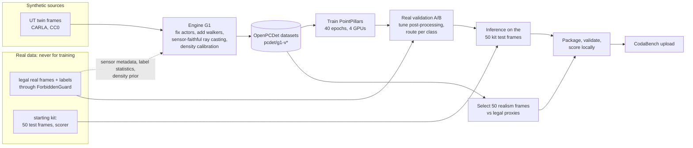
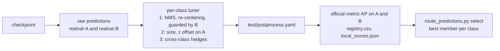
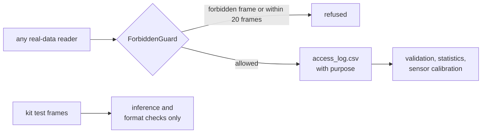

# UrbanTwin Sim2Real 2026: developer guide

Entry for the **UCF UrbanTwin Sim2Real LiDAR Challenge** at the IEEE BigData Cup 2026 ([website](https://urbanity-lab.github.io/bdc2026-urbantwin-sim2real/)), both tracks. This README is the one place to follow the whole process as a developer: set up, prepare data, generate synthetic data, train, validate, run inference, evaluate and submit. Each section links to the detailed track documents and to the plan and design documents in [`docs/`](docs).

**Contents:** [1 Objective](#1-objective) · [2 How the system works](#2-how-the-system-works) · [3 Repository layout](#3-repository-layout) · [4 Prerequisites](#4-prerequisites) · [5 Setup](#5-setup) · [6 Developer workflow](#6-developer-workflow-end-to-end) · [7 Tracks](#7-tracks) · [8 Evaluation](#8-evaluation-common-to-both-tracks) · [9 Submission](#9-submission-common-to-both-tracks) · [10 Results](#10-results-so-far) · [11 Integrity](#11-integrity-rules-and-decision-records) · [12 Contributing](#12-contributing) · [13 Next steps](#13-next-steps) · [14 Documentation index](#14-documentation-index)

---

## 1. Objective

Build synthetic roadside LiDAR data and a 3D object detector **trained on synthetic data only**. The detector is scored on held-out real frames, and the synthetic data is scored on how real it looks.

| | Track 1 | Track 2 |
|---|---|---|
| Real dataset | LUMPI (Leibniz University Hannover; 5 roadside lidars merged) | V2X-Real infrastructure lidar (UCLA; Ouster OS1-64) |
| CodaBench | [16684](https://www.codabench.org/competitions/16684/) | [16685](https://www.codabench.org/competitions/16685/) |
| Classes | Person, Car, Bicycle, Motorcycle, Bus, Truck, Van, Unknown (7 with test GT) | vehicle, pedestrian, truck |
| Organizer synthetic data | UT-LUMPI (CARLA digital twin, CC0) | UT-V2X-Real-IC (CARLA digital twin, CC0) |
| Detailed docs | data: [`data-lumpi-track/README.md`](data-lumpi-track/README.md) · models: [`model-lumpi-track/README.md`](model-lumpi-track/README.md) | data: [`data-v2x-track/README.md`](data-v2x-track/README.md) · models: [`model-v2x-track/README.md`](model-v2x-track/README.md) |

**What you submit per track** (one zip): `synthetic/0001.bin ... 0050.bin` (50 synthetic frames, float32 N x 3, each at most 1.5 MB), `predictions.json` (boxes `[x, y, z, dx, dy, dz, heading]`, score and class for each of the 50 released real test frames) and a signed declaration.

**Score** (exact formula from the kit's `scoring_program`; details in [Section 8](#8-evaluation-common-to-both-tracks)):

```
combined = 0.6 * clip(mAP_3D@0.5 / 0.7)  +  0.4 * R          R = 1 - mean( clip((CD-2)/28), clip(MMD/0.5), clip(EMD/5), clip(FPD/50) )
         ~ 0.857 * mAP + 0.4 * R   (while mAP <= 0.7)
```

**Dates** (CodaBench phases; deadlines are 00:00 UTC = 17:00 PDT the day before):

| Phase | Window | Submissions | Leaderboard |
|---|---|---|---|
| Development | Jul 1 - Oct 31, 2026 00:00 UTC (Oct 30, 17:00 PDT) | 5 per day, 100 in total | public |
| Final | Nov 1 - Nov 15, 2026 00:00 UTC (Nov 14, 17:00 PDT) | **1 per day, 5 in total** (development submissions do not carry over) | hidden until close |
| Report | 4-8 page challenge report due Nov 15, 2026 | | winners announced Nov 25; conference Dec 14-17, Phoenix |

**Our targets and status:** the ECCV 2026 edition used the same scorer and test data; its winners scored V2X 0.746 and LUMPI 0.479, and the live IEEE development leaders are at V2X 0.611 and LUMPI 0.277 (2026-10-02). Targets: V2X 0.80, LUMPI 0.53. Current local estimates: [Section 10](#10-results-so-far). Facts and rules: [`docs/01-CHALLENGE-FACTS.md`](docs/01-CHALLENGE-FACTS.md); strategy and where the points are: [`docs/02-STRATEGY.md`](docs/02-STRATEGY.md).

## 2. How the system works

### 2.1 Big picture



The architecture, data contracts and code map are in [`docs/03-ARCHITECTURE.md`](docs/03-ARCHITECTURE.md); the module-by-module build plan is [`docs/04-IMPLEMENTATION-GUIDE.md`](docs/04-IMPLEMENTATION-GUIDE.md).

### 2.2 Where the points are

| Lever | Why it matters | Where in this repo |
|---|---|---|
| Classes missing from the synthetic data | UT-LUMPI has no Person (1/7 of the LUMPI score); UT-V2X has no walking pedestrian (62% of V2X test objects) | engine G1 walkers: [`common/bdc26/render/`](common/bdc26/render), [`data-lumpi-track/README.md`](data-lumpi-track/README.md) Section 8.7 |
| Box conventions | UT-LUMPI actors are 0.78x real size (cannot reach IoU 0.5); annotators' boxes differ from CARLA's | actor scale fix ([`common/bdc26/prep.py`](common/bdc26/prep.py)); size calibration in post-processing |
| Sensor faithfulness | real density, beam pattern, field of view, null returns | per-sensor ray casting with real beam tables; V2X FOV mask; 31% nulls in V2X frames |
| Post-processing per class | NMS IoU, re-centering, size, hedged duplicates move AP a lot | [`common/tools/tune_postprocess.py`](common/tools/tune_postprocess.py) on real validation |
| Realism | 40% of the score; raw UT-LUMPI frames reach only R 0.59 | calibrated background density ([`common/bdc26/density.py`](common/bdc26/density.py)) and frame selection |

Full ranking with gates and risks: [`docs/02-STRATEGY.md`](docs/02-STRATEGY.md).

### 2.3 Validation and selection loop



realval-A is real data from the same recording as the test frames (LUMPI Measurement4; V2X scenes split by name) and is used for every choice; realval-B is a second split that only checks the choices.

### 2.4 Integrity by construction



Rules and the decision records: [Section 11](#11-integrity-rules-and-decision-records).

## 3. Repository layout

```
utsim2real-bdc26/
├── README.md                    this developer guide
├── requirements.txt             pinned Python requirements (Python 3.10, CUDA 12.1 wheels)
├── common/                      the only shared code folder
│   ├── bdc26/                   Python package (see Section 12 code map)
│   ├── tools/                   command-line tools (train, predict, evaluate, tune, route, select, package)
│   ├── env/                     bdc26.env (paths), activate.sh, setup_venv_ut.sh, setup_bdc_train.sh (conda alternative)
│   ├── tests/                   pytest suite (synthetic fixtures; parity with the official scorer)
│   └── kit/                     place the downloaded starting kits here (git-ignored)
├── data-lumpi-track/            Track 1 data: track.yaml, fetch/prepare scripts, README.md (detailed data guide)
├── data-v2x-track/              Track 2 data: same structure
├── model-lumpi-track/           Track 1 models: README.md (approaches, selected model, lifecycle), registry.csv,
│   └── <model>/                 model.yaml, README.md, train/, validation/, test/, submissions/<date>_<tag>/
├── model-v2x-track/             Track 2 models: same structure
└── docs/                        plan of record (01-07), decisions/, reference/papers/
```

Large data lives outside git under `$BDC_DATA` (default `<repo>/../bdc26-data`); checkpoints, predictions and zips are in git-ignored `output/` and `submissions/*/submission.zip`.

```
$BDC_DATA/
├── third_party/OpenPCDet/       OpenPCDet 233f849 (built by setup_venv_ut.sh)
├── logs/                        download, build, training and evaluation logs
├── lumpi-track/ {kit, ut, real, pcdet, gen}/
└── v2x-track/   {kit, ut, real, pcdet, gen}/
```
The per-track layout and every dataset version: [`data-lumpi-track/README.md`](data-lumpi-track/README.md) Sections 3 and 9, [`data-v2x-track/README.md`](data-v2x-track/README.md) Sections 3 and 9.

## 4. Prerequisites

| Item | Requirement | Tested |
|---|---|---|
| OS | Linux x86_64 | Ubuntu 20.04, kernel 5.4 |
| GPU | NVIDIA, 24 GB or more per GPU for the given batch sizes (4 GPUs per training run) | 8 x RTX A6000 48 GB |
| Driver / CUDA | driver >= 530 (CUDA 12.1 wheels); a CUDA 12.x toolkit with `nvcc` to build OpenPCDet's ops (`CUDA_HOME`) | driver 570, CUDA 12.8 |
| Python | 3.10 (`python3.10 -m venv`) | 3.10.13 |
| Tools | git, curl, a C++17 compiler (gcc 9+) | gcc 9.4 |
| Disk | about 250 GB for data, datasets and checkpoints (UT 70 GB, real 21 GB, datasets 50 GB, checkpoints 2 GB per run, venv 5 GB) | 1.2 TB free |
| RAM / CPU | 64 GB+; generation scripts use 32-64 worker processes | 503 GB, 255 cores |
| Accounts | CodaBench login (starting kits, uploads); licence acceptance for real LUMPI (CC BY-NC 3.0) and V2X-Real (UCLA Academic) | |

## 5. Setup

### 5.1 Python environment (`.venv_ut`)
```bash
git clone <this repository> utsim2real-bdc26 && cd utsim2real-bdc26
python3.10 -m venv .venv_ut                      # git-ignored
bash common/env/setup_venv_ut.sh                 # about 15 min: pip install -r requirements.txt, clone + build OpenPCDet, pip install -e common
source common/env/activate.sh                    # every later shell: sets paths and activates .venv_ut
python -m pytest -q common/tests                 # 36 tests, including bit-for-bit parity with the official scorer
```
[`requirements.txt`](requirements.txt) pins the tested stack: torch 2.1.2+cu121, spconv-cu121 2.3.8, numpy 1.23.5 (OpenPCDet needs < 1.24), numba 0.58.1, POT 0.9.7, shapely 2.0.6 and the OpenPCDet runtime dependencies. [`setup_venv_ut.sh`](common/env/setup_venv_ut.sh) clones OpenPCDet at commit 233f849 into `$BDC_THIRD_PARTY`, makes its Argo2 import optional, builds the CUDA ops (`setup.py develop`), installs this repo's `bdc26` package in editable mode, checks the GPU and the IoU op, and marks the venv ready. [`activate.sh`](common/env/activate.sh) then prefers `.venv_ut`; set `BDC_PYENV=conda` to use the conda alternative ([`setup_bdc_train.sh`](common/env/setup_bdc_train.sh), environment `bdc-train`).

### 5.2 Paths
[`common/env/bdc26.env`](common/env/bdc26.env) (sourced by `activate.sh`) sets `BDC_REPO`, `BDC_DATA` (data root, default `<repo>/../bdc26-data`), `BDC_THIRD_PARTY`, `PCDET_ROOT`, `PYTHONPATH=common`, `CUDA_HOME` and `TORCH_CUDA_ARCH_LIST`. Override any of them with `export` before sourcing.

### 5.3 Starting kits
Download both kits from the CodaBench Files tabs and place them in [`common/kit/`](common/kit) (git-ignored) as `lumpi_starting_kit.zip` and `v2x_real_starting_kit.zip`; Section 6.1 ingests them.

## 6. Developer workflow (end to end)

Run every command from the repository root after `source common/env/activate.sh`. Use `CUDA_VISIBLE_DEVICES` to choose GPUs; run long jobs with `nohup` and logs in `$BDC_DATA/logs/`. Each step links to its detailed section.

### 6.1 Get the data
| Step | Track 1 (LUMPI) | Track 2 (V2X-Real) |
|---|---|---|
| Synthetic (CC0) | `python data-lumpi-track/fetch_ut.py` | `python data-v2x-track/fetch_ut.py` |
| Starting kit | `python data-lumpi-track/ingest_kit.py common/kit/lumpi_starting_kit.zip` | `python data-v2x-track/ingest_kit.py common/kit/v2x_real_starting_kit.zip` |
| Real data (licence) | `python data-lumpi-track/fetch_real.py --accept-licence --meta --labels`, then `--lidar Measurement4 --range 0:6400:5` (and M5, M6) | `python data-v2x-track/fetch_real.py --accept-licence --points`, then `python data-v2x-track/resolve_test_ids.py`, then `fetch_real.py --accept-licence --labels` |
| Details | [`data-lumpi-track/README.md`](data-lumpi-track/README.md) Sections 2, 7, 8.1-8.3 | [`data-v2x-track/README.md`](data-v2x-track/README.md) Sections 2, 6, 7 |

### 6.2 Prepare datasets
| Step | Track 1 | Track 2 |
|---|---|---|
| Baseline UT dataset | `python data-lumpi-track/prepare_ut.py --name ut-v1` | `python data-v2x-track/prepare_ut.py --name ut-v1` |
| Real validation + realism proxies | `python data-lumpi-track/prepare_realval.py` | `python data-v2x-track/prepare_realval.py --stride 5` |
| G1 corpus (selected) | see the block below | `OMP_NUM_THREADS=1 python data-v2x-track/prepare_g1.py --name g1-v3 --walker v2 --placement prior --walkers 16 --density-gain 2.5 --fov-mask --workers 48` |
| Details | [`data-lumpi-track/README.md`](data-lumpi-track/README.md) Sections 8.4-8.7, 9 | [`data-v2x-track/README.md`](data-v2x-track/README.md) Sections 7-9 |

Track 1 G1 corpora (the density prior is fitted on the uncalibrated `g1-v1`):
```bash
export OMP_NUM_THREADS=1                      # generation is CPU-bound: one BLAS thread per worker
python data-lumpi-track/prepare_g1.py --name g1-v1 --workers 64
python common/tools/fit_density_prior.py --track lumpi --real pcdet/realval-v1 --syn pcdet/g1-v1 --out gen/density_prior_v1.npz
python data-lumpi-track/prepare_g1.py --name g1-v2 --density-prior gen/density_prior_v1.npz --workers 64
python data-lumpi-track/prepare_g1.py --name g1-v3 --walker v2 --density-prior gen/density_prior_v1.npz --workers 64
```
Generation scripts are CPU-bound: always run them with `OMP_NUM_THREADS=1` (otherwise each worker's BLAS spawns a thread per core).

### 6.3 Train
```bash
CUDA_VISIBLE_DEVICES=0,1,2,3 bash model-lumpi-track/pointpillars-g1/train/train.sh 4 run1 --fix_random_seed --workers 6
CUDA_VISIBLE_DEVICES=4,5,6,7 bash model-v2x-track/pointpillars-g1v3/train/train.sh 4 run1 --fix_random_seed --workers 6
```
`train.sh NGPUS TAG [OpenPCDet train.py flags]` builds missing OpenPCDet infos, then trains (about 1 h for V2X, 2 h for LUMPI on 4 A6000s). Checkpoints: `<model>/train/output/pcdet_model/<TAG>/ckpt/`. Configs, anchors and hyperparameters: [`model-lumpi-track/README.md`](model-lumpi-track/README.md) Section 3, [`model-v2x-track/README.md`](model-v2x-track/README.md) Section 3.

### 6.4 Validate on real data and tune post-processing
```bash
CUDA_VISIBLE_DEVICES=0 bash model-lumpi-track/pointpillars-g1/validation/tune_and_eval.sh \
    model-lumpi-track/pointpillars-g1/train/output/pcdet_model/run1/ckpt/checkpoint_epoch_40.pth
```
Raw predictions on realval-A/B, per-class tuning (Section 2.3) into `test/postprocess.yaml`, official-metric evaluation on A and B, a row in `model-<track>/registry.csv` and `validation/results/local_scores.json`. Add `--eval-only` to re-score with the current `postprocess.yaml`. Details: [`model-lumpi-track/README.md`](model-lumpi-track/README.md) Section 6.3.

### 6.5 Combine models per class
```bash
python common/tools/route_predictions.py select model-lumpi-track/routed-g1
```
Per class, the member with the best realval-A AP (near-ties broken by realval-B) is written into the routed model's `model.yaml`. Details: [`model-lumpi-track/README.md`](model-lumpi-track/README.md) Section 6.4.

### 6.6 Ablations
Train the comparison model (for example `pointpillars-ut`, UT data without G1) and run 6.4 for it; the comparison tables live in each track's model README (Section 7). Every evaluation is a row in `registry.csv`.

### 6.7 Choose the realism frames
```bash
python common/tools/select_realism_frames.py --track lumpi --syn pcdet/g1-v2 --split val \
    --fit-ref pcdet/realism-proxy-1 --fit-ref pcdet/realism-proxy-2 --fit-ref pcdet/realism-proxy-3 \
    --test-ref pcdet/realism-proxy-4 --test-ref pcdet/realism-proxy-5 --out model-lumpi-track/routed-g1/test/synthetic_ids.txt
```
Picks 50 frames of the generator's val split (never trained on) whose pooled point distribution best matches legal real proxies 1-3, and reports the official realism score on held-out proxies 4-5 (V2X frames are scored with the 31% nulls the packager adds).

### 6.8 Inference, packaging and local scoring
```bash
CUDA_VISIBLE_DEVICES=0 bash model-lumpi-track/routed-g1/test/make_submission.sh first "<team name>"
CUDA_VISIBLE_DEVICES=4 bash model-v2x-track/routed-g1/test/make_submission.sh first "<team name>"
# a single model instead: bash model-<track>/<model>/test/make_submission.sh <ckpt> <tag> "<team name>"
```
Predicts the 50 kit frames, packages `submission.zip`, validates it against the published spec and prints the local realism and combined estimates. Section 9.

### 6.9 Upload and record
Upload `model-<track>/<model>/submissions/<date>_<tag>/submission.zip` on the CodaBench Submit tab (Track 1: competition 16684, Track 2: 16685), then save the scores shown on the detailed-results page as a small JSON file (for example `{"score_combined": 0.58, "mAP_3d_0.5_R40": 0.25, "score_realism": 0.90}`) and record it:
```bash
python common/tools/package_submission.py model-lumpi-track/routed-g1 --tag first --record <codabench_submission_id> <leaderboard.json>
```
This stores the CodaBench id and the leaderboard numbers in the submission's `manifest.json` and appends a row to `registry.csv`; add the row to the submission log in the track's model README (Section 9).

## 7. Tracks

### 7.1 Track 1: LUMPI
- **Data** ([`data-lumpi-track/README.md`](data-lumpi-track/README.md)): UT-LUMPI was simulated with the real Measurement4 rig (beam residual 0.03 deg), so walkers are ray-cast with the five real lidars and inserted with per-sensor occlusion; actors are rescaled by 1/0.78; UT Van is trained as the challenge Van (LUMPI id 6); the background is resampled toward the real spatial density.
- **Model** ([`model-lumpi-track/README.md`](model-lumpi-track/README.md)): `routed-g1`, per-class routing of two PointPillars models (walker v1 and v2); approaches compared with pros and cons in Section 2 there.
- **Results:** [Section 10](#10-results-so-far).

### 7.2 Track 2: V2X-Real
- **Data** ([`data-v2x-track/README.md`](data-v2x-track/README.md)): the challenge's forbidden frames all come from V2X-Real train scenes (resolved by point matching and a monotone-subset argument); walkers are ray-cast with the measured OS1-64 beam table at legal real walker positions and calibrated to the real point counts at every range; UT points outside the real field of view are masked; realism frames carry 31% (0,0,0) nulls like the test frames.
- **Model** ([`model-v2x-track/README.md`](model-v2x-track/README.md)): `routed-g1`, per-class routing of PointPillars models (vehicle from `g1v2`, pedestrian from the walker-calibrated `g1v3`, truck from the UT-only baseline); approaches compared with pros and cons in Section 2 there.
- **Results:** [Section 10](#10-results-so-far).

## 8. Evaluation (common to both tracks)

**Detection**, as the scorer computes it (`scoring_program/detection_eval.py`, verified by [`common/tests/test_official_parity.py`](common/tests/test_official_parity.py)):
- per class and IoU threshold (0.5 primary, 0.7 reported): in each frame, predictions sorted by score each take the unused GT with the highest IoU and count as true positives if IoU >= threshold; predictions in frames without GT of the class are false positives; AP = mean over 40 recall points of the interpolated precision (R40; R11 reported);
- 3D IoU = oriented BEV polygon intersection x z overlap / union volume; class names match case-insensitively; a missing `class` defaults to "Car"; classes without test GT are excluded from the mean; no difficulty filter, no cap on the number of boxes. (The Evaluation page calls this "KITTI 40-point AP"; the matching is VOC-style, as the shipped code shows.)
- Consequences: never threshold scores aggressively (adding low-scored boxes cannot lower AP); per-class NMS matters (duplicates are false positives); the same box may be emitted under several classes (hedges), since per-class AP is independent.

**Realism** (`scoring_program/metrics.py`, reproduced bit-for-bit by [`common/bdc26/realism.py`](common/bdc26/realism.py)): concatenate the 50 frames per side, mask to the range (inclusive; (0,0,0) points are inside), one RNG with seed 1234 draws 10,000 synthetic then 10,000 real points, then CD (squared L2), unbiased RBF MMD (median-heuristic bandwidth), EMD = sqrt(W1) with POT (10M iterations, converged), FPD (Gaussian Frechet on xyz). The real reference is 50 held-out frames we never see; locally we score against 5 sets of 50 legal real frames (`pcdet/realism-proxy-*`).

**Local estimates and what they mean:**

| Number | Tool | Meaning |
|---|---|---|
| realval-A mAP | `tune_and_eval.sh`, [`eval_predictions.py`](common/tools/eval_predictions.py) | official metric on legal real frames of the test recording; also the selection split, so optimistic |
| realval-B mAP | same | a second real split never used for selection (LUMPI: other measurements with a different Person box convention, so pessimistic) |
| R (held-out proxies) | [`score_realism.py`](common/tools/score_realism.py), [`select_realism_frames.py`](common/tools/select_realism_frames.py) | official realism score against legal frames not used for any choice |
| combined estimate | `make_submission.sh` | `0.6 * clip(mAP_A / 0.7) + 0.4 * R` |

The kit's own `local_eval.py` also runs on our zips (format check with its dummy reference; replace `reference_data_dummy/realism_reference/` by 50 legal frames for a realism number). Background on the scoring math and the sensitivity of each term: [`docs/01-CHALLENGE-FACTS.md`](docs/01-CHALLENGE-FACTS.md) Section 4.

## 9. Submission (common to both tracks)

| Rule (kit `submission_format.md`, scorer `score.py`) | How the packager ([`common/bdc26/submit.py`](common/bdc26/submit.py)) handles it |
|---|---|
| exactly 50 `synthetic/*.bin`, float32 N x 3 (N x 4 accepted), each <= 1,500,000 bytes, total < ~75 MB | writes 50 x 50,000 points (600 KB each); validation errors stop packaging |
| `predictions.json`: exactly the 50 test IDs as keys (empty lists allowed); boxes of 7 floats, positive extents; score in [0, 1]; valid class strings (others are discarded) | built from the routed or single-model predictions; every test ID present; classes from the track config |
| declaration.pdf (signed) or declaration.txt containing the verbatim statement | `declaration.txt` with the statement, team and date (sign the kit's `declaration_template.pdf` if you prefer the PDF) |
| V2X: the real frames contain 31% (0,0,0) nulls | packager injects them (`track.yaml` `resample.null_fraction`) |

Each submission is a folder `model-<track>/<model>/submissions/<date>_<tag>/` with `manifest.json` (model, checkpoints, route, frames, local scores, validation result, CodaBench id and leaderboard numbers after `--record`) and `synthetic_ids.txt`; the zip itself is git-ignored.

**Budget and plan:** development phase 5 per day / 100 in total, public leaderboard; final phase **1 per day / 5 in total, hidden leaderboard, development submissions do not carry over**. Use development submissions to confirm that local estimates transfer (one per track first), never to tune against the leaderboard (probing the realism reference is forbidden). Plan the 5 final submissions in advance from local estimates; the schedule is in [`docs/05-SCHEDULE-AND-RUNBOOK.md`](docs/05-SCHEDULE-AND-RUNBOOK.md). The 4-8 page report (due Nov 15) must disclose the real-data uses in [Section 11](#11-integrity-rules-and-decision-records).

## 10. Results so far

All numbers use the official metric on legal real validation; realism is the official score against held-out legal proxies (Section 8). Per-class tables, ablations and every run: [`model-lumpi-track/README.md`](model-lumpi-track/README.md) Section 7, [`model-v2x-track/README.md`](model-v2x-track/README.md) Section 7, and `model-<track>/registry.csv`.

| Track | Selected model | realval-A mAP | realval-B mAP | Realism R | Combined estimate (A / B) | ECCV winner | Live leader (2026-10-02) |
|---|---|---|---|---|---|---|---|
| 1 LUMPI | `routed-g1` | **0.260** | 0.166 | **0.905** | **0.585** / 0.505 | 0.479 | 0.277 |
| 2 V2X-Real | `routed-g1` | **0.572** | 0.520 | **0.919** | **0.858** / 0.814 | 0.746 | 0.611 |

What moved the numbers (Track 1): synthetic walkers (Person 0 -> 0.341; mAP 0.168 -> 0.253), UT Van trained as Van (0.034 -> 0.122), per-class post-processing (+0.043), routing two runs (+0.007), background density calibration and frame selection (realism 0.59 -> 0.905). Track 2: walkers (pedestrian 0 -> 0.118, 0.173 with the v2 body), walker calibration on legal real walkers and the OS1-64 field-of-view mask (pedestrian 0.173 -> 0.266; realism 0.901 -> 0.919), per-class routing (vehicle from `g1v2`, pedestrian from `g1v3`, truck from the UT-only baseline at 0.822: +0.045 over the best single model).

Submission zips (git-ignored; rebuild with Section 6.8): `model-lumpi-track/routed-g1/submissions/2026-10-02_first/submission.zip` (validated by our packager and by the kit's own `local_eval.py`), `model-v2x-track/routed-g1/submissions/2026-10-02_first/submission.zip` (same checks). Caveats: realval-A is also the selection split (optimistic); realval-B is a different measurement or scene set (LUMPI: a different Person box convention, so pessimistic); the leaderboard is the final word.

## 11. Integrity rules and decision records

The code enforces:
- the detector is trained on synthetic data only (training data are `pcdet/ut-*` and `pcdet/g1-*` built from UT frames; real datasets are named `realval-*` and `realism-proxy-*` and no training config points at them);
- every real-data reader goes through `bdc26.guard.ForbiddenGuard`: the 100 forbidden frames plus self-exclusion windows (LUMPI Measurement4 6400-8199; V2X +/-20 frames around each forbidden frame in its scene or in each candidate scene); every allowed access is logged with its purpose in `$BDC_DATA/<track>/real/access_log.csv`;
- the 50 test frames are read only for inference and format checks; nothing is fitted to any kit data; no reference bundles are downloaded; no realism probing; no warping of submitted frames toward real statistics.

Uses of legal real data (allowed by the Rules tab: "hyperparameter selection or domain adaptation, provided no forbidden frame is touched"), all to be disclosed in the report:

| Use | Record |
|---|---|
| Downloading real data on the entrant's instruction; licence sign-off still open | [`docs/decisions/2026-09-30-real-data-download.md`](docs/decisions/2026-09-30-real-data-download.md) |
| Validation, post-processing selection, routing | this README Section 8 |
| Sensor metadata (LUMPI poses and beam tables; measured OS1-64 beam table); label statistics for the generator (walker placement and box sizes) | [`docs/decisions/2026-09-30-g1-generator.md`](docs/decisions/2026-09-30-g1-generator.md) |
| Background density prior from unlabeled frames (gray area: "domain adaptation"; disclose and ask the organizers) | same |
| Research-phase exposure before the guard existed, and its follow-up check | [`docs/decisions/2026-09-30-research-exposure.md`](docs/decisions/2026-09-30-research-exposure.md) |

All decision records: [`docs/decisions/`](docs/decisions). Open questions for the organizers: [`docs/01-CHALLENGE-FACTS.md`](docs/01-CHALLENGE-FACTS.md) Section 10.

## 12. Contributing

### 12.1 Code map (`common/bdc26/`)

| Module | What it does |
|---|---|
| [`config.py`](common/bdc26/config.py) | `load_track("lumpi"|"v2x")`: the track config (`data-<track>/track.yaml`) plus paths (`kit`, `ut`, `real`, `pcdet`, `gen`, `model_dir`) |
| [`guard.py`](common/bdc26/guard.py) | `ForbiddenGuard`: blocks forbidden frames and windows, logs allowed access |
| [`io/`](common/bdc26/io) | `fetch.py` (parallel, resumable downloads, remote zips), readers `ut.py`, `lumpi.py`, `v2x.py`, `kit.py` |
| [`frames.py`](common/bdc26/frames.py), [`boxes.py`](common/bdc26/boxes.py), [`classmap.py`](common/bdc26/classmap.py) | range masks, organizer-style resampling, null handling (`with_nulls`); box geometry, points in boxes, actor scaling; class maps |
| [`prep.py`](common/bdc26/prep.py), [`pcdet_export.py`](common/bdc26/pcdet_export.py) | UT frame -> training frame (class map, inserter hook, scale fix, resampling, calibrated density); OpenPCDet dataset writer with provenance card |
| [`render/pedsim.py`](common/bdc26/render/pedsim.py), [`render/g1.py`](common/bdc26/render/g1.py), [`density.py`](common/bdc26/density.py) | engine G1: walker model, sensors, analytic ray casting, ray-consistent insertion, placement; background density prior |
| [`detect/pcdet_dataset.py`](common/bdc26/detect/pcdet_dataset.py), [`detect/postprocess.py`](common/bdc26/detect/postprocess.py) | OpenPCDet dataset adapter; per-class post-processing (NMS, re-centering, size, z, hedges) |
| [`evalap.py`](common/bdc26/evalap.py), [`realism.py`](common/bdc26/realism.py) | the official detection and realism metrics (plus the KITTI variant for reference) |
| [`submit.py`](common/bdc26/submit.py), [`registry.py`](common/bdc26/registry.py) | packaging and validation; experiment log |

Tools ([`common/tools/`](common/tools)): `pcdet_build_infos`, `pcdet_train`, `pcdet_predict`, `eval_predictions`, `tune_postprocess`, `route_predictions`, `fit_density_prior`, `select_realism_frames`, `score_realism`, `package_submission`, `new_model`. Each has a docstring with usage.

### 12.2 Conventions
- **Track facts live in `data-<track>/track.yaml`**, never as constants in code.
- **Dataset versions are immutable:** a version used by a model is never rebuilt in place; build a new name and record it in the track's data README (Section 9) with the command that built it. Every dataset folder carries a `dataset.yaml` provenance card.
- **A model is a folder** (`python common/tools/new_model.py <track> <name> --from <model>`): `model.yaml` names its training data and real validation set; outputs stay in git-ignored `output/` folders; decisions go to `registry.csv` and the model README.
- **Real data only through the guard**, with a purpose string; any new use of real data gets a decision record in `docs/decisions/` before it influences a submission.
- **Evaluate with the official metric** (`bdc26.evalap.evaluate`, `bdc26.realism.score`); never report KITTI-style numbers as challenge numbers.
- **Style:** match the surrounding code (type hints, numpy, short docstrings that explain why); no new dependencies without adding them to `requirements.txt`.

### 12.3 Typical contributions
| Task | Where | Check |
|---|---|---|
| New generator feature (actor type, sensor effect) | `common/bdc26/render/`, an option in `data-<track>/prepare_g1.py` | a statistic against legal real data (as in the walker calibration tables), a new dataset version |
| New detector | a new model folder; `train/pcdet_model.yaml` | `tune_and_eval.sh`, then add it as a member of a routed model |
| New post-processing knob | `common/bdc26/detect/postprocess.py`, a grid in `common/tools/tune_postprocess.py` | realval-A gain that holds on realval-B |
| Bug fix in metrics or packaging | `evalap.py`, `realism.py`, `submit.py` | `pytest common/tests` including the official-parity tests |

### 12.4 Running long jobs on the shared server
- Check `nvidia-smi` and `df -h` before starting; pin GPUs with `CUDA_VISIBLE_DEVICES` (LUMPI 0-3 and V2X 4-7 match the NUMA nodes).
- Generation: `OMP_NUM_THREADS=1` with many workers. Training: `--workers 6` data loaders per GPU.
- Stop jobs by PID, not by pattern; never edit a shell script while a run of it is executing (bash reads scripts incrementally).
- Tests: `python -m pytest -q common/tests` before every commit.

## 13. Next steps

Prioritized; module numbers refer to [`docs/04-IMPLEMENTATION-GUIDE.md`](docs/04-IMPLEMENTATION-GUIDE.md), dates to [`docs/05-SCHEDULE-AND-RUNBOOK.md`](docs/05-SCHEDULE-AND-RUNBOOK.md).

1. **First development submission per track** (both zips are ready to build with Section 6.8) to confirm that local estimates transfer; record the results (Section 6.9).
2. **Organizer email** ([`docs/01-CHALLENGE-FACTS.md`](docs/01-CHALLENGE-FACTS.md) Section 10): the density prior, the research-phase exposure, label statistics for the generator.
3. **Detector routing by class (M10):** SECOND or CenterPoint for Person, Bicycle and pedestrians; keep PointPillars for vehicles.
4. **Generator (M7-M9):** true-scale re-render of UT-LUMPI actors; riders and containers in the real conventions; static clutter and engine G2 for realism and hard negatives; V2X background density calibration.
5. **Inference (M11):** test-time augmentation per class and weighted box fusion of routed members.
6. **Final phase plan** (5 submissions, 1 per day from Nov 1) and the report.

## 14. Documentation index

| Document | Purpose |
|---|---|
| [`docs/README.md`](docs/README.md) | index of the plan of record and the decisions log |
| [`docs/01-CHALLENGE-FACTS.md`](docs/01-CHALLENGE-FACTS.md) | verified rules, exact scoring, submission spec, leaderboard and competitor intelligence, organizer questions |
| [`docs/02-STRATEGY.md`](docs/02-STRATEGY.md) | where the points are, targets per class, ranked levers, decision gates, risks |
| [`docs/03-ARCHITECTURE.md`](docs/03-ARCHITECTURE.md) | system design: generation engines, detection, evaluation, data contracts, code map with build status |
| [`docs/04-IMPLEMENTATION-GUIDE.md`](docs/04-IMPLEMENTATION-GUIDE.md) | modules M0-M12: goal, code location, steps, acceptance tests, pitfalls |
| [`docs/05-SCHEDULE-AND-RUNBOOK.md`](docs/05-SCHEDULE-AND-RUNBOOK.md) | calendar to the final phase, daily loop, compute and submission budget |
| [`docs/06-LEARNING-PATH.md`](docs/06-LEARNING-PATH.md) | beginner-to-state-of-the-art curriculum tied to the modules |
| [`docs/07-LITERATURE.md`](docs/07-LITERATURE.md) | reading list by module, citation audit, licence register |
| [`docs/decisions/`](docs/decisions) | dated decision records |
| [`docs/reference/papers/`](docs/reference/papers) | the organizers' UrbanTwin and LiGuard papers |
| [`data-lumpi-track/README.md`](data-lumpi-track/README.md), [`data-v2x-track/README.md`](data-v2x-track/README.md) | per-track data guides |
| [`model-lumpi-track/README.md`](model-lumpi-track/README.md), [`model-v2x-track/README.md`](model-v2x-track/README.md) | per-track model guides; each model folder has its own README |

## Licence

Code: Apache 2.0 ([`LICENSE`](LICENSE)). Data keeps its own licence (UT twins CC0; LUMPI CC BY-NC 3.0; V2X-Real UCLA Academic licence).
