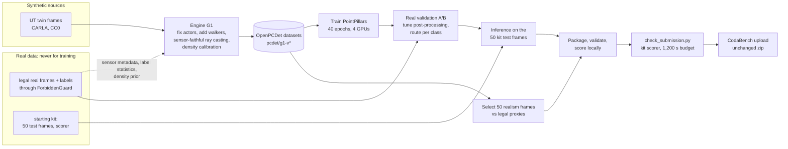
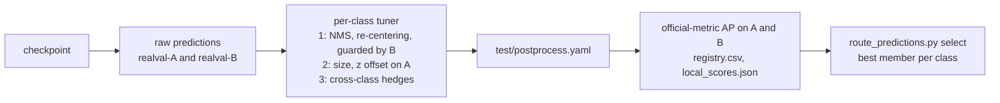
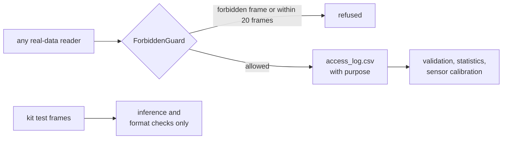

# UrbanTwin Sim2Real 2026: developer guide

Entry for the **UCF UrbanTwin Sim2Real LiDAR Challenge** at the IEEE BigData Cup 2026 ([website](https://urbanity-lab.github.io/bdc2026-urbantwin-sim2real/)), both tracks. This README is the one place to follow the whole process as a developer: set up, prepare data, generate synthetic data, train, validate, run inference, evaluate and submit. Each section links to the detailed track documents and to the plan and design documents in [`docs/`](docs).

**Contents.** Develop: [1 Objective](#1-objective) · [2 How the system works](#2-how-the-system-works) · [3 Repository layout](#3-repository-layout) · [4 Prerequisites](#4-prerequisites) · [5 Setup](#5-setup) · [6 Developer workflow](#6-developer-workflow-end-to-end) · [7 Tracks](#7-tracks). Strategy and results: [8 Strategy and next steps](#8-strategy-and-next-steps) · [9 CodaBench submissions](#9-codabench-submissions). Reference: [10 Documentation index](#10-documentation-index). Citations [Rn] open their entry in [`docs/07-LITERATURE.md`](docs/07-LITERATURE.md#6-named-references-r1-r42).

**Status (2026-10-09):** Track 2 V2X-Real **0.7855, rank 1** (S1+C1, submission 972563; next 0.6616). Track 1 LUMPI **0.4728, rank 2** (S1, 965614) behind 0.4784 from an entry with lower detection (mAP 0.1185) but much higher realism (R 0.942). Next: strategy S2 (CenterPoint specialists for small classes), with LUMPI realism promoted. Submissions: [Section 9](#9-codabench-submissions); register, gates and calendar: [`docs/decisions/README.md`](docs/decisions/README.md).

---

## 1. Objective

Build synthetic roadside LiDAR data and a 3D object detector **trained on synthetic data only**. The detector is scored on held-out real frames, and the synthetic data is scored on how real it looks.

| | Track 1 | Track 2 |
|---|---|---|
| Real dataset | LUMPI (Leibniz University Hannover; 5 roadside lidars merged) | V2X-Real infrastructure lidar (UCLA; Ouster OS1-64) |
| CodaBench | [16684](https://www.codabench.org/competitions/16684/) | [16685](https://www.codabench.org/competitions/16685/) |
| Classes | Person, Car, Bicycle, Motorcycle, Bus, Truck, Van, Unknown (7 with test GT) | vehicle, pedestrian, truck |
| Organizer synthetic data | UT-LUMPI (CARLA digital twin, CC0) | UT-V2X-Real-IC (CARLA digital twin, CC0) |
| Detailed docs | data: [`data-lumpi-track/README.md`](data-lumpi-track/README.md) · models: [`model-lumpi-track/README.md`](model-lumpi-track/README.md) | data: [`data-v2x-track/README.md`](data-v2x-track/README.md) · models: [`model-v2x-track/README.md`](model-v2x-track/README.md) |

**What you submit per track** (one zip): `synthetic/0001.bin ... 0050.bin` (50 synthetic frames, float32 N x 3, each at most 1.5 MB), `predictions.json` (boxes `[x, y, z, dx, dy, dz, heading]`, score and class for each of the 50 released real test frames) and a signed declaration.

**Score** (exact formula from the kit's `scoring_program`; details in [`model-lumpi-track/README.md`](model-lumpi-track/README.md#10-local-evaluation-and-packaging) Section 10):

```
combined = 0.6 * clip(mAP_3D@0.5 / 0.7)  +  0.4 * R          R = 1 - mean( clip((CD-2)/28), clip(MMD/0.5), clip(EMD/5), clip(FPD/50) )
         ~ 0.857 * mAP + 0.4 * R   (while mAP <= 0.7)
```

**Dates** (CodaBench phases; deadlines are 00:00 UTC = 17:00 PDT the day before):

| Phase | Window | Submissions | Leaderboard |
|---|---|---|---|
| Development | Jul 1 - Oct 31, 2026 00:00 UTC (Oct 30, 17:00 PDT) | 5 per day, 100 in total | public |
| Final | Nov 1 - Nov 15, 2026 00:00 UTC (Nov 14, 17:00 PDT) | **1 per day, 5 in total** (development submissions do not carry over) | hidden until close |
| Report | 4-8 page challenge report due Nov 15, 2026 | | winners announced Nov 25; conference Dec 14-17, Phoenix |

**Targets and status:** the ECCV 2026 edition used the same scorer and test data; its winners scored V2X 0.746 and LUMPI 0.479. Targets: V2X 0.80, LUMPI 0.53. S1+C1 scores V2X 0.7855 (above the ECCV winner) and S1 scores LUMPI 0.4728 (0.007 below it, from realism). Leaderboard: [Section 9](#9-codabench-submissions); local results: the track model READMEs Section 7. Facts and rules: [`docs/01-CHALLENGE-FACTS.md`](docs/01-CHALLENGE-FACTS.md); strategy and where the points are: [`docs/02-STRATEGY.md`](docs/02-STRATEGY.md).

## 2. How the system works

### 2.1 Big picture



The architecture, data contracts and code map are in [`docs/03-ARCHITECTURE.md`](docs/03-ARCHITECTURE.md); the module-by-module build plan is [`docs/04-IMPLEMENTATION-GUIDE.md`](docs/04-IMPLEMENTATION-GUIDE.md).

### 2.2 Where the points are

| Lever | Why it matters | Where in this repo |
|---|---|---|
| Classes missing from the synthetic data | UT-LUMPI has no Person (1/7 of the LUMPI score); UT-V2X has no walking pedestrian (62% of V2X test objects) | engine G1 walkers: [`common/bdc26/render/`](common/bdc26/render), [`data-lumpi-track/README.md`](data-lumpi-track/README.md) Section 8.7 |
| Box conventions | UT-LUMPI actors are 0.78x real size (cannot reach IoU 0.5); annotators' boxes differ from CARLA's | actor scale fix ([`common/bdc26/prep.py`](common/bdc26/prep.py)); size calibration in post-processing |
| Sensor faithfulness | real density, beam pattern, field of view, null returns | per-sensor ray casting with real beam tables; V2X FOV mask; 31% nulls in V2X frames |
| Post-processing per class | NMS IoU, re-centering, size, hedged duplicates move AP a lot | [`common/tools/tune_postprocess.py`](common/tools/tune_postprocess.py) on real validation |
| Realism | 40% of the score; raw UT-LUMPI frames reach only R 0.59 | calibrated background density ([`common/bdc26/density.py`](common/bdc26/density.py)) and frame selection |

Full ranking with gates and risks: [`docs/02-STRATEGY.md`](docs/02-STRATEGY.md).

### 2.3 Validation and selection loop



realval-A is real data from the same recording as the test frames (LUMPI Measurement4; V2X scenes split by name) and is used for every choice; realval-B is a second split that only checks the choices.

### 2.4 Integrity by construction



Rules and the real-data uses per track: [`model-lumpi-track/README.md`](model-lumpi-track/README.md#11-integrity-rules-and-real-data-uses) and [`model-v2x-track/README.md`](model-v2x-track/README.md#11-integrity-rules-and-real-data-uses) Section 11. The named end-to-end recipe built from these parts is strategy S1 ([Section 8](#8-strategy-and-next-steps)).

## 3. Repository layout

```
utsim2real-bdc26/
├── README.md                    this developer guide
├── requirements.txt             pinned Python requirements (Python 3.10, CUDA 12.1 wheels)
├── common/                      the only shared code folder
│   ├── bdc26/                   Python package (code map: model-lumpi-track/README.md Section 12.1)
│   ├── tools/                   command-line tools (train, predict, evaluate, tune, route, select, package, check)
│   ├── env/                     bdc26.env (paths), activate.sh, setup_venv_ut.sh, setup_bdc_train.sh (conda alternative)
│   ├── tests/                   pytest suite (synthetic fixtures; parity with the official scorer)
│   └── kit/                     place the downloaded starting kits here (git-ignored)
├── data-lumpi-track/            Track 1 data: track.yaml, fetch/prepare scripts, README.md (detailed data guide)
├── data-v2x-track/              Track 2 data: same structure
├── model-lumpi-track/           Track 1 models: README.md (approaches, selected model, lifecycle), registry.csv,
│   └── <model>/                 model.yaml, README.md, train/, validation/, test/, submissions/<date>_<tag>/
├── model-v2x-track/             Track 2 models: same structure
└── docs/                        plan of record (01-07), decisions/, reference/papers/
```

Large data lives outside git under `$BDC_DATA` (default `<repo>/../bdc26-data`); checkpoints, predictions and working zips are in git-ignored `output/` and `submissions/*/submission.zip`; the upload copy of every packaged version (`<track>_<strategy>_submission.zip`; the 1.0 entries as `submission_<track>.zip`) is committed next to its manifest, and the leaderboard entries are listed in [`RELEASES.md`](RELEASES.md).

```
$BDC_DATA/
├── third_party/OpenPCDet/       OpenPCDet 233f849 (built by setup_venv_ut.sh)
├── logs/                        download, build, training and evaluation logs
├── lumpi-track/ {kit, ut, real, pcdet, gen}/
└── v2x-track/   {kit, ut, real, pcdet, gen}/
```
The per-track layout and every dataset version: [`data-lumpi-track/README.md`](data-lumpi-track/README.md) Sections 3 and 9, [`data-v2x-track/README.md`](data-v2x-track/README.md) Sections 3 and 9.

## 4. Prerequisites

| Item | Requirement | Tested |
|---|---|---|
| OS | Linux x86_64 | Ubuntu 20.04, kernel 5.4 |
| GPU | NVIDIA, 24 GB or more per GPU for the given batch sizes (4 GPUs per training run) | 8 x RTX A6000 48 GB |
| Driver / CUDA | driver >= 530 (CUDA 12.1 wheels); a CUDA 12.x toolkit with `nvcc` to build OpenPCDet's ops (`CUDA_HOME`) | driver 570, CUDA 12.8 |
| Python | 3.10 (`python3.10 -m venv`) | 3.10.13 |
| Tools | git, curl, a C++17 compiler (gcc 9+) | gcc 9.4 |
| Disk | about 250 GB for data, datasets and checkpoints (UT 70 GB, real 21 GB, datasets 50 GB, checkpoints 2 GB per run, venv 5 GB) | 1.2 TB free |
| RAM / CPU | 64 GB+; generation scripts use 32-64 worker processes | 503 GB, 255 cores |
| Accounts | CodaBench login (starting kits, uploads); licence acceptance for real LUMPI (CC BY-NC 3.0) and V2X-Real (UCLA Academic) | |

## 5. Setup

### 5.1 Python environment (`.venv_ut`)
```bash
git clone <this repository> utsim2real-bdc26 && cd utsim2real-bdc26
python3.10 -m venv .venv_ut                      # git-ignored
bash common/env/setup_venv_ut.sh                 # about 15 min: pip install -r requirements.txt, clone + build OpenPCDet, pip install -e common
source common/env/activate.sh                    # every later shell: sets paths and activates .venv_ut
python -m pytest -q common/tests                 # 38 tests, including bit-for-bit parity with the official scorer
```
[`requirements.txt`](requirements.txt) pins the tested stack: torch 2.1.2+cu121, spconv-cu121 2.3.8, numpy 1.23.5 (OpenPCDet needs < 1.24), numba 0.58.1, POT 0.9.7, shapely 2.0.6 and the OpenPCDet runtime dependencies. [`setup_venv_ut.sh`](common/env/setup_venv_ut.sh) clones OpenPCDet at commit 233f849 into `$BDC_THIRD_PARTY`, makes its Argo2 import optional, builds the CUDA ops (`setup.py develop`), installs this repo's `bdc26` package in editable mode, checks the GPU and the IoU op, and marks the venv ready. [`activate.sh`](common/env/activate.sh) then prefers `.venv_ut`; set `BDC_PYENV=conda` to use the conda alternative ([`setup_bdc_train.sh`](common/env/setup_bdc_train.sh), environment `bdc-train`).

### 5.2 Paths
[`common/env/bdc26.env`](common/env/bdc26.env) (sourced by `activate.sh`) sets `BDC_REPO`, `BDC_DATA` (data root, default `<repo>/../bdc26-data`), `BDC_THIRD_PARTY`, `PCDET_ROOT`, `PYTHONPATH=common`, `CUDA_HOME` and `TORCH_CUDA_ARCH_LIST`. Override any of them with `export` before sourcing.

### 5.3 Starting kits
Download both kits from the CodaBench Files tabs and place them in [`common/kit/`](common/kit) (git-ignored) as `lumpi_starting_kit.zip` and `v2x_real_starting_kit.zip`; Section 6.1 ingests them.

## 6. Developer workflow (end to end)

Run every command from the repository root after `source common/env/activate.sh`. Use `CUDA_VISIBLE_DEVICES` to choose GPUs; run long jobs with `nohup` and logs in `$BDC_DATA/logs/`. Each step links to its detailed section.

### 6.1 Get the data
| Step | Track 1 (LUMPI) | Track 2 (V2X-Real) |
|---|---|---|
| Synthetic (CC0) | `python data-lumpi-track/fetch_ut.py` | `python data-v2x-track/fetch_ut.py` |
| Starting kit | `python data-lumpi-track/ingest_kit.py common/kit/lumpi_starting_kit.zip` | `python data-v2x-track/ingest_kit.py common/kit/v2x_real_starting_kit.zip` |
| Real data (licence) | `python data-lumpi-track/fetch_real.py --accept-licence --meta --labels`, then `--lidar Measurement4 --range 0:6400:5` (and M5, M6) | `python data-v2x-track/fetch_real.py --accept-licence --points`, then `python data-v2x-track/resolve_test_ids.py`, then `fetch_real.py --accept-licence --labels` |
| Details | [`data-lumpi-track/README.md`](data-lumpi-track/README.md) Sections 2, 7, 8.1-8.3 | [`data-v2x-track/README.md`](data-v2x-track/README.md) Sections 2, 6, 7 |

### 6.2 Prepare datasets
| Step | Track 1 | Track 2 |
|---|---|---|
| Baseline UT dataset | `python data-lumpi-track/prepare_ut.py --name ut-v1` | `python data-v2x-track/prepare_ut.py --name ut-v1` |
| Real validation + realism proxies | `python data-lumpi-track/prepare_realval.py` | `python data-v2x-track/prepare_realval.py --stride 5` |
| G1 corpus (selected) | see the block below | `OMP_NUM_THREADS=1 python data-v2x-track/prepare_g1.py --name g1-v3 --walker v2 --placement prior --walkers 16 --density-gain 2.5 --fov-mask --workers 48` |
| Details | [`data-lumpi-track/README.md`](data-lumpi-track/README.md) Sections 8.4-8.7, 9 | [`data-v2x-track/README.md`](data-v2x-track/README.md) Sections 7-9 |

Track 1 G1 corpora (the density prior is fitted on the uncalibrated `g1-v1`):
```bash
export OMP_NUM_THREADS=1                      # generation is CPU-bound: one BLAS thread per worker
python data-lumpi-track/prepare_g1.py --name g1-v1 --workers 64
python common/tools/fit_density_prior.py --track lumpi --real pcdet/realval-v1 --syn pcdet/g1-v1 --out gen/density_prior_v1.npz
python data-lumpi-track/prepare_g1.py --name g1-v2 --density-prior gen/density_prior_v1.npz --workers 64
python data-lumpi-track/prepare_g1.py --name g1-v3 --walker v2 --density-prior gen/density_prior_v1.npz --workers 64
```
Generation scripts are CPU-bound: always run them with `OMP_NUM_THREADS=1` (otherwise each worker's BLAS spawns a thread per core).

### 6.3 Train
```bash
CUDA_VISIBLE_DEVICES=0,1,2,3 bash model-lumpi-track/pointpillars-g1/train/train.sh 4 run1 --fix_random_seed --workers 6
CUDA_VISIBLE_DEVICES=4,5,6,7 bash model-v2x-track/pointpillars-g1v3/train/train.sh 4 run1 --fix_random_seed --workers 6
```
`train.sh NGPUS TAG [OpenPCDet train.py flags]` builds missing OpenPCDet infos, then trains (about 1 h for V2X, 2 h for LUMPI on 4 A6000s). Checkpoints: `<model>/train/output/pcdet_model/<TAG>/ckpt/`. Configs, anchors and hyperparameters: [`model-lumpi-track/README.md`](model-lumpi-track/README.md) Section 3, [`model-v2x-track/README.md`](model-v2x-track/README.md) Section 3.

### 6.4 Validate on real data and tune post-processing
```bash
CUDA_VISIBLE_DEVICES=0 bash model-lumpi-track/pointpillars-g1/validation/tune_and_eval.sh \
    model-lumpi-track/pointpillars-g1/train/output/pcdet_model/run1/ckpt/checkpoint_epoch_40.pth
```
Raw predictions on realval-A/B, per-class tuning (Section 2.3) into `test/postprocess.yaml`, official-metric evaluation on A and B, a row in `model-<track>/registry.csv` and `validation/results/local_scores.json`. Add `--eval-only` to re-score with the current `postprocess.yaml`. Details: [`model-lumpi-track/README.md`](model-lumpi-track/README.md) Section 6.3.

### 6.5 Combine models per class
```bash
python common/tools/route_predictions.py select model-lumpi-track/routed-g1
```
Per class, the member with the best realval-A AP (near-ties broken by realval-B) is written into the routed model's `model.yaml`. Details: [`model-lumpi-track/README.md`](model-lumpi-track/README.md) Section 6.4.

### 6.6 Ablations
Train the comparison model (for example `pointpillars-ut`, UT data without G1) and run 6.4 for it; the comparison tables live in each track's model README (Section 7). Every evaluation is a row in `registry.csv`.

### 6.7 Choose the realism frames
```bash
python common/tools/select_realism_frames.py --track lumpi --syn pcdet/g1-v2 --split val \
    --fit-ref pcdet/realism-proxy-1 --fit-ref pcdet/realism-proxy-2 --fit-ref pcdet/realism-proxy-3 \
    --test-ref pcdet/realism-proxy-4 --test-ref pcdet/realism-proxy-5 --out model-lumpi-track/routed-g1/test/synthetic_ids.txt
```
Picks 50 frames of the generator's val split (never trained on) whose pooled point distribution best matches legal real proxies 1-3, and reports the official realism score on held-out proxies 4-5 (V2X frames are scored with the 31% nulls the packager adds).

### 6.8 Inference, packaging and local scoring
```bash
CUDA_VISIBLE_DEVICES=0 bash model-lumpi-track/routed-g1/test/make_submission.sh first
CUDA_VISIBLE_DEVICES=4 bash model-v2x-track/routed-g1/test/make_submission.sh first
# a single model instead: bash model-<track>/<model>/test/make_submission.sh <ckpt> <tag> [team]
```
Predicts the 50 kit frames, packages `submission.zip`, validates it against the published spec and prints the local realism and combined estimates. The team name in `declaration.txt` defaults to `$BDC_TEAM` (`KarmaRV`, set in [`common/env/bdc26.env`](common/env/bdc26.env)); pass a third (single model) or second (routed) argument to override it. Packaging rules: track model README Section 10.4.

### 6.9 Check, upload and record
Check the zip exactly as the server will see it, including a run of the kit's own scorer under the server's 1,200 s limit (about 2 minutes and 6 GB of memory):
```bash
python common/tools/check_submission.py --track lumpi model-lumpi-track/routed-g1/submissions/<date>_<tag>/submission.zip --official
```
To change only the team line of an existing zip, add `--set-team <name>` (every other member is copied byte for byte and `manifest.json` is updated). **Upload the zip file unchanged** (renaming is fine): never unzip it, edit it and compress it again (track model README Section 10.6). If your browser runs on another machine, copy the file and compare its checksum with `zip_md5` in `manifest.json` before uploading:
```bash
md5sum submission.zip
```
Upload it on the CodaBench Submit tab (Track 1: competition 16684, Track 2: 16685), then save the server's scores as `submissions/<date>_<tag>/codabench_<id>.json` (the `scores` dict printed on the `[scoring] DONE` line, plus the uploaded file name and date; see the existing records) and record it:
```bash
python common/tools/package_submission.py model-lumpi-track/routed-g1 --tag first --record <codabench_id> model-lumpi-track/routed-g1/submissions/<date>_first/codabench_<codabench_id>.json
```
This stores the CodaBench id and the leaderboard numbers in the submission's `manifest.json` and appends a `leaderboard` row (combined, mAP, R, per-class AP) to `registry.csv`. Then add the row to the submission log in the track's model README (Section 9 there), attach the zip to the GitHub release of the tag, and list the submission under its strategy in [Section 9](#9-codabench-submissions).

## 7. Tracks

### 7.1 Track 1: LUMPI
- **Data** ([`data-lumpi-track/README.md`](data-lumpi-track/README.md)): UT-LUMPI was simulated with the real Measurement4 rig (beam residual 0.03 deg), so walkers are ray-cast with the five real lidars and inserted with per-sensor occlusion; actors are rescaled by 1/0.78; UT Van is trained as the challenge Van (LUMPI id 6); the background is resampled toward the real spatial density.
- **Model** ([`model-lumpi-track/README.md`](model-lumpi-track/README.md)): `routed-g1`, per-class routing of two PointPillars models (walker v1 and v2); approaches compared with pros and cons in Section 2 there.
- **Results:** local [`model-lumpi-track/README.md`](model-lumpi-track/README.md#7-results-and-ablations) Section 7; CodaBench [Section 9](#9-codabench-submissions) and Section 9 there.
- **Also in that README:** local evaluation and packaging (Section 10: metrics, estimates, packaging rules, pre-upload check, failure handling, budget), integrity rules and real-data uses (Section 11), contributing (Section 12: code map, conventions, typical contributions, long jobs).

### 7.2 Track 2: V2X-Real
- **Data** ([`data-v2x-track/README.md`](data-v2x-track/README.md)): the challenge's forbidden frames all come from V2X-Real train scenes (resolved by point matching and a monotone-subset argument); walkers are ray-cast with the measured OS1-64 beam table at legal real walker positions and calibrated to the real point counts at every range; UT points outside the real field of view are masked; realism frames carry 31% (0,0,0) nulls like the test frames.
- **Model** ([`model-v2x-track/README.md`](model-v2x-track/README.md)): `routed-g1`, per-class routing of PointPillars models (vehicle from `g1v2`, pedestrian from the walker-calibrated `g1v3`, truck from the UT-only baseline); approaches compared with pros and cons in Section 2 there.
- **Results:** local [`model-v2x-track/README.md`](model-v2x-track/README.md#7-results-and-ablations) Section 7; CodaBench [Section 9](#9-codabench-submissions) and Section 9 there.
- **Also in that README:** local evaluation and packaging (Section 10: metrics, estimates, packaging rules, pre-upload check, failure handling, budget), integrity rules and real-data uses (Section 11), contributing (Section 12: code map, conventions, typical contributions, long jobs).

## 8. Strategy and next steps

A strategy is the complete recipe behind one submission per track: synthetic data, detectors, post-processing, routing or fusion, and the 50 realism frames. **S4 is the current stage**: submitted on both tracks on 2026-10-10/11, **rank 1 on both** (LUMPI 975871 combined 0.5040, V2X 975938 combined 0.8485); **S5 submitted 2026-10-11**: V2X 978945 is the new entry (**0.8730**, rank 1); the LUMPI S5 upload (978931, 0.5039) was 0.00007 below S4, so 975871 stays the LUMPI entry (rank 1). Every submission, its gate result and the calendar are in [`docs/decisions/README.md`](docs/decisions/README.md). S2-S6 are the researched next routes, ordered by increasing effort and risk; the order is the execution order, and each strategy keeps whatever passed in the previous one. Details per route (idea, members, pros, cons, steps, gates, calendar): [`docs/02-STRATEGY.md` Section 8](docs/02-STRATEGY.md#8-strategy-routes-after-s1); the research behind them: [`docs/07-LITERATURE.md` Section 7](docs/07-LITERATURE.md#7-detector-research-for-the-next-strategies-2026-10-06).

| Code | Strategy | Stage | What it adds | Gap it targets | Effort / risk | Research |
|---|---|---|---|---|---|---|
| **S1** | [Calibrated Twin, Routed Pillars](docs/02-STRATEGY.md#81-s1-calibrated-twin-routed-pillars) | submitted: LUMPI S1 (965614, the LUMPI entry until the S3 upload is listed); V2X S1+C1 (972563, 0.7855; [8.1.3](docs/02-STRATEGY.md#813-close-out-results-2026-10-09)) | engine G1 data (walkers ray-cast with the real sensors, actor scale fix, density and FOV calibration), PointPillars x 2-4 runs, per-class post-processing and routing | missing classes, box conventions, realism | done | [R1](docs/07-LITERATURE.md#r1-urbantwin-papers) [R5](docs/07-LITERATURE.md#r5-pointpillars) [R7](docs/07-LITERATURE.md#r7-statistical-normalization) [R9](docs/07-LITERATURE.md#r9-lidar-aug) [R19](docs/07-LITERATURE.md#r19-eccv-2026-winner-reports) |
| **S2** | [Center-Routed Small Objects](docs/02-STRATEGY.md#82-s2-center-routed-small-objects) | **done 2026-10-09**: no upload-ready version (LUMPI Bicycle +0.025 on B, below the upload gate; V2X unchanged); CenterPoint members kept for S3 ([8.2.1](docs/02-STRATEGY.md#821-results-2026-10-09)) | CenterPoint specialists for small classes next to the S1 pillars; routes chosen on realval-A and B jointly | LUMPI Person, Bicycle, Motorcycle; V2X pedestrian | low-medium / low | [R22](docs/07-LITERATURE.md#r22-centerpoint) [R24](docs/07-LITERATURE.md#r24-inscope) [R41](docs/07-LITERATURE.md#r41-pillarnet) |
| **S3** | [Fused Portfolio with TTA](docs/02-STRATEGY.md#83-s3-fused-portfolio-with-tta) | submitted: V2X 974400 0.8381; LUMPI 974348 scored 0.5015 by its log, never listed ([8.3.1](docs/02-STRATEGY.md#831-results-2026-10-09)) | 8-view TTA (flips, yaw, height) as routable member variants, per-class fusion of a pillar and a CenterPoint member, per-class score floors | run-to-run variance; V2X height; static false positives | low-medium / low | [R23](docs/07-LITERATURE.md#r23-weighted-boxes-fusion) [R37](docs/07-LITERATURE.md#r37-ms3d-kde-box-fusion) [R38](docs/07-LITERATURE.md#r38-horizonlidar3d) [R39](docs/07-LITERATURE.md#r39-robosense-2025-report) |
| **S4** | [Two-Stage Refinement](docs/02-STRATEGY.md#84-s4-two-stage-refinement) | submitted: V2X 975938 0.8485; **LUMPI 975871 0.5040, the LUMPI entry (rank 1)** ([8.4.1](docs/02-STRATEGY.md#841-results-2026-10-10)) | Voxel R-CNN and PV-RCNN++ members (plain and TTA) fused with the S3 members, up to three per class | walker localization (the S3 review); in effect vehicle, truck and bicycle | medium / medium | [R29](docs/07-LITERATURE.md#r29-pv-rcnn) [R30](docs/07-LITERATURE.md#r30-voxel-r-cnn) [R25](docs/07-LITERATURE.md#r25-robo3d) |
| **S5** | [Geometry-Invariant Inputs](docs/02-STRATEGY.md#85-s5-geometry-invariant-inputs) | **current on V2X**: 978945 **0.8730** (rank 1); LUMPI 978931 0.5039, not confirmed (S4 stays) ([8.5.1](docs/02-STRATEGY.md#851-results-2026-10-11)) | class-wise object scaling to the real size ranges (helps every anchor-free and two-stage member) and GBlobs inputs (only inside fusions) | the twin's size gap (trucks, bicycles, buses); input invariance | medium / medium | [R27](docs/07-LITERATURE.md#r27-gblobs) [R28](docs/07-LITERATURE.md#r28-gblobs-for-sensor-placement) [R26](docs/07-LITERATURE.md#r26-lidar-domain-generalization-study) [R36](docs/07-LITERATURE.md#r36-dts-random-beam-re-sampling) |
| S6 | [Sparse Transformer Experts](docs/02-STRATEGY.md#86-s6-sparse-transformer-experts) | only if time remains | DSVT (or LION, SAFDNet) members | capacity, long range | high / high | [R31](docs/07-LITERATURE.md#r31-dsvt) [R32](docs/07-LITERATURE.md#r32-lion) [R33](docs/07-LITERATURE.md#r33-hednet-and-safdnet) [R20](docs/07-LITERATURE.md#r20-eccv-2026-runner-up-reports) |

**Why this order.** The S1 leaderboard showed that transfer and small-object localization, not detector capacity, limit the score: S1's PointPillars beat the ECCV runner-up's DSVT ensembles on both tracks [R20](docs/07-LITERATURE.md#r20-eccv-2026-runner-up-reports), while LUMPI Person, Bicycle and Truck lost most of their local AP and V2X lost 0.105 mAP to height (0.083 after the S1+C1 z calibration; track model READMEs Section 9.4).

**Next step: R3 (S5 is submitted).** Every strategy has the same template in [`docs/02-STRATEGY.md` Section 8](docs/02-STRATEGY.md#8-strategy-routes-after-s1) (hypothesis, prerequisites, steps, evaluation, gate, deliverables, risks, time box); the gates, the progression tracker and the calendar are in [`docs/decisions/README.md`](docs/decisions/README.md) ([gates](docs/decisions/README.md#32-gates), [tracker](docs/decisions/README.md#4-progression-tracker), [calendar](docs/decisions/README.md#5-calendar-and-compute-plan)).
0. **S1 close-out and S2: done 2026-10-09** ([8.1.3](docs/02-STRATEGY.md#813-close-out-results-2026-10-09), [8.2.1](docs/02-STRATEGY.md#821-results-2026-10-09)): CenterPoint members (stride 8 and 4) on both tracks and an OpenPCDet label-bug fix; no S2 upload. **Main lesson:** most unmatched walker boxes are static structures the twin lacks.
1. **S3: submitted 2026-10-10** ([8.3.1](docs/02-STRATEGY.md#831-results-2026-10-09), [decision record](docs/decisions/2026-10-09-s3-fused-portfolio.md)). Every member got an 8-view TTA variant with its own tuned post-processing; routing and fusion of a pillar and a CenterPoint member per class passed the class gate on 3 of 3 V2X and 4 of 7 LUMPI classes; per-class score floors keep the server cost low. Leaderboard: V2X 974400 combined 0.7855 -> **0.8381** (mAP 0.4869 -> 0.5483), rank 1; LUMPI 0.4728 -> **0.5015** by the scorer log (mAP 0.1357 -> 0.1692, Bicycle 0.053 -> 0.224), still Running at the server. **Lesson:** leaderboard levels follow realval-B, but the gains followed 0.8 x the realval-A gain on both tracks (the B gain over-predicted V2X and under-predicted LUMPI).
2. **S4: submitted 2026-10-10/11** ([8.4](docs/02-STRATEGY.md#84-s4-two-stage-refinement), [8.4.1](docs/02-STRATEGY.md#841-results-2026-10-10), [decision record](docs/decisions/2026-10-10-s4-two-stage.md)). A review of the S3 losses re-scoped S4 to walker localization. Voxel R-CNN and PV-RCNN++ members halve the vehicle localization loss but leave the walker localization loss unchanged (the walker gain is ranking); fused with the S3 members they lift V2X vehicle and truck and LUMPI Bicycle. Leaderboard: V2X 975938 0.8381 -> **0.8485** (vehicle +0.027, truck +0.010); LUMPI 975871 0.5015 -> **0.5040** (Bicycle 0.224 -> 0.244; uploaded below its upload gate by the entrant's call): **rank 1 on both tracks**. **Lesson:** over five uploads the leaderboard gain had the right sign every time but was 0.25-1.9 x any local gain; projections use 0.6 x the mean of the A and B gains.
3. **S5: done 2026-10-11, decision-ready** ([8.5](docs/02-STRATEGY.md#85-s5-geometry-invariant-inputs), [8.5.1](docs/02-STRATEGY.md#851-results-2026-10-11), [decision record](docs/decisions/2026-10-11-s5-object-scaling.md)). The review found that GBlobs as published degenerates at our density (80-83% of the 0.1 m voxels hold one point; covariance taken over 0.4 m cells instead) and that the size gap is in bicycles and trucks, not walkers. Class-wise object scaling to the real size ranges lifts every anchor-free and two-stage member (a single Voxel R-CNN with it equals the S3 portfolio on V2X); GBlobs loses as a member but helps inside fusions. `routed-g5`: V2X realval-B 0.679 -> 0.699 (pedestrian +0.036, truck +0.014), LUMPI 0.188 -> 0.209 (Truck 0.153 -> 0.200, Bus, Bicycle, Car). Leaderboard: V2X 978945 0.8485 -> **0.8730** (pedestrian +0.046, truck +0.029); LUMPI 978931 0.5039, flat (Truck +0.038, Bicycle -0.030, Car -0.010): not confirmed, S4 stays the LUMPI entry. **Lesson:** the LUMPI test window answers the size-augmented Bicycle members with false positives no local split shows; from R3 on the class gate also requires a pooled A+B gain (P >= 0.9), which agrees with the leaderboard on 16 of the 17 class changes of S3-S5.
4. R3: static clutter (poles, signs, trees, parked-car rows) as hard negatives, 12-20 m trucks and walker size and gait statistics from legal real labels in engine G1 (corpus `g1-v4`), then retrain the kept members (pillars and two-stage); measured with the static false-positive share, the walker localization loss and the class gate. Upload bars after S5: LUMPI 0.541, V2X 0.967 (and the LUMPI leaderboard must beat 0.5040); expected leaderboard: previous leaderboard mAP + 0.6 x the mean of the realval-A and B gains. Full steps: [8.7](docs/02-STRATEGY.md#87-parallel-and-gated-work); R3 adds real-sized assets next to static clutter (S5: size realism is the lever).

In parallel, **promoted** (CPU-bound, joins the next LUMPI upload when it passes): LUMPI realism ([`docs/02-STRATEGY.md` Section 8.7](docs/02-STRATEGY.md#87-parallel-and-gated-work)). The LUMPI leader's realism (R 0.942: CD 0.877, EMD 1.108, FPD 0.498) shows how far the realism term can go; at our mAP, about +0.015 leaderboard R regains rank 1. Order: R1 diagnosis and R2 frame selection on the full realism score (Oct 10-12), then R3 engine G2-lite with static clutter and 12-20 m trucks (Oct 13-19). Still open for the organizers ([`docs/01-CHALLENGE-FACTS.md`](docs/01-CHALLENGE-FACTS.md) Section 10): the density prior, the research-phase exposure, label statistics for the generator, and self-training on unlabeled real frames [R40](docs/07-LITERATURE.md#r40-st3d). Final phase (Nov 1-14, 1 per day, 5 in total): only frozen strategies after Gate E (Oct 25).

## 9. CodaBench submissions

Development phase leaderboards: [Track 1 (16684)](https://www.codabench.org/competitions/16684/#/results-tab), [Track 2 (16685)](https://www.codabench.org/competitions/16685/#/results-tab). Scores are the server's own `scores.json` fields, kept with each submission as `codabench_<id>.json`. Per-class AP, realism detail and the local-vs-leaderboard analysis are in the track model READMEs Section 9.

| Rank (at submission / 2026-10-11) | Version | Track | Id (date, CDT) | Combined | Detection | 3D mAP@0.5 | 3D mAP@0.7 | BEV mAP@0.5 | Realism | CD | MMD | EMD | FPD |
|---|---|---|---|---|---|---|---|---|---|---|---|---|---|
| **1 / 1** of 19 (current entry) | S5 | 2 V2X-Real | 978945 (2026-10-11 15:20) | **0.8730** | 0.8415 | 0.5890 | 0.1963 | 0.6389 | 0.9203 | 2.2148 | 0.003286 | 1.4143 | 1.0918 |
| 1 / superseded | S4 | 2 V2X-Real | 975938 (2026-10-10 19:16) | 0.8485 | 0.8007 | 0.5605 | 0.1118 | 0.6219 | 0.9203 | 2.2148 | 0.003286 | 1.4143 | 1.0918 |
| 1 / superseded | S3 | 2 V2X-Real | 974400 (2026-10-10 06:18) | 0.8381 | 0.7833 | 0.5483 | 0.0755 | 0.6179 | 0.9203 | 2.2148 | 0.003286 | 1.4143 | 1.0918 |
| 1 / superseded | S1+C1 | 2 V2X-Real | 972563 (2026-10-09 10:17) | 0.7855 | 0.6956 | 0.4869 | 0.0555 | 0.5696 | 0.9203 | 2.2148 | 0.003286 | 1.4143 | 1.0918 |
| 1 / superseded | S1 | 2 V2X-Real | 965633 (2026-10-06 17:07) | 0.7665 | 0.6640 | 0.4648 | 0.0556 | 0.5696 | 0.9203 | 2.2148 | 0.003286 | 1.4143 | 1.0918 |
| not listed (0.00007 below S4) | S5 | 1 LUMPI | 978931 (2026-10-11 15:12) | 0.5039 | 0.2457 | 0.1720 | 0.0734 | 0.1830 | 0.8912 | 1.6899 | 0.001874 | 1.6472 | 5.0946 |
| **1 / 1** of 18 (current entry) | S4 | 1 LUMPI | 975871 (2026-10-10 18:50) | **0.5040** | 0.2458 | 0.1721 | 0.0621 | 0.1800 | 0.8912 | 1.6899 | 0.001874 | 1.6472 | 5.0946 |
| never listed (status Running after scoring) | S3 | 1 LUMPI | 974348 (2026-10-10 05:48), scores from the scorer log | **0.5015** | 0.2416 | 0.1692 | 0.0609 | 0.1781 | 0.8912 | 1.6899 | 0.001874 | 1.6472 | 5.0946 |
| 1 / superseded | S1 | 1 LUMPI | 965614 (2026-10-06 16:37) | 0.4728 | 0.1938 | 0.1357 | 0.0500 | 0.1533 | 0.8912 | 1.6899 | 0.001874 | 1.6472 | 5.0946 |

Others on 2026-10-11: LUMPI second Raj Patil 0.4794 (mAP 0.1196, R 0.942), V2X runner-up linyongchun 0.6616. ECCV 2026 winners on the same test data ([R19](docs/07-LITERATURE.md#r19-eccv-2026-winner-reports)): LUMPI 0.4793, V2X 0.7457. Every upload with its gate result and decision record: [`docs/decisions/README.md` Section 2](docs/decisions/README.md#2-submission-register); release log with the files of the current entries: [`RELEASES.md`](RELEASES.md).

| Id | Model | Submitted file | Server record | Details |
|---|---|---|---|---|
| 978945 | [`model-v2x-track/routed-g5`](model-v2x-track/routed-g5) | [`v2x_s5_submission.zip`](model-v2x-track/routed-g5/submissions/2026-10-11_s5/v2x_s5_submission.zip) (tag 5.0) | [`codabench_978945.json`](model-v2x-track/routed-g5/submissions/2026-10-11_s5/codabench_978945.json) | [`model-v2x-track/README.md`](model-v2x-track/README.md#9-submission-log) Section 9; [decision record](docs/decisions/2026-10-11-s5-object-scaling.md) |
| 978931 | [`model-lumpi-track/routed-g5`](model-lumpi-track/routed-g5) | [`lumpi_s5_submission.zip`](model-lumpi-track/routed-g5/submissions/2026-10-11_s5/lumpi_s5_submission.zip) (tag 5.0) | [`codabench_978931.json`](model-lumpi-track/routed-g5/submissions/2026-10-11_s5/codabench_978931.json) (not listed) | [`model-lumpi-track/README.md`](model-lumpi-track/README.md#9-submission-log) Section 9; [decision record](docs/decisions/2026-10-11-s5-object-scaling.md) |
| 975938 | [`model-v2x-track/routed-g4`](model-v2x-track/routed-g4) | [`v2x_s4_submission.zip`](model-v2x-track/routed-g4/submissions/2026-10-10_s4/v2x_s4_submission.zip) (tag 4.0) | [`codabench_975938.json`](model-v2x-track/routed-g4/submissions/2026-10-10_s4/codabench_975938.json) | [`model-v2x-track/README.md`](model-v2x-track/README.md#9-submission-log) Section 9; [decision record](docs/decisions/2026-10-10-s4-two-stage.md) |
| 975871 | [`model-lumpi-track/routed-g4`](model-lumpi-track/routed-g4) | [`lumpi_s4_submission.zip`](model-lumpi-track/routed-g4/submissions/2026-10-10_s4/lumpi_s4_submission.zip) (tag 4.0) | [`codabench_975871.json`](model-lumpi-track/routed-g4/submissions/2026-10-10_s4/codabench_975871.json) | [`model-lumpi-track/README.md`](model-lumpi-track/README.md#9-submission-log) Section 9; [decision record](docs/decisions/2026-10-10-s4-two-stage.md) |
| 974400 | [`model-v2x-track/routed-g3`](model-v2x-track/routed-g3) | [`v2x_s3_submission.zip`](model-v2x-track/routed-g3/submissions/2026-10-09_s3/v2x_s3_submission.zip) (tag 3.0) | [`codabench_974400.json`](model-v2x-track/routed-g3/submissions/2026-10-09_s3/codabench_974400.json) | [`model-v2x-track/README.md`](model-v2x-track/README.md#9-submission-log) Section 9; [decision record](docs/decisions/2026-10-09-s3-fused-portfolio.md) |
| 974348 | [`model-lumpi-track/routed-g3`](model-lumpi-track/routed-g3) | [`lumpi_s3_submission.zip`](model-lumpi-track/routed-g3/submissions/2026-10-09_s3/lumpi_s3_submission.zip) (tag 3.0) | [`codabench_974348.json`](model-lumpi-track/routed-g3/submissions/2026-10-09_s3/codabench_974348.json) (scorer log; status Running) | [`model-lumpi-track/README.md`](model-lumpi-track/README.md#9-submission-log) Section 9; [decision record](docs/decisions/2026-10-09-s3-fused-portfolio.md) |
| 972563 | [`model-v2x-track/routed-g1z`](model-v2x-track/routed-g1z) | [`submission_v2x.zip`](model-v2x-track/routed-g1z/submissions/2026-10-09_zcal/submission_v2x.zip) (tag 1.0) | [`codabench_972563.json`](model-v2x-track/routed-g1z/submissions/2026-10-09_zcal/codabench_972563.json) | [`model-v2x-track/README.md`](model-v2x-track/README.md#9-submission-log) Section 9; [decision record](docs/decisions/2026-10-09-s1-closeout-z-calibration.md) |
| 965633 | [`model-v2x-track/routed-g1`](model-v2x-track/routed-g1) ([at 0.1](https://github.com/karmarv/utsim2real-bdc26/tree/0.1/model-v2x-track/routed-g1)) | [`submission_v2x_karmarv.zip`](https://github.com/karmarv/utsim2real-bdc26/releases/download/0.1/submission_v2x_karmarv.zip) (release 0.1) | [`codabench_965633.json`](model-v2x-track/routed-g1/submissions/2026-10-02_first/codabench_965633.json) | [`model-v2x-track/README.md`](model-v2x-track/README.md#9-submission-log) Section 9; [decision record](docs/decisions/2026-10-06-s1-first-submission.md) |
| 965614 | [`model-lumpi-track/routed-g1`](model-lumpi-track/routed-g1) ([at 0.1](https://github.com/karmarv/utsim2real-bdc26/tree/0.1/model-lumpi-track/routed-g1)) | [`submission_lumpi.zip`](model-lumpi-track/routed-g1/submissions/2026-10-02_first/submission_lumpi.zip) (tag 1.0; uploaded as [`submission_lumpi_karmarv.zip`](https://github.com/karmarv/utsim2real-bdc26/releases/download/0.1/submission_lumpi_karmarv.zip), release 0.1) | [`codabench_965614.json`](model-lumpi-track/routed-g1/submissions/2026-10-02_first/codabench_965614.json) | [`model-lumpi-track/README.md`](model-lumpi-track/README.md#9-submission-log) Section 9; [decision record](docs/decisions/2026-10-06-s1-first-submission.md) |

Not scored: 957399 and 957439, hand-edited copies of the same zips ([decision record](docs/decisions/2026-10-06-s1-first-submission.md)).

## 10. Documentation index

| Document | Purpose |
|---|---|
| [`docs/README.md`](docs/README.md) | index of the plan of record and the decisions log |
| [`docs/01-CHALLENGE-FACTS.md`](docs/01-CHALLENGE-FACTS.md) | verified rules, exact scoring, submission spec, leaderboard and competitor intelligence, organizer questions |
| [`docs/02-STRATEGY.md`](docs/02-STRATEGY.md) | where the points are, targets per class, ranked levers, decision gates, risks; **Section 8: strategies S1-S6 in detail** |
| [`docs/03-ARCHITECTURE.md`](docs/03-ARCHITECTURE.md) | system design: generation engines, detection, evaluation, data contracts, code map with build status |
| [`docs/04-IMPLEMENTATION-GUIDE.md`](docs/04-IMPLEMENTATION-GUIDE.md) | modules M0-M12: goal, code location, steps, acceptance tests, pitfalls |
| [`docs/05-SCHEDULE-AND-RUNBOOK.md`](docs/05-SCHEDULE-AND-RUNBOOK.md) | calendar to the final phase, daily loop, compute and submission budget |
| [`docs/06-LEARNING-PATH.md`](docs/06-LEARNING-PATH.md) | beginner-to-state-of-the-art curriculum tied to the modules |
| [`docs/07-LITERATURE.md`](docs/07-LITERATURE.md) | reading list by module, citation audit, licence register; **Section 6: named references R1-R42; Section 7: detector research for S2-S6** |
| [`docs/decisions/README.md`](docs/decisions/README.md) | **submission register, evaluation protocol and gates, progression tracker, calendar**, and the index of dated decision records (one per decision-ready version, named for its strategy) |
| [`docs/reference/papers/`](docs/reference/papers) | the organizers' UrbanTwin and LiGuard papers |
| [`data-lumpi-track/README.md`](data-lumpi-track/README.md), [`data-v2x-track/README.md`](data-v2x-track/README.md) | per-track data guides |
| [`model-lumpi-track/README.md`](model-lumpi-track/README.md), [`model-v2x-track/README.md`](model-v2x-track/README.md) | per-track model guides: approaches, lifecycle, results (7), submission log and CodaBench detail (9), local evaluation and packaging (10), integrity (11), contributing (12) |
| `model-<track>/<model>/submissions/<date>_<tag>/` | `manifest.json`, `synthetic_ids.txt` and the server's `codabench_<id>.json` for every submission; `submission_<track>.zip` for the leaderboard entries |
| [`RELEASES.md`](RELEASES.md) | release log: per tag, the leaderboard entries, their files and checksums |

## Licence

Code: Apache 2.0 ([`LICENSE`](LICENSE)). Data keeps its own licence (UT twins CC0; LUMPI CC BY-NC 3.0; V2X-Real UCLA Academic licence).
