# Releases

Each release tag fixes the code, the documentation and the submission files of the leaderboard entries at that point. The zip of every leaderboard entry is committed next to its manifest, byte for byte the file that was scored (md5 below and in the folder's `manifest.json`): in 1.0 as `submission_<track>.zip`; from S2 on under its upload name `<track>_<strategy>_submission.zip`, written by the packager (the upload copies of leaderboard entries are committed; the ignore rule for upload copies was lifted on 2026-10-10). The full submission register, with the gate result of every version, is [`docs/decisions/README.md` Section 2](docs/decisions/README.md#2-submission-register).

From 6.0 on, a release also carries **the weights of its leaderboard entries** as GitHub release assets (checkpoints are not in git), listed with their repository paths and md5 in `releases/<tag>/weights.json`, so the entries can be rebuilt from a fresh clone (root README Section 6.11). `releases/<tag>/github.json` records the published release as GitHub shows it: URL, commit, label, upload times and the sha256 of every asset, checked against the local files. Real data is never a release asset: the assets are checkpoints trained on synthetic data only and the scored zips (synthetic frames, predictions, declaration).

**Making a release.** Steps 1-4 run on the server; steps 5-8 need the entrant's GitHub credentials and run in the entrant's terminal (the tool reads `$GITHUB_TOKEN` or `$GH_TOKEN`, or asks for a token at a hidden prompt).
1. Record every upload of the release: `package_submission.py <model> --tag <tag> --record <id> <codabench json>` (manifest and registry row), the server record `codabench_<id>.json`, the register row (`docs/decisions/README.md` Section 2), the track README Section 9, the root README Section 9.
2. Dry-run the reproduction scripts of every version on idle GPUs, one job per GPU (`common/pipeline/gpu_queue.sh`): `test/reproduce_<tag>.sh` must report IDENTICAL, `test/reproduce_<tag>_validation.sh` IDENTICAL or EQUIVALENT. Write the result into the release section below.
3. `python common/tools/release_weights.py collect --tag <tag> <model folder>:<submission tag> ...` writes `releases/<tag>/weights.json`; add the release section and its row in the release map below.
4. Commit on main and create the annotated tag: `git tag -a <tag> -m "<summary with the CodaBench ids>"`.
5. `git push origin main && git push origin <tag>`.
6. `python common/tools/release_weights.py publish --tag <tag>`: creates the GitHub pre-release of the tag (notes: its section of this file, links pointing at the tag) and uploads every asset; it ends with "all assets uploaded and sizes match".
7. In a fresh clone at the tag: `release_weights.py fetch --tag <tag> --version <track>:<submission tag>` (md5-verified), then the version's `test/reproduce_<tag>.sh`.
8. Record the outcome in the release section and in `releases/<tag>/github.json` (release URL, label, the sha256 GitHub shows for each asset compared with the local files, fresh-clone check), commit and push; the tag stays on its commit.

The workflow from a scored upload to a release that anyone with read access can rebuild:

```mermaid
flowchart LR
  UP["the entrant's upload<br/>of the unchanged zip"] --> REC["record: codabench_ID.json,<br/>manifest, registry, register"]
  REC --> RS["reproduce_TAG.sh and<br/>reproduce_TAG_validation.sh"]
  RS --> DRY["dry run on idle GPUs:<br/>IDENTICAL or EQUIVALENT"]
  DRY --> COL["release_weights.py collect:<br/>releases/TAG/weights.json"]
  COL --> GIT["commit, annotated tag,<br/>push main and the tag"]
  GIT --> PUB["release_weights.py publish:<br/>pre-release, notes from this file,<br/>checkpoints and zips as assets"]
  PUB --> FET["fresh clone at the tag:<br/>fetch --version, md5 check"]
  FET --> RS2["reproduce scripts against<br/>the scored zip"]
```



## Release map (tags, leaderboard submissions, weights)

Every tag fixes the code, the documentation and the scored zips of the leaderboard versions of that point. A submission is identified by its CodaBench id, its zip (md5 in the folder's `manifest.json` and the server record `codabench_<id>.json`) and its model folder. Weights are GitHub release assets from 6.0 on; earlier versions are rebuilt by retraining from their configs.

| Tag | Date | Strategy | LUMPI (16684) id: combined | V2X (16685) id: combined | Weights in the release | Reproduction script (in the tree from 6.0 on) |
|---|---|---|---|---|---|---|
| 0.1 | 2026-10-06 | S1 | 965614: 0.4728 | 965633: 0.7665 | no (zips as assets) | `routed-g1/test/reproduce_first.sh` |
| 1.0 | 2026-10-09 | S1, S1+C1 | 965614: 0.4728 | 972563: 0.7855 | no | `reproduce_first.sh`, `routed-g1z/test/reproduce_zcal.sh` |
| 2.0 | 2026-10-09 | S2 (no upload) | 965614 | 972563 | no | |
| 3.0 | 2026-10-10 | S3 | 974348: 0.5015 (log; never listed) | 974400: 0.8381 | no | `routed-g3/test/reproduce_s3.sh` |
| 4.0 | 2026-10-11 | S4 | 975871: 0.5040 | 975938: 0.8485 | no | `routed-g4/test/reproduce_s4.sh` |
| 5.0 | 2026-10-11 | S5 | 978931: 0.5039 (not listed) | 978945: 0.8730 | no | `routed-g5/test/reproduce_s5.sh` |
| 5.1 | 2026-10-13 | R3 | 986489: 0.5169 | 986496: 0.8789 | no | `routed-g6/test/reproduce_r3.sh` |
| 5.2 | 2026-10-15 | R5 | 990245: 0.5198 | 990255: 0.8852 | no | `routed-g7/test/reproduce_r5.sh` |
| 6.0 | 2026-10-17 | S6 | 995869: 0.5228 (0.522754) | 995877: 0.8931 | **yes**: 21 checkpoints + 2 zips ([`releases/6.0/weights.json`](releases/6.0/weights.json)), published 2026-10-18 ([`github.json`](releases/6.0/github.json)) | `routed-g8/test/reproduce_s6.sh` (LUMPI), `routed-g8b/test/reproduce_s6b.sh` (V2X) |
| 7.0 | 2026-10-27 | S7 (the entries until S8; the F1 fallback) | **1014495: 0.5228** (0.522846, S7.6) | **1014682: 0.8982** (0.898172, S7.6) = 1001919 (S7 step 1) | **yes**: 25 checkpoints + 3 zips ([`releases/7.0/weights.json`](releases/7.0/weights.json)), published 2026-10-28 ([`github.json`](releases/7.0/github.json)) | `routed-g10/test/reproduce_s7s.sh` (LUMPI), `routed-g12/test/reproduce_s7s.sh` and `routed-g9/test/reproduce_s7.sh` (V2X) |
| **8.0** | 2026-10-30 | **S8** (the entries, F1) | **1022250: 0.5239** (0.523901, S8 U2) | **1022246: 0.9022** (0.902153, S8 V2X U2) | **yes**: 25 checkpoints + 2 zips ([`releases/8.0/weights.json`](releases/8.0/weights.json)), every checkpoint byte-identical to its 7.0 asset | `routed-g11b/test/reproduce_s8b.sh` (LUMPI), `routed-g13/test/reproduce_s8v.sh` (V2X) |

The scripts sit in `model-<track>-track/<model>/test/`; every version's row in [`docs/decisions/README.md` Section 6.1](docs/decisions/README.md#61-reproducing-a-submission) names its release. Uploads that never scored (957399, 957439) are in the register, not in a release. GitHub release pages exist for 0.1, 6.0, 7.0 and 8.0 ([releases](https://github.com/karmarv/utsim2real-bdc26/releases)); the other tags are git tags only, with their zips in the tree.

## 8.0 (pre-release, 2026-10-30)

**Leaderboard** (development phase, its last day; public leaderboards checked 2026-10-30, 20:09 UTC): S8 on both tracks, rank 1 on both. These two zips are F1 for the final phase, unless an S8.2 version (8.1) scores higher before the phase closes.

| Track | Version | CodaBench id | Uploaded (UTC) | Combined | 3D mAP@0.5 | Realism R | Rank | Submission file (md5) | Decision record |
|---|---|---|---|---|---|---|---|---|---|
| 1 LUMPI (16684) | S8 U2 | 1022250 | 2026-10-30 19:57 | **0.5239** (0.523901) | 0.1762 | 0.9323 | **1 of 22** (next 0.5118) | [`lumpi_s8b_submission.zip`](model-lumpi-track/routed-g11b/submissions/2026-10-30_s8b/lumpi_s8b_submission.zip) (`c85189b48795db4647119189f7a5a2d3`) | [s8 last day](docs/decisions/2026-10-29-s8-last-day-strategy.md) |
| 2 V2X-Real (16685) | S8 V2X U2 | 1022246 | 2026-10-30 19:52 | **0.9022** (0.902153) | 0.6170 | 0.9332 | **1 of 25** (next 0.8112) | [`v2x_s8v_submission.zip`](model-v2x-track/routed-g13/submissions/2026-10-30_s8v/v2x_s8v_submission.zip) (`b9c82e3de0c37babf146549eeedabbf6`) | same |

Server records: [`codabench_1022250.json`](model-lumpi-track/routed-g11b/submissions/2026-10-30_s8b/codabench_1022250.json), [`codabench_1022246.json`](model-v2x-track/routed-g13/submissions/2026-10-30_s8v/codabench_1022246.json) (scores from the scoring output, ranks and times from the public API).
- **LUMPI against S7.6 (1014495): +0.00106.** Person 0.1802 -> 0.1865 (+0.0063), Truck 0.0632 -> 0.0653 (+0.0021), Motorcycle +0.0003. Car, Bicycle, Bus, Van and the realism are identical.
- **V2X against S7.6 (1014682): +0.00398.** Pedestrian 0.4288 -> 0.4428 (+0.0139); vehicle, truck and the realism are identical.
- Both projections had the right sign: LUMPI +0.0011 projected, +0.00106 scored; V2X +0.0015 projected, +0.0040 scored. `s8a` (LUMPI U1, the completion alone) was built and not uploaded; `s8b` contains it.

**Release assets: everything needed to replicate the two versions.** The two submission zips and the 25 checkpoints they use (4.44 GB; LUMPI 15, V2X 10), named and mapped as in 7.0 in [`releases/8.0/weights.json`](releases/8.0/weights.json). **All 25 checkpoints are byte-identical to 7.0 assets** (same md5): S8 changes only test-time views (`flip4+yaw+z+scale`), post-processing (`test/postprocess_tta12.yaml` of the 12-view members) and the merge (floors, copies, fusions), all in git. From a fresh clone at this tag:
```bash
python common/tools/release_weights.py fetch --tag 8.0 --version lumpi:s8b                 # or v2x:s8v; md5-verified, placed under train/output/
CUDA_VISIBLE_DEVICES=0 bash model-lumpi-track/routed-g11b/test/reproduce_s8b.sh             # test frames: predictions and frames against the scored zip
CUDA_VISIBLE_DEVICES=0 bash model-v2x-track/routed-g13/test/reproduce_s8v.sh                # V2X entry
```
Verified on 2026-10-30 on an idle GPU (`$BDC_DATA/logs/s8/r80`): both test-frame scripts reproduce their scored zips **IDENTICAL** from these weights. Predictions match with maximum difference 0.0 and 0 frames differing, and all 50 realism frames are byte-identical. The kit scorer is valid: LUMPI `s8b` 329 s and 32,038 boxes, V2X `s8v` 131 s and 21,354 boxes. The first attempts ran next to the S8.2 GPU jobs and came back EQUIVALENT: LUMPI differed in 9 Car boxes, from one seed of the 6-seed PV-RCNN++ bag, and V2X in all 50 frames. As in 6.0 and 7.0, bit-identity needs an idle GPU. The validation scripts (`reproduce_s8b_validation.sh`, `reproduce_s8v_validation.sh`) were not dry-run for 8.0: they repeat every member's inference on realval-A and B, several GPU-hours that S8.2 used on the last day. Their checkpoints are the ones 7.0's validation dry-run checked (EQUIVALENT), and the 12-view members' validation files are in the tree.

**Published** by the entrant on 2026-10-30 ([`releases/8.0/github.json`](releases/8.0/github.json)): [release 8.0](https://github.com/karmarv/utsim2real-bdc26/releases/tag/8.0) on commit `0441b31`. `main` and the tag were pushed from the entrant's terminal, and `release_weights.py publish` uploaded the 27 assets, ending with "all assets uploaded and sizes match". Every checkpoint's sha256 equals the sha256 GitHub showed for the same 7.0 asset (25 of 25). Not done yet: the GitHub-side sha256 of the 8.0 assets and the label, which are read from the release page in the entrant's browser, and the fresh-clone fetch (step 7).

**What 8.0 contains**
- Strategy S8 ([record](docs/decisions/2026-10-29-s8-last-day-strategy.md), [`docs/02-STRATEGY.md` Section 8.13](docs/02-STRATEGY.md#813-s8-last-day-tta-and-completion-2026-10-30)):
  - the 12-view view set (`bdc26.detect.tta`, part `scale`);
  - views in chunks of 8 and `--from-raw` in `pcdet_predict.py`;
  - a second TTA variant per member: `tune_and_eval.sh --tta-tag tta12 --reuse-raw` and `member_tag` `tta_tag`;
  - tail copies with `min_score`, and `fuse --swap-variant`;
  - `common/pipeline/s8_portfolio.sh`;
  - LUMPI `routed-g11` (U1, `s8a`, not uploaded) and `routed-g11b` (U2, `s8b`, 1022250), V2X `routed-g13` (`s8v`, 1022246);
  - the kit-time fallback that moved the Person copies to boxes scored >= 0.274.
- S8.2 (record Section 9): the pre-registered rules and their tooling are in 8.0:
  - `bag_predictions.py --tags/--variant tta12`;
  - `route_predictions.py extend`;
  - the `u3` and `v2x2` stages.

  Its runs (the 12-view seed bags) and versions (`routed-g11c`, `routed-g14`) are not, and go to 8.1.

## 7.0 (pre-release, 2026-10-27)

**Leaderboard** (development phase; public leaderboards checked 2026-10-27, 21:41 CDT): S7 on both tracks, rank 1 on both; the latest upload on each track is its S7.6 package, and those two zips are F1 for the final phase.

| Track | Version | CodaBench id | Scored (UTC) | Combined | 3D mAP@0.5 | Realism R | Rank | Submission file (md5) | Decision record |
|---|---|---|---|---|---|---|---|---|---|
| 1 LUMPI (16684) | S7.6 | 1014495 | 2026-10-28 00:32 | **0.5228** (0.522846) | 0.1749 | 0.9323 | **1 of 22** | [`lumpi_s7s_submission.zip`](model-lumpi-track/routed-g10/submissions/2026-10-27_s7s/lumpi_s7s_submission.zip) (`19122be039da416d98ccdf852d67532b`) | [s7 final revisions](docs/decisions/2026-10-26-s7-final-revisions.md) |
| 2 V2X-Real (16685) | S7.6 | 1014682 | 2026-10-28, between 00:53 and 02:41 (not public: a tie does not replace the listed row) | **0.8982** (0.898172) | 0.6124 | 0.9332 | 1 (tie with 1001919) | [`v2x_s7s_submission.zip`](model-v2x-track/routed-g12/submissions/2026-10-27_s7s/v2x_s7s_submission.zip) (`73518975aed78ed70f78437bf62c715b`) | same |
| 2 V2X-Real (16685) | S7 step 1 | 1001919 | 2026-10-19 02:52 | **0.8982** (0.898172) | 0.6124 | 0.9332 | **1 of 24** (the listed row) | [`v2x_s7_submission.zip`](model-v2x-track/routed-g9/submissions/2026-10-18_s7/v2x_s7_submission.zip) (`c1483d590242d4fe6b4eefff96c1619c`) | [s7 visibility rule](docs/decisions/2026-10-18-s7-visibility-rule.md) |

Server records: [`codabench_1014495.json`](model-lumpi-track/routed-g10/submissions/2026-10-27_s7s/codabench_1014495.json), [`codabench_1014682.json`](model-v2x-track/routed-g12/submissions/2026-10-27_s7s/codabench_1014682.json), [`codabench_1001919.json`](model-v2x-track/routed-g9/submissions/2026-10-18_s7/codabench_1001919.json). LUMPI against S6 (995869): Truck 0.058 -> 0.063, Car 0.652 -> 0.648, every other class and the realism identical (+0.00009). V2X: 1014682 equals 1001919 in every metric; 1001919 against S6 variant b (995877): pedestrian 0.413 -> 0.429, vehicle 0.735 -> 0.737, truck and realism identical (+0.0051).

**Release assets: everything needed to replicate the three versions.** The three submission zips and the 25 checkpoints they use (4.46 GB; LUMPI 15, V2X 10, every file exactly as used), named `<track>.<model folder>.epoch40.pth` and mapped to their repository paths and md5 in [`releases/7.0/weights.json`](releases/7.0/weights.json). Twenty checkpoints are byte-identical to 6.0 assets; new are the five LUMPI PV-RCNN++ checkpoints of the extended bag (`pvrcnnpp-ros-g1v4-s2`, `-s3`, `-s4`, `pvrcnnpp-ros-g1v4d2`, `-d3`). From a fresh clone at this tag (root README Section 6.11):
```bash
python common/tools/release_weights.py fetch --tag 7.0 --version lumpi:s7s                 # or v2x:s7s, v2x:s7; md5-verified, placed under train/output/
CUDA_VISIBLE_DEVICES=0 bash model-lumpi-track/routed-g10/test/reproduce_s7s.sh              # test frames: predictions and frames against the scored zip
CUDA_VISIBLE_DEVICES=0 bash model-lumpi-track/routed-g10/test/reproduce_s7s_validation.sh   # realval-A/B against the recorded scorecard (needs the real data)
CUDA_VISIBLE_DEVICES=0 bash model-v2x-track/routed-g12/test/reproduce_s7s.sh                # V2X entry; routed-g9/test/reproduce_s7.sh for 1001919
```
Verified on 2026-10-27 on idle GPUs, one job per GPU (`$BDC_DATA/logs/r70`): the three test-frame scripts reproduce their scored zips **IDENTICAL** from these weights (predictions, maximum difference 0.0; all 50 frames byte-identical; kit scorer valid: LUMPI `s7s` 284 s and 23,270 boxes, V2X `s7s` 157 s, V2X `s7` 160 s). The two validation scripts reproduce realval-A/B to four decimals: LUMPI `s7s` A 0.3881, B 0.2250, late-A 0.3583, every class within 6.2e-4 AP, 28 of 34 member files bit-identical; V2X `s7s` A 0.7340, B 0.7206, every class within 1.9e-4, 15 of 20 bit-identical (**EQUIVALENT**; the others were recorded on GPUs shared with training, as in 6.0). `v2x:s7` uses the same ten checkpoints and members as `v2x:s7s`.

**Published** by the entrant on 2026-10-28 and checked on GitHub the same day ([`releases/7.0/github.json`](releases/7.0/github.json)): [release 7.0](https://github.com/karmarv/utsim2real-bdc26/releases/tag/7.0) on commit `3eafbaf` (tag created 2026-10-28 04:52 UTC). The 28 assets were uploaded 13:10-13:14 UTC; GitHub lists 30 with its two source archives. The sha256 GitHub shows for every asset equals the sha256 of the file the dry run used (28 of 28), so the published weights and zips are the ones that reproduced. GitHub label: **Latest**, kept by the entrant on 2026-10-28 (a pre-release cannot be Latest; 6.0 carries neither label; both titles say pre-release). The fresh-clone fetch (step 7) is the entrant's: the repository is private and the server has no GitHub token.

**F1 and fallbacks for the final phase** ([`docs/02-STRATEGY.md` Section 8.8](docs/02-STRATEGY.md#88-final-phase-plan-nov-1-14)): F1 = `lumpi_s7s_submission.zip` and `v2x_s7s_submission.zip`. Fallbacks: `v2x_s7_submission.zip` (1001919, equal score, in this release) and `lumpi_s6_submission.zip` (995869, release 6.0).

**What 7.0 contains**
- Strategy S7 ([`docs/02-STRATEGY.md` Sections 8.11-8.12](docs/02-STRATEGY.md#811-s7-visibility-rule-v2x-2026-10-18)):
  - step 1, the V2X sparse-box demotion at the real annotators' visibility cut (`route_predictions.py sparse`, `bdc26.boxes.count_points_per_box`; `routed-g9`, 1001919);
  - step 2, members retrained on visibility-matched labels (`common/tools/filter_labels.py`, corpus `g1-v5m`, `routed-g10`): below the upload gate, so its checkpoints stay out of the release;
  - S7.4-S7.6, fresh generator draws (`prepare_g1.py --seed`; the default reproduces the existing corpora) in extended seed-and-draw bags (`bag-*-g1v5x`, `bag-*-g1v4x`), the bag swap (`route_predictions.py fuse --swap-to`), the pooled bound on score floors (`budget --pooled`), the final check and projection (`common/tools/s7_check.py`); V2X `routed-g11` and `routed-g12` (the entry), LUMPI `routed-g9` and `routed-g10` (the entry). No version passed the +0.003 upload gate; the entrant uploaded both S7.6 packages.
- Pipelines (`common/pipeline/`): `s7_portfolio.sh`, `s7f_portfolio.sh`, `s7g_amend.sh`; `route_predictions.py fuse --pooled-rule` and `merge --frames`.
- Rules and compliance: [`2026-10-18-rules-external-datasets.md`](docs/decisions/2026-10-18-rules-external-datasets.md) (TUMTraf-V2X and other real sets not used), [`2026-10-26-rules-compliance-audit.md`](docs/decisions/2026-10-26-rules-compliance-audit.md) (18 items, the pre-registered rules a-e, the 2026-10-27 forum-FAQ addendum and the disclosure email draft); the V2X corpus card lists every real-derived generator input.
- Documentation: workflow and compliance diagrams as built (root README Sections 2.1, 2.3 and 2.4; `docs/03-ARCHITECTURE.md` Sections 2 and 6.2; `model-lumpi-track/README.md` Section 5); the release map and the release workflow (top of this file); the release of every version in `docs/decisions/README.md` Section 6.1; model READMEs for every `routed-g*` folder.
- Findings: inside portfolios that already fuse architectures, more seeds or draws of one family add little; a score floor can cut an R40 level of the pooled frames that neither split shows; LUMPI Car failed to transfer for the second time (an observation, no rule change before the final); the in-frame order of equal predictions does not change the server score.
- Tests: 106 (`python -m pytest -q common/tests`; `test_s7.py` added; the release-manifest check covers 6.0 and 7.0).

## 6.0 (pre-release, 2026-10-17)

**Leaderboard** (development phase; public leaderboards checked 2026-10-17): both tracks have a new entry, strategy S6.

| Track | Version | CodaBench id | Scored (UTC) | Combined | 3D mAP@0.5 | Realism R | Rank | Submission file (md5) | Decision record |
|---|---|---|---|---|---|---|---|---|---|
| 1 LUMPI (16684) | S6 | 995869 | 2026-10-17 14:17 | **0.5228** | 0.1748 | 0.9323 | **1 of 21** | [`lumpi_s6_submission.zip`](model-lumpi-track/routed-g8/submissions/2026-10-16_s6/lumpi_s6_submission.zip) (`02c731ecbd162a84d6eae5537856bc4a`) | [s6 variance-controlled](docs/decisions/2026-10-16-s6-variance-controlled.md) |
| 2 V2X-Real (16685) | S6 variant b | 995877 | 2026-10-17 14:23 | **0.8931** | 0.6065 | 0.9332 | **1 of 23** | [`v2x_s6b_submission.zip`](model-v2x-track/routed-g8b/submissions/2026-10-16_s6b/v2x_s6b_submission.zip) (`00a80bb32c5019b6d9913555efebc6b6`) | same |

Server records: [`codabench_995869.json`](model-lumpi-track/routed-g8/submissions/2026-10-16_s6/codabench_995869.json), [`codabench_995877.json`](model-v2x-track/routed-g8b/submissions/2026-10-16_s6b/codabench_995877.json). LUMPI against R5: Van 0.117 -> 0.141, every other class and the realism identical. V2X against R5: vehicle 0.721 -> 0.735, truck 0.657 -> 0.671, pedestrian and realism identical.

**Release assets: everything needed to replicate the two entries.** The two submission zips and the 21 checkpoints they use (3.5 GB; LUMPI 11, V2X 10, every file exactly as used, md5 as in the decision record), named `<track>.<model folder>.epoch40.pth` and mapped to their repository paths in [`releases/6.0/weights.json`](releases/6.0/weights.json). From a fresh clone at this tag (root README Section 6.11):
```bash
python common/tools/release_weights.py fetch --tag 6.0 --version lumpi:s6      # or v2x:s6b; md5-verified, placed under train/output/
CUDA_VISIBLE_DEVICES=0 bash model-lumpi-track/routed-g8/test/reproduce_s6.sh    # test frames: predictions and frames against the scored zip
CUDA_VISIBLE_DEVICES=0 bash model-lumpi-track/routed-g8/test/reproduce_s6_validation.sh   # realval-A/B against the recorded scorecard (needs the real data)
```
Verified on 2026-10-17 on idle GPUs (`$BDC_DATA/logs/s6close`): the test-frame scripts reproduce both scored zips **IDENTICAL** (predictions, maximum difference 0.0; all 50 frames byte-identical, from the corpus and from the committed zip); the validation scripts reproduce realval-A/B to four decimals on both tracks (every class within 4e-4 AP: EQUIVALENT; 41 of 48 member files bit-identical, the others recorded on GPUs shared with training).

**Published** 2026-10-18 (assets uploaded 14:43-14:46 UTC; [`releases/6.0/github.json`](releases/6.0/github.json)): the sha256 GitHub shows for each of the 23 assets equals the local file (checked 2026-10-28); GitHub label: none.

**Fallback for the first final-phase submission:** the R5 zips of release 5.2.

**What 6.0 contains**
- Strategy S6 ([`docs/02-STRATEGY.md` Sections 8.6-8.6.2](docs/02-STRATEGY.md#86-s6-variance-controlled-final-portfolio-re-planned-2026-10-15)): seed bags (`common/tools/bag_predictions.py`, model folders `bag-*`), the LUMPI Van judge (`route_predictions.py --judge`, `scorecard.py --judge`), class freezing (`freeze_classes.py`), the per-class score blend as a tool (`score_blend.py`), the realism pool from a whole corpus (`select_realism_frames.py --split train+val`, held-out scores in the packaged order).
- Close-out: the pooled rule as the gate from 6.0 on (`docs/decisions/README.md` Section 3.2; `common/tools/pooled_check.py`, the pooled condition on the final predictions); V2X variant b (`routed-g8b`, the entry) and the LUMPI check of the same rule (`routed-g8b`, Car rejected on the pooled frames); `common/pipeline/finish_portfolio.sh`, `s6b_lumpi.sh`, `gpu_queue.sh` (one reproduction job per GPU).
- Background pipeline (`common/pipeline/`, root README Section 6.10): detached queues for training and post-processing, per-track portfolio orchestrators, `status.sh`, events log; TensorBoard with realval learning curves (`tb_realval.py`) for every member since S3.
- Reproduction (root README Section 6.11, `docs/decisions/README.md` Section 6.1): `reproduce_submission.py` (weights inventory with md5 and release-asset names, re-merge check, `test/reproduce_<tag>.sh` per scored version: portable, frames from the corpus or the scored zip, final comparison of predictions and frames, matched-box equivalence check), `reproduce_validation.py` (`test/reproduce_<tag>_validation.sh`: realval-A/B from the weights against the recorded scorecard), `package_submission.py --syn-zip / --reproduction`; `release_weights.py` and `_github.py` (release assets: collect, publish, fetch, verify; GitHub REST, no CLI needed); a Reproduce section in every decision record since S1.
- Members: LUMPI `voxelrcnn-ros-g1v4-s3/-s4`, `pvrcnnpp-ros-g1v4-s3/-s4`; V2X `voxelrcnn-ros-g1v5-s2/-s3`, `pvrcnnpp-ros-g1v5-s2/-s3`; six bags; models `routed-g8` (both tracks) and `routed-g8b` (V2X variant b, the entry; LUMPI close-out).
- Findings: every seed bag at or above its best seed, but on realval-B none above R5's three-architecture fusions by +0.01; on the leaderboard the bag fusions gained +0.014 on V2X vehicle and truck (the +0.01-on-B requirement was too strict; the pooled condition had the signs right); the LUMPI Van judge transferred at 0.45 x its realval-A gain; LUMPI Car fusion gains vanish on the pooled frames for the third time; realism frame changes below about 0.004 are inside the scorer's subsample noise; inference is bit-identical on an idle GPU.
- Environment: `tensorboard==2.17.1` pinned in `requirements.txt` and the lock.
- Tests: 91 (`python -m pytest -q common/tests`; `test_environment.py` included).

## 5.2 (pre-release, 2026-10-15)

**Leaderboard** (development phase; public leaderboards checked 2026-10-15): both tracks have a new entry, strategy R5.

| Track | Version | CodaBench id | Scored (UTC) | Combined | 3D mAP@0.5 | Realism R | Rank | Submission file (md5) | Decision record |
|---|---|---|---|---|---|---|---|---|---|
| 1 LUMPI (16684) | R5 | 990245 | 2026-10-15 13:50 | **0.5198** | 0.1714 | 0.9323 | **1 of 21** | [`lumpi_r5_submission.zip`](model-lumpi-track/routed-g7/submissions/2026-10-14_r5/lumpi_r5_submission.zip) (`ae3612bfa0607f3f0773702acd985fd0`) | [r5 realism-led](docs/decisions/2026-10-14-r5-realism-led.md) |
| 2 V2X-Real (16685) | R5 | 990255 | 2026-10-15 13:53 | **0.8852** | 0.5972 | **0.9332** | **1 of 20** | [`v2x_r5_submission.zip`](model-v2x-track/routed-g7/submissions/2026-10-14_r5/v2x_r5_submission.zip) (`0d339f79a21059a8c97211d4d7c15533`) | same |

Server records: [`codabench_990245.json`](model-lumpi-track/routed-g7/submissions/2026-10-14_r5/codabench_990245.json), [`codabench_990255.json`](model-v2x-track/routed-g7/submissions/2026-10-14_r5/codabench_990255.json). LUMPI against R3: Person 0.157 -> 0.180, every other class and the realism identical (uploaded below the upload gate by the entrant's call). V2X against R3: pedestrian +0.011 (walker tail copies), vehicle +0.002, realism +0.0065 (EMD 1.345 -> 1.182, FPD 0.733 -> 1.468).

**Fallback for the first final-phase submission:** the R3 zips of release 5.1, re-verified on 2026-10-14 (re-merged from the saved member predictions with the committed `routed-g6/model.yaml` and repackaged: `predictions.json` and all 50 frames byte-identical on both tracks; only the declaration date differs).

**What 5.2 contains**
- Rules: [`docs/decisions/2026-10-14-rules-compliance-review.md`](docs/decisions/2026-10-14-rules-compliance-review.md) (every method against the Rules, Terms and declaration as published on 2026-10-14) and the updated operating interpretation in `docs/01-CHALLENGE-FACTS.md` Section 3.1.
- Strategy R5 ([`docs/02-STRATEGY.md` Sections 8.9 and 8.9.1](docs/02-STRATEGY.md#89-r5-realism-led-refinement-after-r3-review-and-plan-2026-10-14)): iterative density-prior fitting (`fit_density_prior.py --base`, `density.fit(base=...)`); EMD-targeted frame selection (`select_realism_frames.py --objective fpd+emd`); walker tail copies (`route_predictions.py tail`, `apply_tail_copies`; the final gate treats them as class configuration); the late-A rank for LUMPI Person (`fuse --late-rank Person --gate-top 3`); seeded training (`pcdet_train.py --seed`).
- Data: V2X `gen/density_prior_v1.npz` and corpus `g1-v5`; LUMPI `gen/density_prior_v2.npz` and corpus `g1-v5` (built, not adopted).
- Members: `voxelrcnn-ros-g1v4-s2`, `pvrcnnpp-ros-g1v4-s2` on both tracks; V2X `pointpillars-g1v5`, `voxelrcnn-ros-g1v5`, `pvrcnnpp-ros-g1v5`; models `routed-g7`.
- Findings: residual realism is background (EMD attributed point by point), a density prior must be fitted to the generator it corrects (iteratively when cells saturate), seed variance is as large as many strategy steps, walker tail copies transfer as constructed (V2X pedestrian 1.07 x), the late-A Person rule transferred at 1.6 x, the V2X vehicle fusion of new members at 0.2 x, and V2X realism at 0.58 x (EMD transferred, FPD rose on the server); a test-window-like proxy (class-count reweighting) fails its backtest; LUMPI Measurement4 Person labels drift from manual to automatic boxes toward the test window.
- Files: `lumpi_r5_submission.zip` and `v2x_r5_submission.zip` (the scored upload copies) with `manifest.json`, `synthetic_ids.txt` and `codabench_<id>.json` under `model-<track>/routed-g7/submissions/2026-10-14_r5/`.
- Tests: 74 (`python -m pytest -q common/tests`).

## 5.1 (pre-release, 2026-10-13)

**Leaderboard** (development phase; public leaderboards checked 2026-10-14): both tracks have a new entry, strategy R3.

| Track | Version | CodaBench id | Scored (UTC) | Combined | 3D mAP@0.5 | Realism R | Rank | Submission file (md5) | Decision record |
|---|---|---|---|---|---|---|---|---|---|
| 1 LUMPI (16684) | R3 | 986489 | 2026-10-14 05:38 | **0.5169** | 0.1680 | **0.9323** | **1 of 21** | [`lumpi_r3_submission.zip`](model-lumpi-track/routed-g6/submissions/2026-10-12_r3/lumpi_r3_submission.zip) (`8dbce7a9356ae490c5b948218588f86b`) | [r3 g2-lite](docs/decisions/2026-10-12-r3-g2-lite.md) |
| 2 V2X-Real (16685) | R3 | 986496 | 2026-10-14 05:44 | **0.8789** | 0.5929 | 0.9268 | **1 of 19** | [`v2x_r3_submission.zip`](model-v2x-track/routed-g6/submissions/2026-10-12_r3/v2x_r3_submission.zip) (`510eb8f9a775539c87ce323f9b13bc1b`) | same |

Server records: [`codabench_986489.json`](model-lumpi-track/routed-g6/submissions/2026-10-12_r3/codabench_986489.json), [`codabench_986496.json`](model-v2x-track/routed-g6/submissions/2026-10-12_r3/codabench_986496.json). LUMPI against S4: realism 0.891 -> 0.932, Truck +0.025, Bus +0.003, Bicycle -0.056 (mAP -0.004; diagnosed in [`docs/02-STRATEGY.md` 8.7.2](docs/02-STRATEGY.md#872-r3-results-2026-10-11-to-2026-10-13)). V2X against S5: pedestrian +0.012, realism +0.0065.

**What 5.1 contains**
- Strategy R3, *Engine G2-lite* ([`docs/02-STRATEGY.md` Sections 8.7.1 and 8.7.2](docs/02-STRATEGY.md#871-r3-engine-g2-lite-review-and-plan-2026-10-11); [decision record](docs/decisions/2026-10-12-r3-g2-lite.md)): `common/bdc26/render/g2.py` (mesh primitives, hull exemplar bank, two-wheelers with riders, static clutter, ray-consistent Open3D insertion with the candidate-sensor occlusion rule, per-class range-ramped ray dropout, shrink-to-fit real sizes, `G2Pass`), the `post_inserter` hook and the reference sampling rate in `common/bdc26/prep.py` and `common/bdc26/density.py`, `--g2` in both `prepare_g1.py`; corpora `g1-v4` on both tracks.
- Members `pointpillars-g1v4`, `voxelrcnn-ros-g1v4`, `pvrcnnpp-ros-g1v4` on both tracks and `pointpillars-ros-g1v4` on LUMPI (plain and TTA; the uncapped V2X Voxel R-CNN run kept as `run0_rostail`); models `routed-g6` with realism frames from `g1-v4`.
- Protocol and tools: the pooled A+B condition (`scorecard.pooled_gate`, `route_predictions.py --pooled`), the final gate on the final predictions (`route_predictions.py gate --vs <entry>`), the size cap of object scaling (`CLASS_MAX`), the unclipped upload estimate (`combined_estimate(clip=False)`).
- **One environment:** Open3D 0.19.0 moved into `.venv_ut` (no other package changed; the separate conda environment `bdc-sim` and its script are retired); `requirements.txt` pins every directly imported package exactly, the new `requirements-lock.txt` pins the full set, `setup_venv_ut.sh` installs with the lock as constraints, and `common/tests/test_environment.py` fails on any drift. A `g1-v4` rebuild in `.venv_ut` is bit-identical to the corpus built in `bdc-sim` (8 frames per track). Fix: a template `.gitignore` rule (`env/`) had kept `common/env/` (`activate.sh`, `bdc26.env`, `setup_venv_ut.sh`, `setup_bdc_train.sh`) out of git; the folder is now committed.
- Findings: point density compared in the same place (UT Cars 0.44x -> 0.83x real, two-wheelers 0.25-0.52x -> 0.90-1.04x); static walker false positives halve in every LUMPI two-stage member; realism LUMPI 0.891 -> 0.932 on the server (the gap to the hidden reference shrank from 0.015 to 0.002), V2X 0.920 -> 0.927; real sizes need a ceiling and per-class routing; LUMPI Bicycle failed to transfer twice (S5, R3) and is a known exception to the local gates.
- Tests: 70 (`python -m pytest -q common/tests`, all in `.venv_ut`).

## 5.0 (pre-release, 2026-10-11)

**Leaderboard** (development phase; public leaderboards checked 2026-10-11): V2X has a new entry; the LUMPI entry stays the 4.0 one (975871).

| Track | Version | CodaBench id | Scored (UTC) | Combined | 3D mAP@0.5 | Realism R | Rank | Submission file (md5) | Decision record |
|---|---|---|---|---|---|---|---|---|---|
| 2 V2X-Real (16685) | S5 | 978945 | 2026-10-11 20:20 | **0.8730** | 0.5890 | 0.9203 | **1 of 19** | [`v2x_s5_submission.zip`](model-v2x-track/routed-g5/submissions/2026-10-11_s5/v2x_s5_submission.zip) (`e5b258652c9aa0f783f3cdfbd614d687`) | [s5 object scaling](docs/decisions/2026-10-11-s5-object-scaling.md) |
| 1 LUMPI (16684) | S5 | 978931 | 2026-10-11 20:12 | 0.5039 | 0.1720 | 0.8912 | not listed (0.00007 below the S4 entry, which stays rank 1 of 18) | [`lumpi_s5_submission.zip`](model-lumpi-track/routed-g5/submissions/2026-10-11_s5/lumpi_s5_submission.zip) (`9f2c925c3976679b5b2038bfde5f7566`) | same |

Server records: [`codabench_978945.json`](model-v2x-track/routed-g5/submissions/2026-10-11_s5/codabench_978945.json), [`codabench_978931.json`](model-lumpi-track/routed-g5/submissions/2026-10-11_s5/codabench_978931.json). V2X against S4: pedestrian +0.046, truck +0.029, vehicle +0.011. LUMPI against S4: Truck +0.038, Bicycle -0.030, Car -0.010 (confirmation failed; diagnosed in [`docs/02-STRATEGY.md` 8.5.1](docs/02-STRATEGY.md#851-results-2026-10-11)).

**What 5.0 contains**
- Strategy S5, *Geometry-Invariant Inputs* ([`docs/02-STRATEGY.md` Sections 8.5 and 8.5.1](docs/02-STRATEGY.md#851-results-2026-10-11); [decision record](docs/decisions/2026-10-11-s5-object-scaling.md)): the review (voxel occupancy: GBlobs as published degenerates at our density; real vs synthetic label sizes: bicycles and trucks are the gap); `common/bdc26/detect/gblobs_vfe.py` (`GBlobsVFE` ported with its BSD-3 notice, `GBlobsCellVFE`) and `common/bdc26/detect/augment.py` (class-wise object scaling `bdc_object_scaling`); runs `voxelrcnn-gblobs-g1v3`, `voxelrcnn-ros-g1v3`, `pvrcnnpp-ros-g1v3`, `pointpillars-ros-g1v3` on both tracks (plain and TTA); models `routed-g5`.
- Findings: object scaling lifts every anchor-free and two-stage member and hurts the anchor-based V2X pillars; GBlobs loses as a member and helps inside fusions; the LUMPI test window answers the size-augmented Bicycle members with false positives no local split shows; from R3 on the class gate also requires a pooled A+B gain (agrees with the leaderboard on 16 of the 17 class changes of S3-S5).
- Tests: 56 (`python -m pytest -q common/tests`).

## 4.0 (pre-release, 2026-10-11)

**Leaderboard entries** (development phase; public leaderboards checked 2026-10-11): **rank 1 on both tracks.**

| Track | Version | CodaBench id | Scored (UTC) | Combined | 3D mAP@0.5 | Realism R | Rank | Submission file (md5) | Decision record |
|---|---|---|---|---|---|---|---|---|---|
| 2 V2X-Real (16685) | S4 | 975938 | 2026-10-11 00:16 | **0.8485** | 0.5605 | 0.9203 | **1 of 19** | [`v2x_s4_submission.zip`](model-v2x-track/routed-g4/submissions/2026-10-10_s4/v2x_s4_submission.zip) (`29c8f7a9887d1443cd7f23289ecfc8b1`) | [s4 two-stage](docs/decisions/2026-10-10-s4-two-stage.md) |
| 1 LUMPI (16684) | S4 | 975871 | 2026-10-10 23:50 | **0.5040** | 0.1721 | 0.8912 | **1 of 18** | [`lumpi_s4_submission.zip`](model-lumpi-track/routed-g4/submissions/2026-10-10_s4/lumpi_s4_submission.zip) (`ce3dc93c3f7defd7e0ca74bd0efc702a`) | same |

Per-class AP, realism terms and the scoring logs: [`codabench_975938.json`](model-v2x-track/routed-g4/submissions/2026-10-10_s4/codabench_975938.json), [`codabench_975871.json`](model-lumpi-track/routed-g4/submissions/2026-10-10_s4/codabench_975871.json). Against the S3 entries: V2X 0.8381 -> 0.8485 (vehicle +0.027, truck +0.010, pedestrian identical); LUMPI 0.5015 (S3 log; 974348 was never listed) -> 0.5040 (Bicycle 0.224 -> 0.244, every other class identical). The LUMPI package was below its upload gate (estimate +0.003) and uploaded by the entrant's call. Field on 2026-10-11: LUMPI second 0.4784, V2X runner-up 0.6616.

**What 4.0 contains**
- Strategy S4, *Two-Stage Refinement* ([`docs/02-STRATEGY.md` Sections 8.4 and 8.4.1](docs/02-STRATEGY.md#841-results-2026-10-10); [decision record](docs/decisions/2026-10-10-s4-two-stage.md)): the review of the S3 losses (AP-loss decomposition and near-miss analysis, `bdc26.diagnostics.ap_loss_decomposition`, now in every scorecard) and the revised plan; members `voxelrcnn-g1v3` and `pvrcnnpp-g1v3` on both tracks (stage 1 = the S2 CenterPoint; plain and TTA variants); a per-class two-stage score blend (`common/bdc26/detect/pcdet_patches.py`, `pcdet_predict.py --score-blend`); `route_predictions.py fuse --max-members 3` with incumbent-aware selection; models `routed-g4`.
- Findings: refinement halves the vehicle localization loss (3D@0.7 on the V2X leaderboard 0.0755 -> 0.1118) but leaves walker localization unchanged; the leaderboard gain had the right sign at all five uploads with a local change but was 0.25-1.9 x any local gain, so projections use 0.6 x the mean of the realval-A and B gains.
- Tests: 54 (`python -m pytest -q common/tests`).

## 3.0 (pre-release, 2026-10-10)

**Leaderboard entries** (development phase; public leaderboards checked 2026-10-10):

| Track | Version | CodaBench id | Scored | Combined | 3D mAP@0.5 | Realism R | Rank | Submission file (md5) | Decision record |
|---|---|---|---|---|---|---|---|---|---|
| 2 V2X-Real (16685) | S3 | 974400 | 2026-10-10 11:18 UTC (06:18 CDT) | **0.8381** | 0.5483 | 0.9203 | **1 of 19** | [`v2x_s3_submission.zip`](model-v2x-track/routed-g3/submissions/2026-10-09_s3/v2x_s3_submission.zip) (`5e46f9450feb7846455c4b8428483641`) | [s3 fused portfolio](docs/decisions/2026-10-09-s3-fused-portfolio.md) |
| 1 LUMPI (16684) | S3 | 974348 | 2026-10-10 05:48 CDT; scorer log DONE, CodaBench status Running afterwards | **0.5015** (log) | 0.1692 | 0.8912 | not listed yet (would lead: 0.4784); listed LUMPI entry 965614 (S1, rank 2) | [`lumpi_s3_submission.zip`](model-lumpi-track/routed-g3/submissions/2026-10-09_s3/lumpi_s3_submission.zip) (`9133dd7d9d8b377ec9228b79b75065a0`) | same |

Per-class AP, realism terms and the scoring logs: [`codabench_974400.json`](model-v2x-track/routed-g3/submissions/2026-10-09_s3/codabench_974400.json), [`codabench_974348.json`](model-lumpi-track/routed-g3/submissions/2026-10-09_s3/codabench_974348.json). Against the previous entries: V2X 0.7855 -> 0.8381 (vehicle +0.076, pedestrian +0.064, truck +0.044); LUMPI 0.4728 -> 0.5015 (Person +0.040, Car +0.019, Bicycle 0.053 -> 0.224). Realism is identical (same 50 frames): every change is detection. Field on 2026-10-10: LUMPI leader 0.4784, V2X runner-up 0.6616.

**What 3.0 contains**
- Strategy S3, *Fused Portfolio with TTA* ([`docs/02-STRATEGY.md` Section 8.3.1](docs/02-STRATEGY.md#831-results-2026-10-09); [decision record](docs/decisions/2026-10-09-s3-fused-portfolio.md)), built on the S2 members without new training: 8-view test-time augmentation (`common/bdc26/detect/tta.py`: flips, yaw +/-5 deg, z +/-0.25 m) and rotated weighted box fusion (`common/bdc26/detect/fusion.py`); `pcdet_predict.py --tta`; `tune_and_eval.sh --tta` in every member folder (each TTA variant tunes its own `test/postprocess_tta.yaml`); `route_predictions.py` with TTA members, `fuse` (per-class pairs of two checkpoints, class gate, A-only selection-bias check) and `budget` (per-class score floors costing at most 0.002 AP, exact from truncated match flags); models `routed-g3` on both tracks.
- Real validation: V2X realval-A / B 0.585 / 0.537 -> 0.661 / 0.664 (BEV-3D gap on B 0.129 -> 0.062); LUMPI 0.272 / 0.170 -> 0.301 / 0.184 (late-A 0.271 -> 0.298). Upload gate passed on both tracks; kit scorer 74 s (10,671 boxes) and 181 s (17,193 boxes).
- Transfer finding: leaderboard levels follow realval-B (0.83-0.92 x B), but the S3 gains were 0.80 (V2X) and 0.81 (LUMPI) x the realval-A gain against 0.48 and 1.89 x the B gain; the scorecard protocol adds a leaderboard projection (previous leaderboard mAP + 0.8 x the A gain), the gates stay on B.
- Scorecard: static false-positive share at a fixed score and ranked above the median true-positive score (fusion cut the ranked static walker boxes 6.2 -> 1.8 per frame on V2X, 9.7 -> 4.1 on LUMPI); registry rows of TTA runs carry strategy S3.
- Submission files: the S3 upload copies above, and the checked S2 candidate [`lumpi_s2_submission.zip`](model-lumpi-track/routed-g2/submissions/2026-10-09_s2/lumpi_s2_submission.zip) (md5 `3d972c963a5949fcdd87d85c5a8e30bc`, never uploaded) for traceability. Upload copies are tracked from this release on.
- Tests: 52 (`python -m pytest -q common/tests`).

## 2.0 (pre-release, 2026-10-09)

**Leaderboard entries:** unchanged from 1.0 (LUMPI 965614, S1, combined 0.4728, rank 2 of 18; V2X 972563, S1+C1, combined 0.7855, rank 1 of 19). Their files are the 1.0 files above. No S2 version passed the upload gate, so 2.0 adds no entry file; the checked LUMPI S2 candidate `model-lumpi-track/routed-g2/submissions/2026-10-09_s2/lumpi_s2_submission.zip` was kept local in 2.0 and is committed in 3.0 for traceability (checked, never uploaded).

**What 2.0 contains**
- Strategy S2, *Center-Routed Small Objects* ([`docs/02-STRATEGY.md` Section 8.2.1](docs/02-STRATEGY.md#821-results-2026-10-09); [decision record](docs/decisions/2026-10-09-s2-center-routed.md)): CenterPoint members at stride 8 and 4 on both tracks (`centerpoint-g1v3`, `centerpoint-s4-g1v3`), routed models `routed-g2`. Gates: LUMPI Bicycle moves to CenterPoint (realval-B 0.102 -> 0.128) but the combined estimate gains +0.003, below the +0.005 upload gate; V2X keeps S1+C1.
- A runtime fix for OpenPCDet's `CenterHead.assign_targets`, which relabeled classes across head groups (V2X pedestrians trained the vehicle head): `common/bdc26/detect/pcdet_patches.py`, applied by `register()`, with a regression test.
- Diagnosis that static structures cause 72-77% (V2X) and 50-69% (LUMPI) of the unmatched walker detections (oracle bound: V2X pedestrian realval-B 0.252 -> 0.346), which promotes static hard negatives (R3) in the plan.
- Tools: `pcdet_smoke.py` (measured training cost), `route_predictions.py validate` and `select --rule joint --calibrated`, `scorecard.py --realism-from`, track-prefixed upload copies `<track>_<strategy>_submission.zip` from the packager.
- R track: legal late-A realism proxies; the frame re-selection (R2) failed its gate, S1 frames kept.
- Tests: 47 (`python -m pytest -q common/tests`).

## 1.0 (pre-release, 2026-10-09)

**Leaderboard entries** (development phase; public leaderboards checked 2026-10-09):

| Track | Version | CodaBench id | Scored (UTC) | Combined | 3D mAP@0.5 | Realism R | Rank | Submission file (md5) | Decision record |
|---|---|---|---|---|---|---|---|---|---|
| 1 LUMPI (16684) | S1 | 965614 | 2026-10-06 21:37 | 0.4728 | 0.1357 | 0.8912 | 2 of 18 (1 until Oct 7) | [`submission_lumpi.zip`](model-lumpi-track/routed-g1/submissions/2026-10-02_first/submission_lumpi.zip) (`ea2c76393d6f8868762d6bac1ac03fa8`) | [s1 first submission](docs/decisions/2026-10-06-s1-first-submission.md) |
| 2 V2X-Real (16685) | S1+C1 | 972563 | 2026-10-09 15:17 | **0.7855** | 0.4869 | 0.9203 | **1 of 19** | [`submission_v2x.zip`](model-v2x-track/routed-g1z/submissions/2026-10-09_zcal/submission_v2x.zip) (`7fbb973e2c1715dea66d7850b8bde11f`) | [s1 close-out](docs/decisions/2026-10-09-s1-closeout-z-calibration.md) |

Per-class AP, realism terms and the scoring logs: [`codabench_965614.json`](model-lumpi-track/routed-g1/submissions/2026-10-02_first/codabench_965614.json), [`codabench_972563.json`](model-v2x-track/routed-g1z/submissions/2026-10-09_zcal/codabench_972563.json). The LUMPI file was uploaded as `submission_lumpi_karmarv.zip` (same bytes; also a release-0.1 asset). Field on 2026-10-09: LUMPI leader 0.4784 (mAP 0.1185, realism R 0.942); V2X runner-up 0.6616.

**What 1.0 contains**
- Strategy S1, *Calibrated Twin, Routed Pillars* ([`docs/02-STRATEGY.md` Section 8.1](docs/02-STRATEGY.md#81-s1-calibrated-twin-routed-pillars)): engine G1 synthetic data, PointPillars members, per-class post-processing and routing; models `model-<track>/routed-g1`.
- S1 close-out: joint routing with the class gate, `scorecard.py` with a paired frame bootstrap, the `strategy` registry column, evaluation subsets and error breakdowns, and the range-dependent z calibration C1, which gives the V2X version S1+C1 (`model-v2x-track/routed-g1z`, +0.019 combined on the leaderboard).
- Documentation: the strategy routes S2-S6 with steps and gates, the decisions folder (submission register, evaluation protocol and gates, progression tracker, calendar, dated records), named references R1-R42.
- Tests: 44 (`python -m pytest -q common/tests`).

## Earlier tags

0.1 (S1 first submission, 2026-10-06; zips as release assets), 0.2 (documentation of the strategy routes). 1.0 to 5.0 are described above.
