# Track 1 data: LUMPI (`data-lumpi-track/`)

> Everything about the data of Track 1 (CodaBench 16684): sources and licences, the sensor rig and coordinate frame, classes, the guard, every preparation script with its inputs and outputs, the synthetic-data generator (engine G1), the dataset versions on disk, and what we measured. The model side is in [`model-lumpi-track/README.md`](../model-lumpi-track/README.md); the project-wide developer guide is the [root README](../README.md).

## 0. At a glance

| Item | Value |
|---|---|
| Test input | 50 real LUMPI Measurement4 frames (kit `detection_test_frames/`), float32 N x 3, exactly 50,000 points each, all inside the range |
| Point-cloud range | `[-40, -40, -5, 40, 40, 5]` (inclusive bounds in the scorer) |
| Classes (`config.json` order) | Person, Car, Bicycle, Motorcycle, Bus, Truck, Van, Unknown; Unknown has no test GT, so the score is the mean over 7 classes |
| Test GT counts (public, from the scorer's results page) | Person 512, Car 1258, Bicycle 82, Motorcycle 27, Bus 25, Truck 192, Van 79 |
| Forbidden frames | 100 Measurement4 frame indices 006497-008109 (50 test + 50 realism reference); we block the whole window 6400-8199 |
| Synthetic source | UT-LUMPI, the organizers' CARLA twin (CC0), 10,000 frames |
| Real source | LUMPI (Leibniz University Hannover), CC BY-NC 3.0: validation, calibration and statistics only, never training |
| Track config | [`track.yaml`](track.yaml): every track-specific constant the code uses |

## 1. Scripts in this folder

Run everything from the repository root after `source common/env/activate.sh`. Each script prints its own help (`python <script> -h`).

| Script | Purpose | Inputs | Outputs (under `$BDC_DATA/lumpi-track/`) |
|---|---|---|---|
| [`fetch_ut.py`](fetch_ut.py) | Download UT-LUMPI from Dataverse (parallel range requests, MD5 against [`manifests/`](manifests)) and extract `pcd`, `lbl`, `sem_seg`, `ins_seg` | internet | `ut/UCF-DT-LUMPI-Seq-1/{pcd,lbl,sem_seg,ins_seg}/` (49 GB) |
| [`ingest_kit.py`](ingest_kit.py) | Unpack the CodaBench starting kit, report the test-frame format | `common/kit/lumpi_starting_kit.zip` (or `~/Downloads/...`) | `kit/` + `kit/kit_report.json` |
| [`fetch_real.py`](fetch_real.py) | Download real LUMPI from the LUH vault: `--meta` (sensor metadata, HD map), `--labels` (guard-filtered while streaming), `--lidar M --range a:b:s` (raw PLY frames, blocked frames skipped). Requires `--accept-licence` | internet, licence | `real/raw/{meta.json,HD_map/,Measurement*/lidar/*.ply}`, `real/labels/<M>_Label.guarded.csv`, `real/access_log.csv` |
| [`resolve_test_ids.py`](resolve_test_ids.py) | Optional: confirm that kit IDs are Measurement4 frame indices by exact point matching of 2 test frames (raw points only, no labels) | kit, internet | `kit/id_check.json` |
| [`prepare_ut.py`](prepare_ut.py) | UT frames -> OpenPCDet dataset: class map, actor scale fix 1/0.78, resample to 50k points | `ut/` | `pcdet/ut-v1/` |
| [`prepare_realval.py`](prepare_realval.py) | Real validation set A/B, realism proxies, class report (guarded) | `real/` | `pcdet/realval-v1/`, `pcdet/realism-proxy-{1..5}/` |
| [`prepare_g1.py`](prepare_g1.py) | Engine G1: UT frames + ray-cast procedural walkers + UT Van as Van + optional calibrated background density | `ut/`, `real/raw/meta.json`, `real/labels/`, `gen/density_prior_*.npz` | `pcdet/g1-v*/`, `gen/person_prior_m4.npz` |

Shared code used by these scripts: readers [`common/bdc26/io/`](../common/bdc26/io) (`ut.py`, `lumpi.py`, `kit.py`, `fetch.py`), the guard [`common/bdc26/guard.py`](../common/bdc26/guard.py), frame conversion [`common/bdc26/prep.py`](../common/bdc26/prep.py), the generator [`common/bdc26/render/`](../common/bdc26/render) (`pedsim.py`, `g1.py`) and the density prior [`common/bdc26/density.py`](../common/bdc26/density.py).

## 2. Sources and licences

| Source | Where | Size | What we take | Licence | Status (2026-10-02) |
|---|---|---|---|---|---|
| Starting kit | CodaBench 16684, Files tab (login) | 30.6 MB | everything | challenge terms (no redistribution) | ingested |
| UT-LUMPI | Dataverse doi:10.7910/DVN/D9SSWD (25 zip parts) | 52.0 GB | `pcd`, `lbl`, `sem_seg`, `ins_seg` | **CC0** | downloaded and verified |
| LUMPI real | Vault `https://data.uni-hannover.de/vault/ikg/busch/LUMPI/` (plain HTTP, Range supported); SDK `github.com/St3ff3nBusch/LUMPI-SDK-Python` (MIT) | about 318 GB in total | `meta.json`, `HD_map/`, guarded `Label.csv` of Measurements 4-6; Measurement4 frames 0-6399 every 5th (1,280), Measurement5 every 20th (378), Measurement6 every 25th (489): 13 GB | **CC BY-NC 3.0** | downloaded on the entrant's instruction ([decision record](../docs/decisions/2026-09-30-rules-real-data-download.md)); corporate legal sign-off still open |

## 3. Data on disk

```
$BDC_DATA/lumpi-track/                 # $BDC_DATA defaults to <repo>/../bdc26-data (common/env/bdc26.env)
├── kit/                               # starting kit: detection_test_frames/, forbidden_frames.txt, scoring_program/, ...
├── ut/UCF-DT-LUMPI-Seq-1/{pcd,lbl,sem_seg,ins_seg}/      # 10,000 synthetic frames
├── real/
│   ├── raw/meta.json, raw/HD_map/, raw/Measurement{4,5,6}/lidar/NNNNNN.ply
│   ├── labels/Measurement{4,5,6}_Label.guarded.csv       # blocked-window rows removed while streaming
│   └── access_log.csv                                    # every allowed real-data access with its purpose
├── pcdet/<version>/                   # OpenPCDet-format datasets (Section 9)
│   └── points/*.npy, labels/*.txt, ImageSets/{train,val[,valB]}.txt, dataset.yaml, custom_infos_*.pkl, gt_database/
└── gen/                               # generator inputs: person_prior_m4.npz, density_prior_v1.npz
```

## 4. The sensor rig and the coordinate frame

| Unit | M4 session id | Device id | Horizontal res. | Range | Elevation table (`meta.json` `angles`) |
|---|---|---|---|---|---|
| Hesai Pandar64 | 34 | 1 | 0.2 deg | 200 m | non-uniform, +14.9 to -24.9 deg |
| Velodyne HDL-64E S3 | 35 | 0 | 0.16 deg | 120 m | +1.9 to -24.6 deg |
| Hesai PandarQT | 36 | 2 | 0.6 deg | 20 m | +52.1 to -52.1 deg |
| Velodyne VLP-16 | 37 | 3 | 0.2 deg | 100 m | +/-15 deg at 2 deg |
| Velodyne VLP-16 | 38 | 4 | 0.2 deg | 100 m | +/-15 deg at 2 deg |

- **Measurements 4-6 have all five sensors** (Measurements 0-3 only three); the test frames are Measurement4, so validation and calibration use M4-M6 only.
- Raw PLY per frame merges all scanners: `x, y, z, time (us), id (session), intensity, ray, azimuth, distance` (`bdc26.io.lumpi.read_ply`). A raw M4 frame has about 268k points, 210k inside the range (Pandar64 63%, HDL-64E 20%, PandarQT 2%, VLP-16s 7% + 9%). **The challenge frames are uniform 50k resamples.**
- **Frame:** points and labels are in the Measurement4 local frame. The sensor extrinsics in `meta.json` are in a frame offset by (364, 85, 100) (`track.yaml` `real.frame_offset`; `bdc26.io.lumpi.read_sessions` subtracts it). Ground is at about z = -2.1 m; the sensors stand about 1.2-2.6 m above it (Pandar64 at (-9.55, 16.30, -0.65)).
- **UT-LUMPI uses the same frame and the same rig.** Assigning every UT point to the M4 sensor whose beam table explains it gives a median elevation residual of 0.03 deg, and per-sensor point shares of 61/23/7/4/5% (real 63/20/2/7/9%). UT ground is perfectly flat at z = -2.152. (An earlier note claimed the UT sensors sit elsewhere; the beam-residual test supersedes it.) This is what makes per-sensor ray-consistent insertion possible (Section 8).

## 5. Classes

**LUMPI class ids** (SDK): 0 person, 1 car, 2 bicycle, 3 motorcycle, 4 bus, 5 truck, 6 unknown ("non-background miscellaneous objects"), 7 undocumented (rare).

**Mapping to the challenge classes** (`track.yaml` `real.class_id_to_track`): id k -> `class_names[k]`, so **id 6 is the challenge "Van"** and id 7 is "Unknown". Evidence: the index alignment of the two lists; the public test GT has Van 79 and Unknown 0; on legal Measurement4 frames id 6 boxes are van-sized (median 4.84 x 1.99 x 1.95 m vs car 4.48 x 1.99 x 1.70 m).

Legal real statistics (`pcdet/realval-v1/class_report.json` and M4 label medians in range):

| Class (id) | Boxes (A+B) | Median l x w x h (A+B) | Manual share | Median points at 50k |
|---|---|---|---|---|
| Person (0) | 36,585 | 0.80 x 0.77 x 1.89 m (M4 only: 0.77 x 0.74 x 1.90; M5-6: 0.96-0.99 x 0.80 x 1.83-1.88) | 69% | 42 |
| Car (1) | 61,266 | 4.51 x 1.98 x 1.68 | 76% | 101 |
| Bicycle (2) | 8,371 | 2.00 x 0.84 x 1.90 (rider included) | 97% | 68 |
| Motorcycle (3) | 287 | 1.96 x 0.85 x 1.77 | 28% | 66 |
| Bus (4) | 482 | 8.31 x 2.75 x 3.12 | 17% | 140 |
| Truck (5) | 2,815 | 8.24 x 2.68 x 3.09 | 66% | 365 |
| Van (6) | 2,591 | 4.25 x 1.94 x 1.83 | 75% | 53 |
| Unknown (7) | 18 | 4.88 x 2.10 x 2.17 | 100% | 602 |

**UT-LUMPI classes** (`track.yaml` `ut.class_map`, overridden per dataset version):

| UT class | `ut-v1` | `g1-v*` | Note |
|---|---|---|---|
| Car, Unknown | Car | Car | Unknown = CARLA vehicles with an empty `base_type`, car-sized |
| Van | Car | **Van** | rescaled UT vans are 5.92 x 1.99 x 2.43 m (real id 6: 4.84 x 1.99 x 1.95) |
| Truck, Bus, Motorcycle, Bicycle | same name | same name | |
| (none) | - | **Person** | UT-LUMPI has no Person at all: engine G1 inserts walkers |

## 6. Labels

`Label.csv` per measurement: `time [s], object id, BEV rect (4), score, class_id, visibility, x, y, z, length, width, height, heading [rad]`. Frame index = `floor(time * 10)`. The box convention equals OpenPCDet's (`dx` = length along heading, z = box centre). `score == 4` marks manually corrected rows. Parsed by `bdc26.io.lumpi.read_labels_guarded`, which drops blocked frames before anything else sees them.

## 7. Guard and integrity

- All 100 forbidden IDs lie in Measurement4 006497-008109 (the kit's test IDs are 006498-008100). The guard (`bdc26.guard.ForbiddenGuard`) blocks **Measurement4 6400-8199** plus the kit list (`track.yaml` `guard.blocked_windows`); before the kit is ingested the window alone already covers every forbidden frame (`ForbiddenGuard.for_track`).
- `fetch_real.py --labels` filters rows while streaming (75,761 blocked-window rows never reached disk); `prepare_realval.py`, `prepare_g1.py` and `fit_density_prior.py` call the guard again and log every access with its purpose in `real/access_log.csv`.
- What real data may and may not do: [`docs/01-CHALLENGE-FACTS.md`](../docs/01-CHALLENGE-FACTS.md) Section 3. Uses made here: validation and post-processing selection (realval-A/B); sensor metadata (poses, beam tables); label statistics for generator parameters (Person placement and box sizes); unlabeled frames for the background density prior (a gray-area use, disclosed: [G1 decision record](../docs/decisions/2026-09-30-s1-g1-generator.md)).

## 8. Preparation pipeline, step by step

Every command runs from the repository root after `source common/env/activate.sh`. Approximate run times are on the 255-core server.

### 8.1 Synthetic data (UT-LUMPI)
```bash
python data-lumpi-track/fetch_ut.py          # 52 GB download, MD5-checked, extracted to ut/ (about 15 min at 65 MB/s)
python data-lumpi-track/fetch_ut.py --check  # 4 x 10,000 files
```

### 8.2 Starting kit
```bash
python data-lumpi-track/ingest_kit.py common/kit/lumpi_starting_kit.zip   # -> kit/, kit/kit_report.json
```
The 50 test frames are read only for inference and format checks. `reference_data_dummy/` is a format check aid; never fit anything to kit data.

### 8.3 Real data (licence required)
```bash
python data-lumpi-track/fetch_real.py --accept-licence --meta --labels
python data-lumpi-track/fetch_real.py --accept-licence --lidar Measurement4 --range 0:6400:5 --workers 16
python data-lumpi-track/fetch_real.py --accept-licence --lidar Measurement5 --range 0:7560:20 --workers 16
python data-lumpi-track/fetch_real.py --accept-licence --lidar Measurement6 --range 0:12216:25 --workers 16
```

### 8.4 Baseline training data `ut-v1` (actor scale fix)
```bash
python data-lumpi-track/prepare_ut.py --name ut-v1         # 10,000 frames, about 5 min with 48 workers
```
**UT-LUMPI actors are 0.78x real size** (the bus is exactly 0.78 x the CARLA bus used in UT-V2X; cars are 1.0-1.1 m tall). A 0.78x box reaches at most 0.78^3 = 0.47 3D IoU with a perfectly placed real box, below the 0.5 threshold. `bdc26.prep.convert_ut_frame` scales every actor (points selected by `ins_seg` instance id, and its box) by 1/0.78 about the box bottom centre and removes background points left inside an enlarged object. Then it masks to the range, resamples uniformly to 50,000 points, and keeps boxes whose centre is in range and that contain at least one point. Ablation without the fix: `--name ut-noscale-v1 --scale-fix 1.0`.

### 8.5 Real validation, realism proxies, class report
```bash
python data-lumpi-track/prepare_realval.py --name realval-v1    # about 3 min
```
- `pcdet/realval-v1`: split `val` = **realval-A**, 1,280 Measurement4 frames (0-6399 every 5th; the test measurement, used for every selection); split `valB` = **realval-B**, 867 Measurement5-6 frames (a different session and partly automatic labels; used as a check). All sensors merged, masked, resampled to 50,000 points like the organizers' frames. **Never used for training.**
- `pcdet/realism-proxy-{1..5}`: 5 disjoint sets of 50 realval-A frames for local realism scoring (proxies 1-3 select, 4-5 are held out for honest estimates).
- `pcdet/realval-v1/class_report.json`: Section 5.

### 8.6 Engine G1 corpus (walkers, Van, calibrated density)
```bash
python common/tools/fit_density_prior.py --track lumpi --real pcdet/realval-v1 --syn pcdet/g1-v1 --out gen/density_prior_v1.npz
OMP_NUM_THREADS=1 python data-lumpi-track/prepare_g1.py --name g1-v3 --walker v2 --density-prior gen/density_prior_v1.npz --workers 64
```
About 12 minutes for 10,000 frames (set `OMP_NUM_THREADS=1`: each worker's BLAS would otherwise spawn a thread per core). The density prior is fitted on the generator's own uncalibrated output (`g1-v1`), so build `g1-v1` first (`--name g1-v1`, no prior). Details in Section 8.7.

### 8.7 How engine G1 works

Code: [`common/bdc26/render/pedsim.py`](../common/bdc26/render/pedsim.py) (walker model, ray casting, insertion), [`common/bdc26/render/g1.py`](../common/bdc26/render/g1.py) (`WalkerInserter`), [`common/bdc26/prep.py`](../common/bdc26/prep.py) (`inserter` hook), [`common/bdc26/density.py`](../common/bdc26/density.py).

```mermaid
flowchart LR
  A[UT frame: 258k pts, labels, instance ids] --> B[class map g1: Van->Van]
  B --> C[assign each point to its M4 sensor<br/>beam-table residual]
  C --> D[place Poisson 16 walkers<br/>pose + box from legal M4 Person rows]
  D --> E[ray-cast each sensor's beams at the walkers<br/>analytic ray/ellipsoid hits]
  E --> F[occlusion: remove frame points behind walkers<br/>drop walker hits behind frame geometry]
  F --> G[actor scale fix 1/0.78]
  G --> H[resample to 50k: objects uniform,<br/>background by density prior]
  H --> I[labels: UT boxes + walker boxes with >= 1 point]
```



1. **Walker model** (`pedsim.human`): 16-18 ellipsoids (head, neck, chest, pelvis, thighs, shanks, feet, upper arms, forearms, optional backpack, side bag, carried item), gait phase and stride (25% standing), feet at z = 0.
2. **Placement and box** (`prepare_g1.PriorPose`): each walker copies position, heading and l/w/h of a random legal Measurement4 Person label row (`gen/person_prior_m4.npz`, 111k rows), jittered (0.4 m, 0.2 rad, +/-3% size). The body is fitted inside the annotators' box (`BodyFromBox`). Rejected if it overlaps a (scale-fixed) UT box, another walker, or structure in its column, or if it lies outside the range or within 1 m of a sensor.
3. **Ray casting** (`pedsim.insert_pedestrians`): for each of the five sensors, the beams (real elevation table, real azimuth step) that can hit a walker's bounding sphere are intersected analytically with its ellipsoids; nearest hit wins; 2% ray drop; Gaussian range noise.
4. **Ray-consistent occlusion:** frame points of that sensor whose ray passes through a walker are removed (exact ray test); walker returns behind frame geometry are dropped (per-sensor range image of the frame's own points).
5. **Walker v2** (`--walker v2`, used by `g1-v3`): real Person clusters are round blobs (torso-band horizontal std 0.125 / 0.123 m along / across the heading); v1 walkers were flat (0.068 / 0.132). v2 adds deeper torsos (clothing), stronger arm swing, bags, body yaw scatter of 0.8 rad, the body top 2-14 cm below the box top, per-sensor misregistration and capture-time offsets of 4 cm and 3 cm range noise: 0.121 / 0.122 m.
6. **Calibrated background density** (`--density-prior`): raw UT frames are far from real in spatial distribution (proxy R 0.596; FPD 61), because the twin lacks parked-car rows and vegetation and over-represents near-sensor ground rings. A coarse ratio real / synthetic point density on 8 x 8 x 2.5 m cells (fitted on 400 legal realval-A frames disjoint from every proxy) sets the keep probability of background points; object points keep the uniform rate, so the density on objects, which the detector sees, is unchanged. This setting is part of the generator: training frames and submitted frames come from the same configuration.

Checks against legal real data:

| Check | Synthetic | Real |
|---|---|---|
| Person points at 50k, median (all / 10-20 / 20-30 / 30-45 m) | 47 / 49 / 61 / 24 | 42 / 61 / 63 / 28 |
| Person torso-band std along / across heading (v1 -> v2) | 0.068 / 0.132 -> 0.121 / 0.122 m | 0.125 / 0.123 m |
| Realism R on held-out proxies 4-5 (raw UT -> calibrated -> + frame selection) | 0.59 -> 0.88 -> 0.90 | real vs real: about 0.93-0.95 |

### 8.8 OpenPCDet infos and GT database
Built automatically by the model's `train/train.sh` (or by hand: `python common/tools/pcdet_build_infos.py model-lumpi-track/<model> --data pcdet/<version>`). Output inside the dataset folder: `custom_infos_{train,val}.pkl`, `custom_dbinfos_train.pkl`, `gt_database/`.

## 9. Dataset versions (`$BDC_DATA/lumpi-track/pcdet/`)

Layout (`common/bdc26/pcdet_export.py`): `points/<id>.npy` (float32 N x 3), `labels/<id>.txt` (`x y z dx dy dz heading Class`), `ImageSets/{train,val[,valB]}.txt`, `dataset.yaml` (provenance card: source, parameters, class map, counts, git SHA, real-data use). A version used by a model is never rebuilt in place: build a new name.

| Version | Built by | Content | Used by |
|---|---|---|---|
| `ut-v1` | `prepare_ut.py --name ut-v1` | UT-LUMPI, classes mapped (Van -> Car), actors x 1/0.78, 50k points; frames 0-8999 train, 9000-9999 val | `pointpillars-ut` (baseline / ablation) |
| `smoke-lumpi` | `prepare_ut.py --name smoke-lumpi --frames 1000 --stride 10` | 1,000 frames across the sequence | pipeline smoke tests |
| `realval-v1` | `prepare_realval.py` | real, guard-allowed: A = 1,280 M4 frames (`val`), B = 867 M5-6 frames (`valB`) | validation and post-processing selection only |
| `realism-proxy-{1..5}` | `prepare_realval.py` | 5 x 50 disjoint realval-A frames | local realism scoring only |
| `g1-v1` | `prepare_g1.py --name g1-v1` | `ut-v1` + walkers v1 + UT Van -> Van (160k Person, 44k Van boxes), uniform resampling | input of the density prior; ablation |
| `g1-v2` | `prepare_g1.py --name g1-v2 --density-prior gen/density_prior_v1.npz` | `g1-v1` with the calibrated background density | `pointpillars-g1`; realism frames (val split) |
| `g1-v3` | `prepare_g1.py --name g1-v3 --walker v2 --density-prior gen/density_prior_v1.npz` | `g1-v2` with walker v2 | `pointpillars-g1v3` |

## 10. What we measured (all on synthetic data, unlabeled frames or legal label statistics)

| Finding | Evidence | Consequence |
|---|---|---|
| UT-LUMPI actors are 0.78x real size | bus = 0.78 x CARLA bus; cars 1.0-1.1 m tall | scale fix in every version |
| UT-LUMPI has no Person; UT Van/Unknown are CARLA vehicles | label scan | walkers (G1); UT Van trained as Van |
| UT-LUMPI was simulated with the real M4 rig | beam residual 0.03 deg; per-sensor shares match | per-sensor ray-consistent insertion |
| UT and real in-range densities match before resampling | 220k vs 210k points | no density gain needed for walkers |
| Inserted Persons match real point counts | Section 8.7 table | walker model accepted |
| v1 walkers are flat; a G1 checkpoint at epoch 11 found 97% of synthetic but 28% of real Persons (score >= 0.1, BEV IoU 0.25) | torso-band spread | walker v2 (`g1-v3`); after full training, recall on real Persons rose to 81% even with v1 |
| Raw UT frames score R 0.596 on the legal proxy (the ECCV winner reported about 0.59) | FPD 61 (term pinned at 1), EMD 2.8 m | calibrated background density + frame selection: held-out R 0.90 |
| M4 and M5-6 use different Person box conventions | median length 0.77 m (M4) vs 0.96-0.99 m (M5-6) | box-convention knobs are tuned on realval-A only |

## 11. Pitfalls

- Frame 000000 of each measurement is partial; `time` is microseconds in the PLY but seconds in `Label.csv`.
- Do not mix Measurements 0-3 into validation (three sensors only).
- Smoke datasets must span the sequence (`--stride`): the first 300 UT frames contain no Bicycle in range, and the GT-sampling database needs every sampled class.
- Generation scripts are CPU-heavy: always `OMP_NUM_THREADS=1` with many workers.
- Never point anything at `kit/` except inference (`pcdet_predict.py --frames kit`) and format checks.

## 12. Next steps (data side)

Tracked in [`docs/04-IMPLEMENTATION-GUIDE.md`](../docs/04-IMPLEMENTATION-GUIDE.md) (modules M7-M9):
1. Re-render UT actors at true scale (instead of scaling their points) so occlusion and beam density on vehicles are exact.
2. Static clutter that the twin lacks (parked-car rows from legal label positions, vegetation), which would lift realism toward the real-vs-real ceiling and add realistic hard negatives.
3. Riders and id-6 "Van" objects from real conventions; truck size modes.
4. Engine G2 (full re-simulation of the static scene with the five real sensors).
