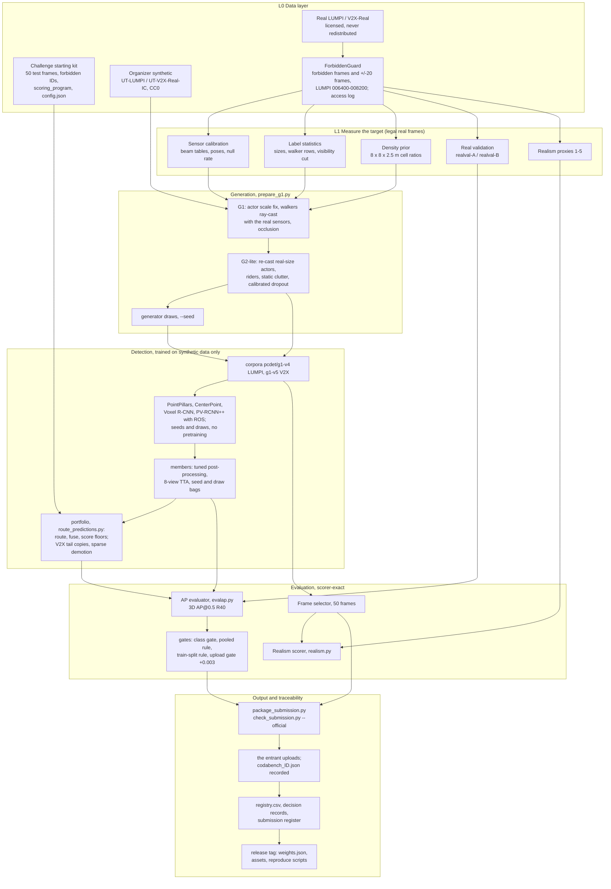
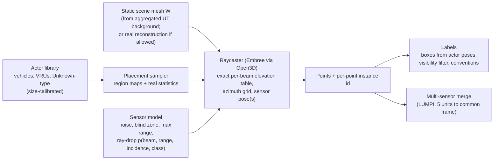
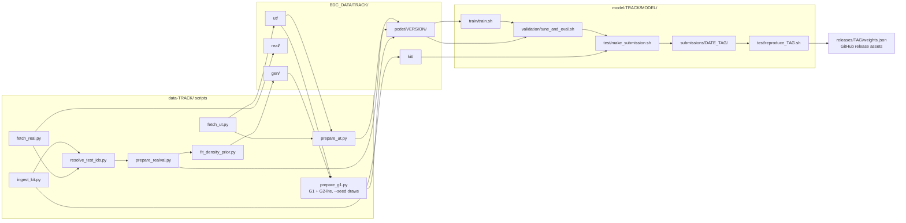

# 03. System architecture

> The target system for both tracks, as a set of modules with explicit data contracts. `04-IMPLEMENTATION-GUIDE.md` turns each module into step-by-step work packages with acceptance tests. Track-specific parameters live in the track guides: [`data-lumpi-track/README.md`](../data-lumpi-track/README.md), [`data-v2x-track/README.md`](../data-v2x-track/README.md), [`model-lumpi-track/README.md`](../model-lumpi-track/README.md), [`model-v2x-track/README.md`](../model-v2x-track/README.md).

---

## 1. Design principles

1. **Measure the target, then synthesize it.** The Rules tab allows using the real train split for hyperparameter selection and domain adaptation. We measure the real sensor (beam table, pose, ray-drop), the real scene, and the real label conventions from non-forbidden frames, and make every generator parameter a hyperparameter fitted to those measurements.
2. **A real labeled validation set is the decision signal.** Every choice (data mix, augmentation, detector, epochs, NMS, ensemble) is decided on scorer-exact AP over real non-forbidden validation frames. The detector is never trained on them. Synthetic validation is only for debugging.
3. **Ship early, then compound.** Engine G1 (below) produces a legal, competitive submission in week 1. Engines G2 and G3 add fidelity without blocking the loop.
4. **One codebase, two configs.** Everything is parameterized by a track config (sites, sensors, taxonomy, ranges).
5. **Scorer-exact everywhere.** Local AP and realism must reproduce `local_eval.py` bit-for-bit before they are trusted.
6. **Rule-safe by construction.** A single `ForbiddenGuard` sits in every real-data loader. Gray-area features are behind flags that default to off until the organizers confirm them (`01-CHALLENGE-FACTS.md` Section 10).

## 2. The pipeline at a glance (as built for S7, 2026-10-27)

The plan of Sections 3-4 was written on 2026-09-30. What was built differs in three places: **G2-lite** (R3, `common/bdc26/render/g2.py`) replaced the G2 Twin-Raycast with a scene mesh; **G3** was not built (the FAQ bars learned synthesis fitted to V2X-Real frames for prize-seeking submissions); the detectors are four OpenPCDet architectures (no VoxelNeXt or DSVT). The diagram shows the system behind the S7 entries.



Every real-data arrow passes the guard; no arrow leads from real data into a training label or a training input. The rules behind each arrow: [`01-CHALLENGE-FACTS.md` Section 3](01-CHALLENGE-FACTS.md#3-rules) and the root README Section 2.4.

## 3. Generation engines

### G1: UT+ (fast, rule-safest, week 1-2)

Start from the organizers' UT frames (a CARLA digital twin of each site) and fix what they lack.

1. **Taxonomy mapping** of the six UT classes to the track taxonomy. V2X follows the official V2X-Real super-class map (truck includes Van, Bus and TrashCan; pedestrian includes riders); LUMPI Van versus Car is decided on real val (data guides, Section 5).
2. **Coordinate alignment** of UT frames to the frame of the challenge's real frames (origin, z datum, axis orientation). A wrong frame loses realism and 3D IoU at the same time.
3. **Ray-consistent insertion** of missing classes (pedestrians and riders; V2X trash cans) into UT frames: project the frame to a range image on the sensor's beam/azimuth grid, raycast the inserted mesh with the same grid, z-buffer merge (the nearer return wins), then back-project. This is the LiDAR-Aug idea (Fang et al., CVPR 2021). For LUMPI, first attribute every UT point to one of the five sensors (their CARLA positions and uniform channel tables are in the organizers' script).
4. **Box conventions** re-fitted to the real annotation style (UT boxes are about 17% smaller in volume than human labels; riders are inside the two-wheeler box).
5. **Density protocol:** resample every frame to **50,000 points** (the organizers' protocol for real frames), for training and for submission. For V2X realism frames, keep the Ouster-style **(0,0,0) null returns** (about 31% of real points).

### G2: Twin-Raycast (main engine, week 2-3)

> **As built:** not built in this form. R3 built **G2-lite** instead ([`02-STRATEGY.md` Section 8.7.1](02-STRATEGY.md#871-r3-engine-g2-lite-review-and-plan-2026-10-11)): UT frames kept as the scene, real-size actors re-cast with Open3D and the real sensors, riders and static clutter added, dropout calibrated (corpus `g1-v4`; V2X `g1-v5` adds the R5 density prior).

A compact, fully controllable LiDAR simulator. No Unreal Engine, no RoadRunner.



Why a custom raycaster instead of CARLA:
- CARLA's `ray_cast` LiDAR spaces channels **strictly uniformly** between `upper_fov` and `lower_fov` (verified in the 0.9.16 source), has no per-beam azimuth offsets, renders pedestrians as physics capsules, and models intensity by distance only. The HDL-64E, Pandar64, PandarQT and OS1 beam tables are non-uniform or staggered.
- Importing a new site mesh into CARLA needs the Unreal editor (a source build or a 600-700 GB UE docker build). RoadRunner is not strictly needed, but the organizers' twin maps are not released, and their geometry already exists implicitly in the UT frames.
- An Embree raycaster on 255 CPU threads handles a 262k-ray frame quickly (see `04-IMPLEMENTATION-GUIDE.md` M6 for the measured throughput), gives exact per-point instance IDs for labels, and lets every sensor parameter be fitted to real data.

CARLA stays useful as a **source of traffic behaviour** if needed later. It is not on the critical path.

**Static scene W, three sources in order of preference:**

| Source | Fidelity | Rule status | Effort |
|---|---|---|---|
| (a) Background accumulated from **UT frames** (static points only), meshed or used as surfels | Organizer twin quality | Safe (synthetic source) | Low |
| (b) Background reconstructed from **real non-forbidden scans** (temporal-median occupancy, then mesh or surfels) | Highest (real geometry) | Gray: ASK first; default off | Medium |
| (c) Procedural ground plus OSM building footprints | Low | Safe | Medium |

### G3: Refine (optional, week 3-4)

> **As built:** not built. The organizers' FAQ (2026-10-14) bars learned synthesis components fitted to V2X-Real frames for prize-seeking submissions.

Learned ray-drop (a small per-ray classifier over range, incidence, beam, local geometry), or range-image refinement, fitted to real unlabeled scans. Gated: default off until the organizers confirm that fitting a generator to real scans is allowed. Expected gain is mostly realism (+0.01-0.03 R), which is worth at most about 0.01 combined.

## 4. Detection subsystem

- **Framework:** OpenPCDet (native 7-DoF box convention = challenge convention; custom-dataset path; CenterPoint, VoxelNeXt, Voxel R-CNN, PV-RCNN++ and DSVT in one place).
- **Inputs:** xyz only (realism ignores intensity and the synthetic intensity model is crude), resampled to 50k points, with (0,0,0) nulls removed inside the data pipeline.
- **Training data:** a weighted mixture of G1 and G2 corpora, with synthetic GT-sampling (copy-paste) for rare classes.
- **Domain-generalization augmentation:** random object scaling, beam/line down-sampling, random point dropout, global rotation/scale/flip consistent with the fixed roadside geometry (small rotations only, because the scene layout is fixed).
- **Model selection:** on the real validation set only.
- **Inference stack:** flip/rotation TTA, multi-seed and multi-architecture ensemble fused with 3D weighted box fusion, per-class NMS. No aggressive score thresholds (they cannot raise AP).
- **Optional (gated) domain adaptation at inference:** a static-background occupancy map built from unlabeled real train-split frames, used to down-weight detections on permanent structures. The detector weights never see real data.

## 5. Evaluation subsystem

| Component | Contract |
|---|---|
| AP evaluator | `evaluate(preds: dict[frame_id, list[Box]], gts: dict[frame_id, list[Box]], classes) -> {per_class AP3D/BEV @0.5/0.7 R40/R11, mAP}`; no difficulty filter; excludes classes with 0 GT; bit-identical to `local_eval.py` on a fixture |
| Realism scorer | `realism(syn_frames: list[np.ndarray], ref_frames: list[np.ndarray], rng=1234, cfg) -> {CD, MMD, EMD, FPD, normalized, R}`; mask then subsample exactly like `local_eval.py` |
| Realism floor | the same scorer on two disjoint real sets: the best achievable value for each metric |
| Frame selector | chooses 50 frames from a generated pool to minimize the proxy realism score, with guard-rails (Section 8 of `01`) |

## 6. Repository layout and code map

### 6.1 Layout (as built)

```
utsim2real-bdc26/
├── README.md                      # developer guide (setup, end-to-end workflow, evaluation, submission, index)
├── requirements.txt               # pinned Python requirements for .venv_ut
├── common/                        # the only shared code folder
│   ├── bdc26/                     # python package (pip install -e common)
│   ├── tools/                     # CLIs used by every track and model
│   ├── env/                       # bdc26.env, activate.sh, setup_venv_ut.sh (venv, the one environment), setup_bdc_train.sh (conda fallback)
│   ├── tests/                     # pytest: synthetic fixtures; parity with the official scorer
│   └── kit/                       # downloaded starting kits (git-ignored)
├── data-lumpi-track/              # Track 1 data: track.yaml (all track facts), scripts, README.md (data guide)
├── data-v2x-track/                # Track 2 data: same structure
├── model-lumpi-track/             # Track 1 models: README.md (model guide), registry.csv, one folder per model
│   └── <model>/                   #   README.md, model.yaml, train/, validation/, test/, submissions/<date>_<tag>/
├── model-v2x-track/               # Track 2 models (same structure)
└── docs/                          # plan (01-07), decisions/, reference/papers/
```

Placement rules:
- **Shared logic** goes into `common/bdc26/` (importable, unit-tested) or `common/tools/` (CLI).
- **Track-specific facts** (ranges, classes, class maps, sources, guard windows, density targets) go into `data-<track>/track.yaml`, never into code.
- **Track-specific data steps** are the scripts in `data-<track>/`; they read `track.yaml` and call `common/bdc26`.
- **Everything about one model** sits in `model-<track>/<model>/`: `model.yaml` (card: architecture, dataset versions, status), `train/` (OpenPCDet configs + `train.sh`; outputs in `train/output/`, git-ignored), `validation/` (`evaluate.sh`, `tune_and_eval.sh`; small JSON results tracked), `test/` (`postprocess.yaml`, `predict.sh`, `make_submission.sh`, `synthetic_ids.txt`; outputs git-ignored), `submissions/<date>_<tag>/` (one folder per CodaBench submission: `manifest.json` and `synthetic_ids.txt` tracked, `submission.zip` git-ignored).
- **Every run, evaluation and submission** appends a row to `model-<track>/registry.csv` (the report's ablation table).
- **Large data** lives under `$BDC_DATA/<track>/` (`kit/`, `ut/`, `real/`, `pcdet/<version>/`, `gen/`); see the track data guides (`data-<track>/README.md` Sections 3 and 9).
- **Documentation of a track** lives with its code: `data-<track>/README.md` (data and generator), `model-<track>/README.md` (models), `model-<track>/<model>/README.md` (one model, written by `common/tools/write_model_readmes.py`).

### 6.2 Data flow through the folders



### 6.3 Code map and build status (2026-09-30; rows M8-M12 updated 2026-10-27)

| Module | Where | Status | Next step |
|---|---|---|---|
| M0 environment | `requirements.txt`, `common/env/` (`setup_venv_ut.sh`, `activate.sh`, `bdc26.env`; conda alternative `setup_bdc_train.sh`) | **Done**: `.venv_ut` is the one environment (generation with Open3D, training, evaluation; `requirements.txt` direct pins, `requirements-lock.txt` full lock, `common/tests/test_environment.py` checks both); `bdc-train` is the conda fallback | keep both pin files in step with every install |
| M1 data + guard | `common/bdc26/{config,guard}.py`, `common/bdc26/io/{fetch,ut,lumpi,v2x,kit}.py`; `data-<track>/{track.yaml,fetch_ut,ingest_kit,fetch_real,resolve_test_ids}.py` | **Done**: UT, real data and both kits on disk; V2X forbidden IDs resolved (26 indices exact, 6 bounded to candidate scenes) | - |
| M2 frames | `common/bdc26/{frames,boxes}.py` | **Partial**: masking, null handling, organizer resampling, box geometry | Frame/density checks against the kit report (`04` M2 acceptance) |
| M3 scorers | `common/bdc26/{evalap,realism,submit,registry}.py`; `common/tools/{eval_predictions,score_realism,package_submission}.py` | **Done**: the official detection metric (VOC-style matching, R40) and realism metric reproduced bit-for-bit against the kit's `scoring_program` (`common/tests/test_official_parity.py`); validator with every server check | - |
| M4 baseline | `data-<track>/prepare_ut.py`, `common/bdc26/{prep,pcdet_export}.py`, `common/bdc26/detect/{pcdet_dataset,postprocess}.py`, `common/tools/{pcdet_build_infos,pcdet_train,pcdet_predict}.py`, `model-<track>/pointpillars-ut/` | **Done**: `pcdet/ut-v1` built on both tracks; V2X trained 40 epochs; LUMPI stopped at epoch 4 for G1 (rerun as ablation) | LUMPI baseline rerun (ablation E1/E3) |
| M5 measurement | `data-<track>/prepare_realval.py`; `common/bdc26/density.py`, `common/tools/fit_density_prior.py`; V2X OS1-64 beam table `gen/os1_64_calib_v1.npz` | **Done for both tracks**: realval-v1 (LUMPI A 1,280 / B 867; V2X A 688 / B 298), realism proxies, LUMPI class report and density prior, V2X walker prior and measured beam table | V2X density prior |
| M6 raycaster | `common/bdc26/render/lidar_sim.py` | **Prototype** (benchmarked) | `render/sensor_model.py` (SensorModel, RayDropModel), OS1 null grid, LUMPI 5-sensor merge |
| M7 actors | `common/bdc26/render/pedsim.py` (walkers: 16 ellipsoids, gait; analytic ray casting) | **Walkers done** (unit-tested; density matches real LUMPI Persons) | Riders, trash cans (V2X truck), parked vehicles; box primitive |
| M8 engine G1 | `common/bdc26/render/{pedsim,g1}.py`, `common/bdc26/prep.py` (`inserter` hook, calibrated resampling), `data-<track>/prepare_g1.py` | **v1-v3 done**: LUMPI `g1-v1..v3` (walker v1/v2, density calibration); V2X `g1-v1..v3` (`g1-v3`: real placement and ground, FOV mask, measured beams, density gain 2.5 calibrated per range) | done in G2-lite (M9): true-scale actors, riders, static clutter |
| M9 engine G2 | `common/bdc26/render/g2.py` (G2-lite), `data-<track>/prepare_g1.py` | **G2-lite done (R3)**: real-size actors re-cast with Open3D and the real sensors, riders, static clutter, calibrated dropout; corpora `g1-v4` (both tracks) and `g1-v5` (V2X, R5 density prior); fresh draws with `--seed` (S7.4/S7.5). The Twin-Raycast scene mesh was not built | - |
| M10 detector v2 | `model-<track>/<model>/` via `common/tools/new_model.py` | **Done**: CenterPoint (stride 8 and 4), Voxel R-CNN and PV-RCNN++ beside PointPillars, class-wise object scaling (ROS), seeds and generator draws; seed bags (`common/tools/bag_predictions.py`, folders `bag-*`) | - |
| M11 inference | `common/bdc26/detect/postprocess.py`, `common/tools/tune_postprocess.py`, `common/tools/route_predictions.py`, `model-<track>/<model>/validation/tune_and_eval.sh` | **Done**: per-class NMS, score floor, re-centering, size calibration, z offset, hedges; 8-view TTA; per-class routing, cross-architecture weighted box fusion, score floors, z calibration, V2X tail copies and sparse-box demotion (S7), the LUMPI Van judge; gates in `pooled_check.py` and `s7_check.py` | - |
| M12 selection + packaging | `common/tools/{select_realism_frames,package_submission,check_submission,reproduce_submission,reproduce_validation,release_weights}.py`, `model-<track>/<model>/test/make_submission.sh` | **Done**: frame selection against legal proxies; one command from predictions to a validated zip; the kit scorer check; reproduction scripts per scored version; release weights as GitHub assets (6.0, 7.0) | the 4-8 page report (`paper-bigdata2026/`) |

## 7. Core data contracts

```python
# Point cloud: np.ndarray float32 [N, 3] (x, y, z) or [N, 4] (+intensity), metres, in the TRACK frame
# (the frame of the challenge's real test frames). Optional sidecar arrays: instance_id int32 [N],
# sensor_id uint8 [N], beam_id int16 [N].

@dataclass
class Box3D:              # OpenPCDet / challenge convention
    x: float; y: float; z: float        # box centre, metres, track frame
    dx: float; dy: float; dz: float     # full extents (length, width, height)
    heading: float                      # radians about +Z, from +X
    cls: str                            # track class string
    score: float = 1.0
    n_points: int = -1                  # LiDAR points inside (for visibility filtering)

@dataclass
class Frame:
    frame_id: str
    points: np.ndarray
    boxes: list[Box3D]
    source: str               # "real" | "ut" | "g1" | "g2" | "g3"
    meta: dict                # sensor poses, generator config hash, seed

@dataclass
class SensorModel:
    name: str
    elev_deg: np.ndarray      # per-beam elevation angles [n_beams]
    az_offset_deg: np.ndarray # per-beam azimuth offsets [n_beams]
    n_cols: int               # azimuth samples per revolution
    min_range: float; max_range: float
    range_noise_std: float
    pose: np.ndarray          # 4x4 sensor-to-track transform
    drop_model: "RayDropModel"
```

## 8. Where each score component is won

Module numbers refer to `04-IMPLEMENTATION-GUIDE.md` (where each lives: Section 6.3):
M0 environment, M1 data + guard, M2 frame conventions, M3 scorers + validator, M4 baseline detector, M5 measurement, M6 sensor model + raycaster, M7 actors + labels, M8 engine G1, M9 engine G2, M10 detector v2, M11 inference stack, M12 frame selection + packaging + report.

| Score driver | Modules |
|---|---|
| Missing classes (largest single lever) | M7 actors (procedural humans and cyclists), M8 insertion (G1), M9 generation (G2) |
| Box accuracy at IoU 0.5 (z, height, heading) | M2 frames, M5 label statistics, M7 label conventions, M10 detector |
| Vehicle-class AP | M10 detector + DG aug, M11 inference stack |
| Realism R (EMD-dominated) | M2 frame alignment, M5 calibration, M6 sensor model + ray-drop, M9 scene, M12 frame selection |
| Not losing points to bugs | M1 guard, M3 scorers + validator |
