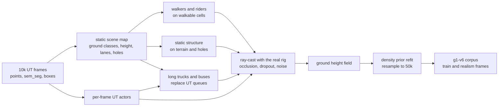

# 2026-11-02 S9 plan: Clean Twin v6, a re-composed synthetic twin and new members

**Version.** S9 starts from the S8 entries:
- LUMPI 1022492 (`routed-g11d` / `s8d`, 0.525688);
- V2X 1022246 (`routed-g13` / `s8v`, 0.902153).

Both rank 1. This record is the plan, written and pre-registered before any S9 run. Results go in Section 14.

**Why now.** The organizers extended the development phase to **2026-11-06 04:59 UTC** (Thu Nov 5, 22:59 CST), at 10 uploads per day. That leaves about 99 hours with leaderboard feedback, enough for one new synthetic corpus and three to four training waves per track.

**Sources.**
- The CodaBench public API, read 2026-11-02 01:25 UTC.
- The organizers' notices of 2026-10-31 (both tracks).
- The organizers' reply of 2026-10-31 to the entrant's declaration email.
- New probes on legal frames and synthetic data (Section 3).

## 1. What changed since the S8 compliance review

| Item | Before | Now (API, 2026-11-02) | Consequence |
|---|---|---|---|
| Development phase | closed Nov 1 00:00 UTC | **open until 2026-11-06 04:59 UTC**, 10 per day, 100 in total | complete-system uploads get scored feedback until Nov 5 |
| Final phase | Nov 1 to Nov 15 | **LUMPI 2026-11-06 05:00 to 11-16 04:59 UTC; V2X 2026-11-06 05:00 to 11-15 04:59 UTC**; 1 per day, 5 in total, hidden scores, `Force_Best`, 1,200 s | F1 opens Thu Nov 5, 23:00 CST. Anything uploaded since Nov 1 went to development |
| Declaration | in every zip; Q5 open | the organizers confirmed receipt of the emailed declaration (2026-10-31): "no further action is needed"; adding it to the zip is optional | Q5 answered. Disclosure items (a)-(h) and Q1-Q4 are still unsent |
| Competition | LUMPI 2nd 0.5118 | **LUMPI:** Raj Patil 0.5118, dipper13579 0.5073 (Nov 1), sadbodh 0.4903 (Nov 1). **V2X:** Raj Patil 0.8112, linyongchun 0.7811, sadbodh 0.7785 (Nov 1) | three LUMPI teams are active; both LUMPI challengers sit at R of about 0.942 |
| Compute | | 8 idle A6000 GPUs, 255 CPUs, 682 GB free | about 700 GPU-hours to the development close |

## 2. Where the points are

**The score arithmetic.**
- **Detection.** LUMPI combined = 0.857 mAP + 0.4 R over 7 classes, so +0.01 AP on one class is **+0.0012 combined**. V2X has 3 classes, so +0.01 AP is **+0.0029** (mAP is capped at 0.7; ours is 0.617).
- **Realism.** With CD below 2 and MMD near 0 (true on both tracks), R = 1 - (EMD/5 + FPD/50)/4 (`bdc26.realism.NORM`).
  - EMD -0.1 is +0.005 R, or **+0.002 combined**; FPD -1.0 is the same.
  - **V2X CD is 1.986.** CD above 2.0 starts a new penalty, so the realism gate must hold CD below 2.

| # | Gap | Evidence | Lever (S9) | Value if closed (est.) |
|---|---|---|---|---|
| G1 | **LUMPI Truck 0.065** (192 test boxes, 3.8 per test frame) | 29% of legal real trucks are 12-20 m; synthetic trucks are shortened to the free road in UT queues. False long trucks stand at tall static structures. Truck changes transferred with the right sign at 0.3-0.8 x B (S5, R3, S7.6) | full-length procedural trucks and buses that **replace** UT queues; tall static hard negatives | Truck 0.065 -> 0.10-0.15: **+0.004 to +0.010** |
| G2 | **LUMPI realism, R 0.932 against about 0.942** for both challengers | R is entirely EMD (1.30). New probe (Section 3): ground height, holes in the twin, and the 0.3-0.5 m band | ground height field, ground and structure where the twin has none, density prior refit, frame selection | EMD 1.30 -> 1.15: **+0.003** |
| G3 | LUMPI Person 0.188 against 0.34-0.40 on realval-A | label provenance drifts toward automatic boxes in late Measurement4 (R5 review); static false positives | no convention change (R5: none is safe); hard negatives, label-free walkers with matched density | +0.01 to +0.02 AP: +0.001 to +0.002 |
| G4 | V2X pedestrian 0.443 | remaining errors are ranking and misses: 5.1 unmatched confident boxes per frame on B; random centre error 0.16-0.22 m | walker and rider content, hard negatives in walkable areas, a new architecture family for fusion diversity | +0.01 to +0.03 AP: **+0.003 to +0.009** |
| G5 | V2X realism R 0.933: FPD 1.47 on the server against 0.73 before R5 | local proxies miss the reference's moments | the v6 ground and structure, FPD and moments in the frame objective | **+0.001 to +0.003** |
| G6 | **Compliance: walker placement copies real label rows** (audit item 4, moderate), real size priors, clutter placed near real walker positions | FAQ: "never ... real labels (or derivatives) as ground truth for training" | **label-free placement from the twin's own semantic map**; sizes from public datasheets and anthropometric tables | lowers the one moderate rules risk before the Nov 20 verification |
| G7 | Model family saturation | seeds and generator draws of Voxel R-CNN / PV-RCNN++ add under 0.002 inside the fused portfolio (S6, S7.4-7.5); architecture diversity helped fusions (S3-S5) | VoxelNeXt (in the installed OpenPCDet 0.6, no new dependency); fade of GT sampling; small pitch/roll augmentation | +0.001 to +0.005 on the classes it joins |

**Not targeted:**
- LUMPI Bicycle, Motorcycle and Bus stay frozen. No local split has predicted them (S5, R3, R5).
- LUMPI Car changes only through the pooled floor-bound rule (S7.6); it has failed to transfer twice.

## 3. New measurements for this plan (2026-11-02; legal frames and synthetic data only)

1. **The twin carries its own scene map.** Every UT frame has per-point CARLA semantic tags (`sem_seg`), and the roadside rig never moves. Aggregating 200 frames per track gives a static map of the twin:
   - **LUMPI:** road 9,882 cells; terrain 12,331; sidewalk 67; road line 45 (0.5 m cells).
   - **V2X:** road 5,909; terrain 5,437; sidewalk 793; road line 97.

   The twin has **no** buildings, vegetation, poles or fences. Within 1 m of a synthetic sidewalk, terrain or road-line cell lie:
   - 76.5% of legal realval-A Person positions (LUMPI);
   - 68.0% of legal pedestrian positions (V2X).

   On LUMPI, 41% of the positions lie in cells where the twin has no points at all. This was a validation check of a placement design; no real position is copied.
2. **LUMPI realism is a ground-height and coverage gap.** Measured on our S8 frames against legal proxies 1-5 (40 m box, nulls removed):
   - **Height bands** above the 5th-percentile ground:
     - 0.3-0.5 m holds 18.5% of real points and 7.4% of ours;
     - below 0.3 m, 49.2% real and 58.8% ours.
   - **Ground height per 4 m cell:** the real ground is lower than ours by 0.2 m or more in cells holding 22% of the real mass. The median offset is -0.03 m at 10-20 m, -0.12 m at 20-30 m and -0.17 m beyond 30 m. The twin is flatter than the site.
   - **Coverage on 2 m cells:** 10% of the real mass lies where we have under 10% of the real density. Half the L1 mass difference is 0.275 (0.181 on 4 m cells).

   The range quartiles match (17-30 m on both). So this is placement and height of mass, not overall density. The 8 x 8 x 2.5 m density prior can neither add mass to empty cells nor move ground by 0.2 m. The R5 attribution (44% of excess transport in the ground band) now has a mechanism.
3. **V2X bands match** within 0.01 in every height band. The V2X gap is horizontal: 8% of the real mass sits in 2 m cells where we have under 10% of the real density, and 6.4% of our mass sits where the real frames have little.
4. **Competitors' realism.** Raj Patil (0.5118, mAP 0.1575) and dipper13579 (0.5073, mAP 0.1522) both imply R of about 0.942, or EMD of about 1.1. Our detection lead is 0.021-0.026 mAP (+0.018 to +0.022 combined); our realism deficit costs 0.004.
5. **Training cost** (measured, 40 epochs, total batch 16 on 4 GPUs):
   - LUMPI: Voxel R-CNN-ROS 4.7 h, PV-RCNN++-ROS 3.7 h;
   - V2X: both families 2.9 h;
   - corpus build: 5-12 min for 10,000 frames on 96 workers.

## 4. Hypothesis

The next level comes from a **re-composed twin**, not from more draws of the same recipe.
- A roadside rig never moves, so the 10,000 UT frames define a complete synthetic map of each site: ground classes, ground height, lanes from UT actor tracks, and the free space around them.
- On that map we can compose each training frame freely:
  - walkers and riders where the map is walkable;
  - full-length trucks and buses where UT queues stand;
  - static structure where the twin has bare terrain or nothing;
  - a ground surface at the site's height.

  Each item comes from synthetic data, public datasheets or a disclosed scalar calibration.
- Members trained on that corpus attack G1, G3 and G4 and add diversity to the fusion. Frames from it attack G2 and G5. Label-free placement closes G6.

## 5. The synthesis-to-model chain: what S9 changes at each layer

| Layer | Now (`g1-v4` / `g1-v5`) | S9 (`g1-v6`) | Real-data use in S9 | Check before training |
|---|---|---|---|---|
| Scene map | none (per-frame UT points only) | static BEV map per track from aggregated `sem_seg` (road, sidewalk, terrain, road line, holes), ground height field from UT ground points, lanes and headings from UT actor tracks (`lbl`) | none | map coverage within 40 m |
| Ground | UT ground as rendered | (a) **random smooth ground warps** (training augmentation, ±0.3 m over 40 m). (b0) **first, per-sensor pitch, roll and height scalars** (15 constants for LUMPI's 5 sensors), fitted to the ground-ring radii and ground-band thickness of legal realval-A frames: ring radius is h / tan(elevation), so a few tenths of a degree move far ground by the measured 0.12-0.17 m (audit rule e prefers constants). (b) **a ground offset field** on 4 m cells, only if (b0) leaves more than half of the measured offset; fitted on 400 legal realval-A frames disjoint from every proxy, applied to ground points and to everything standing on them | (b0) and (b) the same data as the density prior (audit item 19, disclosed) | per-cell offset quantiles against the held-out proxies |
| Static structure | Poisson(30) poles, trees, bollards, boxes, bins, barriers; 60% near real walker positions | **map-placed** hedges, fences, low walls, bushes, tree rows, shelters and kiosks on terrain and hole cells next to sidewalks; facades at the 40 m edge; no placement from real positions | none | 0.3-3 m band shares and BEV mass against the proxies (realism only) |
| Walkers | body v2 (ellipsoids), pose and box copied from a jittered real label row | the same body; **positions sampled on walkable map cells** (sidewalk and terrain within 3 m of road, crosswalk segments, 10% on road), groups of 1-4, headings along the sidewalk or across the road; stature and girth from public anthropometric tables | the box-to-body margins as per-class scalars chosen on realval-A (audit rule b) | position-matched points per box and per-range counts against legal real (as in `g1-v3`) |
| Riders (V2X pedestrian) | UT two-wheelers where present | bicycle, scooter and motorcycle riders at scalar shares on the same map | the shares as scalars | the same as walkers |
| Long vehicles | UT trucks extended to real label sizes when the road is free; convex-hull re-cast (a closed solid) | **procedural, non-convex meshes**: rigid trucks 7-12 m, tractor and semitrailer 16.5 m with a kingpin yaw up to ±25° and the visible gap, drawbar 18.75 m, city bus 12 m, articulated bus 18 m, refuse trucks 8-10 m (V2X `TrashCan`), vans. Each has **an open underbody, wheel gaps and see-through glass** (rays pass the windows to the cabin interior or beyond). A closed hull is a wall, the signature of the static structures where false long trucks fire. Each vehicle **replaces** a UT queue: actors whose boxes lie inside the new vehicle are removed (their shadows lie inside its shadow), then it is ray-cast with the real rig. One box per combination (check the convention on legal frames in S0) | none: sizes from EU limits (96/53/EC) and public manufacturer datasheets | length histogram per class; points per box position-matched |
| Sensor | real beam tables, per-class ray dropout, range noise | unchanged; re-used for every inserted object | unchanged (beam tables: item 19) | as in R3 |
| Density | 8 x 8 x 2.5 m keep-probability prior | refit to the `g1-v6` output by iterative proportional fitting (R5 method), after the ground and structure changes | as now (item 19) | random 50-frame draws on proxies 1-3 only |
| Labels | `min_points: 1`; LUMPI keeps box sizes per actor | unchanged conventions: no regime or visibility change at training (R5 and S7 step 2 showed none is safe) | none new | |
| Corpus | 9,000 train frames per draw | two draws of `g1-v6` (seeds 1234 and 2234) | | the provenance card lists every real-data use |
| Training | 40 epochs, GT sampling throughout, yaw-only rotation | the same, plus **GT-sampling fade** (no copy-paste in the last 5 epochs) and **pitch/roll of ±1.5°**, adopted only if the Day 0 arm passes | none | Day 0 arm (WP-M1) |
| Architectures | PointPillars, CenterPoint, Voxel R-CNN, PV-RCNN++, GBlobs | plus **VoxelNeXt** (fully sparse, centre-based), adopted only if the Day 0 arm passes | none | member checks of S6 |
| Inference | 8 or 12 views; tail copies; floors; V2X sparse demotion | unchanged machinery; 12 views for the walker members of `g1-v6`. **WP-C1:** LUMPI Person tail copies at the automatic-label box size, scored below every original box. These are non-negative by construction, and S8 copies used only shifts; they must fit the 390 s kit bound, so the copy mix is chosen on realval-A | none | bar (b), kit time |
| Fusion | per-class routing and fusion, pooled gates | the same, with the S9 members added as candidates | realval A and B, as before | Section 8 |
| Realism frames | `g1-v4` (LUMPI), `g1-v5` (V2X) | `g1-v6` validation split, the FPD+EMD objective on proxies 1-3 | as before | Section 8 rule 4 |

## 6. Three plans

| Plan | Scope | GPU-h | Expected (LUMPI / V2X combined) | Risk |
|---|---|---|---|---|
| **A, recommended: Clean Twin v6** | Sections 4-5 in full; new members on `g1-v6` (Voxel R-CNN-ROS and PV-RCNN++-ROS, 2-3 seeds each, VoxelNeXt if the arm passes); `g1-v6` realism frames | about 550 | **+0.004 to +0.013 / +0.003 to +0.012** | the generator takes the first day. The label-free walkers may score below the label-row ones locally; the gates then keep the old walker members, and long vehicles, structure and realism still count |
| B, increments on the current twin | the `g1-v5` recipe plus long vehicles, structure and ground only; label-row walkers stay | about 450 | +0.003 to +0.010 / +0.002 to +0.008 | less code. Leaves audit item 4 as it is, and every new member deepens it |
| C, no training | realism frames from a structure-and-ground variant used only for frames; 20-view walker TTA | about 30 | +0.001 to +0.003 / +0.000 to +0.001 | frames from a generator that trains nothing were ruled out in S1 ("metric-only"); C is acceptable only if those frames also train a submitted member, which makes it A or B |

**Recommendation.**
- **Plan A, staged.** Corpus `g1-v6a` carries the map, label-free walkers and datasheet sizes. Corpus `g1-v6` adds long vehicles, structure and ground.
- If `g1-v6` is not built by 19:00 UTC on Day 0, wave 1 trains on `g1-v6a`, and `g1-v6` moves to wave 2.
- The Day 0 GPU arm (WP-M1) runs on the existing corpora while the generator is written, so no GPU idles.

## 7. Work packages and schedule (Plan A)

| WP | What | Where | Start (UTC) | Output | Decision it feeds |
|---|---|---|---|---|---|
| **M1** | VoxelNeXt-ROS and Voxel R-CNN-ROS + fade + pitch/roll on `g1-v4` (LUMPI) and `g1-v5` (V2X) | GPUs 0-3 LUMPI, 4-7 V2X, two runs per track in sequence | Nov 2, 04:00 | 4 members, plain and 8-view | VoxelNeXt and the recipe join the `g1-v6` waves only if each passes the S6 member check (pooled P >= 0.9 on a class, as a candidate against its family's incumbent) |
| **S0** | diagnostics on legal frames: Truck misses by length and false trucks by nearest structure; EMD attribution of the S8 frames by band, cell and twin tag; V2X pedestrian misses by range, points and type | CPU | Nov 2, 04:00 | `$BDC_DATA/logs/s9/s0_*` | the v6 parameters (structure share, truck mix), fixed before the corpus build |
| **G1** | static scene map and ground height field from UT (`common/bdc26/render/scene_map.py`) | CPU | Nov 2, 05:00 | `gen/scene_map_v1.npz` per track | |
| **G2** | label-free walkers and riders on the map (`prepare_g1.py --placement map`) | CPU | Nov 2, 07:00 | `g1-v6a` at stride 10, then in full | |
| **G3** | procedural long vehicles with queue replacement (`render/vehicles.py`) | CPU | Nov 2, 09:00 | `--long-vehicles` | |
| **G4** | map-placed structure, ground field, density prior refit | CPU | Nov 2, 12:00 | `gen/ground_offset_v1.npz`, `gen/density_prior_v6.npz` | |
| **G5** | `g1-v6` builds (2 draws per track), provenance cards, realism random draws (proxies 1-3) and the frame selection | CPU | Nov 2, 16:00 | `pcdet/g1-v6`, `pcdet/g1-v6d2` | wave 1 corpus |
| **W1** | `voxelrcnn-ros-g1v6`, `pvrcnnpp-ros-g1v6` per track | all 8 GPUs | Nov 2, 19:00 | 4 members, plain and TTA | first S9 portfolio |
| **W2** | seeds s2 of both families; `voxelnext-ros-g1v6` (if M1 passes) | all 8 | Nov 3, 04:00 | 4-6 members | bags |
| **W3** | seeds s3 (or the `g1-v6d2` draw); LUMPI `pointpillars-ros-g1v6` | all 8 | Nov 3, 14:00 | 4-6 members | bags |
| **W4** | the best family on both draws (18,000 frames, 40 epochs); 12-view TTA for the walker members | all 8 | Nov 4, 04:00 | 2-4 members | final portfolio |
| **P** | portfolios `routed-g12` (LUMPI, from `routed-g11d`) and `routed-g15` (V2X, from `routed-g13`) with the S6-S8 machinery; package, kit check, scorecard, reproduction | CPU and 1 GPU | after each wave | candidate zips | uploads (Section 9) |

**Calendar** (UTC; CST = UTC-6):
- **Mon Nov 2:** M1 and S0 from 04:00. Generator G1-G4 until about 16:00, the corpus builds and realism checks until 19:00, then W1 starts.
- **Tue Nov 3:** W1 done about 00:00 (V2X) to 03:30 (LUMPI). TTA tuning, then the first portfolio around 10:00. **First S9 uploads:** the realism-only zip if rule 4 passes, and the W1 portfolio if it passes the gates. W2 and W3 train.
- **Wed Nov 4:** the bag portfolio and its uploads; W4 trains.
- **Thu Nov 5:** the last training ends by about 10:00 UTC. The final portfolio, reproduction dry-run (an idle GPU) and the **last development uploads by 22:00 UTC (16:00 CST)**: 7 hours before the close, at 6-10 min of server time per zip.
- **Fri Nov 6, 05:00 UTC (Thu Nov 5, 23:00 CST):** the final phase opens. F1 = the best confirmed development zip per track (Section 9).

All runs go through detached chains with an event log and a status file, as in S7 and S8 (`common/pipeline/s9_portfolio.sh`, `$BDC_DATA/logs/s9`).

## 8. Pre-registered rules (written 2026-11-02, before any S9 run)

1. **Class gate:** the 6.0 pooled rule (pooled A+B P >= 0.9, neither split down by more than 0.005), with the train-split result reported (audit rule a). Then the final pooled gate against the entry (`gate --vs routed-g11d` / `--vs routed-g13`), bar (b) (projection > 0) and the kit check under 400 s.
2. **Frozen:** LUMPI Bicycle, Motorcycle and Bus keep their S8 configuration. LUMPI Car changes only through the pooled floor-bound rule of S7.6. LUMPI Person candidates are ranked by late-A AP (the R5 rule).
3. **Members first:** a new member enters the portfolio search only after the S6 member check against its family's incumbent on the same classes. A failed member is recorded and not tried again with other settings.
4. **Realism frames** change only if, on the held-out proxies (4, 5 and late 1-3):
   - R gains at least 0.003 on average (the R2 rule);
   - CD, MMD and FPD are not worse;
   - **V2X CD stays below 2.0**.

   The frames must come from a corpus that trains a submitted member.
5. **Generator choices** (structure share, truck mix, ground field, prior steps) are made on synthetic checks and on realism proxies 1-3 only. Detection data never chooses a generator parameter after its members are trained.
6. **Leaderboard:**
   - **Upload limits:** at most 3 complete systems per track per day, each with its projection recorded before upload.
   - **Choosing:** the choice between scored systems uses the combined score only. No class, member or parameter is chosen from leaderboard per-class numbers (audit rule d).
7. **Compliance:** every `g1-v6` corpus carries a provenance card listing its real-data uses (Section 10). No real label row and no test frame enters the generator. Test frames are used for inference and kit checks only.

## 9. Uploads: development (to Nov 5) and the final phase

**Development** (10 per day; we use at most 3 per track per day under rule 6):

| When (UTC) | Candidate | Contents | Pass condition |
|---|---|---|---|
| Nov 3 | `s9r` (LUMPI, V2X) | the F1 predictions with `g1-v6` realism frames | rule 4 |
| Nov 3-4 | `s9a` | the W1 portfolio (with the `s9r` frames if they passed) | rules 1-3 |
| Nov 4-5 | `s9b` | the W2-W4 bag portfolio | rules 1-3 |
| Nov 5 by 22:00 | final development entry | the best scored complete system per track | the combined score |

**Final phase** (the 2026-10-31 plan, moved to the new dates):
- **F1** on Nov 6 (UTC): the best confirmed development zip per track, unchanged.
- **F2-F4:** only for versions that finish after the development close and pass every gate. Under `Force_Best` an unconfirmed candidate costs only a slot.
- **F5:** the F1 zips again on the last full day (LUMPI Nov 15, V2X Nov 14 UTC), unless the organizers answer Q3 "best counts".
- The final phase ends a day earlier on V2X than on LUMPI (API).

## 10. Compliance: what S9 changes against the rules

| Change | Clause | Assessment |
|---|---|---|
| Label-free walker and clutter placement from the twin's own semantic map | FAQ "real labels (or derivatives) as ground truth" | **removes** the audit item 4 derivative for every `g1-v6` member |
| Datasheet and anthropometric sizes for trucks, buses and walkers | as above | **removes** the label-derived size prior for `g1-v6`. The ROS size ceilings stay scalar quantiles of legal labels (rule b) |
| Ground offset field on 4 m cells from legal realval-A frames disjoint from the proxies | Rules: train split for hyperparameter selection; audit item 19 | the same kind and granularity as the density prior (400 cell scalars, no labels). **Disclose** it next to item 19; option (a) of Section 5 is the label-free alternative if the organizers object |
| VoxelNeXt, fade, pitch/roll | "any 3D object detector ... trained on your synthetic data only" | none |
| Uploads up to 3 per track per day | 10 per day; rule d | complete systems only; projections recorded first |

**Never in S9:**
- training on any real frame, including pseudo-labels or batch-norm statistics from real or test clouds;
- a generative model fitted to real frames;
- realism frames from a generator that trains nothing;
- any statistic of the test frames;
- downloading reference bundles.

The disclosure email, if sent, gains a line for the ground field and for the label-free placement (an improvement to state, not a risk).

## 11. Risks and fallbacks

| Risk | Sign | Fallback |
|---|---|---|
| The generator slips past 19:00 UTC on Day 0 | G3 or G4 unfinished | W1 on `g1-v6a`; long vehicles and structure in W2 |
| Label-free walkers score below the label-row walkers | the W1 member check on Person or pedestrian fails | the walker classes keep their S8 members (rules 1-3); the other classes and realism continue |
| Queue replacement makes false long trucks | a Truck false-positive rise on realval A or B | Truck keeps its S8 route |
| A realism gain that does not hold out | rule 4 fails on 4-5 or late | the S8 frames stay |
| V2X CD crosses 2.0 | the rule 4 check | the S8 frames stay |
| Out of memory from running TTA next to training | failed TTA job | one job per GPU; TTA between waves (R3 lesson) |
| Nothing passes | | the S8 entries stay the F1 zips. S9 costs GPU time only |

## 12. Literature behind the levers

**Sources.**
- Levers already in use, with their references in `docs/07-LITERATURE.md`: ROS [R40], LiDAR augmentation [R9], ray-cast insertion and G2-lite (R3), and the density prior (S1, R5).
- New sources come from the 2026-11-02 literature pass. Numbers marked "read" were taken from the paper page in that pass; the others are from memory and are to be checked before the report cites them.

| Source | Finding | Use in S9 |
|---|---|---|
| Synth It Like KITTI (ROBOVIS 2025, arXiv 2502.15076) | **Synthetic-only training:** Voxel R-CNN on KITTI Car (3D AP@0.7, moderate) goes 53.95 -> 62.77 when glass passes rays instead of returning the first hit (read). Visibility-dependent box shrinking gives 37.27 -> 62.77 (read). Gaussian range noise is neutral (read) | non-convex long vehicles with glass and open underbodies (Section 5). The box-convention result is the kind of change R5 found unsafe for LUMPI Person, so labels stay unchanged |
| Eskandar et al. (CVPR 2024, arXiv 2402.17562) | **Cross-domain:** GT sampling lowers cross-domain AP (PV-RCNN Waymo -> nuScenes Car 20.36 -> 15.86; KITTI-64 -> KITTI-16 pedestrian 27.13 -> 14.45; read). Taller voxels help low-resolution targets (read). Centre-based heads are no better than anchor-based ones under location shift | **supports the fade arm in M1.** If fade passes, a "no GT sampling" arm is the next recipe test. Taller voxels are a spare arm |
| PointAugmenting, TransFusion and the RoboSense 2025 winner | fade: no pasting in the last 5 epochs; about +1.3 mAP (from memory) | M1 recipe arm |
| Manivasagam et al. (ICCV 2023), Synth It Like KITTI | small pitch, roll and mount-height errors move ring radii and object distributions strongly (qualitative, read) | ground option (b0): per-sensor scalars before a cell field |
| A LUMPI entrant's write-up (arXiv 2609.07590, as reported by the pass) | global affine searches did not lower EMD; radial-density matching did. Real-vs-real EMD on 10,000-point subsamples is about 0.9-1.0 | per-sensor radial density as a candidate density-prior form in G4; EMD 1.0 is our floor (R5 measured 0.93-1.03) |
| Diversity studies (for example arXiv 2509.11201, another domain) | more scene types beat more scenes of the same types (summary) | the S9 premise: new recipe axes, not more draws (S7.4-7.5 saturation) |
| PDDA (ECCV 2024, arXiv 2311.10845); Eskandar line downsampling | beam-density resampling gains across densities (nuScenes -> KITTI 3D mAP 18.50 -> 24.08; read). Its test-time encoder update is **not allowed** | spare arm for far cars (synthetic far cars are at 0.6 x real density). Not in the main waves, because our training density already matches the test frames |
| TransFusion-L / BEVFusion-L, SAFDNet, DSVT, VoxelNeXt | no published cross-domain numbers for the sparse transformers. GBlobs plus TTA on BEVFusion-L won the RoboSense 2025 cross-placement track on CARLA data (read) | VoxelNeXt first (no new dependency); TransFusion-L is the second family if VoxelNeXt fails its check |
| GBlobs RoboSense report (arXiv 2510.18539) | GBlobs leads up to about 28 m and falls off beyond (read) | a range-gated route for the GBlobs members is a CPU-only candidate in P, through the pooled gate |
| SWAD (NeurIPS 2021), model soups (ICML 2022) | weight averaging improves domain generalization (from memory) | low value with one-cycle schedules (the last epochs barely move); not planned |

**Considered and not planned for these four days:**
- SMPL-X walkers and riders (12-20 h);
- per-sensor sweep-time motion (the LUMPI smear is secondary);
- beam-divergence edge points (a small expected gain);
- 3D-VField and the sparsity-invariant teacher-student (20-30 h);
- SPG completion (25-40 h).

**Not allowed by the rules:**
- learned ray-drop or translation networks fitted to real scans;
- meshes or neural fields reconstructed from real frames;
- real backgrounds;
- LiDAR diffusion models pretrained on real scans;
- TENT, AdaBN, ST3D and every self-training on real or test clouds;
- MS3D pseudo-labels.

## 13. Decisions for the entrant

1. **Go for Plan A**: start M1 and S0 now, then the generator. B is the alternative if any change to walker placement is unwanted.
2. **The ground correction**: per-sensor scalars first (b0), then the cell field (b) only if needed, both with disclosure (recommended). The alternative is the random-warp augmentation (a) alone.
3. **The disclosure email**: still recommended before the final phase. It would carry the ground field and the label-free placement besides (a)-(h).

## 14. Results

### 14.1 Start, S0 and the generator decisions (2026-11-02, 01:50-02:10 UTC; before any S9 model result)

The entrant chose Plan A ("Start Plan A") with the recommended ground option. Run directory: `$BDC_DATA/logs/s9` (`STATUS.md`, `events.txt`; event times are server time, UTC-8).

**M1 started at 01:48 UTC:**
- `voxelnext-ros-g1v4` and `voxelrcnn-rosf-g1v4` on GPUs 0-3;
- `voxelnext-ros-g1v5` and `voxelrcnn-rosf-g1v5` on GPUs 4-7.

All four ran 6-minute smoke trainings first. Two code changes:
- OpenPCDet's `VoxelNeXtHead.assign_targets` has the same in-place relabeling as `CenterHead` (S2), so the S2 runtime fix now covers it (`pcdet_patches.py`).
- The fade uses OpenPCDet's own `DisableAugmentationHook`, and the tilt is `bdc_world_tilt` (`augment.py`).

**S0, LUMPI Truck (legal realval, the entry's routed predictions at score >= 0.3).** This changes the Truck lever of Section 5.

| Real truck length | A: boxes | A: recall (BEV IoU >= 0.5) | B: boxes | B: recall |
|---|---|---|---|---|
| under 8 m | 451 | 0.15 | 954 | 0.09 |
| 8-12 m | 497 | 0.70 | 357 | 0.72 |
| 12-16 m | 213 | 0.73 | 95 | 0.54 |
| 16-25 m | 176 | 0.97 | 72 | 0.88 |

- Long trucks are already found. The misses are the **short "trucks": transporters and box vans** (median 5.75 x 2.21 x 2.23 m on A). We find most of them, but as Car (224 of 451 on A, 463 of 954 on B) or Van (48, 90).
- The twin's `Van` class is exactly this vehicle (median 5.92 x 1.99 x 2.43 m), while real M4 vans are smaller (4.84 x 1.99 x 1.95 m). This is a class-convention gap.
- **Inference hedge (no training).** Truck copies of large Car and Van boxes, scored below every Truck box, add +0.0005 to +0.0009 Truck AP on A and +0.0012 to +0.0053 on B. Tail hedges stay saturated (S6), so the detector must learn the convention.
- **Decision:**
  - The `g1-v6` labels follow the LUMPI convention as four size thresholds, fitted on legal realval-A label sizes: Truck if l >= 5.6 m or h >= 2.40 m; Van if l >= 4.6 m and h >= 2.00 m; else Car. On real labels this keeps 97.7% of the trucks and 93.9% of the cars in their class; vans are ambiguous by size (37.5%).
  - Smoke frames: 6.3 boxes relabeled per frame, so trucks per frame go from 2.8 to 5.3.
  - The queue-replacing long vehicles are **dropped**: long trucks are already found.
  - V2X needs no change: its convention already maps Van to truck.

**Ground.**
- The 5-constant surface a + bx + cy + dr + er² (`gen/ground_bowl_v1.json`) lowers the weighted per-cell ground error from 0.146 to 0.113 m on LUMPI, and from 0.31 to 0.25 m on V2X.
- Applied to the S8 frames, it changes realism on the fit proxies 1-3 by +0.0000 on LUMPI (0.9355 both) and -0.0022 on V2X.
- By rule 5 it is **not used**, which removes one real-data use. The ground error is real but not what EMD sees.

**Label-free walkers.**
- The map gives each walker the twin's local ground height. LUMPI "terrain" stands a median 0.26 m above the road (curbs) and up to 4 m (raised blocks), so road-level feet buried the lower body.
- The area shares are set by points per walker against legal real (median 42). Single-area builds of 40 frames gave road 45, curb 30, open terrain 22 and beyond the twin 25, so the shares are 0.45 road, 0.30 curb, 0.05 open and 0.20 beyond.
- Medians per walker:

  | | Label-free (`g1-v6`) | Current corpus | Real |
  |---|---|---|---|
  | LUMPI | about 36 (mix estimate) | 36 (`g1-v4`) | 42 |
  | V2X | 21 | 16 (`g1-v5`) | 17 |

- The range histogram is matched by distance to the nearest sensor.

**Real-data uses of `g1-v6`** (provenance card):
- sensor metadata and the beam tables (as before);
- the density prior (as before, refit);
- scalars only: the walker box mixture (two modes), the nearest-sensor range histogram, 19 size quantiles per dimension (Truck, Bus, Bicycle, Motorcycle; V2X truck) and the four class thresholds.

No real label row and no real position is read by the generator.

### 14.2 The corpus recipe by rule 5 (2026-11-02, 02:05-02:12 UTC; proxies 1-3 only, before any S9 model result)

Six random 50-frame draws per stride-10 candidate corpus (1,000 frames), each draw scored against fit proxies 1, 2 and 3 (`$BDC_DATA/logs/s9/probes/realism_draws.py`):

| Corpus (v6 options: map walkers, map clutter anchors, size quantiles; LUMPI size class rule) | LUMPI R | V2X R |
|---|---|---|
| current corpus (`g1-v4` / `g1-v5`) | 0.9179 | 0.9354 |
| v6, structures 30, current density prior (`g1-v6p`) | 0.9218 | 0.9279 |
| v6, no structures, current prior (`g1-v6p0`) | 0.9235 | **0.9374** |
| v6, structures 30, prior refit on `g1-v6p` (`g1-v6q`) | **0.9353** | 0.9301 |
| v6, no structures, prior refit on `g1-v6p0` (`g1-v6q0`) | 0.9255 | 0.9368 |

The standard deviation of the draw means is 0.0009-0.0048. For reference, the S8 *selected* frames score 0.9355 (LUMPI) on the same proxies.

**Decisions.**
- **LUMPI `g1-v6`:** structures 30 with the refit prior `gen/density_prior_v6.npz` (one IPF step from v2 on `g1-v6p`).
  - Random draws now reach the S8 selected frames, so selection has room above them.
  - Structures plus a refit beat a refit alone by 0.010: the structures fill the twin's empty areas and the refit shapes them.
- **V2X `g1-v6`:** no structures, with the current prior `gen/density_prior_v1.npz`. Structures raise FPD on V2X.
- Both tracks get two draws (`g1-v6` seed 1234, `g1-v6d2` seed 2234), built 02:11 UTC.

**Correction to Section 9 (rule 4 as written).** A realism-only upload (`s9r`: the F1 predictions with `g1-v6` frames) would break rule 4's last clause, because no submitted member would train on `g1-v6`. The `g1-v6` frames therefore travel with the first portfolio that holds a `g1-v6` member (`s9a`), and there is no separate `s9r`.

**Wave 1 queue (02:12 UTC), in order:**
1. `v2x:voxelrcnn-ros-g1v6`
2. `lumpi:voxelrcnn-ros-g1v6`
3. `v2x:pvrcnnpp-ros-g1v6`
4. `lumpi:pvrcnnpp-ros-g1v6`
5. `v2x:voxelrcnn-rosf-g1v6`
6. `lumpi:voxelrcnn-rosf-g1v6`
7. `v2x:voxelrcnn-ros-g1v6d2`, then `lumpi:voxelrcnn-ros-g1v6d2`, `v2x:pvrcnnpp-ros-g1v6d2`, `lumpi:pvrcnnpp-ros-g1v6d2`

The training seed is 666 for all. VoxelNeXt on `g1-v6` joins only if M1 passes.

### 14.3 Realism frames from `g1-v6`: rule 4 passes on both tracks (2026-11-02, 02:35 UTC)

`select_realism_frames.py --split train+val --objective fpd+emd` picked the frames on fit proxies 1-3. The tables compare them with the S8 entries' frames on the held-out proxies, packaged order (`$BDC_DATA/logs/s9/realism/`).

**LUMPI:**

| Held-out proxy | S8 frames R | `g1-v6` frames R | EMD (S8 -> v6) | FPD (S8 -> v6) |
|---|---|---|---|---|
| 4 | 0.9344 | 0.9404 | 1.282 -> 1.180 | 0.285 -> 0.12 |
| 5 | 0.9330 | 0.9394 | 1.303 -> 1.201 | 0.371 -> 0.12 |
| late-1 | 0.9319 | 0.9373 | 1.337 -> 1.242 | 0.244 -> 0.13 |
| late-2 | 0.9319 | 0.9380 | 1.344 -> 1.234 | 0.182 -> 0.06 |
| late-3 | 0.9341 | 0.9372 | 1.309 -> 1.247 | 0.085 -> 0.09 |
| **mean** | **0.9331** | **0.9385 (+0.0054)** | | |

- CD 1.47-1.53 (S8: 1.51-1.61); MMD about 0 on both.
- The S8 frames scored 0.9323 on the server against a held-out mean of 0.9331, so the projection is **R of about 0.937, or +0.002 combined**.
- That is about half of the realism gap to the two LUMPI challengers (R of about 0.942).

**V2X:**

| Held-out proxy | S8 frames R | `g1-v6` frames R | CD | FPD (S8 -> v6) |
|---|---|---|---|---|
| 4 | 0.9354 | 0.9391 | 1.93 | 1.12 -> 0.78 |
| 5 | 0.9378 | 0.9411 | 1.91 | 0.96 -> 0.63 |
| **mean** | **0.9366** | **0.9401 (+0.0035)** | | |

- CD stays under 2.0. MMD is 0.0005 (S8: 0.0006).

**Use.** The frames go into the wave-1 portfolios (`s9a`) and stay there only if a member trained on `g1-v6` or `g1-v6d2` is in use (rule 4, last clause; `common/pipeline/s9_portfolio.sh` checks this before packaging).

**Running (02:36 UTC):**
- the wave-1 portfolio waiters: `routed-g12` (LUMPI, from `routed-g11d`) and `routed-g15` (V2X, from `routed-g13`). Their members are `vrros6` and `pvros6` (`g1-v6`) and the M1 VoxelNeXt member;
- `m1gate`, which puts `voxelnext-ros-g1v6` at the front of the queue on a track whose M1 VoxelNeXt passes rule 3 against `centerpoint-g1v3`.

### 14.4 M1: VoxelNeXt on V2X passes rule 3 (2026-11-02, 04:42 UTC)

`voxelnext-ros-g1v5` (40 epochs on `g1-v5`) was checked against the family incumbent `centerpoint-g1v3`, using tuned validation predictions (`$BDC_DATA/logs/s9/m1_check_v2x.log`):

| Class | Variant | A (vs CenterPoint) | B (vs CenterPoint) | Pooled delta | P(gain) | Rule 3 |
|---|---|---|---|---|---|---|
| vehicle | plain | 0.696 (+0.046) | 0.683 (+0.007) | +0.0355 | 1.00 | pass |
| pedestrian | plain | 0.289 (+0.037) | 0.331 (+0.052) | +0.0401 | 1.00 | pass |
| truck | plain | 0.548 (-0.202) | 0.431 (-0.090) | -0.1666 | 0.00 | - |
| vehicle | 8-view | 0.757 (+0.034) | 0.746 (-0.020) | +0.0181 | 1.00 | - (B down) |
| pedestrian | 8-view | 0.310 (+0.028) | 0.346 (+0.022) | +0.0262 | 1.00 | pass |
| truck | 8-view | 0.736 (+0.014) | 0.610 (+0.083) | +0.0363 | 0.99 | pass |

- The member `vn5` enters the `routed-g15` search, as listed in its waiter.
- `m1gate` moved `v2x:voxelnext-ros-g1v6` to the front of the training queue, ahead of the remaining W1 jobs. This is the W2 item of Section 7, brought forward by the M1 pass as planned.
- Plain truck is far below CenterPoint, while 8-view truck is above it. The fuse step picks per class and variant, so the plain truck variant is simply not chosen.
- The LUMPI M1 member (`voxelnext-ros-g1v4`) finished training at 04:35 UTC. Its validation tuning started at 04:44 UTC, and its check follows.
- **Effect on timing:** `vn6` takes trainB after V2X `vrros6` (about 06:20 UTC). V2X `pvros6` then starts on trainA after LUMPI `vrros6` (about 07:45 UTC). The V2X `s9a` therefore moves to about 12:30-13:00 UTC, and the LUMPI `s9a` stays near 16:00 UTC.

### 14.5 M1: VoxelNeXt on LUMPI passes rule 3 (2026-11-02, 07:56 UTC)

`voxelnext-ros-g1v4` against `centerpoint-g1v3` (`$BDC_DATA/logs/s9/m1_check_lumpi.log`). The table shows the classes that passed, plus Car and Van:

| Class | Variant | A (vs CenterPoint) | B (vs CenterPoint) | Pooled delta | P(gain) | Rule 3 |
|---|---|---|---|---|---|---|
| Person | plain | 0.263 (+0.168) | 0.071 (+0.033) | +0.0974 | 1.00 | pass |
| Person | 8-view | 0.373 (+0.162) | 0.111 (+0.030) | +0.0964 | 1.00 | pass |
| Truck | plain | 0.267 (+0.130) | 0.084 (+0.007) | +0.0603 | 1.00 | pass |
| Truck | 8-view | 0.299 (+0.137) | 0.114 (+0.002) | +0.0725 | 1.00 | pass |
| Motorcycle | 8-view | 0.128 (-0.003) | 0.027 (+0.010) | +0.0148 | 0.91 | pass (frozen by rule 2: no effect) |
| Car | plain / 8-view | 0.844 / 0.884 | 0.737 / 0.773 | -0.011 / -0.007 | 0.00 | - |
| Van | plain / 8-view | 0.082 / 0.102 | 0.002 / 0.002 | -0.013 / -0.002 | 0.00 / 0.06 | - |

- Bicycle and Bus fail. They are frozen anyway.
- `vn4` enters the `routed-g12` search, as listed in its waiter. Its Person candidates are ranked by late-A AP there (rule 2).
- `m1gate` moved `lumpi:voxelnext-ros-g1v6` to the front of the queue and finished. Both tracks now train a VoxelNeXt member on `g1-v6`.

**Run notes:**
- **V2X `vrros6` exited with code 1 at the end of training.** Ranks 1-3 hit "unexpected EOF" while loading `checkpoint_epoch_40.pth` for OpenPCDet's end-of-training evaluation, as rank 0 was still writing it. The 40 epochs had completed, and the checkpoint loads cleanly (epoch 40, 463 tensors). The queue verified it and passed the member to post-processing, as designed.
- **A second post-processing worker, `postB`, started at 07:57 UTC.** LUMPI validation tuning takes about 3 hours per member on one worker (plain about 1 hour, 8-view about 2), and the single worker had become the bottleneck. The GPUs have 49 GB each, and training uses about 9 GB. This change affects scheduling only.
- **Expected:**
  - V2X `s9a` about 14:00 UTC, after `pvros6` trains on trainB (08:05 to about 11:00) and is tuned.
  - LUMPI `s9a` about 19:00 UTC, after `pvros6` trains (about 11:00 to 14:40) and is tuned.
  - `vn6` LUMPI (trainA, about 08:20 to 11:20) and `vn6` V2X (trainB, about 06:25 to 08:05) feed `s9b`.

### 14.6 V2X `s9a`: built, near the entry; no `g1-v6` member used (2026-11-02, 14:29 UTC)

**Member checks (rule 3):**
- `vrros6` passes on truck, plain and 8-view, against `voxelrcnn-ros-g1v5`: A +0.06, B +0.10 to +0.14.
- `pvros6` fails on every class against `pvrcnnpp-ros-g1v5`. It is recorded and not retried with other settings (rule 3).
- `vn5` passes, as in 14.4.

**Portfolio `routed-g15`:**
- **Fuse:**
  - Vehicle and truck keep the incumbent fusions. Truck `pp5_tta+bagvr5_tta+bagpv5@0.5` has A 0.936 and B 0.848, far above any single new member (`vrros6` 8-view truck: 0.835 / 0.801).
  - Pedestrian takes a new set of existing members, `bagvr5_tta+bagpv5x_tta+vrros_tta12@0.7`, which comes from the wider search under the pooled rule.
- **Final check against `routed-g13`:** pedestrian is kept (A +0.006, B +0.002, pooled +0.0041, P 0.965, train split +0.013). Vehicle and truck equal the entry.
- **Rule 4, last clause:** no used member was trained on `g1-v6`, so the zip carries `routed-g13`'s realism frames.
- **Package:**
  - `model-v2x-track/routed-g15/submissions/2026-11-02_s9a/submission.zip`
  - kit check valid, 38,824 boxes, 221 s
  - scorecard: A 0.738, B 0.725; B against `routed-g13` is +0.0006 mAP (P 0.60)
  - projection +0.0007 combined, below the +0.003 notice bar but above bar (b)

**Upload:** the entrant chose to upload V2X `s9a` as a data point (2026-11-02, about 17:45 UTC). It is the first S9 upload, V2X slot 1 of 3 for the day under rule 6.
- File: `v2x_s9a_submission.zip`, sha256 `12825f31...f8eff86c` (identical to `submission.zip`).
- Projection recorded before the upload: +0.0007 combined.
- It carries the `routed-g13` frames (`pcdet/g1-v5`, the same ids), so realism should equal the entry's.
- Under rule 6 the combined score alone decides between it and `s8v` (1022246, 0.902153).

**Reading:**
- `s9a` on V2X is the entry plus a small pedestrian re-fusion. It carries none of the S9 corpus.
- On V2X, single `g1-v6` members do not reach the bag fusions on any class. Their gains (truck for Voxel R-CNN; vehicle and truck for VoxelNeXt, 14.7) can only enter as bags of the two generator draws.
- Pedestrian did not gain from the label-free walkers on V2X:
  - VoxelNeXt on `g1-v6` is -0.07 to -0.10 below VoxelNeXt on `g1-v5`;
  - Voxel R-CNN is flat.

### 14.7 Read-only member checks of the finished `g1-v6` members, and the W2 changes (2026-11-02, 14:30-14:40 UTC)

These are the same checks the portfolios run, done early to order the queue (`$BDC_DATA/logs/s9/probes/checks/`).

**LUMPI `voxelrcnn-ros-g1v6` against `voxelrcnn-ros-g1v4`:**

| Class | Plain A / B (delta) | 8-view A / B (delta) | Rule 3 |
|---|---|---|---|
| Person | 0.525 (+0.176) / 0.178 (+0.088) | 0.567 (+0.132) / 0.206 (+0.102) | pass, both variants |
| Bicycle | 0.510 (+0.019) / 0.206 (-0.003) | 0.535 / 0.221 | plain passes (frozen by rule 2) |
| Truck | 0.287 (-0.034) / 0.179 (+0.101) | 0.321 (-0.037) / 0.208 (+0.104) | - (A down) |
| Car | 0.852 (-0.028) / 0.753 (-0.020) | 0.866 / 0.741 | - |
| Van | 0.045 (-0.076) / 0.001 | 0.055 / 0.001 | - |

**What the LUMPI Person result means:**
- This single member beats the LUMPI entry's whole Person route. The entry `routed-g11d` has Person A 0.484 and B 0.172. The new member reaches A 0.567 and B 0.206 with 8 views.
- This is the largest S9 effect so far. It is the label-free walkers on the twin's own map, the G2 lever of Section 5, which replace S8's walker rows.
- One class at +0.035 to +0.08 AP comes to about +0.004 to +0.010 combined, before fusion.
- LUMPI Truck gains on B (+0.10) from the size rule but loses on A, so it fails the per-split condition.

**V2X `voxelnext-ros-g1v6`:**
- Against `voxelnext-ros-g1v5` it passes vehicle (+0.02 to +0.06) and truck (+0.06 to +0.18). It fails pedestrian (-0.07 to -0.10).
- Against `centerpoint-g1v3` it passes vehicle, plain and 8-view, and truck 8-view.

**Changes (scheduling only; no rule is touched):**
1. **The LUMPI wave-1 portfolio was restarted without `pvros6`.**
   - The waiter `pf_lumpi_w1` was stopped by PID before it had built anything.
   - `pf_lumpi_s9a` now builds `routed-g12` / `s9a` from `vrros6` (against `voxelrcnn-ros-g1v4`), `vn4` (against `centerpoint-g1v3`) and `vn6` (against `voxelnext-ros-g1v4`). It still uses the `g1-v6` frames under rule 4.
   - `pvros6` LUMPI is still training and joins `s9b`.
   - Expected `s9a`: about 17:30 UTC, after `vn6` LUMPI is tuned, instead of about 19:30.
2. **New folders `voxelnext-ros-g1v6d2` (both tracks):** the `vn6` configuration on the second generator draw, with the same training seed, as bag partners. The pattern is the same as `voxelrcnn-ros-g1v6d2`.
3. **Training queue reordered.** The d2 bag partners of the members that passed come first:
   1. `lumpi:voxelrcnn-ros-g1v6d2`
   2. `v2x:voxelnext-ros-g1v6d2`
   3. `lumpi:voxelrcnn-rosf-g1v6`
   4. `v2x:voxelrcnn-ros-g1v6d2`
   5. `lumpi:voxelnext-ros-g1v6d2`
   6. `lumpi:pvrcnnpp-ros-g1v6d2`
   7. `v2x:pvrcnnpp-ros-g1v6d2`, last, because `pvros6` V2X failed rule 3.

   `v2x:voxelrcnn-rosf-g1v6` is training now. Capacity is not the constraint: about 130 worker-hours remain until the Nov 5 10:00 UTC training stop.
4. **Draw bags for `s9b`:**
   - **Folders.** Four new folders: `bag-voxelrcnn-ros-g1v6x` and `bag-voxelnext-ros-g1v6x` on each track. Each one fuses a member's draw-1 and draw-2 versions. They follow the naming and `data.train` convention of the S7 `...x` draw bags, with the iou of the track's S6 Voxel R-CNN bag, and have no knob of their own.
   - **`s9_member_check.py`** reads a bag's fused predictions.
   - **`s9_portfolio.sh`:**
     - fuses a listed bag once all its seeds are tuned;
     - writes the bag checkpoint name in the card;
     - in the rule 4 clause, counts a draw bag as trained on `g1-v6`.

     The running `pf_lumpi_s9a` uses its launch snapshot and is unaffected.
   - **Check.** `bag-voxelrcnn-ros-g1v5` against its single seed `voxelrcnn-ros-g1v5` (8-view) gains +0.023 on vehicle, +0.026 on pedestrian and +0.127 on truck. That is the effect the `g1-v6` bags need on V2X.
   - **Tests:** 121 pass. This includes the S6 bag-folder test on the four new bags.

### 14.8 LUMPI `s9a`: a large Person gain, but over the kit-time bound (2026-11-02, 17:51 UTC)

**Member checks:**
- `vrros6` passes Person, Bicycle and Person 8-view against `voxelrcnn-ros-g1v4`.
- `vn4` passes as in 14.5.
- `vn6` passes Person, Bicycle and Bus (plain and 8-view) against `voxelnext-ros-g1v4`.

**Portfolio `routed-g12`:**
- **Fuse:** Person becomes `vrros6_tta+vn6_tta@0.5`, which is two `g1-v6` members. Every other class keeps its incumbent fusion. Motorcycle fused, but the rare-class freeze (rule 2) undid it.
- **Final check against `routed-g11d`:** Person is kept (A +0.090, B +0.044, pooled +0.062, P 1.00, train split +0.090). Every other class equals the entry.
- **Frames:** rule 4's last clause holds, so the zip carries the `g1-v6` frames.
- **Projection:** A +0.0129, B +0.0063, combined **+0.0049**.

**The kit check fails rule 1:**
- `routed-g12` took 491 s in the pipeline.
- A parallel timing at 17:50 UTC gave **489.5 s** for `s9a` against 371.9 s for `s8d`.
- The cause is Person boxes: 20,761 against 12,709 in `s8d`. All other classes are unchanged within 10 boxes. The new Person fusion keeps more boxes above the inherited copy threshold t = 0.0841, which is the S8 q0.6 constant of `routed-g10`'s scores, and every box above it gets 4 copies.
- **The zip is not to be uploaded.**

**The fix is the S8 rule 1(a) applied to the new route:**
- t is the lowest realval-A quantile in {0.8, 0.7, 0.6, 0.5} of `routed-g12`'s own pre-copy Person scores whose kit check is at or under 390 s, timed in parallel.
- It only removes copies, which are scored below every original, so no original box or other class changes.
- Afterwards: validate, final check and projection again, then repackage.

**Probe:**
- **No threshold in the S8 range fits.** The new route has 334,160 pre-copy Person boxes on realval-A, mostly with low scores: q0.5 is 0.022 and q0.8 is 0.0797. q0.8 already gives 45,702 kit boxes.
- **The copy gain sits in the top tenth.** The ladder was therefore extended upward:

| Person copies for scores >= | Person A | Person B | Kit boxes |
|---|---|---|---|
| no copies | 0.5715 | 0.2115 | 36,626 |
| q0.90 (0.2749) | 0.5738 | 0.2157 | 40,766 |
| q0.93 (0.4636) | 0.5727 | 0.2150 | 39,354 |
| **q0.95 (0.6511)** | **0.5727** | **0.2150** | **38,466** |
| q0.96 (0.7300) | 0.5727 | 0.2141 | 38,026 |
| q0.97 (0.7945) | 0.5715 | 0.2133 | 37,610 |
| q0.98 (0.8397) | 0.5715 | 0.2133 | 37,202 |
| S8 constant 0.0841 (`s9a`) | 0.5738 | 0.2157 | 45,438 |

**Timing and choice:**
- The q0.95 and q0.96 zips were timed in parallel with `s8d`: 388.3 s and 383.8 s, with `s8d` at 377.5 s. **t = 0.6511** (q0.95) is the lowest quantile at or under 390 s. The timing builds are kept in `$BDC_DATA/logs/s9/timing_builds/`.
- **Later timings are noisier.** The identical content took 416.7 s next to a scorecard run, and 403.0 s against 386.6 s for `s8d` at a load average of 55-110. `s9a2` is consistently 3-4% slower than `s8d`. In absolute terms it sits within 390-417 s, depending on the machine's load.

**`s9a2` (`routed-g12` with t = 0.6511):**
- **Validation:** A 0.4042, B 0.2332; Person A 0.5727, B 0.2150.
- **Final check against `routed-g11d`:** Person is kept (A +0.089, B +0.043, pooled +0.061, P 1.00). The other classes are frozen at the entry, and the freeze changed nothing.
- **Projection:** A +0.0127, B +0.0062, combined **+0.0049**.
- **Scorecard:** B against `routed-g11d` is Person +0.0435 (P 1.00) and mAP +0.0062.
- **Realism** (held-out proxies 4 and 5): R 0.9399, the same frames as `s9a`. Against the S8 frames' 0.9337 on the same proxies, that adds about +0.002 combined on top of the projection.
- **Zip:** `model-lumpi-track/routed-g12/submissions/2026-11-02_s9a2/lumpi_s9a2_submission.zip`, sha256 `a00f5f9d...97552bf6`, kit check valid with 38,466 boxes.
  - Its CLI merge equals the timed q0.95 build, file by file.
  - The re-merge reproduction is identical (`test/reproduce_s9a2.sh`).
- **Over-time zip:** `s9a`, with t = 0.0841, stays in place unchanged and is not to be uploaded.

**Upload:** the entrant chose to upload LUMPI `s9a2` as is (2026-11-02, about 19:15 UTC). It is LUMPI slot 1 of 3 for the day under rule 6.
- The projection was recorded before the upload: +0.0049 detection, plus about +0.002 from realism.
- The development server run also tests its kit time, which is 3-4% over `s8d`'s.
- If the server times it out, the fallback is the q0.98 variant (37,202 boxes, at or below `s8d`'s count; about -0.0002 against `s9a2`).
- Under rule 6 the combined score alone decides between `s9a2` and `s8d` (1022492, 0.525688).

### 14.9 Leaderboard: `s9a2` and `s9a` (release 9.1)

The entrant uploaded both zips unchanged. Both were checked on the public `get_leaderboard` API at 2026-11-02 19:20 UTC. The server records are `codabench_<id>.json` in each submission folder.

| Track | Version | CodaBench id | Uploaded (UTC) | Combined | Detection | 3D mAP@0.5 | Realism R | Rank | Against the S8 entry |
|---|---|---|---|---|---|---|---|---|---|
| LUMPI | `s9a2` | 1028541 | 19:11 | **0.535667** | 0.269979 | 0.1890 | 0.9342 | **1 of 24** (next dipper13579 0.5132) | **+0.00998** over 1022492 (0.525688) |
| V2X | `s9a` | 1028491 | 18:24 | **0.902971** | 0.882793 | 0.6180 | 0.9332 | **1 of 28** (next Raj Patil 0.8112) | +0.00082 over 1022246 (0.902153) |

**LUMPI `s9a2`:**
- **Detection +0.0154, mAP +0.0108.**
  - Person: 0.188 -> **0.262** (+0.0745). The local gains were A +0.089 and B +0.043.
  - Every other class is within 0.0008. Car -0.0001, Bicycle +0.0008, the rest +-0.00004. Bicycle and Bus move through Person's cross-class suppression only.
- **Realism +0.0019 (0.9323 -> 0.9342):**

  | Metric | S8 | `s9a2` | Change |
  |---|---|---|---|
  | EMD | 1.302 | 1.272 | -0.030 |
  | FPD | 0.519 | 0.430 | -0.089 |
  | CD | 1.594 | 1.510 | -0.084 |
  | MMD | about 0 | about 0 | none |

  - The held-out proxies predicted more: EMD -0.10, and R +0.0062 on proxies 4-5.
  - So the server realism moved about 0.3 times as much as the proxies said. Earlier frame changes transferred at roughly 0.5-1.4 times (R3 and R5, from the register). This proxy-to-server realism gap is the first open question for the next frames.
- **Combined against the projection:** +0.0100 measured, against about +0.007 projected (+0.0049 detection plus about +0.002 realism). That is 1.4 times the projection, carried by Person.
- **Server time:** the scoring took about 4 minutes, as the entrant observed. So the server is well inside its limit at 38,466 boxes, while the local kit check took 388-417 s.

**V2X `s9a`:**
- Pedestrian: 0.443 -> **0.446** (+0.0029).
- Everything else is identical, realism included.
- +0.00082 combined against +0.0007 projected, 1.17 times the projection.

**Where the competition stands:**
- **LUMPI:** a new runner-up, dipper13579 0.5132 (1028228, uploaded on Nov 2), then Raj Patil 0.5118 and sadbodh 0.4989. Our lead is **+0.0225**.
- **V2X:** Raj Patil 0.8112, sadbodh 0.7991, linyongchun 0.7811. Our lead is +0.092.

**Decisions under rule 6:**
- `s9a2` and `s9a` are now the confirmed development entries, and the F1 candidates unless a later S9 version scores higher.
- **Budget used:** LUMPI 12, V2X 13. Today 1 of 3 per track.

**Compliance:**
- **Real-data uses.** Both zips use only the uses in Section 10. The `g1-v6` provenance cards are in `pcdet/g1-v6/dataset.yaml`, under `real_data_use`.
- **Label-free walkers.** LUMPI `s9a2` is the first entry whose walkers are placed without real label rows. It uses only scalars and the twin's own map, which removes the moderate-risk walker-row item of the 2026-10-26 audit for this corpus.
- **Test frames** were used for inference and kit checks only.
- **Still to send:** the disclosure email, items (a)-(h). Add S9's label-free placement and the q0.95 copy threshold.

**Release 9.1** carries both versions with 29 assets (`releases/9.1/weights.json`, 4.70 GB):
- 27 checkpoints, of which 4 are new since 8.1: LUMPI `voxelrcnn-ros-g1v6` and `voxelnext-ros-g1v6`, and V2X `pvrcnnpp-ros-g1v5d2` and `pvrcnnpp-ros-g1v5d3`, the members of `bag-pvrcnnpp-ros-g1v5x`;
- 2 zips.

## 15. After 9.1: the `s9b` portfolios (pre-registered 2026-11-02, about 19:45 UTC, before any `s9b` result)

**What 9.1 showed:**
1. **LUMPI Person is the lever.** On the server, label-free walkers on the twin's map were worth +0.0745 Person AP. The members that carry them are single draws, so draw bags and 12-view variants are the next cheapest gain on the same class (the S6 and S8 pattern).
2. **The realism proxies over-predicted the `g1-v6` frames by about 3x on EMD.** Section 8 rule 4 stays as it is. No new frame selection is planned until the cause is understood (item 6).
3. **On V2X, no single `g1-v6` member reaches the bag fusions.** Its gains can only arrive as draw bags. This includes the `g1-v6` frames (+0.0035 R held-out), which need a used `g1-v6` member.

**Rule 1(b), new: the copy threshold for a new route.**
- **When:** the LUMPI Person route changes.
- **The rule:** the Person copy threshold is re-derived for the new route. It is the lowest realval-A quantile in {0.95, 0.96, 0.97, 0.98, 0.99} of the route's own pre-copy Person scores whose kit prediction keeps **at most 38,466 boxes**.
  - 38,466 is the count of `s9a2`, which the server scored in about 4 minutes.
  - Box counts are load-independent, while local kit times varied from 388 to 417 s for the same zip.
  - If no rung fits, Person gets no copies.
- **Tooling:** `common/tools/s9_copies_fit.py`, run after packaging. If the threshold changes, the version is validated, checked against the reference and packaged again.
- **Kept from rule 1:** the kit check must stay valid.

**`s9b` members**, each checked (rule 3) against the strongest member of its architecture that the reference uses or that passed in `s9a`:

| Track | Member | Against | Ready (UTC, estimate) |
|---|---|---|---|
| LUMPI | `bag-voxelrcnn-ros-g1v6x` (`vrros6` + `vrros6d2`) | `voxelrcnn-ros-g1v6` | about 21:50, after `vrros6d2` is tuned |
| LUMPI | `voxelrcnn-rosf-g1v6` (fade plus tilt) | `voxelrcnn-ros-g1v6` | about 01:30 Nov 3 |
| LUMPI | `pvrcnnpp-ros-g1v6` | `pvrcnnpp-ros-g1v4` | done |
| LUMPI | 12-view siblings of `vrros6` and `vn6` (`S9_TTA12`) | swapped into the fusions (S8 rule) | about 22:30 |
| V2X | `bag-voxelnext-ros-g1v6x` (`vn6` + `vn6d2`) | `voxelnext-ros-g1v6` | about 20:00 |
| V2X | `bag-voxelrcnn-ros-g1v6x` (`vrros6` + `vrros6d2`) | `bag-voxelrcnn-ros-g1v5` | about 23:10 |
| V2X | `voxelnext-ros-g1v6` | `voxelnext-ros-g1v5` | done (passes vehicle and truck, 14.7) |
| V2X | `voxelrcnn-rosf-g1v6` | `voxelrcnn-ros-g1v6` | done (passes pedestrian and 8-view truck) |

**Portfolios:**
- **LUMPI `s9b`:** `routed-g13`, from `routed-g12` (`s9a2`), with rule 1(b). Expected about 03:30 UTC Nov 3.
- **V2X `s9b`:** `routed-g16`, from `routed-g15` (`s9a`). Expected about 01:00 UTC Nov 3.
- **Both:** the `g1-v6` frames under rule 4, so they are kept only if a used member is trained on `g1-v6` or `g1-v6d2`. Rules 1-3 and 6 apply unchanged.
- **Later:** a LUMPI `s9c` adds `bag-voxelnext-ros-g1v6x` once `voxelnext-ros-g1v6d2` is trained and tuned, about 04:30 UTC Nov 3.

**Not planned:**
- New generator parameters chosen from detection results (rule 5), including a V2X walker mix tuned on pedestrian AP.
- A V2X 12-view pass for `g1-v6` members before a bag of them is in use.

**Item 6, research: the realism transfer.**
- Why did held-out proxies 4-5 predict EMD -0.10 while the server showed -0.03?
- **Question:** are the proxies too close to the frames the density prior and the structure share were fitted on (same measurement), compared with the test frames?
- **Method:** legal frames only, for example per-measurement proxies and frames selected with the density prior switched off. No test-frame statistic is used (audit rule c).
- **Output:** a recommendation for the next frame change, decided before any further upload that changes frames.

**Launched (2026-11-02, 19:34-19:43 UTC):**
- `pf_v2x_s9b` builds `routed-g16` / `s9b`.
- `pf_lumpi_s9b` builds `routed-g13` / `s9b`, with `S9_TTA12="vrros6 vn6"` and `S9_MAX_BOXES=38466`.
- **Copy-fit check.** Run on `routed-g12` first, `s9_copies_fit.py` reproduces the `s9a2` choice exactly: q0.95, t 0.6511, 38,466 kit boxes, `UNCHANGED`. It reproduces the Person AP of every rung in the 14.8 table.

**Release 9.1 dry run** (2026-11-02, 19:22-19:55 UTC, GPUs 3 and 7, both shared with training):
- Both scripts are EQUIVALENT: 99.9% of the boxes are matched, centres within 1 cm and 3 mm at the 99th percentile, and every unmatched box scores below 0.3.
- The frames are byte-identical.
- An idle-GPU IDENTICAL run is still open (RELEASES.md 9.1).

### 15.1 Item 6 result: the realism over-prediction is not session-specific (2026-11-02, 21:10 UTC)

**New proxies.** Three realism proxies were built from legal realval-B frames, a different recording session from the Measurement4 proxies and from the density-prior frames: `pcdet/realism-proxy-b-m5`, `-b-m6` and `-b-mix`. Each has 50 frames, and each has a `card.json` naming the source split, seed and use. Three frame sets whose server realism is known were scored against them (`$BDC_DATA/logs/s9/probes/realism_b/`):

| Frames | Proxy 4 | Proxy 5 | B-M5 | B-M6 | B-mix | Server R (EMD) |
|---|---|---|---|---|---|---|
| S1 (`routed-g1`) | 0.9057 | 0.9049 | 0.9080 | 0.9064 | 0.9040 | 0.8912 (1.647) |
| R3 to S8 (`g1-v4`) | 0.9344 | 0.9330 | 0.9337 | 0.9341 | 0.9346 | 0.9323 (1.302) |
| `s9a2` (`g1-v6`) | 0.9404 | 0.9394 | 0.9391 | 0.9385 | 0.9381 | 0.9342 (1.272) |

**Reading:**
- **All legal proxies agree within about 0.001 R**, across Measurement4, 5 and 6. The `g1-v6` gain over the S8 frames is +0.004 to +0.006 on every one of them.
- **The server transfer differs by step.**

  | Step | Server gain | Legal-proxy gain | Ratio | Server EMD |
  |---|---|---|---|---|
  | S1 to R3 | +0.041 | +0.028 to +0.031 | 1.4x | 1.647 -> 1.302 |
  | R3 to `g1-v6` | +0.0019 | +0.004 to +0.006 | 0.35x | 1.302 -> 1.272 |

- **What this means.** The `g1-v6` levers lower EMD by about 0.09 against every legal session, and by 0.03 against the hidden reference. Those levers are fine-grained: structures in empty map cells and a cell-wise density refit. R3's coarse levers transferred fully: real-size actors and the first density prior. This confirms the R1-R2 finding (Section 8.7 of `docs/02-STRATEGY.md`) that the hidden reference differs in content from every legal frame. It is not session-specific overfitting.

**Consequences:**
- Rule 4 cannot see this gap, because no legal proxy disagrees.
- The remaining realism distance to the LUMPI challengers (server EMD about 1.10 against our 1.27) is not reachable by more legal-proxy fitting.
- Further work on the same lever has a low expected value. The `s9b` versions keep the `g1-v6` frames, which scored +0.0019, and no new frame selection is planned.
- The detection levers transfer at about 1x or better: Person +0.0745 on the server against +0.061 pooled locally. They get the GPUs.
- **A realism-only test, if wanted later:** the same predictions as `s9a2` with frames chosen for coarse statistics (radial and height profiles) instead of cell densities. This is a complete system, so one development upload judged on the combined score alone is allowed (rule 6). It needs frames from a corpus that trains a used member (rule 4): `g1-v4`, `g1-v6` or `g1-v6d2`. It is not scheduled. The entrant decides.

### 15.2 V2X `s9b`: not built, every class keeps its fusion (2026-11-03, 01:51 UTC)

**Member checks (rule 3):**

| Member | Against | Result |
|---|---|---|
| `bag-voxelnext-ros-g1v6x` (plain A 0.6009 / B 0.5653, 8-view 0.6350 / 0.5952) | `voxelnext-ros-g1v6` | PASS vehicle, pedestrian, truck, vehicle 8-view, pedestrian 8-view |
| `bag-voxelrcnn-ros-g1v6x` (plain 0.6700 / 0.6627, 8-view 0.6944 / 0.6760) | `bag-voxelrcnn-ros-g1v5` | FAIL |
| `voxelnext-ros-g1v6` | `voxelnext-ros-g1v5` | PASS vehicle, truck, vehicle 8-view, truck 8-view |
| `voxelrcnn-rosf-g1v6` | `voxelrcnn-ros-g1v6` | PASS pedestrian, truck 8-view |

**Fusion:**
- On all three classes, the fuse step kept the incumbent fusion of `routed-g15` (`s9a`) as the best candidate:
  - vehicle `bagvr5_tta+pvros4s2_tta@0.7`
  - pedestrian `bagvr5_tta+bagpv5x_tta+vrros_tta12@0.7`
  - truck `pp5_tta+bagvr5_tta+bagpv5@0.5`
- The final check against `routed-g15` found no change on any class, so `routed-g16` equals `routed-g15` and no `s9b` zip was built.
- No used member is trained on `g1-v6`, so the `g1-v6` frames cannot ship on V2X (rule 4).

**Consequences:**
- V2X stays at the 9.1 entry (`s9a`, 1028491, 0.902971). There is no V2X upload from `s9b`.
- **What V2X still has:**
  - The Voxel R-CNN `g1-v6` bag fails against the `g1-v5` bag. The incumbent fusions lean on `g1-v5` bags (`bagvr5`, `bagpv5x`, `bagpv5`).
  - The open V2X paths are therefore W4 joint-draw training and a PV-RCNN++ `g1-v6` bag. `v2x:pvrcnnpp-ros-g1v6d2` is next in the train queue, and its bag partner `pvros6` failed alone (14.6). DSVT V2X applies only if D1 passes.
  - A bag that mixes `g1-v5` and `g1-v6` draws is not pre-registered and is not planned.
- **GPU order:** LUMPI items come first (16.2). V2X items fill free workers.

### 15.3 LUMPI `s9b`: a new Person route, built and kit-checked (2026-11-03, 04:47 UTC)

**Member checks (rule 3), all against the family incumbents of Section 15:**

| Member | Against | Passes on |
|---|---|---|
| `bag-voxelrcnn-ros-g1v6x` | `voxelrcnn-ros-g1v6` | Person, Car, Bicycle, Motorcycle, Van (plain); Person, Car, Bicycle, Motorcycle, Truck, Van (8-view) |
| `voxelrcnn-rosf-g1v6` | `voxelrcnn-ros-g1v6` | Person, Car, Motorcycle, Van (plain and 8-view) |
| `pvrcnnpp-ros-g1v6` | `pvrcnnpp-ros-g1v4` | Person, Bicycle (plain); Person, Truck (8-view) |
| `voxelrcnn-ros-g1v6` | `voxelrcnn-ros-g1v4` | Person, Bicycle (plain); Person (8-view) |
| `voxelnext-ros-g1v6` | `voxelnext-ros-g1v4` | Person, Bicycle, Bus (plain and 8-view) |

**Fusion and gates:**
- **Person:** the fuse step picked `vrrosf6_tta+pvros6_tta@0.5` (the pooled rule, ranked on late-A). It replaces the `s9a2` route `vrros6_tta+vn6_tta`.
  - The draw bag `bag-voxelrcnn-ros-g1v6x` passed rule 3 but is not in the chosen set.
  - The 12-view siblings of `vrros6` and `vn6` were added, and the swap stage ran. Neither is in the new Person route. The swap stage tested Bicycle, Truck and Van, and none of its changes reached the zip.
- **Frozen classes (rule 2):** Motorcycle (a fusion with `vrrosf6_tta`) and Bicycle (a 12-view swap) passed the pooled rule, but both stay at their S8 configuration. Truck kept its fusion because the pooled condition failed. Car and Van kept theirs.
- **Final check against `routed-g12`:** before the copy fit, Person changed by A +0.0100, B +0.0187, pooled +0.0170, P 1.00. Every other class is unchanged.
- **Rule 1(b):** the copy fit re-derived the Person threshold for the new route, from t 0.6511 to **0.7311** (q0.95, 29,132 kit boxes).
  - The new route keeps far fewer Person boxes: 4,451 against 13,789 in `s9a2`.
  - Even the lowest rung (q0.95) is well under the 38,466 bound.
  - After the fit, Person changed by A +0.0065, B +0.0147, pooled +0.0116, P 1.00, with neither split down. The train-split result is A +0.0065.

**The zip:** `model-lumpi-track/routed-g13/submissions/2026-11-02_s9b/lumpi_s9b_submission.zip`

| Check | Result |
|---|---|
| md5 | `0341c5943d77a2a16082645f7eb579e0` |
| sha256 | `4f694e36...b74cd1e2` |
| Boxes | 29,131 |
| Kit check | valid, **248 s** (`s9a2`: 388-417 s) |
| Realism frames | the same 50 `g1-v6` ids as `s9a2` |
| Rule 4 | both Person members are trained on `g1-v6` |

**Local scores:**
- mAP: A 0.4051 (+0.0009), B 0.2353 (+0.0021).
- Person: A 0.579, B 0.230, late-A 0.459.

**Projection:**
- Against `routed-g12`: **+0.0008 combined**. Bar (b), projection > 0, is met. The +0.003 notice bar is not met (as V2X `s9a`, 14.6).
- Expected server score: about 0.5365 (the `s9a2` 0.535667 plus 0.0008). Realism is unchanged, because the frames are the same.
- **Recommendation: upload.** It passes rules 1-4 and 1(b), its kit time is about 150 s inside the bound, and it is one of the 3 LUMPI uploads for Nov 3.

**What follows from `s9b`:**
- **`g1-v6d3` is not built:** the 2-draw Voxel R-CNN bag is not used (16.2, synthesis item 1).
- **LUMPI `s9c` amendment** (written 2026-11-03 at about 04:55 UTC, before any `s9c` result). The Person route now rests on `vrrosf6` and `pvros6`, so `s9c` adds:
  - `bag-voxelnext-ros-g1v6x` against `voxelnext-ros-g1v6` (as planned in Section 15);
  - **`bag-pvrcnnpp-ros-g1v6x`** (`pvros6` + `pvros6d2`) against `pvrcnnpp-ros-g1v6`. `pvros6d2` was trained as a bag partner (14.7). The bag uses the iou of the track's earlier PV-RCNN++ bags.
  - **12-view siblings of `vrrosf6` and `pvros6`** (`S9_TTA12`, the S8 swap rule). They run on GPUs 4 and 7, from about 04:51 UTC, for about 1.5 h.
  - **Settings:** `routed-g14` from `routed-g13`, with rule 1(b) (`S9_MAX_BOXES=38466`) and the `g1-v6` frames under rule 4. Expected about 08:00-10:00 UTC.
- **For `s9d`:** `lumpi:voxelrcnn-rosf-g1v6d2` (the `vrrosf6` config on draw 2, seed 666) is queued for trainB after `v2x:pvrcnnpp-ros-g1v6d2`, to make a `vrrosf6` draw bag. It is trained at about 06:30-10:30 UTC and tuned by about 13:30 UTC.
- All member choices above come from local validation results. No generator parameter is involved (rule 5), and no leaderboard number is involved (rule 6).

### 15.4 LUMPI `s9c`: the 12-view Person route, built and kit-checked (2026-11-03, 10:32 UTC)

**Member checks (rule 3):** all four pass.

| Member | Against | Passes on |
|---|---|---|
| `voxelrcnn-rosf-g1v6` | `voxelrcnn-ros-g1v6` | Person, Car, Motorcycle, Van (plain and 8-view) |
| `pvrcnnpp-ros-g1v6` | `pvrcnnpp-ros-g1v4` | Person, Bicycle (plain); Person, Truck (8-view) |
| `bag-voxelnext-ros-g1v6x` | `voxelnext-ros-g1v6` | every class (plain and 8-view) |
| `bag-pvrcnnpp-ros-g1v6x` | `pvrcnnpp-ros-g1v6` | Person, Car, Bicycle, Truck, Van (plain); the same plus Motorcycle (8-view) |

**Fusion and gates:**
- **Main fuse:** every class kept its `routed-g13` fusion. Neither draw bag entered a fusion. Motorcycle passed the pooled rule but is frozen (rule 2).
- **12-view swap stage:** Person moved to `vrrosf6_tta12+pvros6_tta12@0.5`. This is the `s9b` pair with 12 views instead of 8. Bicycle also passed, but is frozen (rule 2). Truck kept its fusion because the pooled condition failed.
- **Final check against `routed-g13`:** Person changed by A +0.0126, B -0.0013, pooled +0.0051, P 1.00. Every other class is unchanged.
- **Rule 1(b):** the copy fit moved the Person threshold from t 0.7311 to **0.7316** (q0.95, 29,031 kit boxes). The Person deltas after the fit are the same.

**The zip:** `model-lumpi-track/routed-g14/submissions/2026-11-03_s9c/lumpi_s9c_submission.zip`

| Check | Result |
|---|---|
| md5 | `3691b1150595c45007d975097c8c2e53` |
| sha256 | `bdc001f0...a57df85c` |
| Boxes | 29,027 |
| Kit check | valid, **257 s** |
| Realism frames | the same 50 `g1-v6` ids as `s9a2` and `s9b` |
| Rule 4 | both Person members are trained on `g1-v6` |

**Local scores:**
- mAP: A 0.4069 (+0.0018 on `s9b`), B 0.2351 (-0.0002).
- Person: A 0.592, B 0.228.

**Projection:**
- Against `routed-g13` (`s9b`): **+0.0004 combined**. Bar (b) is met; the +0.003 notice bar is not.
- Against `routed-g12` (`s9a2`, scored): about +0.0012. Expected server score: about 0.5369.
- **Recommendation: upload `s9c`.** It passes rules 1-4 and 1(b), and its kit time is about 140 s inside the bound. `s9b` differs from it only by the 8-view Person variants, so `s9b` is optional.

**Leaderboard read at 10:32 UTC (public API):** no new KarmaRV row on either track.
- LUMPI: dipper13579 is at 0.5166 (1029138, 02:59 UTC Nov 3) and sadbodh at 0.5018.
- V2X: sadbodh is at 0.8171.
- Our leads are +0.019 on LUMPI and +0.086 on V2X.

**Training since 15.3:**
- `dsvt-ros-g1v6` (D1) finished training at 10:13 UTC, after 7.5 h, and its validation tuning started at 10:14 UTC. trainA then exited, because the queue was empty.
- `voxelrcnn-rosf-g1v6d2` is at epoch 27 of 40 on trainB and ends at about 12:00 UTC.

**What follows (written 2026-11-03 at about 10:45 UTC, before any of these results):**
- **W4, joint-draw training (Section 7; 16.2 synthesis item 2):**
  - **Corpus.** `pcdet/g1-v6j` is the union of the `g1-v6` and `g1-v6d2` train splits: 18,000 frames, with draw-2 ids moved up by 10000. Validation is the 1,000 `g1-v6` val frames.
  - Points and labels are relative symlinks, so nothing is copied or changed. Infos and the GT database are rebuilt (`$BDC_DATA/logs/s9/w4_joint_build.sh`).
  - **Members.** `voxelrcnn-rosf-g1v6j` and `pvrcnnpp-ros-g1v6j` are the two Person-route families of `s9b` and `s9c`. Each keeps its parent's configuration unchanged, with 40 epochs, which is twice the iterations of a single-draw run.
  - `voxelrcnn-rosf-g1v6j` trains on trainA (GPUs 0-3, relaunched) from about 10:55 UTC. `pvrcnnpp-ros-g1v6j` trains on trainB after `voxelrcnn-rosf-g1v6d2`, from about 12:00 UTC.
  - Each takes about 7.5-9 h, so both are tuned by about 00:00-02:00 UTC Nov 4.
  - **Gates (rule 3):** against `voxelrcnn-rosf-g1v6` and `pvrcnnpp-ros-g1v6` respectively. Rule 4 holds, because `g1-v6` is in their training corpus.
  - **They feed `s9e`**, with their 12-view siblings (`S9_TTA12`) if they pass.
- **LUMPI `s9d`** (waiter `s9dwait`, `$BDC_DATA/logs/s9/s9d_lumpi_wait.sh`):
  - It builds `routed-g15` from `routed-g14` (`s9c`) once `voxelrcnn-rosf-g1v6d2` is tuned and the D1 gate has decided.
  - Its members are `brf6` = `bag-voxelrcnn-rosf-g1v6x` (`vrrosf6` + `vrrosf6d2`) against `voxelrcnn-rosf-g1v6`, and `dsvt-ros-g1v6` against `voxelnext-ros-g1v6`, but the latter only if D1 passes.
  - Settings: rule 1(b) and the `g1-v6` frames, as for `s9c`. Expected at about 16:00-18:00 UTC.
- **Queue order.** If D1 passes, `v2x:dsvt-ros-g1v6` goes to the front as pre-registered. With both workers on W4, it starts when the first W4 member ends (about 19:00 UTC), not at the gate. LUMPI keeps the GPUs first, because the V2X lead is +0.086.

### 15.5 Leaderboard: LUMPI `s9c` and `s9b` (2026-11-03)

**Uploads.** The entrant uploaded both zips unchanged:
- `s9c` (md5 `3691b115...`) at 14:41 UTC, as submission **1030511**;
- `s9b` (md5 `0341c594...`) at 14:56 UTC, as submission **1030540**.

These are the first and second LUMPI uploads of Nov 3. Rule 6 allows at most 3 per track per day.

**Checks.** One public `get_leaderboard` read after each (14:53 and 15:02 UTC) confirmed rank 1 of 24. The KarmaRV row is now 1030540. dipper13579 is next at 0.5167 (1030330, 13:34 UTC). The server records are `codabench_1030511.json` and `codabench_1030540.json`, in the two submission folders.

| Score | `s9a2` (1028541) | `s9b` (1030540) | `s9c` (1030511) |
|---|---|---|---|
| Combined | 0.535667 | **0.541542** (+0.005875) | 0.541154 (+0.005487) |
| Detection | 0.269979 | 0.279770 | 0.279123 |
| Realism R | 0.9342 | 0.9342 | 0.9342 (the same frames; CD, MMD, EMD and FPD are identical) |
| mAP 3D@0.5 R40 | 0.188986 | 0.195839 | 0.195386 |
| mAP BEV@0.5 R40 | 0.200619 | 0.205718 | 0.206365 |
| Person AP | 0.262104 | **0.309032** | 0.305154 |
| Bicycle AP | 0.188955 | 0.190009 | 0.190662 |
| Car, Motorcycle, Bus, Truck, Van AP | | each within ±0.0001 of `s9a2` | each within ±0.0001 of `s9a2` |

**What it shows:**
- **The Person pair `vrrosf6` + `pvros6` transfers well above 1x.**
  - `s9b` raised Person by +0.047 on the server, against +0.007 (A) and +0.015 (B) locally.
  - Its projection was +0.0008 combined, and the server gave +0.0059.
  - This is the third LUMPI Person change in a row above 1x (`s9a2`: +0.075, 14.9). It supports the 16.2 reading that LUMPI Person is the main lever.
- **12 views against 8 views:**
  - Locally, the swap gained +0.0004 combined: Person A +0.013, B -0.001.
  - On the server it lost -0.0004: Person -0.004.
  - Only the realval-B change had the server's sign. This is one comparison, at the size of the smallest steps we upload, so it does not change any rule.
- **The frozen classes** moved by at most 0.0017 (Bicycle), the same size of cross-class change as after `s9a2` (14.9).
- **Server scoring time** was about 4 minutes for `s9b` and 9 for `s9c`, with almost equal box counts (29,131 and 29,027). Server time depends on its load, so the local kit check stays the rule-1 bound.

**Decisions (rule 6 and audit rule d):**
- **The best scored LUMPI system is `s9b`** (1030540, 0.541542), by the combined score only. It is the LUMPI F1 candidate unless a later development upload scores higher.
- **`s9d` keeps its pre-registered reference `routed-g14` (`s9c`).** It started at 14:59 UTC, before the `s9b` score.
  - `s9b` and `s9c` differ only in the Person view count. Rebasing on `s9b` because of these scores would therefore be a leaderboard-informed Person choice.
  - `s9d`'s own fuse step re-ranks the Person candidates on local validation, and its projection and the bar (b) decision stay local.
- **The projection method is unchanged**, since it gates only bar (b), projection > 0. No per-class choice is taken from these numbers.
- **Release:** `s9b` and `s9c` use the `voxelrcnn-rosf-g1v6` and `pvrcnnpp-ros-g1v6` checkpoints, which are not release assets yet. A release is the entrant's call.

## 16. DSVT viability and the roadmap to the development close (2026-11-02, 21:30 UTC; before any `s9b` result)

### 16.1 Is DSVT the next step up?

The entrant asked whether DSVT, the sparse voxel transformer in mainline OpenPCDet, can lift the evaluations beyond VoxelNeXt.

**Evidence:**

| Source | What it shows | Weight here |
|---|---|---|
| The ECCV 2026 runner-up (R20), in this exact challenge | DSVT experts (0.2 m voxels, 40-60 epochs) scored LUMPI mAP 0.126 and V2X 0.452 on the hidden test. That is below our S1 PointPillars (0.136 and 0.465). | **High**: same task and data source. Their synthetic data was older and weaker than `g1-v6`. |
| Eskandar et al., CVPR 2024 (arXiv 2402.17562), nine OpenPCDet detectors across domain gaps | Transformer backbones generalize better **only with local point features** (VOTR-TSD). Without them, Voxel R-CNN is more robust than its transformer twin. On pedestrians, PV-RCNN and Voxel R-CNN lead (mean cross-domain AP about 30, against 25-30 for the transformers). | Medium: real-to-real shifts. DSVT has no point-feature branch. |
| RoboSense 2025, cross-placement track (arXiv 2510.18539, 2601.05014) | The winner and runner-up both used BEVFusion-L with input invariance (GBlobs) and TTA. None used a stronger backbone. | Medium: input and data levers won, not capacity. |
| Our S2 record | Finer-grained centre-based detectors fired on static structures the twin lacked as walkers (1.8-2.7x more static false positives). | Medium: `g1-v6` now adds hedges, fences and walls as negatives, which may reduce this. |
| S9 so far | On `g1-v6`, Voxel R-CNN, PV-RCNN++ and VoxelNeXt all gain about +0.10 to +0.14 Person AP over their `g1-v4` versions. In the fusion, VoxelNeXt contributes as a **decorrelated** member; seeds and draws of one family had added under 0.002 (S6, S7.4-7.5). | **High**: the data drives the gain, and family diversity drives the fusion. |

**Viability on our stack (measured today):**
- **Code.** DSVT's code and Waymo configs are in our OpenPCDet checkout (`233f849`).
- **Dependency.** Its one missing package is `torch_scatter`, which is used only by the dynamic VFEs (`scatter_mean`, `scatter_max(...)[0]`). `common/bdc26/detect/pcdet_patches.py` now supplies both with torch 2.1's `scatter_reduce`. It matches a reference loop exactly (`test_s9.py`), so no new package is needed.
- **Member folder.** `model-lumpi-track/dsvt-ros-g1v6`: DSVT-Pillar, 0.2 m dynamic pillars on a 400 x 400 grid, a CenterPoint head with our head groups, the same data and augmentation as `voxelnext-ros-g1v6`, 40 epochs.
- **Smoke run on `g1-v6`** (one GPU, shared with training): it builds and trains, and the loss falls from 264 to 51 in 100 iterations. Memory is about 23 GB per GPU at batch 4, and an iteration takes 1.78 s.
- **Projection:** about 6-8 h for 40 epochs on a 4-GPU worker per track, or 2-2.5x VoxelNeXt. Its 8-view validation tuning takes about 4-5 h on LUMPI.

**Assessment:**
- **Not the next step up by itself.** No evidence says DSVT transfers better from synthetic to real. The only in-challenge evidence is negative, and the S9 gain came from data, not architecture.
- **Its realistic value is as a fourth family in the fusions.** On LUMPI Person it would join Voxel R-CNN, PV-RCNN++ and VoxelNeXt, where VoxelNeXt showed that a new family can enter.
- **Expected effect:**
  - P(passes rule 3 on Person against `voxelnext-ros-g1v6`) is about 1 in 3.
  - If it passes and is fused, about +0.005 to +0.01 Person AP, or +0.0006 to +0.0012 combined on LUMPI.
  - **Cost:** about 8 GPU-worker-hours plus tuning on LUMPI, and again on V2X.
- **Recommendation:** a time-boxed DSVT arm on LUMPI. V2X follows only if LUMPI passes. Pre-registered here:
  - **D1:** train `dsvt-ros-g1v6` on LUMPI in the slot after `lumpi:pvrcnnpp-ros-g1v6d2`.
  - **Gate (rule 3):** against `voxelnext-ros-g1v6`, per class and variant: pooled P >= 0.9, and neither split down by more than 0.005.
  - **If it passes:** it joins the next LUMPI portfolio, and `dsvt-ros-g1v6` V2X (z range [-8, 2], our V2X classes) replaces `v2x:pvrcnnpp-ros-g1v6d2` in the queue. That job's family failed rule 3 on V2X (14.6).
  - **If it fails:** it is recorded, and DSVT is not retried with other settings (rule 3).
- **Launched (2026-11-03, 02:28 UTC; the entrant said "Queue DSVT on LUMPI"):**
  - **Checks before queueing.** The inference path was tested with a randomly initialized checkpoint: plain, 8-view and kit predictions all run through `pcdet_predict.py`, the same calls as the post-processing and packaging. The V2X folder `model-v2x-track/dsvt-ros-g1v6` was built and checked in the same way.
    - It is the V2X VoxelNeXt data, augmentation, classes, head groups and z range with the LUMPI DSVT model. These are the same three differences as between the two tracks' VoxelNeXt configs.
    - A 4-minute V2X training smoke ran on one shared GPU: the loss fell from 270 to 29 in 150 iterations, at about 1.3 s per iteration.
  - **Queue.** `lumpi:dsvt-ros-g1v6` is at the head of the train queue, so it takes trainA (GPUs 0-3) when `lumpi:pvrcnnpp-ros-g1v6d2` ends, at about 02:45 UTC. trainB had already taken `v2x:pvrcnnpp-ros-g1v6d2` at 02:18 UTC, before the go. If D1 passes, the V2X DSVT job therefore goes to the **front** of the queue instead of replacing that job.
  - **Timing, corrected.** At 9,000 frames, 562 iterations per epoch on four GPUs, and 1.2-1.8 s per iteration, 40 epochs take about 8-11 h, not the 6-8 h projected above. Training ends at about 11:00-14:00 UTC. The two post steps take about 4-5 h, so the gate falls at about 15:00-19:00 UTC Nov 3.
  - **Gate waiter.** `d1gate` (`$BDC_DATA/logs/s9/d1_dsvt_gate.sh`) waits for the LUMPI post-processing, runs `s9_member_check.py lumpi dsvt-ros-g1v6 voxelnext-ros-g1v6` and logs the result. On a PASS it pushes `v2x:dsvt-ros-g1v6` to the front of the queue. If no training worker is left by then, it logs that the job waits for a relaunch. On a training or post-processing failure it logs the failure and stops; DSVT is not retried with other settings.
  - **On a PASS**, the LUMPI member joins `s9d` (16.2). The V2X member follows the same rule-3 check against `voxelnext-ros-g1v6` (V2X).
- **Result (2026-11-03, 13:22 UTC): D1 passes.** Training ran 02:42-10:13 UTC (7.5 h) and tuning 10:14-13:13 UTC. Rule 3 against `voxelnext-ros-g1v6`:

  | Class | Plain A / B (delta) | Pooled, P | 8-view A / B (delta) | Pooled, P |
  |---|---|---|---|---|
  | Person | 0.548 (+0.030) / 0.167 (-0.002) | +0.0085, 0.99 | 0.587 (+0.043) / 0.195 (+0.006) | +0.0204, 1.00 |
  | Car | 0.838 (+0.008) / 0.737 (+0.009) | +0.0100, 1.00 | 0.860 (-0.015) / 0.751 (-0.008) | -0.0073, 0.00 |
  | Bicycle | 0.504 (+0.088) / 0.197 (+0.022) | +0.0628, 1.00 | 0.562 (+0.093) / 0.234 (+0.038) | +0.0734, 1.00 |
  | Van | 0.061 (+0.025) / 0.001 (+0.000) | +0.0101, 1.00 | 0.071 (+0.019) / 0.001 (+0.000) | +0.0093, 1.00 |
  | Motorcycle, Bus, Truck | fail | | fail | |

  - It passes on Person, Car, Bicycle and Van (plain), and on Person, Bicycle and Van (8-view). Its 8-view Person (A 0.587, B 0.195) is at the level of the `g1-v6` Voxel R-CNN members. This beats the prior of about 1 in 3 in the assessment above.
  - `d1gate` pushed `v2x:dsvt-ros-g1v6` to the front of the train queue. Both workers are on W4 (15.4), so it starts when the first W4 member ends, at about 18:15 UTC.
  - The LUMPI member enters `s9d` through `s9dwait` (15.4).
  - **Its 12-view sibling** (`dsvt-ros-g1v6_tta12`, the S8 swap rule) runs on GPU 1 from 13:22 UTC for about 3 h. It is for `s9e`, where `dsvt6` joins `S9_TTA12` if `s9d` puts DSVT in a fusion. This was written before any `s9d` result.
- **Not planned:**
  - LION, SAFDNet and HEDNet: not in our checkout. They would need a second codebase or a Mamba build, against the one-environment rule.
  - DSVT-Voxel (3D windows): heavier than the pillar variant, with no evidence of a better transfer.

### 16.2 Roadmap to the development close (Nov 3-5) and the final phase

**What 9.1 and the checks since then say about where the points are:**
- **LUMPI Person** is the main lever. Local gains transfer at 1x or better.
- **Realism** cannot be improved with legal proxies any further (15.1).
- **V2X** gains only through bags and the `g1-v6` frames.
- **Rule 5** forbids choosing generator parameters from detection results, so synthesis work for this phase is **new draws of the same configuration and training-data composition**. A new generator configuration is a final-phase option only.

**Synthesis side:**
1. **`g1-v6d3`, a third generator draw of the `g1-v6` configuration**, for both tracks: same flags, a new seed, the same provenance card. About 20 min of CPU, plus infos. It gives 3-draw bags of the Person members, and is built only if the 2-draw bag `bag-voxelrcnn-ros-g1v6x` is used in LUMPI `s9b`. Bag evidence on V2X so far: the VoxelNeXt 2-draw bag gains +0.05 mAP plain and +0.013 with 8 views over its single draw.
2. **Training-data composition (W4, Section 7):** the best `g1-v6` family trained on draws 1 and 2 together (20,000 frames, 40 epochs), about 7.6 h for LUMPI Voxel R-CNN. Its frames are `g1-v6` frames, so rule 4 holds.
3. **Realism:** no new frame selection. The optional realism-only test of 15.1 is the entrant's call.
4. **For the final phase only**, if a version can still finish in time for F2-F4: a `g1-v7` configuration chosen on synthetic checks and proxies 1-3 only (rule 5). Candidates are coarse radial and height profile priors, and walker pose variety. Nothing is built before the development close.

**Model side, in order:**

| When (UTC) | Item | GPU | Feeds |
|---|---|---|---|
| Nov 3, about 01:00 | V2X `s9b` (VoxelNeXt and Voxel R-CNN draw bags, `vn6`, the fade recipe; `g1-v6` frames if a used member is trained on `g1-v6`). **Result 01:51: not built, every class kept its fusion (15.2)** | portfolio | upload |
| Nov 3, about 03:30 | LUMPI `s9b` (Voxel R-CNN draw bag, PV-RCNN++ `g1-v6`, the fade recipe, 12-view `vrros6` and `vn6`, rule 1(b)). **Result 04:47: built, Person route `vrrosf6_tta+pvros6_tta`, projection +0.0008, kit 248 s (15.3). Server: 1030540, 0.541542, rank 1, the best scored LUMPI system (15.5)** | portfolio | uploaded |
| Nov 3, 00:50-04:30 | `lumpi:voxelnext-ros-g1v6d2`, then `lumpi:pvrcnnpp-ros-g1v6d2` (queued) | trainA/B | `s9c` |
| Nov 3, 02:42 to 10:13 (gate 13:22) | **D1: `dsvt-ros-g1v6` LUMPI** (queued 02:28, 16.1; trained in 7.5 h). **Result 13:22: PASS on Person, Car, Bicycle, Van; `v2x:dsvt-ros-g1v6` queued first (16.1)** | trainA | `s9d` |
| Nov 3, about 05:00-09:00 | `g1-v6d3` builds; `lumpi:voxelrcnn-ros-g1v6d3`, if item 1 applies | the other worker | `s9d` |
| Nov 3, about 08:00-10:00 | LUMPI `s9c` (adds the VoxelNeXt and PV-RCNN++ draw bags and the 12-view `vrrosf6` and `pvros6`; 15.3). **Result 10:31: built, Person route `vrrosf6_tta12+pvros6_tta12`, projection +0.0004 on `s9b`, kit 257 s (15.4). Server: 1030511, 0.541154, rank 1 (15.5)** | portfolio | uploaded |
| Nov 3, 10:55 to about 19:00-21:00 | **W4: `voxelrcnn-rosf-g1v6j` (trainA) and `pvrcnnpp-ros-g1v6j` (trainB from about 12:00) on `g1-v6j`** (15.4); then DSVT V2X, only if D1 passes | both | `s9e` |
| Nov 3, about 16:00-18:00 | LUMPI `s9d` (the `vrrosf6` draw bag; DSVT if D1 passes; waiter `s9dwait`, 15.4) | portfolio | upload |
| Nov 4, about 02:00-04:00 | LUMPI `s9e` (the W4 members and their 12-view siblings) | portfolio | upload |
| Nov 4 | `s9d` both tracks (3-draw bags, DSVT if it passed, 12-view swaps); W4 tuning | portfolio | uploads |
| Nov 5, until 10:00 | the last training; idle-GPU IDENTICAL reproduction of 9.1 and of the newest entries | | release |
| Nov 5, by 22:00 | the final development uploads: the best scored complete system per track (rule 6) | | F1 |

**Budget:**
- **Training:** about 106 worker-hours remain from 05:00 UTC Nov 3 to the 10:00 UTC Nov 5 stop. The table uses about 40-45, which leaves room for one more draw or family when the `s9b`/`s9c` results say where.
- **Validation tuning** (two post workers, about 3 h per LUMPI member and 4-5 h for DSVT) is the tighter constraint. Members are queued in the order of the table.

**Uploads** stay at most 3 per track per day (rule 6), each with its projection recorded first, through the 22:00 UTC Nov 5 cut-off. F1 opens on Nov 6, 05:00 UTC.
