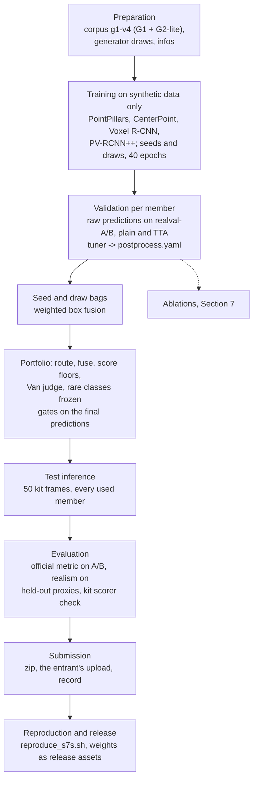

# Track 1 models: LUMPI (`model-lumpi-track/`)

> Modeling for Track 1 (CodaBench 16684): the approaches we considered, the selected model and why, and the selected model's full lifecycle (preparation, training, validation, test inference, ablations, evaluation, submission). Data and the generator are in [`data-lumpi-track/README.md`](../data-lumpi-track/README.md); the project-wide developer guide is the [root README](../README.md).

## 0. At a glance

| | |
|---|---|
| Selected model | [`routed-g10`](routed-g10) (S7.6, the entry since 2026-10-27, F1): the S6 portfolio with Car fused from `pvros_tta` + the extended PV-RCNN++ bag (floor 0.0) and Truck from a generator-draw run ([record](../docs/decisions/2026-10-26-s7-final-revisions.md)); before: [`routed-g8`](routed-g8) (S6): the R5 portfolio with Van fused from `vrros` + `vrros4_tta` + `g1_tta` through the pre-registered judge (early/late realval-A; Section 7.11); before: [`routed-g7`](routed-g7) (R5) |
| Real validation (official metric, tuned) | **realval-A mAP 0.384**, realval-B 0.223, late-A 0.358 (S6; Van A 0.120 -> 0.173); R5 0.377 / 0.223 / 0.351; R3 0.367 / 0.221; S4 0.313 / 0.188; S1 0.260 / 0.166 (Section 7) |
| Realism of the submitted frames | **R = 0.932 on the server** (R3 frames from `g1-v4`, engine G2-lite; 0.934 on held-out legal proxies); S1-S5 frames 0.891 (0.906 locally); raw UT frames 0.59 |
| Local combined estimate | 0.565 (B) and 0.586 (B with Van read from realval-A) for S6; leaderboard 0.5228 (Section 9); ECCV winner 0.479 |
| Competition | **rank 1 of 22** (S7.6, 0.5228, 2026-10-27; second Raj Patil 0.4960, 1009661, Oct 26; third dipper13579 0.4885, new on Oct 27); earlier: rank 1 of 21 (S6, 0.5228, 2026-10-17); second Raj Patil 0.4914 (980383, Oct 12) with mAP 0.1337 and realism R about 0.942 (ours 0.932) |
| CodaBench | **1014495 (S7.6): combined 0.5228** (0.522846; mAP 0.1749, R 0.9323), rank 1 of 22 on 2026-10-27; before: 995869 (S6, 0.522754), 990245 (R5, 0.5198), 986489 (R3, 0.5169), 975871 (S4, 0.5040), 978931 (S5, 0.5039, not listed), 974348 (S3, 0.5015 by its log), 965614 (S1, 0.4728) (Section 9; root README Section 9) |
| Submitted zip | current entry and F1, S7.6: [`routed-g10/submissions/2026-10-27_s7s/lumpi_s7s_submission.zip`](routed-g10/submissions/2026-10-27_s7s/lumpi_s7s_submission.zip) (tag 7.0; weights as release assets, [`releases/7.0/weights.json`](../releases/7.0/weights.json)); S6: [`routed-g8/submissions/2026-10-16_s6/lumpi_s6_submission.zip`](routed-g8/submissions/2026-10-16_s6/lumpi_s6_submission.zip) (tag 6.0; weights as release assets, [`releases/6.0/weights.json`](../releases/6.0/weights.json)); R5: [`lumpi_r5_submission.zip`](routed-g7/submissions/2026-10-14_r5/lumpi_r5_submission.zip) (tag 5.2); R3: [`lumpi_r3_submission.zip`](routed-g6/submissions/2026-10-12_r3/lumpi_r3_submission.zip) (tag 5.1) |
| Submit | `bash model-lumpi-track/routed-g10/test/make_submission.sh <tag> [team]` (Section 6.7; team defaults to `$BDC_TEAM`) |
| Strategy | S1, S3, S4, S5, R3, R5, S6 and **S7.6 submitted**; **S7.6 is the entry** (+0.0001 over S6: Car -0.004, Truck +0.005 on the leaderboard); before: S6 (Section 7.11: Van 0.117 -> 0.141 on the leaderboard); S2 done, below the upload gate (Section 7.5); S5 not confirmed (Section 7.8); next: the final phase with the S7.6 zip as F1, root README Section 8, [`docs/02-STRATEGY.md`](../docs/02-STRATEGY.md#812-s7-final-revisions-s74-s76-2026-10-26) Sections 8.8 and 8.12 |
| Experiment log | [`registry.csv`](registry.csv) (one row per evaluation and submission) |

## 1. Folder conventions

One folder per model. A model is a detector configuration plus the dataset version it was trained on.

```
model-lumpi-track/
├── README.md                 this file
├── registry.csv              experiment log (bdc26.registry), appended by eval_predictions.py and package_submission.py
└── <model>/
    ├── README.md             what this model is, how to run it, its results
    ├── model.yaml            model card read by the tools: track, data.train, data.realval, realism_frames, members (routed)
    ├── train/                pcdet_model.yaml (+ _BASE_CONFIG_ pcdet_dataset.yaml), train.sh; output/ (git-ignored: ckpt, logs, tensorboard)
    ├── validation/           evaluate.sh, tune_and_eval.sh; output/ (git-ignored predictions); results/ (tracked JSON, local_scores.json)
    ├── test/                 postprocess.yaml (selected on real val), predict.sh, make_submission.sh, synthetic_ids.txt; output/ (git-ignored)
    └── submissions/<date>_<tag>/   manifest.json, synthetic_ids.txt, codabench_<id>.json, <track>_<strategy>_submission.zip (tracked; 1.0 entries: submission_<track>.zip); submission.zip (git-ignored)
```

Create a model with `python common/tools/new_model.py lumpi <name> --from <existing>` (copies configs, never outputs), then edit `model.yaml` and `train/pcdet_model.yaml`.

| Model | Data | Role | Status |
|---|---|---|---|
| [`pointpillars-ut`](pointpillars-ut) | `pcdet/ut-v1` (UT only, actors x 1/0.78, Van -> Car) | baseline and ablation (what G1 adds) | run2 trained 40 epochs |
| [`pointpillars-g1`](pointpillars-g1) | `pcdet/g1-v2` (walkers v1, Van as Van, calibrated density) | routed member | trained 40 epochs, tuned |
| [`pointpillars-g1v3`](pointpillars-g1v3) | `pcdet/g1-v3` (walkers v2) | routed member | trained 40 epochs, tuned |
| [`routed-g1`](routed-g1) | members above | S1 | submitted (965614) |
| [`centerpoint-g1v3`](centerpoint-g1v3) | `pcdet/g1-v3` | S2 member: CenterPoint, stride 8 | trained 40 epochs (label fix), tuned; wins Bicycle (Section 7.5) |
| [`centerpoint-s4-g1v3`](centerpoint-s4-g1v3) | `pcdet/g1-v3` | S2 variant: CenterPoint, stride 4 | trained 40 epochs, tuned; no class won |
| [`routed-g2`](routed-g2) | `routed-g1` members + `cp` (+ `cp4`) | S2 candidate | Bicycle from `cp`; below the upload gate (+0.003); package `2026-10-09_s2/lumpi_s2_submission.zip` checked, not uploaded |
| [`routed-g3`](routed-g3) | `routed-g2` members and their TTA variants (`<member>_tta`) | S3 | submitted (974348, 0.5015 by its scorer log, never listed; Section 7.6) |
| [`voxelrcnn-g1v3`](voxelrcnn-g1v3) | `pcdet/g1-v3` | S4 member: Voxel R-CNN (CenterPoint stage 1, voxel RoI pooling) | trained 40 epochs, per-class score blend, tuned plain and TTA (Section 7.7) |
| [`pvrcnnpp-g1v3`](pvrcnnpp-g1v3) | `pcdet/g1-v3` | S4 member: PV-RCNN++ (CenterPoint stage 1, keypoint RoI pooling) | trained 40 epochs, per-class score blend, tuned plain and TTA (Section 7.7) |
| [`routed-g4`](routed-g4) | `routed-g3` members + `vr`, `pv` and their TTA variants | S4 | submitted (975871, 0.5040, the entry until R3; below its upload gate; Section 7.7) |
| [`voxelrcnn-gblobs-g1v3`](voxelrcnn-gblobs-g1v3) | `pcdet/g1-v3` | S5 run a: Voxel R-CNN with GBlobs inputs (cell covariance) | trained, tuned plain and TTA; below its parent alone, used in the Car fusion (Section 7.8) |
| [`voxelrcnn-ros-g1v3`](voxelrcnn-ros-g1v3) | `pcdet/g1-v3` | S5 run b: Voxel R-CNN with class-wise object scaling | trained, tuned plain and TTA; Bus route, Bicycle fusion (Section 7.8) |
| [`pvrcnnpp-ros-g1v3`](pvrcnnpp-ros-g1v3) | `pcdet/g1-v3` | S5 extension: PV-RCNN++ with object scaling | trained, tuned plain and TTA; Truck, Bicycle and Car fusions |
| [`pointpillars-ros-g1v3`](pointpillars-ros-g1v3) | `pcdet/g1-v3` | S5 extension: PointPillars g1v3 with object scaling | trained, tuned plain and TTA; Truck and Car fusions |
| [`routed-g5`](routed-g5) | `routed-g4` members + the four S5 runs (plain and TTA) | S5 | submitted (978931, 0.5039: 0.00007 below S4, not confirmed; Section 7.8) |
| [`pointpillars-g1v4`](pointpillars-g1v4) | `pcdet/g1-v4` (engine G2-lite) | R3 wave 0: `pointpillars-g1v3` on the new corpus, anchors at the new label sizes | trained, tuned plain and TTA; Bicycle and Bus fusions (Section 7.9) |
| [`voxelrcnn-ros-g1v4`](voxelrcnn-ros-g1v4) | `pcdet/g1-v4` | R3: `voxelrcnn-ros-g1v3` on the new corpus (generic ROS) | trained, tuned plain and TTA; Person B +0.020 alone |
| [`pvrcnnpp-ros-g1v4`](pvrcnnpp-ros-g1v4) | `pcdet/g1-v4` | R3: `pvrcnnpp-ros-g1v3` on the new corpus (ROS capped at real sizes) | trained, tuned plain and TTA; Bicycle and Truck fusions |
| [`pointpillars-ros-g1v4`](pointpillars-ros-g1v4) | `pcdet/g1-v4` | R3: `pointpillars-ros-g1v3` on the new corpus (ROS capped) | trained, tuned plain and TTA; Bus fusion |
| [`routed-g6`](routed-g6) | `routed-g4` (incumbent) + S5 and R3 members (plain and TTA) | R3 | submitted (986489, 0.5169; Section 7.9) |
| [`voxelrcnn-ros-g1v4-s2`](voxelrcnn-ros-g1v4-s2), [`pvrcnnpp-ros-g1v4-s2`](pvrcnnpp-ros-g1v4-s2) | `pcdet/g1-v4` | R5: seed 1666 of the R3 two-stage members | trained, tuned plain and TTA; Person fusion (Section 7.10) |
| [`routed-g7`](routed-g7) | `routed-g6` (incumbent) + the R5 seeds | R5 | submitted (990245, 0.5198; Section 7.10) |
| [`voxelrcnn-ros-g1v4-s3`](voxelrcnn-ros-g1v4-s3), [`-s4`](voxelrcnn-ros-g1v4-s4), [`pvrcnnpp-ros-g1v4-s3`](pvrcnnpp-ros-g1v4-s3), [`-s4`](pvrcnnpp-ros-g1v4-s4) | `pcdet/g1-v4` | S6: seeds 2666 and 3666 | trained, tuned plain and TTA (Section 7.11) |
| [`bag-voxelrcnn-ros-g1v4`](bag-voxelrcnn-ros-g1v4), [`bag-pvrcnnpp-ros-g1v4`](bag-pvrcnnpp-ros-g1v4) | seeds 1666-3666; 666-3666 | S6 seed bags (weighted box fusion of the seeds' tuned predictions) | at or above the best seed on A and B; no class through the gate |
| [`routed-g8`](routed-g8) | `routed-g7` (incumbent) + the S6 seeds and bags | **selected** (S6) | submitted (995869, **0.5228**, rank 1 of 21; Van through the judge; Section 7.11) |
| [`routed-g8b`](routed-g8b) | `routed-g8` + the Car candidate by the pooled rule | S6 close-out | not adopted: Car +0.007 on A and on B, but -0.002 on the pooled frames (P 0.24) on the final predictions; nothing packaged |
| [`voxelrcnn-ros-g1v4d2`](voxelrcnn-ros-g1v4d2), [`-d3`](voxelrcnn-ros-g1v4d3), [`pvrcnnpp-ros-g1v4d2`](pvrcnnpp-ros-g1v4d2), [`-d3`](pvrcnnpp-ros-g1v4d3) | `pcdet/g1-v4d2`, `g1-v4d3` (fresh `g1-v4` generator draws, seeds 2234 / 3234); training seeds 4666 / 5666 | S7.5 draw members | done: Voxel R-CNN draws above their seeds (TTA A 0.345-0.350 against 0.327-0.336), PV-RCNN++ inside |
| [`bag-voxelrcnn-ros-g1v4x`](bag-voxelrcnn-ros-g1v4x), [`bag-pvrcnnpp-ros-g1v4x`](bag-pvrcnnpp-ros-g1v4x) | the seeds + both draws (5 and 6) | S7.5 extended bags | done: TTA +0.0110 / +0.0070 and +0.0050 / +0.0013 over the S6 bags |
| [`routed-g9`](routed-g9), [`routed-g10`](routed-g10) | `routed-g8` + the draw runs and extended bags; `routed-g10` = the S7.6 bag swap and pooled budget | S7.5 and S7.6 portfolios | Truck (+0.017 pooled) and, in `routed-g10`, Car (+0.006) pass, but the projection is +0.0010 / +0.0014, below +0.003 ([record](../docs/decisions/2026-10-26-s7-final-revisions.md)); **`routed-g10` (`s7s`) submitted by the entrant (1014495, 0.5228, rank 1 of 22): the entry and F1**; `routed-g9` (`s7x`) not uploaded |

## 2. Modeling approaches considered

What matters for this challenge (from [`docs/02-STRATEGY.md`](../docs/02-STRATEGY.md) and the competitor reports in [`docs/01-CHALLENGE-FACTS.md`](../docs/01-CHALLENGE-FACTS.md) Section 7):
- the detector is trained on synthetic data only and scored on real data, so **robustness to the sim-to-real gap** matters more than benchmark accuracy;
- the score is a 7-class mean of 3D AP at IoU 0.5, so **small and rare classes** (Person, Bicycle, Van, Truck, Bus, Motorcycle) count as much as Car;
- every architecture change needs fast iteration (many generator versions, real-validation loops) on shared GPUs.

| Approach | Pros for this challenge | Cons for this challenge | Verdict |
|---|---|---|---|
| **PointPillars** (anchor-based, pillars) | fast (40 epochs on 9k frames in about 2 h on 4 GPUs); robust to density changes; multi-mode anchors fit fixed size conventions; won the ECCV edition on both tracks | coarse z (one pillar spans 10 m); weaker on small objects in the literature (InScope pedestrian AP 23.8 vs 49.6 for CenterPoint) | **selected as the base detector** (best speed / robustness trade-off; small-class weakness addressed with synthetic Persons and per-class post-processing) |
| SECOND (sparse voxels, anchors) | finer z than pillars; beats pillars on roadside pedestrians (DAIR-V2X-I) | slower; voxel features more sensitive to density mismatch | the sparse voxel backbone of the S2 CenterPoint members |
| CenterPoint (center heads) | strong on small objects; no anchor tuning | heatmap head sensitive to density and box-convention shifts; the ECCV winner found it no better than pillars here | **strategy S2 (next)**: Person, Bicycle, Motorcycle specialists ([`docs/02` 8.2](../docs/02-STRATEGY.md#82-s2-center-routed-small-objects)) |
| PV-RCNN++ / Voxel R-CNN (two-stage) | top accuracy on roadside benchmarks | 3-5x slower; refinement stage may relearn synthetic box conventions | strategy S4 ([`docs/02` 8.4](../docs/02-STRATEGY.md#84-s4-two-stage-refinement)) |
| VoxelNeXt / DSVT / LION / HEDNet (fully sparse, transformers) | state-of-the-art; DSVT experts were the ECCV runner-up's backbone | heavy; needs more data diversity than one 10k-frame twin; LION needs its own fork | optional research track of S6 (S6 itself was re-planned on 2026-10-15 as seed bags and the Van judge, [`docs/02` 8.6](../docs/02-STRATEGY.md#86-s6-variance-controlled-final-portfolio-re-planned-2026-10-15)) |
| Domain adaptation (self-training on real frames, BN adaptation) | can close the gap without labels | self-training on real frames is a gray area ([`01`](../docs/01-CHALLENGE-FACTS.md) Section 3.1); the detector must stay "trained on synthetic data only" | not used |
| Ensembles / per-class routing / WBF | per-class AP is independent, so a class can come from the model that is best for it; run-to-run variance is large on rare classes | needs a real validation set to choose routes (we have one: realval-A/B) | **used** (routing in S1); fusion and TTA are strategy S3 ([`docs/02` 8.3](../docs/02-STRATEGY.md#83-s3-fused-portfolio-with-tta)) |

**Why the selected model.** `routed-g1` takes each class from the better of two PointPillars G1 runs on real validation. Compared with a single PointPillars model it gains where training variance is large (Bicycle, Truck, Bus, Motorcycle) and uses walker v2 for Person, which transfers better to other measurements. Compared with heavier architectures it trains in 2 hours, which let us iterate on the generator (the biggest lever: synthetic Persons, Van class, density calibration). Cons: two forward passes at inference; routing is chosen on realval-A, the same measurement the test frames come from, so realval-A numbers are optimistic (realval-B is the check); PointPillars' coarse z limits 3D IoU for small objects (Person boxes are predicted too tall; the size calibration in post-processing partly compensates).

## 3. The detector configuration (`pointpillars-g1`, `pointpillars-g1v3`)

| Setting | Value | Why |
|---|---|---|
| Framework | OpenPCDet 0.6.0 (commit 233f849) with the `BDCDataset` adapter ([`common/bdc26/detect/pcdet_dataset.py`](../common/bdc26/detect/pcdet_dataset.py)) | OpenPCDet's 7-DoF box convention is the challenge's |
| Input | xyz only, 50,000 points in `[-40, -40, -5, 40, 40, 5]` | the test frames carry no intensity |
| Pillars | 0.15625 m, 512 x 512 grid, one pillar spans z [-5, 5], 32 points per pillar, 40,000 pillars | a 50k-point LUMPI frame fills about 31k pillars |
| Backbone / head | PillarVFE 64 -> BaseBEVBackbone [64, 128, 256] -> AnchorHeadSingle with direction classifier | standard PointPillars |
| Anchors (l, w, h; bottom at -2.15 m) | Person 0.78 x 0.75 x 1.90 (legal M4 median); Car 4.79 x 1.99 x 1.58; Bicycle 1.76 x 0.6 x 1.73; Motorcycle 2.19 x 0.87 x 1.53; Bus 10.27 x 3.94 x 4.25; Truck 7.94 x 2.89 x 3.46; Van 5.92 x 1.99 x 2.43; Unknown as Car | training-label medians (rescaled UT boxes, generator boxes) |
| Augmentation | GT-sampling Person 6, Car 6, Bicycle 10, Motorcycle 6, Bus 3, Truck 6, Van 6 (min 5 points); flips x/y; rotation +/-10 deg; scaling 0.95-1.05 | rare classes need GT-sampling |
| Optimization | 40 epochs, batch 6 per GPU on 4 GPUs, adam_onecycle LR 0.003, weight decay 0.01, `--fix_random_seed` | the one-cycle schedule matters: epoch 11 (high LR) found only 28% of real Persons, epoch 40 81% |
| OpenPCDet NMS | score 0.01, class-agnostic NMS 0.9, 1,000 boxes | keeps near-raw outputs; real NMS is per class in post-processing |
| Post-processing ([`common/bdc26/detect/postprocess.py`](../common/bdc26/detect/postprocess.py), `test/postprocess.yaml`) | per class: score floor, top-400 pre-NMS, rotated NMS IoU, re-centering on in-box points, size scale about the bottom centre, z offset; cross-class hedged copies | all selected on real validation (Section 6.3) |

## 4. Engine G1 data in one paragraph

UT-LUMPI frames with the actor scale fix, plus about 16 procedural walkers per frame ray-cast with the five real Measurement4 lidars, placed at legal real Person positions with real box sizes, inserted with per-sensor occlusion; UT Van trained as Van; background resampled toward the real spatial density. Full description and checks: [`data-lumpi-track/README.md`](../data-lumpi-track/README.md) Section 8.7.

## 5. Selected model lifecycle at a glance

The lifecycle of the entry (S7.6, [`routed-g10`](routed-g10); the V2X entry `routed-g12` follows the same steps plus tail copies and the sparse-box demotion):



## 6. Selected model lifecycle, step by step

The commands below walk through the first entry (S1, `routed-g1`: two PointPillars members); every later model repeats them per member, then adds the portfolio steps of its model README (`routed-g10/README.md`, Commands) and its `test/reproduce_<tag>.sh`. All commands from the repository root after `source common/env/activate.sh`. GPU numbers are examples (`CUDA_VISIBLE_DEVICES`).

### 6.1 Preparation
```bash
python data-lumpi-track/prepare_g1.py --name g1-v1 --workers 64                                   # density-prior input
python common/tools/fit_density_prior.py --track lumpi --real pcdet/realval-v1 --syn pcdet/g1-v1 --out gen/density_prior_v1.npz
OMP_NUM_THREADS=1 python data-lumpi-track/prepare_g1.py --name g1-v2 --density-prior gen/density_prior_v1.npz --workers 64
OMP_NUM_THREADS=1 python data-lumpi-track/prepare_g1.py --name g1-v3 --walker v2 --density-prior gen/density_prior_v1.npz --workers 64
```
Prerequisites (data guide Section 8): UT-LUMPI, real labels and frames, `pcdet/realval-v1`. The infos and GT database are built by `train.sh` on first use.

### 6.2 Training
```bash
CUDA_VISIBLE_DEVICES=0,1,2,3 bash model-lumpi-track/pointpillars-g1/train/train.sh 4 run1 --fix_random_seed --workers 6
CUDA_VISIBLE_DEVICES=4,5,6,7 bash model-lumpi-track/pointpillars-g1v3/train/train.sh 4 run1 --fix_random_seed --workers 6
```
`train.sh NGPUS TAG [OpenPCDet train.py flags]` builds missing infos, then runs OpenPCDet's `tools/train.py` through [`common/tools/pcdet_train.py`](../common/tools/pcdet_train.py) (registers `BDCDataset`, injects the dataset path from `model.yaml`). Outputs: `train/output/pcdet_model/<TAG>/ckpt/checkpoint_epoch_N.pth`, `train_*.log`, `tensorboard/`. About 2 h on 4 A6000s (up to 45 GB per GPU at batch 6); at the end OpenPCDet evaluates the synthetic val split (`g1-v2` val: mAP 0.800), which only checks that training converged.

### 6.3 Validation and post-processing selection
```bash
CUDA_VISIBLE_DEVICES=0 bash model-lumpi-track/pointpillars-g1/validation/tune_and_eval.sh \
    model-lumpi-track/pointpillars-g1/train/output/pcdet_model/run1/ckpt/checkpoint_epoch_40.pth
```
[`tune_and_eval.sh`](pointpillars-g1/validation/tune_and_eval.sh) runs:
1. raw predictions (OpenPCDet outputs, score >= 0.01) on realval-A (`val`) and realval-B (`valB`) with [`pcdet_predict.py --raw`](../common/tools/pcdet_predict.py);
2. [`tune_postprocess.py`](../common/tools/tune_postprocess.py), per class and independently (per-class AP does not depend on other classes):
   - phase 1, detector behaviour: NMS IoU in {0.01, ..., 0.7}, re-centering in {0, 0.25, 0.5} for Person/Bicycle/Motorcycle; kept only if realval-B does not drop by more than 0.005;
   - phase 2, box convention: z offset in {-0.3, ..., 0.3} m and size scale {0.85, ..., 1.16} (length/width together, then height), only for classes with 500+ GT in A; not guarded by B because conventions differ by measurement (M4 Person boxes 0.77 m long, M5-6 0.96-0.99 m);
   - greedy cross-class hedges (discounted copies, factors {0.1, 0.3, 0.6}) where they add at least 0.002 AP on A;
   - the search uses the fast float32 IoU; the result is written to `test/postprocess.yaml` (previous config kept as `.prev`, report in `test/postprocess.report.json`);
3. post-processed predictions on A and B, scored with the official metric ([`eval_predictions.py`](../common/tools/eval_predictions.py), exact IoUs), registry rows, `validation/results/local_scores.json`.

### 6.4 Routing
```bash
python common/tools/route_predictions.py select model-lumpi-track/routed-g1
```
For every class: the member with the best realval-A AP; within 0.005 of the best, the one with the higher realval-B AP. The route is written into [`routed-g1/model.yaml`](routed-g1/model.yaml) and the table into `routed-g1/validation/results/route_table.json`. Verify by merging the members' validation predictions (`route_predictions.py merge ... --pred g1=... --pred g1v3=...`) and scoring them with `eval_predictions.py`.

### 6.5 Test inference
`pcdet_predict.py <member> --ckpt <ckpt> --frames kit` runs each member on the 50 kit frames with its own `test/postprocess.yaml`; `route_predictions.py merge` keeps each class from its routed member. Both steps are inside `make_submission.sh` (6.7). The test frames are used for nothing else.

### 6.6 Evaluation
- **Detection:** [`common/bdc26/evalap.py`](../common/bdc26/evalap.py) implements the official scorer exactly (VOC-style greedy matching, 40-point interpolation, classes without GT excluded); parity with the kit's `scoring_program` is a unit test ([`common/tests/test_official_parity.py`](../common/tests/test_official_parity.py)).
- **Realism:** [`common/bdc26/realism.py`](../common/bdc26/realism.py) reproduces `scoring_program/metrics.py` bit-for-bit; [`score_realism.py`](../common/tools/score_realism.py) scores a zip against the held-out legal proxies 4-5. The 50 frames are chosen once by [`select_realism_frames.py`](../common/tools/select_realism_frames.py) (pooled-moment matching to proxies 1-3).
- **Combined estimate:** `0.6 * clip(mAP / 0.7) + 0.4 * R`, printed by `make_submission.sh` with the realval-A mAP.

### 6.7 Submission
```bash
CUDA_VISIBLE_DEVICES=0 bash model-lumpi-track/routed-g1/test/make_submission.sh first
python common/tools/check_submission.py --track lumpi model-lumpi-track/routed-g1/submissions/<date>_first/submission.zip --official
# upload that submission.zip unchanged on CodaBench 16684 (Submit tab); never unzip, edit or re-zip it. Then:
python common/tools/package_submission.py model-lumpi-track/routed-g1 --tag first --record <codabench_id> model-lumpi-track/routed-g1/submissions/<date>_first/codabench_<codabench_id>.json
```
The packager writes `submission.zip` (50 synthetic frames from `test/synthetic_ids.txt`, `predictions.json` for every test ID, `declaration.txt`), validates it against the published spec, and stores `manifest.json` (model, route, frames, local scores, validation result). Packaging rules, the pre-upload check and failure handling: Sections 10.4-10.6.

## 7. Results and ablations

Numbers are 3D AP at IoU 0.5 (R40) with the **official metric**, mean over the 7 classes with test GT; realval-A = 1,280 Measurement4 frames (selection split), realval-B = 867 Measurement5-6 frames (check). Every row is in [`registry.csv`](registry.csv).

### 7.1 Models (official metric, tuned post-processing)

| Model | Training data | realval-A | realval-B | Person | Car | Bicycle | Motorcycle | Bus | Truck | Van |
|---|---|---|---|---|---|---|---|---|---|---|
| `pointpillars-ut` (baseline) | `ut-v1`: UT only, Van -> Car | 0.168 | 0.127 | 0.000 | 0.843 | 0.124 | 0.005 | 0.006 | 0.166 | 0.034 |
| `pointpillars-g1` | `g1-v2`: + walkers v1, Van as Van, calibrated density | 0.253 | 0.156 | 0.341 | 0.874 | 0.265 | 0.010 | 0.006 | 0.154 | 0.122 |
| `pointpillars-g1v3` | `g1-v3`: + walker v2 | 0.248 | 0.163 | 0.340 | 0.873 | 0.186 | 0.008 | 0.011 | 0.200 | 0.118 |
| **`routed-g1`** (selected) | per class from the two above | **0.260** | **0.166** | 0.340 | 0.874 | 0.265 | 0.008 | 0.011 | 0.200 | 0.122 |

realval-B per class for `routed-g1`: Person 0.134, Car 0.770, Bicycle 0.102, Motorcycle 0.015, Bus 0.012, Truck 0.131, Van 0.001. The route: Person, Motorcycle, Bus, Truck from `g1v3`; Car, Bicycle, Van (and Unknown) from `g1`.

Reference points: ECCV 2026 winner on the test set, mAP 0.133 (Person 0.149, Car 0.643, Bicycle 0.078, Van 0.032, Motorcycle 0.020, Truck 0.011, Bus 0.000); live IEEE development leader mAP 0.102 (2026-10-02).

### 7.2 Ablations

| Question | Comparison | Result (realval-A mAP unless noted) |
|---|---|---|
| What does engine G1 add? | `pointpillars-ut` vs `pointpillars-g1` | 0.168 -> 0.253 (+0.085): Person 0 -> 0.341, Van 0.034 -> 0.122, Bicycle 0.124 -> 0.265 |
| Walker v1 vs v2 | `g1` vs `g1v3` | equal on A for Person (0.341 vs 0.340); on realval-B Person 0.091 -> 0.134 (v2 transfers to other measurements) |
| Training variance | `g1` vs `g1v3` on classes whose data are identical | Bicycle 0.265 vs 0.186, Truck 0.154 vs 0.200: large, so per-class routing pays (+0.007 over the best single model) |
| Post-processing (`g1`) | start config -> + NMS / re-centering -> + size and z -> + hedges | 0.210 -> 0.213 -> 0.242 -> 0.253 (box-convention calibration is the largest part: Person +0.049, Bicycle +0.109 with re-centering, Truck +0.019) |
| Training length | `g1` epoch 11 vs epoch 40 (untuned, KITTI-style metric at the time) | Person recall at BEV IoU 0.25 on real frames 28% -> 81% |
| Realism: density calibration and selection | raw UT frames -> `g1-v2` random 50 -> selected 50 (held-out proxies 4-5, official scorer) | R 0.59 -> 0.88 -> 0.906 (CD 1.63, MMD 0.0012, EMD 1.53 m, FPD 3.4); the first two values used the faster capped EMD solver, about 0.005 pessimistic |

### 7.3 Local estimate of the first submission

`routed-g1/submissions/2026-10-02_first/submission.zip`: realval-A mAP 0.260, realism R 0.906 (the kit's `local_eval.py` with 50 legal frames as the reference) -> **combined about 0.585** (0.505 with the realval-B mAP). The zip passes the kit's own validation (`valid_submission: 1`).

### 7.4 S1 close-out diagnostics (2026-10-09)

Official metric on legal real validation, S1 `routed-g1` predictions; files in [`routed-g1/validation/results/diagnostics/`](routed-g1/validation/results/diagnostics) and [`scorecard.json`](routed-g1/validation/results/scorecard.json). Summary and decisions: [`docs/02-STRATEGY.md` Section 8.1.3](../docs/02-STRATEGY.md#813-close-out-results-2026-10-09).

| Diagnostic | Finding |
|---|---|
| Test class mix vs realval-A (objects per frame) | Person 10.2 vs 17.4, Car 25.2 vs 27.9, Bicycle 1.6 vs 4.8, Motorcycle 0.54 vs 0.02, Bus 0.50 vs 0.17, Truck 3.8 vs 1.0, Van 1.6 vs 1.4 (realval-B: Truck 1.7, Motorcycle 0.30, Bus 0.31) |
| Drift toward the test window (realval-A frame bands 0-3199 / 3200-4799 / 4800-6399) | mAP 0.272 / 0.237 / 0.255; Person 0.421 / 0.225 / 0.196; Bicycle 0.278 / 0.283 / 0.232; Truck 0.223 / 0.002 / 0.387. The late band (late-A, 320 frames) has the test's Person density and is now part of the LUMPI gate |
| Height and z (BEV-matched pairs, score >= 0.1) | 91% (A) / 84% (B) of matched Persons reach 3D IoU 0.5; Persons 0.07-0.08 m too tall, Cars 0.08 m too low, Buses 2.7 m too short; BEV-3D gap 0.025 on B: height is not LUMPI's problem |
| Recall by points in the GT box (score >= 0.3, 3D IoU 0.5) | Person 0.24 / 0.51 / 0.65 / 0.64 (1-10 / 10-30 / 30-100 / 100+ points) on A; 0.21 / 0.38 / 0.42 / 0.23 on B (dense Persons missed on Measurement5-6); Truck 0.26-0.51 below 100 points |
| AP by range (0-15 / 15-30 / 30-45 / 45+ m) | Person 0.005 / 0.355 / 0.322 / 0.028; Bicycle 0.42 / 0.35 / 0.11 / 0.03; Truck 0.47 / 0.27 / 0.17 / 0.03; Van 0.12 / 0.36 / 0.06 / 0.04 |
| Truck lengths | real realval-A trucks: 5-6 m (224), 8-9 m (364), 12-14 m (213), 14-20 m (176); **synthetic `g1-v3` trucks: at most 8.47 m**; GT trucks over 12 m are predicted near 9.2 m. A generator gap (long trucks and trailers), not a post-processing one |
| Joint routing (A and B) | same route as S1 (Motorcycle from `g1` fails the class gate) |
| Range-dependent z calibration (C1) | no class passes the class gate (largest realval-B gain +0.004); [decision record](../docs/decisions/2026-10-09-s1-closeout-z-calibration.md) |

**Outcome:** no new LUMPI submission from the close-out; S1 stays the Track 1 entry.

### 7.5 S2 results: CenterPoint members (2026-10-09)

Official metric, tuned post-processing, realval-A / realval-B (late-A for the selected route). Summary, gates and lessons: [`docs/02-STRATEGY.md` Section 8.2.1](../docs/02-STRATEGY.md#821-results-2026-10-09); [decision record](../docs/decisions/2026-10-09-s2-center-routed.md).

| Member | Person | Car | Bicycle | Motorcycle | Truck | Van | mAP |
|---|---|---|---|---|---|---|---|
| S1 route (`g1`, `g1v3`) | **0.340 / 0.134** | **0.874 / 0.770** | 0.265 / 0.102 | 0.008 / 0.015 | **0.200 / 0.131** | 0.122 / 0.001 | 0.260 / 0.166 |
| `centerpoint-g1v3` (stride 8) | 0.095 / 0.038 | 0.848 / 0.756 | **0.350 / 0.128** | 0.069 / 0.022 | 0.137 / 0.077 | 0.119 / 0.001 | 0.233 / 0.147 |
| `centerpoint-s4-g1v3` (stride 4) | 0.168 / 0.047 | 0.844 / 0.749 | 0.318 / **0.134** | 0.057 / 0.023 | 0.118 / 0.109 | 0.087 / 0.001 | 0.230 / 0.153 |

- **Gate:** Bicycle moves to `centerpoint-g1v3` (B 0.102 -> 0.128, P(gain) 1.00, A 0.265 -> 0.350); Motorcycle (B +0.007) and Bus fail; everything else keeps its S1 member. `routed-g2`: A 0.260 -> 0.272, late-A 0.255 -> 0.271, B 0.1664 -> 0.1700; combined estimate (B) 0.5047 -> 0.5078, **+0.0031, below the +0.005 upload gate**. Package `routed-g2/submissions/2026-10-09_s2/lumpi_s2_submission.zip` (same 50 frames as S1, only the Bicycle boxes differ; kit scorer valid in 156 s) is kept for an optional confirmation upload.

- **Why the Person collapses:** CenterPoint emits about 39 Person boxes per frame scoring >= 0.5 against 17 real Persons; 69% of its unmatched ones sit in the same 1 m cells in at least 20% of the frames (static structures such as poles, signs and trees, which the twin does not contain), 2.7x more than the pillars. Removing those cells with the labels (an upper bound) would lift the S1 Person from 0.340 to 0.400 on A.
- **What it does well:** Bicycle (raw 0.196 vs 0.058 for the pillars on a 320-frame sample) and Car before tuning (0.805 vs 0.753).
- **Bug fixed on the way:** OpenPCDet's `CenterHead.assign_targets` trained the Car head on Motorcycles with these head groups; see `common/bdc26/detect/pcdet_patches.py`.

### 7.6 S3 results: TTA variants, fusion and score floors (2026-10-09)

Official metric, realval-A / realval-B. Summary, gates and lessons: [`docs/02-STRATEGY.md` Section 8.3.1](../docs/02-STRATEGY.md#831-results-2026-10-09); [decision record](../docs/decisions/2026-10-09-s3-fused-portfolio.md).

| Class | S2 route | S3 (`routed-g3`) | From | dB (bootstrap P) |
|---|---|---|---|---|
| Person | 0.340 / 0.134 | **0.396 / 0.145** | fused `g1v3_tta` + `g1_tta` (IoU 0.5) | +0.011 (1.00) |
| Car | 0.874 / 0.770 | **0.898 / 0.792** | fused `g1v3_tta` + `cp_tta` (IoU 0.7) | +0.022 (1.00) |
| Bicycle | 0.350 / 0.128 | **0.444 / 0.173** | fused `cp4_tta` + `cp_tta` (IoU 0.5) | +0.045 (1.00) |
| Truck | 0.200 / 0.131 | **0.231 / 0.153** | `g1v3_tta` | +0.023 (1.00) |
| Motorcycle, Bus, Van | B 0.015, 0.012, 0.001 | B 0.013, 0.011, 0.001 | S2 members (score floors cost -0.001) | gate failed for every change |
| **mAP** (late-A) | 0.272 / 0.170 (0.271) | **0.301 / 0.184 (0.298)** | | +0.014 (+0.012 to +0.016) |

- **TTA per member** (8 views: flips, yaw +/-5 deg, z +/-0.25 m; each variant with its own tuned `test/postprocess_tta.yaml`): Person on B from 0.091 to 0.141 for `g1` and from 0.038 to 0.081 for `centerpoint-g1v3`, Bicycle up for all four members, Car +0.009 to +0.024; `g1v3` Person is the exception (B 0.134 -> 0.128).
- **Static false positives** (Person on B, boxes ranked above the median true-positive score): 9.7 -> 4.1 per frame with fusion; 41% of the remaining unmatched ones are still static: R3 (static hard negatives) is the next Person lever.
- **Gated out:** Motorcycle fusion of `cp_tta` + `cp4` (A 0.008 -> 0.143, but B only +0.008, P 0.92); the Person fusion is the fragile gain (selected on realval-A alone, its pair loses on B).
- **Upload gate:** combined estimate (B) 0.505 (S1, uploaded) -> **0.520**, late-A 0.255 -> 0.298, R 0.905 (same 50 frames); kit scorer 181 s with 17,193 boxes (score floors: 1,045 -> 359 boxes per realval-A frame for -0.0007 B-mAP). **Passed.** Projected before the upload (0.82 x B): mAP about 0.151, combined about 0.486.
- **Leaderboard (974348, 2026-10-10, scorer log):** combined **0.5015**, mAP 0.1692 (Person 0.157, Car 0.652, Bicycle **0.224**, Truck 0.033, Van 0.117), 3D@0.7 0.0609, BEV 0.1781; confirmation passed by the log (+0.029 over 965614). CodaBench kept the submission in Running after the scorer printed DONE (Section 10.6). The gain was 1.89 x the realval-B gain and 0.81 x the realval-A gain (Section 9.4).

### 7.7 S4 results: two-stage members (2026-10-10)

Official metric, realval-A / realval-B. Review, plan, results and lessons: [`docs/02-STRATEGY.md` Sections 8.4 and 8.4.1](../docs/02-STRATEGY.md#841-results-2026-10-10); [decision record](../docs/decisions/2026-10-10-s4-two-stage.md).

| Member or step | Person | Car | Bicycle | Truck | mAP |
|---|---|---|---|---|---|
| `centerpoint-g1v3` (stage 1 alone), TTA | 0.211 / 0.081 | 0.886 / 0.780 | 0.406 / 0.155 | 0.162 / 0.113 | 0.275 / 0.165 |
| `voxelrcnn-g1v3`, TTA | 0.289 / 0.069 | 0.895 / 0.775 | 0.487 / **0.195** | 0.217 / 0.118 | 0.295 / 0.170 |
| `pvrcnnpp-g1v3`, TTA | 0.309 / 0.073 | 0.887 / 0.787 | 0.493 / 0.182 | 0.314 / 0.108 | 0.312 / 0.167 |
| S3 portfolio (`routed-g3`) | 0.396 / 0.145 | 0.898 / 0.792 | 0.444 / 0.173 | 0.231 / 0.153 | 0.301 / 0.184 |
| **S4 portfolio (`routed-g4`)** | 0.396 / 0.145 | 0.898 / 0.792 | **0.525 / 0.202** | 0.231 / 0.153 | **0.313 / 0.188** |

- **Routing and fusion:** Bicycle from `vr_tta` + `pv_tta` (IoU 0.7), B +0.029 (P 1.00); Car narrowly fails (`pv_tta` + `g1v3_tta`, B +0.0097); Truck from `pv_tta` gains A +0.08 but loses B 0.05 (gated out); Person keeps the S3 pillar fusion (the two-stage Persons reach only B 0.07).
- **Upload gate:** combined estimate (B) 0.520 -> 0.523 (bar 0.525), late-A 0.298 -> 0.304, R 0.905; kit scorer 182 s with 17,004 boxes. **Failed** (+0.003); uploaded by the entrant's call.
- **Leaderboard (975871, 2026-10-10):** combined **0.5040**, mAP 0.1721 (Bicycle 0.224 -> **0.244**; every other class identical to S3), rank **1 of 18**; confirmation passed (+0.0025 over the S3 log). The B-based estimate was right (+0.003); the A-based projection was not (+0.009): the gain was 0.25 x the A gain and 0.72 x the B gain.

### 7.8 S5 results: object scaling and GBlobs (2026-10-11)

Official metric, realval-A / realval-B, TTA members. Review, plan, results and lessons: [`docs/02-STRATEGY.md` Sections 8.5 and 8.5.1](../docs/02-STRATEGY.md#851-results-2026-10-11); [decision record](../docs/decisions/2026-10-11-s5-object-scaling.md).

| Member or step | Person | Car | Bicycle | Bus | Truck | mAP |
|---|---|---|---|---|---|---|
| `voxelrcnn-g1v3` (parent) | 0.289 / 0.069 | 0.895 / 0.775 | 0.487 / 0.195 | 0.010 / 0.010 | 0.217 / 0.118 | 0.295 / 0.170 |
| `voxelrcnn-gblobs-g1v3` (run a) | 0.177 / 0.058 | 0.895 / 0.783 | 0.459 / 0.178 | 0.010 / 0.010 | 0.218 / 0.086 | 0.276 / 0.162 |
| `voxelrcnn-ros-g1v3` (run b) | 0.287 / 0.084 | 0.895 / 0.788 | **0.540 / 0.220** | **0.018 / 0.077** | 0.362 / 0.142 | **0.322 / 0.189** |
| `pvrcnnpp-ros-g1v3` (extension) | 0.243 / 0.070 | **0.897 / 0.797** | 0.499 / 0.201 | 0.023 / 0.061 | **0.397 / 0.162** | 0.312 / 0.186 |
| `pointpillars-ros-g1v3` (extension) | 0.332 / **0.151** | 0.894 / 0.784 | 0.274 / 0.118 | 0.025 / 0.050 | 0.366 / **0.190** | 0.287 / 0.187 |
| S4 portfolio (`routed-g4`) | 0.396 / 0.145 | 0.898 / 0.792 | 0.525 / 0.202 | 0.011 / 0.011 | 0.231 / 0.153 | 0.313 / 0.188 |
| **S5 portfolio (`routed-g5`)** | 0.396 / 0.145 | **0.909 / 0.806** | **0.565 / 0.225** | **0.016 / 0.075** | **0.433 / 0.200** | **0.350 / 0.209** |

- **Routing and fusion:** Truck from `pvros_tta` + `ppros_tta` (B +0.047, late-A 0.414 -> 0.598), Bicycle from `vrros_tta` + `pvros_tta` + `pv_tta` (+0.023), Car from `pvros_tta` + `vrgb_tta` + `ppros_tta` (+0.014), Bus from `vrros_tta` (+0.064); Person keeps the S3 pillar fusion (best candidate B +0.006).
- **Why ROS helps:** the synthetic bicycles (1.66 x 0.58 x 1.62 m, no spread) and trucks (at most 8.47 m) are scaled to cover the real 2.00 x 0.85 x 1.90 m bicycles and 5.6-17.1 m trucks; Bus recall at IoU 0.5 0.20 -> 0.42 (Bus shares the head with Truck). GBlobs costs Person (A 0.189 -> 0.098 for the member).
- **Upload gate:** combined estimate (B) 0.523 -> **0.541** (bar 0.528), late-A 0.304 -> 0.335, R 0.905; kit scorer 146 s with 13,831 boxes. **Passed.** Projection: combined about 0.519 (0.514-0.541).
- **Leaderboard (978931, 2026-10-11):** 0.5039 (mAP 0.1720) against the S4 entry's 0.5040: **confirmation failed** (Truck 0.033 -> 0.072, Bicycle 0.244 -> 0.215, Car 0.652 -> 0.642). Diagnosis ([`docs/02` 8.5.1](../docs/02-STRATEGY.md#851-results-2026-10-11)): the changes lie outside the test-size sampling range; the size-augmented Bicycle members fire 18% more often on the test frames (realval +4%), motorcycle confusion explains little of it; the Car change was weak locally (pooled A+B P 0.64). S4 stays the entry; from R3 on the class gate also requires a pooled A+B gain.

### 7.9 R3 results: engine G2-lite corpus `g1-v4` (2026-10-12)

Official metric, realval-A / realval-B, TTA members. Review, plan, results and lessons: [`docs/02-STRATEGY.md` Sections 8.7.1 and 8.7.2](../docs/02-STRATEGY.md#872-r3-results-2026-10-11-to-2026-10-13); [decision record](../docs/decisions/2026-10-12-r3-g2-lite.md).

| Member or step | Person | Car | Bicycle | Bus | Truck | mAP |
|---|---|---|---|---|---|---|
| `pointpillars-g1v3` (parent of wave 0) | 0.381 / 0.128 | 0.890 / 0.778 | 0.228 / 0.100 | 0.011 / 0.009 | 0.232 / 0.154 | 0.271 / 0.170 |
| `pointpillars-g1v4` (data only) | 0.410 / 0.137 | 0.883 / 0.775 | **0.506 / 0.222** | **0.047 / 0.096** | 0.260 / 0.113 | **0.317 / 0.195** |
| `voxelrcnn-ros-g1v4` | **0.435 / 0.104** | 0.888 / 0.778 | 0.522 / 0.226 | 0.012 / 0.008 | 0.358 / 0.104 | 0.343 / 0.178 |
| `pvrcnnpp-ros-g1v4` | 0.402 / 0.101 | 0.891 / 0.783 | 0.524 / 0.230 | 0.017 / 0.051 | 0.372 / 0.141 | 0.342 / 0.191 |
| `pointpillars-ros-g1v4` | 0.402 / 0.155 | 0.886 / 0.775 | 0.498 / 0.225 | 0.058 / 0.051 | 0.305 / 0.127 | 0.327 / 0.193 |
| S4 portfolio (`routed-g4`, the entry) | 0.396 / 0.145 | 0.898 / 0.792 | 0.525 / 0.202 | 0.011 / 0.011 | 0.231 / 0.153 | 0.313 / 0.188 |
| **R3 portfolio (`routed-g6`)** | 0.396 / 0.145 | 0.898 / 0.792 | **0.600 / 0.264** | **0.079 / 0.134** | **0.466 / 0.200** | **0.367 / 0.221** |

- **Routing and fusion** (built on the S4 entry, every change through the class gate and the final pooled gate): Bicycle from `vrros_tta` + `pvros4_tta` + `pp4_tta` (B +0.062), Bus from `ppros4_tta` + `vrros_tta` (+0.123), Truck from `pvros_tta` + `ppros_tta` + `pvros4_tta` (+0.047). The S5 Car fusion is reverted by the final gate (pooled +0.0006, P 0.64); Person keeps the S4 fusion (best candidate B +0.004).
- **What the corpus changes:** each two-stage member halves its confident static Person false positives on B (14.5 -> 6.1 and 12.3 -> 5.0 per frame) and gains 0.02-0.03 Person AP on B; riders lift Bicycle (recall at IoU 0.25 0.88 -> 0.96 for the pillars) and real sizes lift Bus. Single members lose Truck and Bus: real-size buses and short trucks resemble trucks and cars, and the pillars' long anchor fires on a tall static structure of the real intersection (around (18, -28)).
- **Realism:** the 50 frames from `g1-v4` score 0.934 on proxies 4-5 (S1 frames 0.905) and 0.932-0.934 on the late proxies.
- **Upload gate:** combined estimate (B) 0.541 -> **0.563** (bar 0.546), late-A 0.304 -> 0.341; kit scorer 180 s with 16,262 boxes. **Passed.** Projection: combined 0.526-0.538 against the 0.5040 entry (with and without the S1 realism offset).
- **Leaderboard (986489, 2026-10-14):** combined **0.5169**, rank 1 of 21; confirmation passed (+0.0129) **through realism** (R 0.891 -> **0.932**: EMD 1.647 -> 1.302, FPD 5.10 -> 0.52; the local-to-server gap shrank from 0.015 to 0.002), while the mAP fell 0.1721 -> 0.1680: Truck 0.033 -> 0.058, Bus 0.000 -> 0.003, **Bicycle 0.244 -> 0.188** (the other four classes identical). Diagnosis ([`docs/02` 8.7.2](../docs/02-STRATEGY.md#872-r3-results-2026-10-11-to-2026-10-13)): outside the test-size sampling range; 3.68 confident Bicycle boxes per test frame (S4 3.16) against about 1.6 real ones; no motorcycle confusion. LUMPI Bicycle has now failed to transfer twice (S5, R3) and is a known exception to the local gates.

### 7.10 R5 results: seeds, refined density prior, late-A Person rule (2026-10-14)

Full tables: [`docs/02-STRATEGY.md` Section 8.9.1](../docs/02-STRATEGY.md#891-r5-results-2026-10-14); record [`2026-10-14-r5-realism-led.md`](../docs/decisions/2026-10-14-r5-realism-led.md).

| Item | realval-A / realval-B |
|---|---|
| `voxelrcnn-ros-g1v4-s2` (seed 1666, with the size cap), TTA | 0.336 / 0.188 (R3 member 0.343 / 0.178); Person B 0.104 -> 0.137 |
| `pvrcnnpp-ros-g1v4-s2` (seed 1666), TTA | 0.343 / 0.196 (0.342 / 0.191); Person B 0.101 -> 0.124 |
| `routed-g7` Person (late-A rule: `pp4_tta` + `vrros4s2_tta`, IoU 0.5) | 0.396 / 0.145 -> **0.465 / 0.160**, pooled +0.053 |
| `routed-g7` Car (new triple) | passed `fuse` (+0.011 on B), reverted by the final gate (pooled -0.0003) |
| `routed-g7` mAP (late-A) | 0.367 / 0.221 (0.341) -> **0.377 / 0.223 (0.351)**; estimate 0.563 -> 0.565, below the upload bar 0.568 |
| Realism | prior v2 (v1 refined once on the G2-lite output) lifts random frames, but the selected `g1-v5` frames gain only +0.0028 on the held-out proxies: R3 frames kept, no `g1-v5` retrain |
| **Leaderboard (2026-10-15)** | 990245: **0.5198** (mAP 0.1714): **Person 0.157 -> 0.180** (1.6 x the B gain), every other class and the realism identical; rank 1 of 21 |

### 7.11 S6 results: seed bags, the Van judge (2026-10-16)

Full tables: [`docs/02-STRATEGY.md` Section 8.6.1](../docs/02-STRATEGY.md#861-s6-results-2026-10-15-to-2026-10-16); record [`2026-10-16-s6-variance-controlled.md`](../docs/decisions/2026-10-16-s6-variance-controlled.md).

| Item | realval-A / realval-B |
|---|---|
| Seeds `voxelrcnn-ros-g1v4-s3/-s4`, `pvrcnnpp-ros-g1v4-s3/-s4`, TTA | Voxel R-CNN 0.327 / 0.189 and 0.333 / 0.180 (Person B 0.126, 0.093); PV-RCNN++ 0.337 / 0.190 and 0.341 / 0.188 |
| `bag-pvrcnnpp-ros-g1v4` (seeds 666-3666), TTA | **0.356 / 0.200** (best seed 0.343 / 0.196); late-A Person 0.334 (seeds 0.316-0.328) |
| `bag-voxelrcnn-ros-g1v4` (seeds 1666-3666), TTA | **0.348 / 0.192** (best seed 0.336 / 0.189) |
| `routed-g8` Van (judge: early-A rank, late-A gate) | `vrros` + `vrros4_tta` + `g1_tta` (IoU 0.5): A 0.120 -> **0.173**, late-A 0.118 -> **0.173** (+0.055, P 1.00) |
| `routed-g8` Person, Car, Truck | R5 kept (bag fusions: Person B -0.009 to -0.015, Car +0.007, Truck -0.004); Motorcycle passed (+0.023) but stays frozen with Bicycle and Bus |
| `routed-g8` mAP (late-A) | 0.377 / 0.223 (0.351) -> **0.384 / 0.223 (0.358)**; judged estimate (Van from A) 0.5796 -> **0.5860**, upload bar 0.5846: **passed** |
| Realism | frames from the whole `g1-v4` corpus: 0.9344 / 0.9313 against 0.9337 as packaged: R5 frames kept |

**Leaderboard (2026-10-17):** 995869 **0.5228** (mAP 0.1748): **Van 0.117 -> 0.141**, every other class and the realism identical; rank 1 of 21.

## 8. Experiment log and next experiments

| # | Question | Result / plan |
|---|---|---|
| E1 | Actor scale fix (`ut-noscale-v1` vs `ut-v1`) | planned (the 0.78^3 IoU cap argues for it) |
| E2 | UT Van -> Van and hedges | done: Van 0.034 (baseline, hedge only) -> 0.122 |
| E3 | Synthetic Persons (G1) | done: Person 0 -> 0.341 on realval-A; mAP 0.168 -> 0.253 |
| E4 | Walker v2 | done: Person on realval-B 0.091 -> 0.134; equal on A |
| E5 | Calibrated background density | done: realism 0.59 -> 0.88 (0.906 with frame selection) |
| E6 | Per-class post-processing | done: 0.210 -> 0.253 for `g1` (Section 7.2) |
| E7 | Architecture routing (CenterPoint for Person, Bicycle, Motorcycle) | done (S2): Bicycle moves to CenterPoint; Person collapses on static false positives (Section 7.5) |
| E8 | Truck size modes, Bus convention | done (R3): real label sizes for Truck, Bus, Bicycle, Motorcycle in `g1-v4`; trucks shortened to the free road in queues (63% take a real size) (Section 7.9) |
| E9 | TTA and weighted box fusion | done (S3): Person, Car, Bicycle, Truck up on B; mAP B 0.170 -> 0.184 (Section 7.6) |
| E11 | Two-stage refinement (Voxel R-CNN, PV-RCNN++) | done (S4): Bicycle B 0.173 -> 0.202; Person and Truck unchanged; below the upload gate (Section 7.7) |
| E12 | GBlobs inputs and class-wise object scaling | done (S5): object scaling helps every anchor-free and two-stage member; GBlobs only inside fusions (Section 7.8) |
| E10 | Static clutter and G2 for realism and hard negatives | done (R3): realism 0.905 -> 0.934; static Person false positives halved in every two-stage member; Bicycle, Bus, Truck up in the portfolio (Section 7.9) |
| E13 | Long tall static negatives (walls, hedges, tree rows) | not built (R5): the residual realism EMD is background (44% ground, 11% above 3 m), so the R5 lever was the density prior (E14); the long false trucks at the tall real structure remain open |
| E14 | Residual realism after R3 | done (R5): the EMD excess is background (44% ground, 11% above 3 m), not tall structure; refined density prior v2: realism gate missed by 0.0002 (Section 7.10) |
| E15 | Seeds of the two-stage members | done (R5): Person B +0.02-0.03 per seed member; the late-A Person rule moved Person for the first time since S3 (Section 7.10) |
| E16 | Seed bags and the Van judge | done (S6): every bag at or above its best seed; Van 0.120 -> 0.173 on A and late-A through the judge; upload gate passed (Section 7.11) |
| E17 | S7 visibility rule (rank boxes with few points last; V2X step 1) | not applicable (2026-10-18): LUMPI labels keep boxes with no points (0.5-1.8% of Person and Car labels, amodal track boxes); on `routed-g8` the rule gave Person +0.000 to +0.002 and Car -0.004 to -0.014, so LUMPI stays at S6 ([record](../docs/decisions/2026-10-18-s7-visibility-rule.md)) |
| E18 | Generator-draw bags, bag swap and pooled budget (S7.5, S7.6) | done: Truck and Car pass, projection +0.0014 below the gate; uploaded by the entrant as 1014495: +0.00009 (Truck +0.0049, Car -0.0042), the entry ([record](../docs/decisions/2026-10-26-s7-final-revisions.md)) |

## 9. Submission log

| Date | Model / tag | CodaBench id | Local mAP (A / B) | Local R | LB mAP | LB R | LB combined | Note |
|---|---|---|---|---|---|---|---|---|
| 2026-10-02 | `routed-g1` / `first`, hand-edited copy (team typed into declaration.txt, re-zipped) | 957399 | 0.260 / 0.166 | 0.906 | | | | Failed after a few hours, no score; not counted (0 of 100 used); Section 10.6 |
| 2026-10-06 | `routed-g1` / `first`, team KarmaRV, uploaded unchanged as `submission_lumpi_karmarv.zip` | 965614 | 0.260 / 0.166 | 0.906 | **0.1357** | **0.8912** | **0.4728** | strategy S1; rank 1 of 31 (next 0.2769); server record [`codabench_965614.json`](routed-g1/submissions/2026-10-02_first/codabench_965614.json) |
| 2026-10-10 | `routed-g3` / `s3` (strategy S3), uploaded unchanged as `lumpi_s3_submission.zip` | 974348 | 0.301 / 0.184 | 0.905 | **0.1692** | **0.8912** | **0.5015** | strategy S3; scores from the scorer log (DONE), status Running afterwards, not listed yet; kit scorer 181 s, 17,193 boxes; server record [`codabench_974348.json`](routed-g3/submissions/2026-10-09_s3/codabench_974348.json); [decision record](../docs/decisions/2026-10-09-s3-fused-portfolio.md) |
| 2026-10-10 | `routed-g4` / `s4` (strategy S4), uploaded unchanged as `lumpi_s4_submission.zip` (below the upload gate, the entrant's call) | 975871 | 0.313 / 0.188 | 0.905 | **0.1721** | **0.8912** | **0.5040** | strategy S4; **rank 1 of 18** (next 0.4784); kit scorer 182 s, 17,004 boxes; server record [`codabench_975871.json`](routed-g4/submissions/2026-10-10_s4/codabench_975871.json); [decision record](../docs/decisions/2026-10-10-s4-two-stage.md) |
| 2026-10-11 | `routed-g5` / `s5` (strategy S5), uploaded unchanged as `lumpi_s5_submission.zip` | 978931 | 0.350 / 0.209 | 0.905 | 0.1720 | 0.8912 | 0.5039 | strategy S5; 0.00007 below the S4 entry, not listed; **confirmation failed**, diagnosed; kit scorer 146 s, 13,831 boxes; server record [`codabench_978931.json`](routed-g5/submissions/2026-10-11_s5/codabench_978931.json); [decision record](../docs/decisions/2026-10-11-s5-object-scaling.md) |
| 2026-10-13 | `routed-g6` / `r3` (strategy R3), uploaded unchanged as `lumpi_r3_submission.zip` | 986489 | 0.367 / 0.221 | 0.934 | 0.1680 | **0.9323** | **0.5169** | strategy R3; **rank 1 of 21** (next 0.4914); confirmed through realism (mAP -0.004: Bicycle -0.056, diagnosed); kit scorer 180 s, 16,262 boxes; server record [`codabench_986489.json`](routed-g6/submissions/2026-10-12_r3/codabench_986489.json); [decision record](../docs/decisions/2026-10-12-r3-g2-lite.md) |
| 2026-10-15 | `routed-g7` / `r5` (strategy R5), uploaded unchanged as `lumpi_r5_submission.zip` (below the upload gate, the entrant's call) | 990245 | 0.377 / 0.223 | 0.934 | **0.1714** | 0.9323 | **0.5198** | strategy R5; **rank 1 of 21** (next 0.4914); confirmed (+0.0029: Person 0.157 -> 0.180, every other class and the realism identical); kit scorer 157 s, 15,009 boxes; server record [`codabench_990245.json`](routed-g7/submissions/2026-10-14_r5/codabench_990245.json); [decision record](../docs/decisions/2026-10-14-r5-realism-led.md) |
| 2026-10-17 | `routed-g8` / `s6` (strategy S6), uploaded unchanged as `lumpi_s6_submission.zip` | 995869 | 0.384 / 0.223 (late-A 0.358) | 0.934 | **0.1748** | 0.9323 | **0.5228** | strategy S6; **rank 1 of 21** (next 0.4914); confirmed (+0.0029: Van 0.117 -> 0.141, every other class and the realism identical); kit scorer 160 s, 15,082 boxes; server record [`codabench_995869.json`](routed-g8/submissions/2026-10-16_s6/codabench_995869.json) |
| 2026-10-27 | `routed-g10` / `s7s` (S7.6 amendment), uploaded unchanged as `lumpi_s7s_submission.zip` (below the upload gate, the entrant's call) | 1014495 | 0.388 / 0.225 | 0.934 | **0.1749** | 0.9323 | **0.5228** | strategy S7.6; **rank 1 of 22** (next 0.4960); +0.00009 over 995869: Truck 0.058 -> 0.063 (+0.0049, local +0.021 / +0.005), Car 0.652 -> 0.648 (-0.0042, local +0.006 on both), other classes and realism identical; projection was +0.0014; server record [`codabench_1014495.json`](routed-g10/submissions/2026-10-27_s7s/codabench_1014495.json) |
| 2026-10-30 | `routed-g11b` / `s8b` (S8 U2: completion + 12-view Person), uploaded unchanged as `lumpi_s8b_submission.zip` (last-day bar (b), projection +0.0011) | 1022250 | 0.391 / 0.227 (late-A 0.361) | 0.934 | **0.1762** | 0.9323 | **0.5239** | strategy S8; **rank 1 of 22** (next 0.5118); +0.00106 over 1014495: Person 0.180 -> 0.187 (+0.0063; local +0.0168 / +0.0090 against S7.6), Truck 0.063 -> 0.065 (+0.0021, floor 0.03 -> 0.01), Motorcycle +0.0003 (floor 0.3 -> 0.01), Car, Bicycle, Bus, Van and realism identical; kit scorer 328 s, 32,038 boxes; server record [`codabench_1022250.json`](routed-g11b/submissions/2026-10-30_s8b/codabench_1022250.json); [decision record](../docs/decisions/2026-10-29-s8-last-day-strategy.md) |

### 9.1 Local vs leaderboard per class (3D AP@0.5 R40)

| | mAP | Person | Car | Bicycle | Motorcycle | Bus | Truck | Van |
|---|---|---|---|---|---|---|---|---|
| **S8 U2 leaderboard (1022250, the entry)** | **0.1762** | **0.187** | 0.648 | 0.188 | 0.001 | 0.003 | **0.065** | 0.141 |
| S8 U2 realval-A / realval-B (late-A) | 0.391 / 0.227 (0.361) | 0.482 / 0.169 | 0.905 / 0.798 | 0.601 / 0.264 | 0.008 / 0.015 | 0.079 / 0.134 | 0.487 / 0.205 | 0.174 / 0.002 |
| S7.6 leaderboard (1014495, the entry until S8) | **0.1749** | 0.180 | 0.648 | 0.188 | 0.001 | 0.003 | **0.063** | 0.141 |
| S7.6 realval-A / realval-B (late-A) | 0.388 / 0.225 (0.358) | 0.465 / 0.160 | 0.905 / 0.798 | 0.600 / 0.264 | 0.008 / 0.013 | 0.079 / 0.134 | 0.487 / 0.205 | 0.173 / 0.002 |
| S6 leaderboard (995869, the entry until S7.6) | **0.1748** | 0.180 | 0.652 | 0.188 | 0.001 | 0.003 | 0.058 | **0.141** |
| S6 realval-A / realval-B (late-A) | 0.384 / 0.223 (0.358) | 0.465 / 0.160 | 0.898 / 0.792 | 0.600 / 0.264 | 0.008 / 0.013 | 0.079 / 0.134 | 0.466 / 0.200 | **0.173** / 0.002 (late-A 0.173) |
| R5 leaderboard (990245) | **0.1714** | 0.180 | 0.652 | 0.188 | 0.001 | 0.003 | 0.058 | 0.117 |
| R5 realval-A / realval-B | 0.377 / 0.223 | 0.465 / 0.160 | 0.898 / 0.792 | 0.600 / 0.264 | 0.008 / 0.013 | 0.079 / 0.134 | 0.466 / 0.200 | 0.120 / 0.001 |
| R3 leaderboard (986489) | **0.1680** | 0.157 | 0.652 | 0.188 | 0.001 | 0.003 | 0.058 | 0.117 |
| R3 realval-A / realval-B | 0.367 / 0.221 | 0.396 / 0.145 | 0.898 / 0.792 | 0.600 / 0.264 | 0.008 / 0.013 | 0.079 / 0.134 | 0.466 / 0.200 | 0.120 / 0.001 |
| S5 leaderboard (978931, not listed) | 0.1720 | 0.157 | 0.642 | 0.215 | 0.001 | 0.001 | 0.072 | 0.117 |
| S5 realval-A / realval-B | 0.350 / 0.209 | 0.396 / 0.145 | 0.909 / 0.806 | 0.565 / 0.225 | 0.008 / 0.013 | 0.016 / 0.075 | 0.433 / 0.200 | 0.120 / 0.001 |
| S4 leaderboard (975871, the entry until R3) | **0.1721** | 0.157 | 0.652 | **0.244** | 0.001 | 0.000 | 0.033 | 0.117 |
| S4 realval-A / realval-B | 0.313 / 0.188 | 0.396 / 0.145 | 0.898 / 0.792 | 0.525 / 0.202 | 0.008 / 0.013 | 0.011 / 0.011 | 0.231 / 0.153 | 0.120 / 0.001 |
| S3 leaderboard (974348, scorer log) | 0.1692 | 0.157 | 0.652 | **0.224** | 0.001 | 0.000 | 0.033 | 0.117 |
| S3 realval-A / realval-B | 0.301 / 0.184 | 0.396 / 0.145 | 0.898 / 0.792 | 0.444 / 0.173 | 0.008 / 0.013 | 0.011 / 0.011 | 0.231 / 0.153 | 0.120 / 0.001 |
| S3 leaderboard / realval-B | 0.92 | 1.08 | 0.82 | 1.29 | | | 0.22 | |
| leaderboard gain / realval-A gain (S1 -> S3) | 0.81 | 0.71 | 0.81 | 0.96 | | | 0.16 | |
| S1 leaderboard (965614) | 0.1357 | 0.117 | 0.633 | 0.053 | 0.001 | 0.000 | 0.028 | 0.118 |
| S1 realval-A | 0.260 | 0.340 | 0.874 | 0.265 | 0.008 | 0.011 | 0.200 | 0.122 |
| S1 realval-B | 0.166 | 0.134 | 0.770 | 0.102 | 0.015 | 0.012 | 0.131 | 0.001 |
| S1 leaderboard / realval-A | 0.52 | 0.34 | 0.72 | 0.20 | | | 0.14 | 0.97 |

Realism on the server: CD 1.690, MMD 0.00187, EMD 1.647, FPD 5.095, R 0.8912 (local proxy 4: 1.629, 0.00117, 1.530, 3.447, 0.9057). Van and Car transfer; Person, Bicycle and Truck lose most of their realval-A AP, so the realval-A selection does not represent the test window well (analysis: Section 9.4; next strategy: root README Section 8 and [`docs/02-STRATEGY.md`](../docs/02-STRATEGY.md#8-strategy-routes-after-s1) Section 8).

### 9.2 Artifacts

S7.6 (1014495, the entry and F1): model [`routed-g10`](routed-g10) ([`model.yaml`](routed-g10/model.yaml)); the upload copy [`lumpi_s7s_submission.zip`](routed-g10/submissions/2026-10-27_s7s/lumpi_s7s_submission.zip) (md5 `19122be039da416d98ccdf852d67532b`, in its [`manifest.json`](routed-g10/submissions/2026-10-27_s7s/manifest.json)); server record [`codabench_1014495.json`](routed-g10/submissions/2026-10-27_s7s/codabench_1014495.json); the 15 checkpoints as assets of release 7.0 (`python common/tools/release_weights.py fetch --tag 7.0 --version lumpi:s7s`; ten of them also in 6.0, the five PV-RCNN++ checkpoints `pvrcnnpp-ros-g1v4-s2/-s3/-s4/d2/d3` new in 7.0); reproduction from the weights: [`routed-g10/test/reproduce_s7s.sh`](routed-g10/test/reproduce_s7s.sh) (test frames) and [`reproduce_s7s_validation.sh`](routed-g10/test/reproduce_s7s_validation.sh) (realval-A/B).

S6 (995869, the entry until 1014495): model [`routed-g8`](routed-g8) ([`model.yaml`](routed-g8/model.yaml)); the upload copy [`lumpi_s6_submission.zip`](routed-g8/submissions/2026-10-16_s6/lumpi_s6_submission.zip) (md5 `02c731ecbd162a84d6eae5537856bc4a`, in its [`manifest.json`](routed-g8/submissions/2026-10-16_s6/manifest.json)); server record [`codabench_995869.json`](routed-g8/submissions/2026-10-16_s6/codabench_995869.json); the 11 checkpoints as assets of release 6.0 ([`releases/6.0/weights.json`](../releases/6.0/weights.json); `python common/tools/release_weights.py fetch --tag 6.0 --version lumpi:s6`); reproduction from the weights: [`routed-g8/test/reproduce_s6.sh`](routed-g8/test/reproduce_s6.sh) (test frames) and [`reproduce_s6_validation.sh`](routed-g8/test/reproduce_s6_validation.sh) (realval-A/B).

R5 (990245): model [`routed-g7`](routed-g7) ([`model.yaml`](routed-g7/model.yaml)); the upload copy [`lumpi_r5_submission.zip`](routed-g7/submissions/2026-10-14_r5/lumpi_r5_submission.zip) (md5 `ae3612bfa0607f3f0773702acd985fd0`, in its [`manifest.json`](routed-g7/submissions/2026-10-14_r5/manifest.json)); server record [`codabench_990245.json`](routed-g7/submissions/2026-10-14_r5/codabench_990245.json); realism frames from `pcdet/g1-v4`, the R3 frames.

R3 (986489): model [`routed-g6`](routed-g6) ([`model.yaml`](routed-g6/model.yaml)); the upload copy [`lumpi_r3_submission.zip`](routed-g6/submissions/2026-10-12_r3/lumpi_r3_submission.zip) (md5 `8dbce7a9356ae490c5b948218588f86b`, in its [`manifest.json`](routed-g6/submissions/2026-10-12_r3/manifest.json)); server record [`codabench_986489.json`](routed-g6/submissions/2026-10-12_r3/codabench_986489.json); realism frames from `pcdet/g1-v4` ([`synthetic_ids.txt`](routed-g6/submissions/2026-10-12_r3/synthetic_ids.txt)).

S5 (978931, not listed): model [`routed-g5`](routed-g5) ([`model.yaml`](routed-g5/model.yaml)); the upload copy [`lumpi_s5_submission.zip`](routed-g5/submissions/2026-10-11_s5/lumpi_s5_submission.zip) (md5 `9f2c925c3976679b5b2038bfde5f7566`, in its [`manifest.json`](routed-g5/submissions/2026-10-11_s5/manifest.json)); server record [`codabench_978931.json`](routed-g5/submissions/2026-10-11_s5/codabench_978931.json).

S4 (975871): model [`routed-g4`](routed-g4) ([`model.yaml`](routed-g4/model.yaml): members with the two-stage members and TTA variants, `route`, `fusion`, `budget`); the upload copy [`lumpi_s4_submission.zip`](routed-g4/submissions/2026-10-10_s4/lumpi_s4_submission.zip) (md5 `ce3dc93c3f7defd7e0ca74bd0efc702a`, byte-identical to the folder's `submission.zip`, in its [`manifest.json`](routed-g4/submissions/2026-10-10_s4/manifest.json)); server record [`codabench_975871.json`](routed-g4/submissions/2026-10-10_s4/codabench_975871.json); reproducible from the committed `model.yaml` and the saved member predictions.

S3 (974348): model [`routed-g3`](routed-g3) ([`model.yaml`](routed-g3/model.yaml): members with TTA variants, `route`, `fusion`, `budget`); the upload copy [`lumpi_s3_submission.zip`](routed-g3/submissions/2026-10-09_s3/lumpi_s3_submission.zip) (md5 `9133dd7d9d8b377ec9228b79b75065a0`, byte-identical to the folder's `submission.zip`, in its [`manifest.json`](routed-g3/submissions/2026-10-09_s3/manifest.json)); server record [`codabench_974348.json`](routed-g3/submissions/2026-10-09_s3/codabench_974348.json) (scorer log); reproducible: the zip's predictions equal `route_predictions.py merge` of the saved member predictions with the committed `model.yaml`.

965614 (strategy S1):

| | |
|---|---|
| Model | [`routed-g1`](routed-g1) ([at tag 0.1](https://github.com/karmarv/utsim2real-bdc26/tree/0.1/model-lumpi-track/routed-g1)); members and route in [`routed-g1/model.yaml`](routed-g1/model.yaml); checkpoints are not in git |
| Submitted file | [`submission_lumpi.zip`](routed-g1/submissions/2026-10-02_first/submission_lumpi.zip) (tag 1.0), uploaded as [`submission_lumpi_karmarv.zip`](https://github.com/karmarv/utsim2real-bdc26/releases/download/0.1/submission_lumpi_karmarv.zip) (GitHub release [0.1](https://github.com/karmarv/utsim2real-bdc26/releases/tag/0.1)), the packaged zip unchanged, md5 `ea2c76393d6f8868762d6bac1ac03fa8` |
| Manifest | [`manifest.json`](routed-g1/submissions/2026-10-02_first/manifest.json) (checkpoints, route, frames, local scores, validation, CodaBench attempts), [`synthetic_ids.txt`](routed-g1/submissions/2026-10-02_first/synthetic_ids.txt) |
| Server record | [`codabench_965614.json`](routed-g1/submissions/2026-10-02_first/codabench_965614.json): every `scores.json` field and the scoring log |
| Leaderboard | [CodaBench 16684 results](https://www.codabench.org/competitions/16684/#/results-tab) |

### 9.3 Realism on the server

| | CD | MMD | EMD | FPD | R |
|---|---|---|---|---|---|
| leaderboard S6 (995869, the R3 frames) | 1.594 | 0.00003 | 1.302 | 0.519 | 0.9323 (identical) |
| leaderboard R5 (990245, the R3 frames) | 1.594 | 0.00003 | 1.302 | 0.519 | 0.9323 (identical) |
| leaderboard R3 (986489, frames from `g1-v4`) | 1.594 | 0.00003 | 1.302 | 0.519 | **0.9323** |
| local R3, held-out proxy 4 | 1.52 | 0.0000 | 1.282 | 0.29 | 0.9344 |
| leaderboard (965614 to 978931, identical S1 frames) | 1.690 | 0.00187 | 1.647 | 5.095 | 0.8912 |
| local, held-out proxy 4 | 1.629 | 0.00117 | 1.530 | 3.447 | 0.9057 |
| ECCV 2026 winner | | | | | 0.913 |
| other IEEE entries (identical values: the kit's dummy frames) | 10.245 | 0.0677 | 3.39 | 119.5 | 0.473 |

Both sides pooled 2,500,000 points before subsampling (50 x 50,000), so the packaged density was used as intended. Share of the realism loss (1 - R) per term: EMD 76%, FPD 23%, MMD 1%, CD 0% (CD below 2 is free).

### 9.4 What transferred and what did not

| Finding | Evidence | Implication |
|---|---|---|
| Realism transfers, but less than on V2X | R 0.891 vs 0.906 locally (FPD 5.1 vs 3.4, EMD 1.65 vs 1.53) | the frames are slightly too average: the test-window reference has static structure the twin lacks (35% of the reference mass, [R19](../docs/07-LITERATURE.md#r19-eccv-2026-winner-reports)); engine G2 static clutter (`docs/02` Section 8.7, R track; promoted 2026-10-09) |
| Car and Van transfer | Car 0.633 (A 0.874, B 0.770); Van 0.118 (A 0.122) | keep the pillar members for vehicles in every later strategy |
| Person, Bicycle and Truck do not | Person 0.117 (A 0.340), Bicycle 0.053 (A 0.265), Truck 0.028 (A 0.200), with 512, 82 and 192 test GT boxes, so real gaps | realval-A (Measurement4 frames 0-6399) precedes the excluded last 20% of the recording, which holds the forbidden frames (6497-8109) and presumably the test frames; post-processing tuned on A partly fits A; select on A and B jointly (S2 onward) |
| Combined below the ECCV winner despite higher mAP | 0.4728 vs 0.4793: mAP 0.136 vs 0.133, R 0.891 vs 0.913 | +0.022 R is worth +0.009 combined: the cheapest LUMPI gain |
| Local estimate was optimistic | estimate A / B / leaderboard: 0.585 / 0.505 / 0.473; S3 0.620 / 0.520 / 0.501 | report the realval-B estimate; treat realval-A as an upper bound for levels |
| S3 gains transferred more than realval-B predicted | mAP +0.034 on the leaderboard vs +0.018 on B (1.89 x), but 0.81 x the realval-A gain (V2X: 0.80 x) | levels follow B, gains follow A: project the leaderboard from the A gain |
| Bicycle is the first weak class that moved | 0.053 -> 0.224 (B 0.102 -> 0.173, A 0.265 -> 0.444) | CenterPoint plus TTA and fusion fit the bikes of the test window; keep both CenterPoint members |
| S4 changed only Bicycle, as gated | 0.224 -> 0.244 (A +0.081, B +0.029); the other six classes identical on the leaderboard | the merge changes exactly the gated classes; the gain was 0.25 x A and 0.72 x B (S3: 0.81 x A, 1.89 x B): project with 0.6 x the mean of both |
| Truck still does not transfer | 0.028 -> 0.033 (B +0.022) | the synthetic trucks stop at 8.47 m (close-out D5): long trucks in the generator (R3) |
| R3 realism transferred, its detection did not | R 0.891 -> 0.932 (local +0.028, server +0.041); mAP -0.004: Truck +0.025, Bus +0.003, Bicycle -0.056 (outside the test-size ranges) | generator content closes the hidden-reference gap (0.015 -> 0.002); LUMPI Bicycle changes need a test-window-like proxy before they are trusted |
| S5 did not transfer on LUMPI | Truck +0.038 but Bicycle -0.030 and Car -0.010, each outside the test-size sampling range (P <= 0.02) | the test window answers the size-augmented Bicycle members with false positives no local split shows; the class gate adds a pooled A+B condition from R3 on |
| R5 Person transferred at 1.6 x B | Person 0.157 -> 0.180 (B +0.015, A +0.069, late-A +0.069); the first Person change since S3 | the late-A rule (the late Measurement4 labels share the test window's label provenance) picks Person fusions that fit the test window; the seed members of the clutter-trained two-stage models supply them |
| S6 Van transferred at 0.45 x its realval-A gain | Van 0.117 -> 0.141 (A +0.053, late-A +0.055, B flat: realval-B's class 6 is not vans); every other class identical | the pre-registered judge (early-A rank, late-A gate) moved a class the B gate could never move; the level ratio leaderboard / A fell from 0.97 to 0.81, so the A gain is an upper bound |

## 10. Local evaluation and packaging

Everything here runs locally before an upload. The metrics are common to both tracks; the numbers are this track's.

### 10.1 Detection metric

As the scorer computes it (`scoring_program/detection_eval.py`, reproduced by [`common/bdc26/evalap.py`](../common/bdc26/evalap.py), checked by [`common/tests/test_official_parity.py`](../common/tests/test_official_parity.py)):
- per class and IoU threshold (0.5 primary, 0.7 reported): in each frame, predictions sorted by score each take the unused GT with the highest IoU and count as true positives if IoU >= threshold; predictions in frames without GT of the class are false positives; AP = mean over 40 recall points of the interpolated precision (R40 [R14](../docs/07-LITERATURE.md#r14-r40-average-precision); R11 reported);
- 3D IoU = oriented BEV polygon intersection x z overlap / union volume; class names match case-insensitively; a missing `class` defaults to "Car"; classes without test GT are excluded from the mean; no difficulty filter, no cap on the number of boxes;
- this track: mAP over the 7 classes with test GT (Unknown has none); test GT counts (kit `config.json`): Person 512, Car 1,258, Bicycle 82, Motorcycle 27, Bus 25, Truck 192, Van 79;
- consequences: never threshold scores aggressively (low-scored boxes cannot lower AP); per-class NMS matters (duplicates are false positives); a box may be emitted under several classes (hedges).

### 10.2 Realism metric

`scoring_program/metrics.py`, reproduced bit-for-bit by [`common/bdc26/realism.py`](../common/bdc26/realism.py): concatenate the 50 frames per side, mask to the range (inclusive; (0,0,0) points are inside), one RNG with seed 1234 draws 10,000 synthetic then 10,000 real points; CD (squared L2) and EMD = sqrt(W1) [R15](../docs/07-LITERATURE.md#r15-chamfer-and-earth-movers-distances) with POT [R18](../docs/07-LITERATURE.md#r18-pot) (10M iterations), unbiased RBF MMD with a median-heuristic bandwidth [R16](../docs/07-LITERATURE.md#r16-maximum-mean-discrepancy), FPD (Gaussian Frechet distance on xyz [R17](../docs/07-LITERATURE.md#r17-frechet-distance)).
```
R = 1 - mean( clip((CD-2)/28), clip(MMD/0.5), clip(EMD/5), clip(FPD/50) )        combined = 0.6 * clip(mAP / 0.7) + 0.4 * R
```
The real reference is 50 held-out frames we never see; locally we score against 5 sets of 50 legal real frames (`pcdet/realism-proxy-*`; 1-3 select, 4-5 are held out). Sensitivity of each term: [`docs/01-CHALLENGE-FACTS.md`](../docs/01-CHALLENGE-FACTS.md) Section 4.

### 10.3 Local estimates and how far to trust them

| Number | Tool | Meaning |
|---|---|---|
| realval-A mAP | `tune_and_eval.sh`, [`eval_predictions.py`](../common/tools/eval_predictions.py) | official metric on legal real frames; also the selection split, so optimistic |
| realval-B mAP | same | a second real split never used for selection |
| R (held-out proxies 4-5) | [`score_realism.py`](../common/tools/score_realism.py), [`select_realism_frames.py`](../common/tools/select_realism_frames.py) | official realism score against legal frames not used for any choice |
| combined estimate | `make_submission.sh` | `0.6 * clip(mAP / 0.7) + 0.4 * R`; **use the realval-B mAP** (Section 9.4) |

Local results of every model are in Section 7; the leaderboard calibration is in Section 9.

### 10.4 Packaging rules

| Rule (kit `submission_format.md`, scorer `score.py`) | How the packager ([`common/bdc26/submit.py`](../common/bdc26/submit.py)) handles it |
|---|---|
| exactly 50 `synthetic/*.bin`, float32 N x 3 (N x 4 accepted), each <= 1,500,000 bytes, total < ~75 MB | 50 x 50,000 points (600 KB each); validation errors stop packaging |
| `predictions.json`: exactly the 50 test IDs as keys (empty lists allowed); boxes of 7 floats, positive extents; score in [0, 1]; valid class strings | built from the routed or single-model predictions; every test ID present; classes from `track.yaml` |
| declaration.pdf (signed) or declaration.txt containing the verbatim statement | `declaration.txt` with the statement, `Team: $BDC_TEAM` (KarmaRV) and the date; validation fails on an empty team |
| the scorer reads `synthetic/`, `predictions.json` and `declaration.*` at the zip root | exactly these entries; `check_submission.py` rejects anything else (a nested folder, `__MACOSX/`, `.DS_Store`) |
| this track's frames | LUMPI frames have no (0,0,0) nulls: the packager writes 50,000 real-range points per frame |

Each submission is a folder `<model>/submissions/<date>_<tag>/` with `manifest.json`, `synthetic_ids.txt`, the upload copy `lumpi_<strategy>_submission.zip` (byte-identical to `submission.zip`, written by the packager; upload this file unchanged) and, after an upload, `codabench_<id>.json`; the working `submission.zip` is git-ignored; the upload copy is committed (from 3.0; the 1.0 entries as `submission_<track>.zip`), and the leaderboard entries are listed in [`RELEASES.md`](../RELEASES.md).

### 10.5 Server cost and the pre-upload check

Both competitions use CodaBench's shared default queue, Docker image `codalab/codalab-legacy:py312` and a 1,200 s execution limit. The worker unzips the upload into `/app/input/res`, `run.sh` pip-installs numpy, scipy, shapely and POT, then `score.py` validates and scores; on a validation error it prints `[scoring] FATAL: <reason>`, writes zeros and `Infinity` into `scores.json` and the reason into `detailed_results.html`, and exits 0.

[`check_submission.py`](../common/tools/check_submission.py) `--official` runs the kit's scorer on a zip with a legal stand-in reference (realism-proxy-4 frames; realval labels under the test IDs) and reports validity, realism, wall time and peak memory. This track's S1 zip: 134 s, 5.9 GB peak. Memory is the same for every participant (10,000-point subsamples; the dense MMD matrices dominate); time grows with the number of boxes (17,095 in S1); a per-class box cap of 100 would cost -0.0005 mAP on realval-A, so it stays off.

### 10.6 When a CodaBench submission fails or hangs

| Symptom on the Submissions page | Most likely cause | What to do |
|---|---|---|
| Failed within minutes, or a score row of zeros | validation (declaration, `synthetic/`, prediction IDs) | read the scoring stdout (`FATAL:` line) and `detailed_results.html`; fix with the packager, never by hand |
| Failed with no message after hours in the queue | as above, but the `Infinity` fields may not be storable; or the worker died | collect the logs; re-check the exact uploaded file with `check_submission.py` |
| Running or "Preparing submission..." for more than a day with no log | no worker ran it, or the worker was lost | cancel and upload the same checked zip once more; if it hangs again, write to the organizers with the ids |
| Failed after about 20 minutes | the 1,200 s limit | compare with the `--official` wall time; only then consider the box cap |
| Running for hours although the scoring log already shows `[scoring] DONE: scores=...` (S3 upload, 2026-10-10) | the scorer finished; the platform did not finish the post-scoring step (storing the results) | keep the log (it holds every score); wait; if it ends as Failed or stays Running for a day, upload the same checked zip once more (it costs one of 5 per day) and report the id to the organizers |

Collect for every failed or stuck submission: the id, the status tooltip, the expanded row (scoring stdout and stderr, detailed results), the exact uploaded file (`unzip -l`, `check_submission.py --official`), its name, size and checksum, and how it was made. History: [`docs/decisions/2026-10-06-s1-first-submission.md`](../docs/decisions/2026-10-06-s1-first-submission.md).

### 10.7 Submission budget

Development phase 5 per day / 100 in total (public leaderboard, ends Oct 30, 17:00 PDT); final phase **1 per day / 5 in total, hidden leaderboard, development submissions do not carry over**. One development submission per strategy to confirm the local estimate; never tune against the leaderboard (probing the realism reference is forbidden). The schedule: [`docs/05-SCHEDULE-AND-RUNBOOK.md`](../docs/05-SCHEDULE-AND-RUNBOOK.md); the gates, the progression tracker and the submission register: [`docs/decisions/README.md`](../docs/decisions/README.md#3-evaluation-protocol-and-gates) Sections 2-4.

## 11. Integrity rules and real-data uses

The code enforces, for this track:
- the detector is trained on synthetic data only (training sets are `pcdet/ut-*` and `pcdet/g1-*` built from UT frames; real sets are named `realval-*` and `realism-proxy-*` and no training config points at them);
- every real-data reader goes through `bdc26.guard.ForbiddenGuard`: the 100 forbidden frames plus the self-exclusion window Measurement4 6400-8199 (the forbidden IDs lie in 6497-8109); every allowed access is logged with its purpose in `$BDC_DATA/lumpi-track/real/access_log.csv`;
- the 50 test frames are read only for inference and format checks; nothing is fitted to kit data; no reference bundles; no realism probing; no warping of submitted frames toward real statistics.

Uses of legal real data (allowed by the Rules tab: "hyperparameter selection or domain adaptation, provided no forbidden frame is touched"), all to be disclosed in the report:

| Use | Record |
|---|---|
| Validation, post-processing selection, routing (realval-A = Measurement4 0-6399 every 5th; realval-B = Measurement5-6) | Sections 6.3-6.4 and 10.3 |
| Sensor metadata: poses and beam tables of the five Measurement4 lidars (`meta.json`) | [`docs/decisions/2026-09-30-s1-g1-generator.md`](../docs/decisions/2026-09-30-s1-g1-generator.md) |
| Label statistics for the generator: Person positions, headings and box sizes | same |
| Background density prior from 400 unlabeled legal frames (gray area: "domain adaptation"; disclosed, ask the organizers) | same |
| Research-phase exposure before the guard existed, and its follow-up check | [`docs/decisions/2026-09-30-rules-research-exposure.md`](../docs/decisions/2026-09-30-rules-research-exposure.md) |
| Downloading real data on the entrant's instruction; licence sign-off still open | [`docs/decisions/2026-09-30-rules-real-data-download.md`](../docs/decisions/2026-09-30-rules-real-data-download.md) |

All decision records: [`docs/decisions/`](../docs/decisions). Open questions for the organizers: [`docs/01-CHALLENGE-FACTS.md`](../docs/01-CHALLENGE-FACTS.md) Section 10.

## 12. Contributing

### 12.1 Code map (`common/bdc26/`, shared by both tracks)

| Module | What it does |
|---|---|
| [`config.py`](../common/bdc26/config.py) | `load_track("lumpi"\|"v2x")`: the track config (`data-<track>/track.yaml`) plus paths (`kit`, `ut`, `real`, `pcdet`, `gen`, `model_dir`) |
| [`guard.py`](../common/bdc26/guard.py) | `ForbiddenGuard`: blocks forbidden frames and windows, logs allowed access |
| [`io/`](../common/bdc26/io) | `fetch.py` (parallel, resumable downloads), readers `ut.py`, `lumpi.py`, `v2x.py`, `kit.py` |
| [`frames.py`](../common/bdc26/frames.py), [`boxes.py`](../common/bdc26/boxes.py), [`classmap.py`](../common/bdc26/classmap.py) | range masks, organizer-style resampling, nulls; box geometry, points in boxes, actor scaling; class maps |
| [`prep.py`](../common/bdc26/prep.py), [`pcdet_export.py`](../common/bdc26/pcdet_export.py) | UT frame -> training frame; OpenPCDet dataset writer with provenance card |
| [`render/pedsim.py`](../common/bdc26/render/pedsim.py), [`render/g1.py`](../common/bdc26/render/g1.py), [`density.py`](../common/bdc26/density.py) | engine G1: walker model, sensors, ray casting, ray-consistent insertion, placement; background density prior |
| [`detect/pcdet_dataset.py`](../common/bdc26/detect/pcdet_dataset.py), [`detect/postprocess.py`](../common/bdc26/detect/postprocess.py) | OpenPCDet dataset adapter; per-class post-processing |
| [`evalap.py`](../common/bdc26/evalap.py), [`realism.py`](../common/bdc26/realism.py) | the official detection and realism metrics |
| [`detect/pcdet_patches.py`](../common/bdc26/detect/pcdet_patches.py) | runtime fix of OpenPCDet's CenterHead label corruption (applied by `register()`) |
| [`scorecard.py`](../common/bdc26/scorecard.py), [`diagnostics.py`](../common/bdc26/diagnostics.py), [`detect/zcalib.py`](../common/bdc26/detect/zcalib.py) | strategy scorecard and paired frame bootstrap; error breakdowns (box errors, AP by range, recall by points); range-dependent z calibration |
| [`submit.py`](../common/bdc26/submit.py), [`registry.py`](../common/bdc26/registry.py) | packaging and validation; experiment log |

Tools ([`common/tools/`](../common/tools)): `pcdet_build_infos`, `pcdet_train`, `pcdet_predict`, `eval_predictions`, `tune_postprocess`, `route_predictions`, `fit_density_prior`, `select_realism_frames`, `score_realism`, `package_submission`, `check_submission`, `scorecard`, `pcdet_smoke`, `new_model`, `write_model_readmes`; each has a docstring with usage. `route_predictions.py` modes: `select` (`--rule joint`, `--calibrated`), `validate`, `calibrate`, `merge`.

### 12.2 Conventions
- Track facts live in `data-lumpi-track/track.yaml`, never as constants in code.
- Dataset versions are immutable: build a new name and record it in [`data-lumpi-track/README.md`](../data-lumpi-track/README.md) Section 9 with the command that built it.
- A model is a folder (`python common/tools/new_model.py lumpi <name> --from <model>`); outputs stay in git-ignored `output/`; decisions go to `registry.csv` and the model README.
- A strategy is named (root README Section 8, [`docs/02-STRATEGY.md`](../docs/02-STRATEGY.md#8-strategy-routes-after-s1) Section 8); every CodaBench submission is listed under it in the root README Section 9 and in Section 9 here.
- Real data only through the guard, with a purpose string; a new use of real data gets a decision record before it influences a submission.
- Evaluate with the official metric (`bdc26.evalap.evaluate`, `bdc26.realism.score`); never report KITTI-style numbers as challenge numbers.
- Match the surrounding code; new dependencies go into `requirements.txt`.

### 12.3 Typical contributions
| Task | Where | Check |
|---|---|---|
| New generator feature | `common/bdc26/render/`, an option in `data-lumpi-track/prepare_g1.py` | a statistic against legal real data; a new dataset version |
| New detector (S2, S4, S6) | a new model folder; `train/pcdet_model.yaml` | `tune_and_eval.sh`, then a member of a routed or fused model |
| New post-processing or fusion knob (S3) | `common/bdc26/detect/`, `common/tools/tune_postprocess.py` | realval-A gain that holds on realval-B |
| Metrics or packaging fix | `evalap.py`, `realism.py`, `submit.py` | `python -m pytest -q common/tests`, including the official-parity tests |

### 12.4 Running long jobs on the shared server
- Check `nvidia-smi` and `df -h` first; pin GPUs with `CUDA_VISIBLE_DEVICES` (LUMPI 0-3, V2X 4-7 match the NUMA nodes).
- Generation: `OMP_NUM_THREADS=1` with many workers. Training: `--workers 6` per GPU.
- Stop jobs by PID, not by pattern; never edit a shell script while a run of it is executing.
- Run the tests before every commit.
