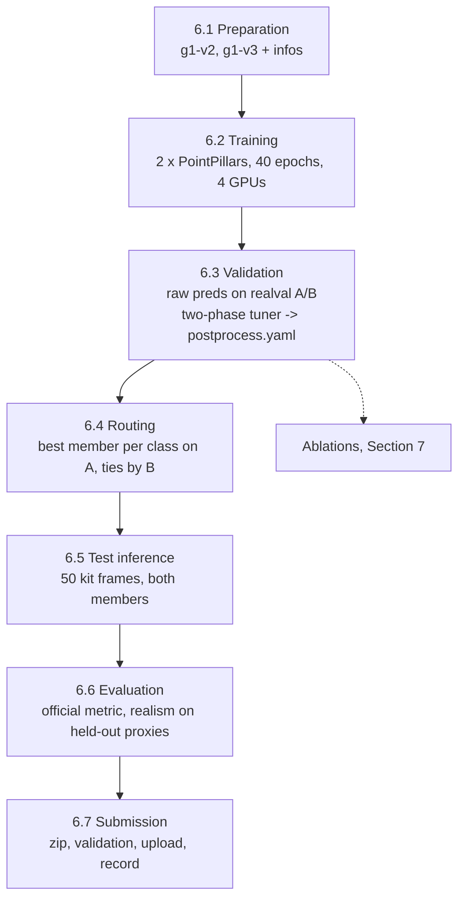

# Track 1 models: LUMPI (`model-lumpi-track/`)

> Modeling for Track 1 (CodaBench 16684): the approaches we considered, the selected model and why, and the selected model's full lifecycle (preparation, training, validation, test inference, ablations, evaluation, submission). Data and the generator are in [`data-lumpi-track/README.md`](../data-lumpi-track/README.md); the project-wide developer guide is the [root README](../README.md).

## 0. At a glance

| | |
|---|---|
| Selected model | [`routed-g1`](routed-g1): per-class routing of two PointPillars models trained on engine-G1 synthetic data ([`pointpillars-g1`](pointpillars-g1) with walker v1, [`pointpillars-g1v3`](pointpillars-g1v3) with walker v2) |
| Real validation (official metric, tuned) | **realval-A mAP 0.260**, realval-B 0.166 (Section 7) |
| Realism of the submitted frames | R = 0.906 on held-out legal proxies, official scorer (raw UT frames: 0.59) |
| Local combined estimate | **0.585** (A) / 0.505 (B); ECCV winner 0.479, live leader 0.277 |
| Ready to upload | [`routed-g1/submissions/2026-10-02_first/submission.zip`](routed-g1/submissions) (git-ignored; rebuild with Section 6.7) |
| Submit | `bash model-lumpi-track/routed-g1/test/make_submission.sh <tag> "<team>"` (Section 6.7) |
| Experiment log | [`registry.csv`](registry.csv) (one row per evaluation and submission) |

## 1. Folder conventions

One folder per model. A model is a detector configuration plus the dataset version it was trained on.

```
model-lumpi-track/
├── README.md                 this file
├── registry.csv              experiment log (bdc26.registry), appended by eval_predictions.py and package_submission.py
└── <model>/
    ├── README.md             what this model is, how to run it, its results
    ├── model.yaml            model card read by the tools: track, data.train, data.realval, realism_frames, members (routed)
    ├── train/                pcdet_model.yaml (+ _BASE_CONFIG_ pcdet_dataset.yaml), train.sh; output/ (git-ignored: ckpt, logs, tensorboard)
    ├── validation/           evaluate.sh, tune_and_eval.sh; output/ (git-ignored predictions); results/ (tracked JSON, local_scores.json)
    ├── test/                 postprocess.yaml (selected on real val), predict.sh, make_submission.sh, synthetic_ids.txt; output/ (git-ignored)
    └── submissions/<date>_<tag>/   manifest.json + synthetic_ids.txt (tracked), submission.zip (git-ignored)
```

Create a model with `python common/tools/new_model.py lumpi <name> --from <existing>` (copies configs, never outputs), then edit `model.yaml` and `train/pcdet_model.yaml`.

| Model | Data | Role | Status |
|---|---|---|---|
| [`pointpillars-ut`](pointpillars-ut) | `pcdet/ut-v1` (UT only, actors x 1/0.78, Van -> Car) | baseline and ablation (what G1 adds) | run2 trained 40 epochs |
| [`pointpillars-g1`](pointpillars-g1) | `pcdet/g1-v2` (walkers v1, Van as Van, calibrated density) | routed member | trained 40 epochs, tuned |
| [`pointpillars-g1v3`](pointpillars-g1v3) | `pcdet/g1-v3` (walkers v2) | routed member | trained 40 epochs, tuned |
| [`routed-g1`](routed-g1) | members above | **selected** | ready to submit |

## 2. Modeling approaches considered

What matters for this challenge (from [`docs/02-STRATEGY.md`](../docs/02-STRATEGY.md) and the competitor reports in [`docs/01-CHALLENGE-FACTS.md`](../docs/01-CHALLENGE-FACTS.md) Section 7):
- the detector is trained on synthetic data only and scored on real data, so **robustness to the sim-to-real gap** matters more than benchmark accuracy;
- the score is a 7-class mean of 3D AP at IoU 0.5, so **small and rare classes** (Person, Bicycle, Van, Truck, Bus, Motorcycle) count as much as Car;
- every architecture change needs fast iteration (many generator versions, real-validation loops) on shared GPUs.

| Approach | Pros for this challenge | Cons for this challenge | Verdict |
|---|---|---|---|
| **PointPillars** (anchor-based, pillars) | fast (40 epochs on 9k frames in about 2 h on 4 GPUs); robust to density changes; multi-mode anchors fit fixed size conventions; won the ECCV edition on both tracks | coarse z (one pillar spans 10 m); weaker on small objects in the literature (InScope pedestrian AP 23.8 vs 49.6 for CenterPoint) | **selected as the base detector** (best speed / robustness trade-off; small-class weakness addressed with synthetic Persons and per-class post-processing) |
| SECOND (sparse voxels, anchors) | finer z than pillars; beats pillars on roadside pedestrians (DAIR-V2X-I) | slower; voxel features more sensitive to density mismatch | next candidate for Person/Bicycle routing |
| CenterPoint (center heads) | strong on small objects; no anchor tuning | heatmap head sensitive to density and box-convention shifts; the ECCV winner found it no better than pillars here | candidate for Person routing (M10) |
| PV-RCNN++ / Voxel R-CNN (two-stage) | top accuracy on roadside benchmarks | 3-5x slower; refinement stage overfits synthetic point patterns | not selected |
| VoxelNeXt / DSVT / LION / HEDNet (fully sparse, transformers) | state-of-the-art; DSVT experts were the ECCV runner-up's backbone | heavy; needs more data diversity than one 10k-frame twin; LION needs its own fork | later, once G2 provides more varied data |
| Domain adaptation (self-training on real frames, BN adaptation) | can close the gap without labels | self-training on real frames is a gray area ([`01`](../docs/01-CHALLENGE-FACTS.md) Section 3.1); the detector must stay "trained on synthetic data only" | not used |
| Ensembles / per-class routing / WBF | per-class AP is independent, so a class can come from the model that is best for it; run-to-run variance is large on rare classes | needs a real validation set to choose routes (we have one: realval-A/B) | **used** (routing now; WBF later) |

**Why the selected model.** `routed-g1` takes each class from the better of two PointPillars G1 runs on real validation. Compared with a single PointPillars model it gains where training variance is large (Bicycle, Truck, Bus, Motorcycle) and uses walker v2 for Person, which transfers better to other measurements. Compared with heavier architectures it trains in 2 hours, which let us iterate on the generator (the biggest lever: synthetic Persons, Van class, density calibration). Cons: two forward passes at inference; routing is chosen on realval-A, the same measurement the test frames come from, so realval-A numbers are optimistic (realval-B is the check); PointPillars' coarse z limits 3D IoU for small objects (Person boxes are predicted too tall; the size calibration in post-processing partly compensates).

## 3. The detector configuration (`pointpillars-g1`, `pointpillars-g1v3`)

| Setting | Value | Why |
|---|---|---|
| Framework | OpenPCDet 0.6.0 (commit 233f849) with the `BDCDataset` adapter ([`common/bdc26/detect/pcdet_dataset.py`](../common/bdc26/detect/pcdet_dataset.py)) | OpenPCDet's 7-DoF box convention is the challenge's |
| Input | xyz only, 50,000 points in `[-40, -40, -5, 40, 40, 5]` | the test frames carry no intensity |
| Pillars | 0.15625 m, 512 x 512 grid, one pillar spans z [-5, 5], 32 points per pillar, 40,000 pillars | a 50k-point LUMPI frame fills about 31k pillars |
| Backbone / head | PillarVFE 64 -> BaseBEVBackbone [64, 128, 256] -> AnchorHeadSingle with direction classifier | standard PointPillars |
| Anchors (l, w, h; bottom at -2.15 m) | Person 0.78 x 0.75 x 1.90 (legal M4 median); Car 4.79 x 1.99 x 1.58; Bicycle 1.76 x 0.6 x 1.73; Motorcycle 2.19 x 0.87 x 1.53; Bus 10.27 x 3.94 x 4.25; Truck 7.94 x 2.89 x 3.46; Van 5.92 x 1.99 x 2.43; Unknown as Car | training-label medians (rescaled UT boxes, generator boxes) |
| Augmentation | GT-sampling Person 6, Car 6, Bicycle 10, Motorcycle 6, Bus 3, Truck 6, Van 6 (min 5 points); flips x/y; rotation +/-10 deg; scaling 0.95-1.05 | rare classes need GT-sampling |
| Optimization | 40 epochs, batch 6 per GPU on 4 GPUs, adam_onecycle LR 0.003, weight decay 0.01, `--fix_random_seed` | the one-cycle schedule matters: epoch 11 (high LR) found only 28% of real Persons, epoch 40 81% |
| OpenPCDet NMS | score 0.01, class-agnostic NMS 0.9, 1,000 boxes | keeps near-raw outputs; real NMS is per class in post-processing |
| Post-processing ([`common/bdc26/detect/postprocess.py`](../common/bdc26/detect/postprocess.py), `test/postprocess.yaml`) | per class: score floor, top-400 pre-NMS, rotated NMS IoU, re-centering on in-box points, size scale about the bottom centre, z offset; cross-class hedged copies | all selected on real validation (Section 6.3) |

## 4. Engine G1 data in one paragraph

UT-LUMPI frames with the actor scale fix, plus about 16 procedural walkers per frame ray-cast with the five real Measurement4 lidars, placed at legal real Person positions with real box sizes, inserted with per-sensor occlusion; UT Van trained as Van; background resampled toward the real spatial density. Full description and checks: [`data-lumpi-track/README.md`](../data-lumpi-track/README.md) Section 8.7.

## 5. Selected model lifecycle at a glance



## 6. Selected model lifecycle, step by step

All commands from the repository root after `source common/env/activate.sh`. GPU numbers are examples (`CUDA_VISIBLE_DEVICES`).

### 6.1 Preparation
```bash
python data-lumpi-track/prepare_g1.py --name g1-v1 --workers 64                                   # density-prior input
python common/tools/fit_density_prior.py --track lumpi --real pcdet/realval-v1 --syn pcdet/g1-v1 --out gen/density_prior_v1.npz
OMP_NUM_THREADS=1 python data-lumpi-track/prepare_g1.py --name g1-v2 --density-prior gen/density_prior_v1.npz --workers 64
OMP_NUM_THREADS=1 python data-lumpi-track/prepare_g1.py --name g1-v3 --walker v2 --density-prior gen/density_prior_v1.npz --workers 64
```
Prerequisites (data guide Section 8): UT-LUMPI, real labels and frames, `pcdet/realval-v1`. The infos and GT database are built by `train.sh` on first use.

### 6.2 Training
```bash
CUDA_VISIBLE_DEVICES=0,1,2,3 bash model-lumpi-track/pointpillars-g1/train/train.sh 4 run1 --fix_random_seed --workers 6
CUDA_VISIBLE_DEVICES=4,5,6,7 bash model-lumpi-track/pointpillars-g1v3/train/train.sh 4 run1 --fix_random_seed --workers 6
```
`train.sh NGPUS TAG [OpenPCDet train.py flags]` builds missing infos, then runs OpenPCDet's `tools/train.py` through [`common/tools/pcdet_train.py`](../common/tools/pcdet_train.py) (registers `BDCDataset`, injects the dataset path from `model.yaml`). Outputs: `train/output/pcdet_model/<TAG>/ckpt/checkpoint_epoch_N.pth`, `train_*.log`, `tensorboard/`. About 2 h on 4 A6000s (up to 45 GB per GPU at batch 6); at the end OpenPCDet evaluates the synthetic val split (`g1-v2` val: mAP 0.800), which only checks that training converged.

### 6.3 Validation and post-processing selection
```bash
CUDA_VISIBLE_DEVICES=0 bash model-lumpi-track/pointpillars-g1/validation/tune_and_eval.sh \
    model-lumpi-track/pointpillars-g1/train/output/pcdet_model/run1/ckpt/checkpoint_epoch_40.pth
```
[`tune_and_eval.sh`](pointpillars-g1/validation/tune_and_eval.sh) runs:
1. raw predictions (OpenPCDet outputs, score >= 0.01) on realval-A (`val`) and realval-B (`valB`) with [`pcdet_predict.py --raw`](../common/tools/pcdet_predict.py);
2. [`tune_postprocess.py`](../common/tools/tune_postprocess.py), per class and independently (per-class AP does not depend on other classes):
   - phase 1, detector behaviour: NMS IoU in {0.01, ..., 0.7}, re-centering in {0, 0.25, 0.5} for Person/Bicycle/Motorcycle; kept only if realval-B does not drop by more than 0.005;
   - phase 2, box convention: z offset in {-0.3, ..., 0.3} m and size scale {0.85, ..., 1.16} (length/width together, then height), only for classes with 500+ GT in A; not guarded by B because conventions differ by measurement (M4 Person boxes 0.77 m long, M5-6 0.96-0.99 m);
   - greedy cross-class hedges (discounted copies, factors {0.1, 0.3, 0.6}) where they add at least 0.002 AP on A;
   - the search uses the fast float32 IoU; the result is written to `test/postprocess.yaml` (previous config kept as `.prev`, report in `test/postprocess.report.json`);
3. post-processed predictions on A and B, scored with the official metric ([`eval_predictions.py`](../common/tools/eval_predictions.py), exact IoUs), registry rows, `validation/results/local_scores.json`.

### 6.4 Routing
```bash
python common/tools/route_predictions.py select model-lumpi-track/routed-g1
```
For every class: the member with the best realval-A AP; within 0.005 of the best, the one with the higher realval-B AP. The route is written into [`routed-g1/model.yaml`](routed-g1/model.yaml) and the table into `routed-g1/validation/results/route_table.json`. Verify by merging the members' validation predictions (`route_predictions.py merge ... --pred g1=... --pred g1v3=...`) and scoring them with `eval_predictions.py`.

### 6.5 Test inference
`pcdet_predict.py <member> --ckpt <ckpt> --frames kit` runs each member on the 50 kit frames with its own `test/postprocess.yaml`; `route_predictions.py merge` keeps each class from its routed member. Both steps are inside `make_submission.sh` (6.7). The test frames are used for nothing else.

### 6.6 Evaluation
- **Detection:** [`common/bdc26/evalap.py`](../common/bdc26/evalap.py) implements the official scorer exactly (VOC-style greedy matching, 40-point interpolation, classes without GT excluded); parity with the kit's `scoring_program` is a unit test ([`common/tests/test_official_parity.py`](../common/tests/test_official_parity.py)).
- **Realism:** [`common/bdc26/realism.py`](../common/bdc26/realism.py) reproduces `scoring_program/metrics.py` bit-for-bit; [`score_realism.py`](../common/tools/score_realism.py) scores a zip against the held-out legal proxies 4-5. The 50 frames are chosen once by [`select_realism_frames.py`](../common/tools/select_realism_frames.py) (pooled-moment matching to proxies 1-3).
- **Combined estimate:** `0.6 * clip(mAP / 0.7) + 0.4 * R`, printed by `make_submission.sh` with the realval-A mAP.

### 6.7 Submission
```bash
CUDA_VISIBLE_DEVICES=0 bash model-lumpi-track/routed-g1/test/make_submission.sh first "<team name>"
# upload model-lumpi-track/routed-g1/submissions/<date>_first/submission.zip on CodaBench 16684 (Submit tab), then:
python common/tools/package_submission.py model-lumpi-track/routed-g1 --tag first --record <codabench_id> <leaderboard.json>
```
The packager writes `submission.zip` (50 synthetic frames from `test/synthetic_ids.txt`, `predictions.json` for every test ID, `declaration.txt`), validates it against the published spec, and stores `manifest.json` (model, route, frames, local scores, validation result). See the root README, "Submission".

## 7. Results and ablations

Numbers are 3D AP at IoU 0.5 (R40) with the **official metric**, mean over the 7 classes with test GT; realval-A = 1,280 Measurement4 frames (selection split), realval-B = 867 Measurement5-6 frames (check). Every row is in [`registry.csv`](registry.csv).

### 7.1 Models (official metric, tuned post-processing)

| Model | Training data | realval-A | realval-B | Person | Car | Bicycle | Motorcycle | Bus | Truck | Van |
|---|---|---|---|---|---|---|---|---|---|---|
| `pointpillars-ut` (baseline) | `ut-v1`: UT only, Van -> Car | 0.168 | 0.127 | 0.000 | 0.843 | 0.124 | 0.005 | 0.006 | 0.166 | 0.034 |
| `pointpillars-g1` | `g1-v2`: + walkers v1, Van as Van, calibrated density | 0.253 | 0.156 | 0.341 | 0.874 | 0.265 | 0.010 | 0.006 | 0.154 | 0.122 |
| `pointpillars-g1v3` | `g1-v3`: + walker v2 | 0.248 | 0.163 | 0.340 | 0.873 | 0.186 | 0.008 | 0.011 | 0.200 | 0.118 |
| **`routed-g1`** (selected) | per class from the two above | **0.260** | **0.166** | 0.340 | 0.874 | 0.265 | 0.008 | 0.011 | 0.200 | 0.122 |

realval-B per class for `routed-g1`: Person 0.134, Car 0.770, Bicycle 0.102, Motorcycle 0.015, Bus 0.012, Truck 0.131, Van 0.001. The route: Person, Motorcycle, Bus, Truck from `g1v3`; Car, Bicycle, Van (and Unknown) from `g1`.

Reference points: ECCV 2026 winner on the test set, mAP 0.133 (Person 0.149, Car 0.643, Bicycle 0.078, Van 0.032, Motorcycle 0.020, Truck 0.011, Bus 0.000); live IEEE development leader mAP 0.102 (2026-10-02).

### 7.2 Ablations

| Question | Comparison | Result (realval-A mAP unless noted) |
|---|---|---|
| What does engine G1 add? | `pointpillars-ut` vs `pointpillars-g1` | 0.168 -> 0.253 (+0.085): Person 0 -> 0.341, Van 0.034 -> 0.122, Bicycle 0.124 -> 0.265 |
| Walker v1 vs v2 | `g1` vs `g1v3` | equal on A for Person (0.341 vs 0.340); on realval-B Person 0.091 -> 0.134 (v2 transfers to other measurements) |
| Training variance | `g1` vs `g1v3` on classes whose data are identical | Bicycle 0.265 vs 0.186, Truck 0.154 vs 0.200: large, so per-class routing pays (+0.007 over the best single model) |
| Post-processing (`g1`) | start config -> + NMS / re-centering -> + size and z -> + hedges | 0.210 -> 0.213 -> 0.242 -> 0.253 (box-convention calibration is the largest part: Person +0.049, Bicycle +0.109 with re-centering, Truck +0.019) |
| Training length | `g1` epoch 11 vs epoch 40 (untuned, KITTI-style metric at the time) | Person recall at BEV IoU 0.25 on real frames 28% -> 81% |
| Realism: density calibration and selection | raw UT frames -> `g1-v2` random 50 -> selected 50 (held-out proxies 4-5, official scorer) | R 0.59 -> 0.88 -> 0.906 (CD 1.63, MMD 0.0012, EMD 1.53 m, FPD 3.4); the first two values used the faster capped EMD solver, about 0.005 pessimistic |

### 7.3 Local estimate of the first submission

`routed-g1/submissions/2026-10-02_first/submission.zip`: realval-A mAP 0.260, realism R 0.906 (the kit's `local_eval.py` with 50 legal frames as the reference) -> **combined about 0.585** (0.505 with the realval-B mAP). The zip passes the kit's own validation (`valid_submission: 1`).

## 8. Experiment log and next experiments

| # | Question | Result / plan |
|---|---|---|
| E1 | Actor scale fix (`ut-noscale-v1` vs `ut-v1`) | planned (the 0.78^3 IoU cap argues for it) |
| E2 | UT Van -> Van and hedges | done: Van 0.034 (baseline, hedge only) -> 0.122 |
| E3 | Synthetic Persons (G1) | done: Person 0 -> 0.341 on realval-A; mAP 0.168 -> 0.253 |
| E4 | Walker v2 | done: Person on realval-B 0.091 -> 0.134; equal on A |
| E5 | Calibrated background density | done: realism 0.59 -> 0.88 (0.906 with frame selection) |
| E6 | Per-class post-processing | done: 0.210 -> 0.253 for `g1` (Section 7.2) |
| E7 | Architecture routing (SECOND / CenterPoint for Person, Bicycle) | next (M10) |
| E8 | Truck size modes, Bus convention | next (M7) |
| E9 | TTA and weighted box fusion | next (M11) |
| E10 | Static clutter and G2 for realism and hard negatives | next (M9) |

## 9. Submission log

| Date | Model / tag | CodaBench id | Local mAP (A / B) | Local R | LB mAP | LB R | LB combined | Note |
|---|---|---|---|---|---|---|---|---|
| 2026-10-02 | `routed-g1` / `first` | (to upload) | 0.260 / 0.166 | 0.906 | | | | packaged and validated; estimate 0.585 |
