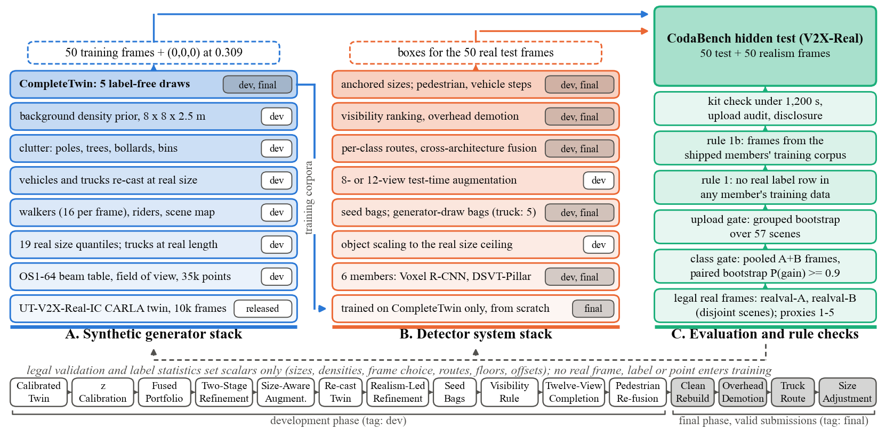
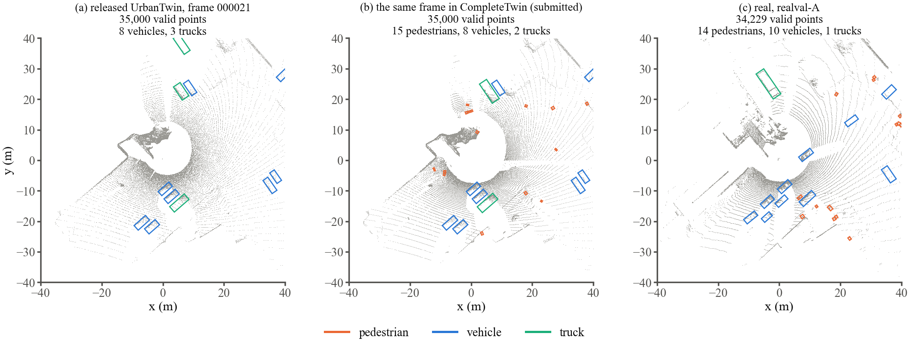
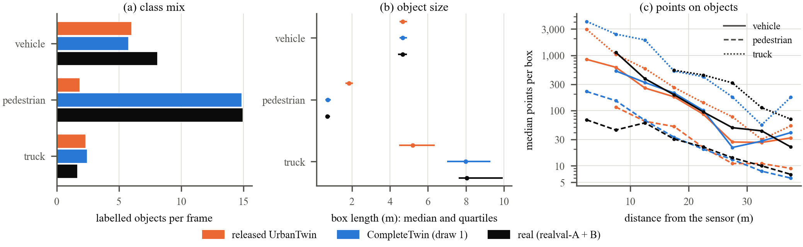
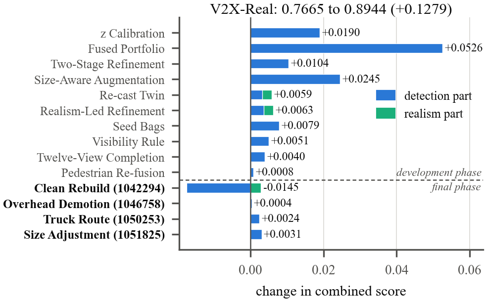
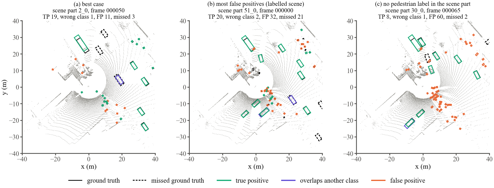
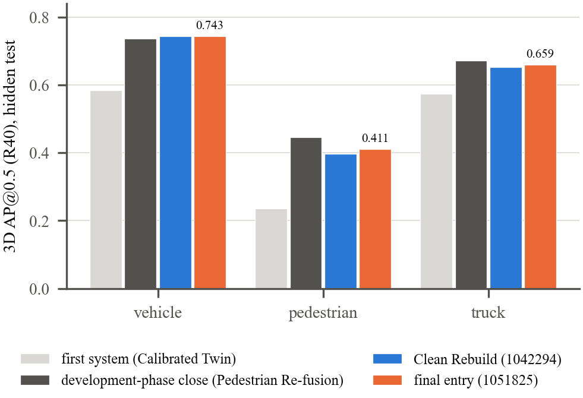

# UrbanTwin Sim2Real for Synthetic-Only LiDAR Detection: V2X-Real Track, Team KarmaRV
Rahul Vishwakarma
Hitachi America, Ltd. R&D
rahul.vishwakarma@hal.hitachi.com

<!-- docx-skip -->
> Final report of team KarmaRV for the V2X-Real track of the UCF UrbanTwin Sim2Real LiDAR Challenge, IEEE BigData Cup 2026 (up to 10 pages including references, IEEE two-column, US letter). The LUMPI track has its own report with the same structure ([`report_lumpi.md`](report_lumpi.md)). The Word version is built from this file inside the IEEE conference template: [`Final_Report_IEEE_Big_Data_Cup_2026_V2X-Real_Track_KarmaRV.docx`](Final_Report_IEEE_Big_Data_Cup_2026_V2X-Real_Track_KarmaRV.docx) (`python paper-bigdata2026/build_docx.py --track v2x --pdf`); the figures `figures/fig_v2x_*.png` come from [`make_figures.py`](make_figures.py). Every number is copied from a record in this repository (the `codabench_<id>.json` score files, the model cards, the member score files and the dated decision records in `docs/decisions/`) or measured by `make_figures.py` on legal frames (Figs. 2, 3 and 6); no model was re-run for the report. Revised 2026-11-15 for the formal submission: new title; abstract on the approach, its gains and gaps; no dates or ranks; organizer clarifications as points; Section VII by challenge phase with named approaches (development phase, then the valid final-phase submissions). Internal codes used in the decision records: C0 = Clean Rebuild (1042294), OD = Overhead Demotion (1046758), V1 = Truck Route (1050253), V4 = Size Adjustment (1051825), V3x = Calibrated Corpus (not uploaded).
<!-- /docx-skip -->

**Abstract**– The UrbanTwin Sim2Real LiDAR challenge asks for 3D object detectors trained only on synthetic data that transfer to a real roadside site, together with 50 synthetic frames whose point statistics resemble the real ones; the score weights a normalized 3D mAP by 0.6 and a realism score by 0.4. On the V2X-Real track (one Ouster OS1-64 at an intersection; vehicle, pedestrian and truck), we measured that the released digital twin has no walkers although pedestrians are 62% of the test objects, renders trucks 3 m too short, and emulates a denser, wider sensor than the real one. Our generator completes the twin without copying any real label: the real beam table and field of view, walkers ray-cast and placed on the twin's own scene map, trucks re-cast at real size, and unlabeled static clutter. Voxel R-CNN and DSVT-Pillar detectors trained from scratch on these frames are combined per class through test-time views, generator-draw bags and box fusion; label-free stages then encode the annotators' conventions: a range-dependent height offset, sparse boxes and pedestrian boxes under overhead structure ranked last, and box sizes moved toward the real medians. Each change had to pass a validation gate fixed in advance. Our final submission scores 0.8944 (mAP 0.605, realism 0.941). Relative to a PointPillars baseline on the calibrated twin (0.7665), the gain traces to variance reduction (+0.065), size handling (+0.028), annotation conventions (+0.024), twin content (+0.012), two-stage refinement (+0.010) and class routes (+0.003), less 0.015 for retraining every detector on label-free corpora. Two gaps remain: pedestrian AP (0.411) is bounded by localization in crowds, and retraining every detector on a realism-calibrated corpus raised realism by 0.011 but cost 0.059 mAP. Code will be released at https://github.com/karmarv/utsim2real-bdc26.

**Keywords**– LiDAR 3D object detection, sim-to-real transfer, digital twin, synthetic data, roadside perception, V2X-Real

## I. Introduction

Roadside LiDAR sensors at intersections see every road user from a fixed viewpoint, which makes them valuable for traffic monitoring and cooperative driving, but labelling their point clouds in 3D is slow and specific to each site. Digital twins promise labels for free: a simulated copy of the site produces point clouds whose boxes are known by construction. The UCF UrbanTwin Sim2Real LiDAR Challenge of the IEEE BigData Cup 2026 [1] tests that promise. The organizers released UrbanTwin datasets [2], simulated in CARLA [3] on digital twins of real intersections [4], for two real sites: the LUMPI intersection in Hannover [5] and the infrastructure LiDAR of V2X-Real at UCLA [6]. Participants train a detector only on synthetic data they generate, detect objects in 50 real test frames per site, and submit 50 synthetic frames that the scorer compares with 50 held-out real frames.

This report covers the V2X-Real track. Three things make it hard. First, the twin contains no walkers, while pedestrians (walkers, riders and scooters) are 62% of the test objects; its trucks are about 3 m shorter than the real ones; and it emulates a sensor with about twice the real number of valid points. Second, the hidden test is small (124 trucks), so local gains transfer noisily. Third, no real frame, label or point may enter training, while legal real frames may be used to validate, to select settings and to calibrate the generator with statistics. With the same scorer and test data, the best solutions of the ECCV 2026 edition of the challenge reached 0.4793 on LUMPI and 0.7457 on V2X [7], [8], and the organizers showed that a SEED detector [9] trained on UT-LUMPI matches a real-trained one for cars and that SECOND [10] trained on UT-V2X reaches 63.18 car AP [2].

**Team and submission.** Team KarmaRV has one participant, the author. Submissions are uploaded to the challenge's CodaBench leaderboard, which scores them automatically on the hidden test and realism reference frames. Our final V2X-Real submission is CodaBench submission **1051825** (combined 0.8944, mAP 0.605, realism 0.941; Section VIII).

Our contributions are (i) measurements of what the V2X twin lacks and a label-free generator that repairs each gap with our own synthetic geometry; (ii) a synthetic-only detector system built with OpenPCDet [11], with post-processing stages that encode the real annotation conventions; (iii) a decision protocol for a 50-frame hidden test, and the evolution of named approaches behind the final submission, with the measured server gain of each; and (iv) a record of every real-data use and a ledger of what did not work, including the organizers' calibrated-generator path. Fig. 1 shows the system as two stacks and the checks between them.

## II. Related Work

**Synthetic LiDAR and twins.** CARLA [3] renders LiDAR by ray casting against game assets, and LiDARsim [12] narrowed the gap for vehicle-mounted sensors with real surfel maps and learned ray drop. The organizers' twin method [4] builds CARLA maps from public geographic data and emulates each real sensor; the UrbanTwin datasets [2] release 10,000 such frames per site with automatic boxes.

**Transfer.** Statistical normalization [13] showed that object-size statistics explain much of the cross-dataset gap of 3D detectors, and random object scaling [14] makes detectors robust to size shift. We use both only through scalar statistics and never use self-training, which the rules exclude.

**Detectors and ensembles.** We trained PointPillars [15], SECOND-style sparse backbones [10] with center-based heads [16], Voxel R-CNN [17], PV-RCNN++ [18], [19], VoxelNeXt [20] and DSVT [21] in OpenPCDet [11], and tried GBlobs inputs [22]. Weighted box fusion [23], deep ensembles [24], weight averaging [25] and flip and rotation test-time augmentation [16], [26] reduce variance. Earlier solutions to this challenge [7], [8], [27], [28] used per-class non-maximum suppression (NMS), size calibration, null-return modelling and transformer ensembles; on V2X, the ECCV runner-up's DSVT ensemble reached mAP 0.452 [28].

**Metrics.** The realism score combines the Chamfer and earth mover's distances [29], the kernel maximum mean discrepancy [30] and a Fréchet point distance [31] between Gaussians fitted to the point sets, as in the Fréchet inception distance [32]. Detection uses KITTI-style [33] AP over 40 recall points [34].

<!-- wide top -->

*Fig. 1. The V2X-Real system as two stacks and their checks: A, the generator stack, from the released twin to CompleteTwin, our label-free training corpora; B, the detector stack, from training to the final size steps; C, the validation data, gates and rule checks before the hidden test. Tags give the challenge phase in which each layer entered or last changed; the bottom row lists the adopted approaches in order (Section VII).*

## III. Track, Data and Protocol

### A. Track and metric

Table I summarizes the track. With mAP the mean 3D AP at IoU 0.5 (R40) over the three classes, the score is

combined = 0.6 clip(mAP/0.7) + 0.4 R, (1)

R = 1 - (C + M + E + F)/4, (2)

with C = clip((CD-2)/28), M = clip(MMD/0.5), E = clip(EMD/5) and F = clip(FPD/50), each computed between the 50 submitted and 50 reference frames after masking to the range and subsampling to 10,000 points. While mAP is below 0.7, +0.01 AP on one V2X class is worth +0.0029 combined, +0.01 R +0.0040, and 0.1 m less EMD +0.0020. The CD term is zero below 2.0, so every frame change had to keep CD below that floor.

Table: TABLE I. The V2X-Real track (challenge kit and our measurements)

| Item | V2X-Real (Track 2) |
|---|---|
| Real sensor | 1 Ouster OS1-64 (64 x 1,024, 10 Hz) on the intersection's infrastructure pole |
| Classes and test boxes | vehicle 470, pedestrian 953 (with riders and scooters), truck 124 |
| Range (m) | x, y within 40; z from -8 to 2 |
| Forbidden frames | 50 test + 50 realism reference, over 32 scenes |
| Real frames | 49,405-50,000 points, 31% of them (0,0,0) no-returns |
| Synthetic data | UT-V2X-Real-IC [35], 10,000 frames |
| Real data licence | academic use |

### B. The real-data boundary

The rules allow any simulator and any detector trained on the participant's synthetic data, and the use of the real dataset's frames for validation and hyperparameter selection, provided no forbidden frame is touched. They forbid training on real labels, observing any of the 100 forbidden frames, and inferring the realism reference from the leaderboard. The organizers' clarifications fixed four further points, which our final system follows:
- Real labels, and object points cut out with real boxes, must not enter the training set.
- Validation and selection on real frames, label statistics in the generator and at test time, realism calibration and test-time post-processing are allowed, and each use must be reported (Section IX).
- The submitted frames must represent the training data: a calibration may change them only if it also changed the detector's training corpus.
- Our submissions are ranked from the Clean Rebuild on (Section VII-B), and the best ranked submission counts.

Every real-data reader in our code goes through one guard that refuses forbidden frames, logs each read with its purpose, and excludes the 20 frames on either side of each forbidden frame. We call the remaining real frames legal.

### C. Validation splits

No real frame was ever trained on. realval-A holds 688 frames and realval-B 298, from disjoint scenes: A draws 424, 119 and 145 frames from the public V2X-Real train, val and test splits, B 162, 27 and 109. Together they form 57 scene parts, the groups of the upload gate's bootstrap. Five realism proxies of 50 legal frames (1-3 fit, 4-5 held out) judge the frames. The test frames are denser than realval-A: 9.4 vehicles, 19.1 pedestrians and 2.5 trucks per frame against 8.1, 16.2 and 1.7.

<!-- wide top -->

*Fig. 2. Bird's-eye views of (a) a released UT-V2X-Real-IC frame in our training format (resampled to 35,000 points), (b) the same frame in CompleteTwin, one of our 50 submitted frames, and (c) a legal realval-A frame, with boxes by class. CompleteTwin adds the walkers, re-casts the trucks at real size and adds unlabeled clutter.*

### D. Environment

All work ran on one server with 8 NVIDIA RTX A6000 GPUs, in a single pinned Python 3.10 environment (PyTorch 2.1.2, CUDA 12.1, spconv 2.3.8, Open3D 0.19 [36] for ray casting, POT 0.9.7 [37] for the EMD) with OpenPCDet at commit 233f849. A 10k-frame corpus takes 5-20 CPU minutes on 96 workers; training one member for 40 epochs on 4 GPUs takes 1-2 h (PointPillars) to 3-7.5 h (two-stage and transformer models), and tuning its post-processing on both splits about as long.

## IV. Data Observations

### A. Sensor and frame

The real sensor's beam table, measured on 23 legal unlabeled frames, has 64 rows from +16.13 to -16.77 degrees (median spacing 0.53 degrees). The released twin emulates a different sensor: about 106,000 points per frame (69,000 valid in range against 35,000 real), elevations from -56 to +25 degrees, and rings that vary with azimuth because a level CARLA lidar was rotated into the tilted sensor frame. The site slopes: walker box bottoms lie at -3.5 m near the pole, -2 to -1 m at 10-30 m and -4.7 m beyond 30 m. Below -16.8 degrees there are no returns, so within about 10 m the real sensor sees only upper bodies (median hit height 1.41 m). Real frames carry 31% (0,0,0) no-returns.

### B. Objects: class mix, size and density

Table II lists the gaps of the released twin and our fixes, and Figs. 2 and 3 show them. The twin's only pedestrian boxes are riders (1.8 per frame, median length 1.84 m), against 14.9 labelled pedestrians per legal real frame; CompleteTwin has 14.9 pedestrians per frame, walkers and riders. The twin's trucks are 5.20 m long against 8.04 m real; re-cast trucks reach 7.99 m. Vehicles match in length (4.67 against 4.68 m) but are 9% too low (1.52 against 1.67 m). The real pedestrian class has two size modes, walkers and riders, and the truck class includes refuse trucks labelled TrashCan (8.2 x 2.9 x 2.6 m).

Points per box agree from 10 m outward (pedestrians 44 against 37 at 10-20 m, 18 against 19 at 20-30 m), but within 10 m CompleteTwin walkers carry three times the real points (151 against 46), the near-field cut of Section IV-A that our walkers do not reproduce. Real vehicles near the sensor are denser than ours (1,114 against 488 points at 0-10 m), and our trucks are denser than real ones at 10-20 m (979 against 538), where real trucks are often occluded.

Table: TABLE II. Gaps of the released V2X twin (measured on synthetic data and legal real statistics) and the generator fix

| Gap and consequence | Fix in our generator |
|---|---|
| No walkers: the twin's pedestrian boxes are riders, 1.8 per frame against 14.9 real pedestrians; pedestrians are 62% of the test objects | articulated walkers ray-cast with the real beam table, placed on the twin's scene map, Poisson(16) per frame in groups of 1-4 |
| A denser, wider sensor: 69k against 35k valid points, elevations -56 to +25 degrees | measured OS1-64 beam table, field-of-view mask (+16.4 / -17.0 degrees), 35,000 valid points |
| Trucks 5.20 m against 8.04 m long, at 0.42x the real density in the same place | trucks re-cast at real size with the real sensor: 7.99 m, 0.77x density |
| No buildings, vegetation, poles or fences in the scene map; 38.1% of the real above-ground static mass has no twin geometry | Poisson(30) unlabeled poles, trees, bollards, bins and barriers at curbside cells, as hard negatives |
| Raw twin frames score R about 0.83 against held-out real frames | sensor fixes, a background density prior and frame selection: R 0.9406 on the server |
| Real frames hold 31% (0,0,0) points | added at the real rate when the 50 frames are packaged; stripped by the detector's loader |

### C. Static structure

The twin's scene map, aggregated from its own CARLA semantic tags, holds road, terrain, sidewalk and road-line cells but no buildings, vegetation, poles or fences. That missing structure is where the detector errs: with the center-head detectors of the early development phase, 72-77% of the unmatched confident pedestrian boxes repeated in the same 1 m cells across frames, and in the Clean Rebuild 65% of the unmatched pedestrian boxes scored at least 0.5 still lie on static structure. Points 0.2-2.0 m above a box top mark 13.9% of the false pedestrian boxes scored at least 0.3 but only 1.9% of the true ones (a tree, sign or canopy above the box), which became the overhead stage of Section V-D. An oracle that removes pedestrian boxes on static structure would add 0.082 AP.

<!-- wide top -->

*Fig. 3. The V2X data on legal frames: (a) labelled objects per frame, (b) box length (median and quartiles) and (c) median points per box (log scale) against distance from the sensor, for the released twin (1,000 frames; its pedestrian boxes are riders), CompleteTwin draw 1 (1,000 frames) and realval-A and B (986 frames; panel c on a subset of frames). Bins with fewer than 12 boxes are left out.*

### D. Label coverage of the validation splits

One realval-B scene part (11 frames) has no pedestrian label, although the other part of the same recording has 28 labelled pedestrians per frame and our system places 31.7 pedestrian boxes per frame there at score 0.5 or more (349 boxes, all counted as false positives; Section VIII-B). realval-A has no such part. Local pedestrian AP on B is therefore a lower bound, and B-only gains in pedestrians were read with care.

### E. Realism

Table III follows the realism terms of our frame versions on the server. EMD carried 89% of the realism loss of the first frames. The density prior of Realism-Led Refinement lowered FPD locally but doubled it on the server (0.733 to 1.468); across frame versions the server moved 0.86 times the local held-out gain. The residual gap is horizontal, not vertical: the height bands match within 0.01, but 8% of the real mass lies in 2 m cells where we have less than a tenth of the real density. A fixed sensor also repeats its points to the centimetre (median nearest-point distance between real frames 0.000-0.002 m, ours 0.22-0.33 m), which a re-rendered twin cannot do; two real frame sets reach R 0.9617.

Table: TABLE III. Realism of our V2X frame versions (server terms of the scored uploads; local R on held-out proxies 4-5)

| Frames | CD | MMD | EMD | FPD | R | R local |
|---|---|---|---|---|---|---|
| Calibrated Twin | 2.215 | 0.00329 | 1.414 | 1.092 | 0.9203 | 0.9190 |
| Re-cast Twin | 2.181 | 0.00146 | 1.345 | 0.733 | 0.9268 | 0.9254 |
| Realism-Led (density prior) | 1.986 | 0.00063 | 1.182 | 1.468 | 0.9332 | 0.9366 |
| CompleteTwin (final entry) | 1.844 | 0.00034 | 1.110 | 0.748 | 0.9406 | 0.9426 |
| real against real (local) | 0.33 | | 0.751 | | 0.9617 | |

## V. The Final System

### A. Label-free generator

We call the final corpora CompleteTwin: the UrbanTwin frames completed, without copying any real label, with what the real site has and the twin lacks. Five draws with different generator seeds (1234-5234) give independent training sets of 10,000 frames each. Each draw adds, in order:
- **Sensor:** resampling to 35,000 valid points with the measured OS1-64 beam table and field-of-view mask.
- **Map-placed walkers:** walkers are placed on the cells of a scene map aggregated from the twin's own semantic tags and ground heights (0.45 road, 0.30 curb, 0.05 open, 0.20 beyond the twin's ground), in groups of 1-4, Poisson(16) per frame, with sizes and ranges drawn from scalar summaries of legal labels. No real position or label row is read.
- **Re-cast actors:** vehicles and trucks are re-cast with the real sensor from mirrored convex hulls at real size, with per-class ray dropout matched to the real points per box; trucks draw their sizes from 19 real size quantiles per dimension.
- **Clutter:** Poisson(30) unlabeled poles, trees, bollards, bins and barriers anchored at curbside map cells. Larger structures (hedges, fences, walls and shelters) lowered R on the fit proxies (0.9279 against 0.9374) and are left out.
- **Density prior:** keep probabilities of background points on 8 x 8 x 2.5 m cells, fitted on 400 legal unlabeled frames disjoint from the proxies.
- **Frames:** the 50 frames are chosen from the training corpus by greedy EMD + FPD swaps against proxies 1-3 and accepted only if the held-out proxies 4-5 gain at least 0.003 R. The packager adds (0,0,0) points at the real rate (0.309); the loader strips them in training and inference.

### B. Synthetic-only training

Every member is trained from scratch on synthetic frames for 40 epochs (Adam with a one-cycle schedule, learning rate 0.003, batch 4 per GPU on 4 GPUs). Augmentation uses ground-truth sampling [10], flips, rotation, global scaling, a small world tilt, and random object scaling capped at the real 99th-percentile sizes. The default configuration, ros (random object scaling), keeps ground-truth sampling; rosf switches it off for the final 5 epochs. Strong configurations are trained on up to five CompleteTwin draws and merged into bags by weighted box fusion of their predictions. Nothing is pretrained, and no batch-norm statistic, pseudo-label or fine-tuning step touches real data.

### C. Inference: views, routes and fusion

Each member runs with 8 views (identity, three flips, yaw +/-5 degrees, height +/-0.25 m) or 12 views (plus global scale 0.95 and 1.05), fused by weighted box fusion, and has its own per-class score floor, NMS IoU, re-centring and size scale, tuned on realval-A and checked on realval-B. A per-class routing table then sends each class to one member or fuses up to three (Table IV). The entry holds six member models (seven checkpoints), all trained on CompleteTwin draws, and Table V gives the members' own scores.

Table: TABLE IV. Composition of the final entry (submission 1051825; views: 8v / 12v; draws: CompleteTwin seeds; IoU: fusion threshold; AP: 3D AP@0.5 of the system)

| Class | Members (draws, views); fusion | realval A / B | Test |
|---|---|---|---|
| vehicle | bag of Voxel R-CNN (2 draws, 12v) + DSVT-Pillar (8v); IoU 0.5 | 0.873 / 0.881 | 0.743 |
| pedestrian | Voxel R-CNN on draws 1 and 2 + Voxel R-CNN rosf (all 12v); IoU 0.5 | 0.409 / 0.401 | 0.411 |
| truck | bag of Voxel R-CNN (5 draws, 8v) + Voxel R-CNN rosf (12v); IoU 0.7 | 0.911 / 0.853 | 0.659 |

Table: TABLE V. Members of the final entry on realval-A / realval-B (mAP with 8 and 12 views; pedestrian AP with 12 views)

| Member | 8 views | 12 views | Pedestrian |
|---|---|---|---|
| Voxel R-CNN, draw 1 | 0.666 / 0.667 | 0.670 / 0.666 | 0.372 / 0.376 |
| Voxel R-CNN, draw 2 | 0.690 / 0.658 | 0.696 / 0.672 | 0.382 / 0.367 |
| Voxel R-CNN rosf | 0.682 / 0.666 | 0.691 / 0.677 | 0.378 / 0.368 |
| DSVT-Pillar | 0.667 / 0.624 | 0.670 / 0.624 | 0.350 / 0.339 |
| Voxel R-CNN bag, 2 draws | 0.694 / 0.676 | 0.697 / 0.683 | 0.380 / 0.373 |
| Voxel R-CNN bag, 5 draws | 0.703 / 0.683 | 0.705 / 0.686 | 0.386 / 0.374 |

### D. Label-free post-processing

After routing and fusion, a fixed sequence of stages edits the boxes. It uses only the detector's own output, point counts in the test frame, and scalar label statistics:
- **Score floors** per class (vehicle 0.01, pedestrian and truck 0.05), which also keep the scorer within its time limit (the entry holds 41,252 boxes, 36,010 of them pedestrians; the kit check takes 283 s of the 1,200 s allowed).
- **Low-score copies:** each confident pedestrian box gets four copies shifted by 0.15 m and scored below every original pedestrian box, so they can only add matches.
- **Visibility ranking:** boxes with fewer than 6 (vehicle, pedestrian) or 8 (truck) points rank last. Real labels almost never fall below these counts (2nd percentile of points per box: pedestrian 6, vehicle 8, truck 18), while 16.3% of our synthetic pedestrians do, so a detector trained on them proposes boxes the annotators would not have drawn.
- **Overhead demotion:** a pedestrian box with 5 or more points 0.2-2.0 m above its top ranks last.
- **Anchored size calibration:** vehicle length -0.3 m and height +0.03 m, chosen on validation. The box end nearest the sensor stays fixed and the bottom is kept, because the observed near face is right and the inferred far face overshoots.
- **Final size adjustment:** pedestrian height moves halfway to 1.73 m and vehicle footprints a quarter of the way to 4.64 x 2.06 m, the realval-A medians, with the bottom kept. No stage adds, removes or rescores a box at a place where the detector placed none.

### E. Decision protocol

A change enters only if rules fixed before its results accept it:
- **Class gate:** a gain on the pooled A+B frames (realval-A and realval-B together) with a paired-bootstrap probability of gain, P(gain), of at least 0.9, and no loss above 0.005 on either split.
- **Upload gate:** a complete system is uploaded only if a grouped bootstrap over the 57 scene parts gives P(gain) of at least 0.75 (0.8 for the last submissions) and no leave-one-group-out loss beyond 0.002.
- **Checks in code before packaging:** no shipped member may have a real label row in its training data (rule 1). The 50 frames must come from a training corpus of the shipped checkpoints, with every calibration of that corpus in every checkpoint's training data (rule 1b).

We call the server change predicted from a validation gain its projection. Server results recalibrated these rules (Section VII) but never chose a frame set, a setting, a class route or a member.

## VI. Model Observations

**Architectures.** PointPillars [15] carried the first upload, but lost trucks under object scaling (realval-B truck 0.704 to 0.546) because its single 7.94 m truck anchor cannot follow a wide size range, and on CompleteTwin it passed no class. Center-head models (CenterPoint [16]) cut the pedestrian gap between bird's-eye-view (BEV) and 3D AP from 0.158 to 0.112 but made 1.8 times more static false positives. The two-stage Voxel R-CNN [17] carries every final class: it reduced the vehicle localization loss from 0.140 (CenterPoint) to 0.103, and PV-RCNN++ [19] to 0.058, while the pedestrian localization loss stayed at 0.27-0.30, so the walker gain of two-stage models came from ranking (ranking loss 0.424 to 0.343). DSVT-Pillar [21] is the strongest single CompleteTwin member for vehicles (8-view realval A / B 0.830 / 0.841) and sits in the vehicle fusion; it is weaker on pedestrians (Table V). VoxelNeXt [20] gained vehicles and trucks on CompleteTwin but lost 0.07-0.10 pedestrian AP, and PV-RCNN++ retrained on CompleteTwin lost every class against its earlier corpus, so neither is in the entry.

**Views, bags and seeds.** Eight views were the largest single gain: routing the view-averaged members raised realval-B from 0.537 to 0.617 (truck +0.114, vehicle +0.081) and fusion to 0.666. Twelve views help walkers only, and on the server the 12-view pedestrians gained 0.0139 against 0.0070-0.0103 locally. Seeds of one configuration differ by up to 0.17 AP (truck 0.636 against 0.803), which is why the truck class is a 5-draw bag: the third draw adds vehicle +0.019, the fourth +0.0046 and the fifth truck +0.0155, after which bags saturate. Ground-truth sampling off for the last 5 epochs (rosf) passed pedestrian and truck and is in both fusions, while sampling off throughout lost pedestrians.

**Localization at IoU 0.7.** The unscored 3D AP at IoU 0.7 tracks box quality: it rose from 0.056 in the first system to 0.112 with two-stage members and to 0.196 with object scaling, then fell to 0.165 with the seed bags and to 0.149 with the Truck Route, while the scored AP at 0.5 rose.

**Error profile.** Pedestrian errors are near misses in crowds: in the crowd case of Section VIII-B, 18 of 29 labelled pedestrians are missed while 13 of the 32 unmatched pedestrian boxes overlap one of them at IoU 0.1-0.5. The vertical centres of the walker boxes scatter with an interquartile range of 0.12 m and their heights with 0.17 m, and heights read from points lose 0.021-0.040 AP, so the 0.5 IoU of a 0.7 m box is the limit.

## VII. Strategy Evolution

We built the system as a sequence of named approaches, each targeting one measured gap, judged by a gate on legal validation and scored by an upload; they pull six kinds of lever: twin content, capacity, variance reduction (views, fusion, bags), sizes and conventions, selection (routes) and compliance. Table VI lists them by challenge phase, and Fig. 4 splits the server change of each adopted approach into detection and realism parts.

The gates grew with the evidence: after the Fused Portfolio and Two-Stage Refinement, the projection was refit to 0.6 times the mean of the A and B gains; with Seed Bags, the bar of +0.01 AP on B gave way to the pooled rule, because it had rejected vehicle and truck fusions that then gained 0.014 AP each on the server; and the grouped gate's threshold of 0.75 for the final phase was set from an upload that scored +0.0008 at P 0.79.

### A. Development phase: completing the twin, averaging the detectors and encoding the conventions

**Early approaches.** Twin content and variance reduction carried the early gains, then sizes and conventions. Our first system, PointPillars on the Calibrated Twin with walkers, already scored 0.7665, above the ECCV winner's 0.7457 [8]. z Calibration added 0.0190 while leaving BEV AP unchanged, a pure height convention of the real labels; the Fused Portfolio added 0.0526, the largest single step; Two-Stage Refinement added 0.0104; and Size-Aware Augmentation added 0.0245, because real trucks and vehicles span sizes the twin's few assets never showed.

**Late approaches.** The Re-cast Twin and Realism-Led Refinement added 0.0122 together and raised R from 0.920 to 0.933, and Seed Bags added 0.0079 through vehicle and truck fusions. The Visibility Rule encoded what the annotators label and added the largest CPU-only gain (pedestrian +0.0154), and Twelve-View Completion added 0.0040 on pedestrians. Late in the phase we trained members on the label-free corpus, walkers placed on the twin's own scene map instead of at real label positions, but none entered a fusion before the phase closed; its last upload was a pedestrian re-fusion of existing members (+0.0008), at 0.9030.

### B. Final phase: valid submissions from the Clean Rebuild to the entry

Once the organizers clarified that real labels must not enter training (Section III-B), every V2X member was at risk, because the development-phase corpora had placed walkers at real label positions. We retrained every member on CompleteTwin, added a code check (rule 1), and rebuilt the development-phase recipe, including the anchored vehicle length validated at its end, from clean members only. Every later submission adds a validated stage or route to this rebuild; Table VII gives their per-class test AP.

**Clean Rebuild (1042294).** The rebuild cost 0.0145 against the development-phase close (detection -0.0175, realism +0.0030), about twice its projection and almost all of it pedestrians (AP 0.446 to 0.398), as validation had shown (-0.06 on B): the walkers placed at legal label positions had mattered most, and the label-free walkers did not recover them. The anchored vehicle length raised vehicle AP from 0.737 to 0.743.

**Overhead Demotion (1046758).** Ranking last the pedestrian boxes that have points 0.2-2.0 m above their top (Section IV-C) added 0.0004.

**Truck Route (1050253).** Routing trucks to a five-draw bag fused with a rosf member added 0.0073 truck AP (+0.0024).

*Fig. 4. What each adopted approach bought on the V2X hidden test: the combined-score change between successive entries, split into the detection part 0.6 x change of clip(mAP/0.7) and the realism part 0.4 x change of R (official score files). Bold: valid final-phase submissions, with their CodaBench IDs.*

<!-- wide top -->
Table: TABLE VI. The approaches on V2X-Real by challenge phase (local: realval-A / B mAP; server: change against the previous entry, with transfer as server gain over projected gain; bold: valid final-phase submissions)

| Approach (lever) | What changed | Decision evidence and gate | Trade-off | Server: submission, change |
|---|---|---|---|---|
| **Development phase** | | | | |
| Calibrated Twin (twin content) | walkers ray-cast at legal label positions; field-of-view mask; 3 PointPillars members | local 0.572 / 0.520; pedestrian 0 to 0.266 on realval-A | label-placed walkers, later replaced | 965633: 0.7665 |
| z Calibration (conventions) | box z offset growing with range (vehicle -0.15 m + 0.005 m per m; pedestrian -0.175 m + 0.0075) | local 0.585 / 0.537 | truck left uncorrected | 972563: +0.0190 (pedestrian +0.046, BEV unchanged) |
| Fused Portfolio (variance) | 8-view TTA; cross-architecture box fusion; score floors | B 0.537 to 0.666; static false positives 6.2 to 1.8 per frame | 8x inference time | 974400: +0.0526 (0.48-0.80x) |
| Two-Stage Refinement (capacity) | Voxel R-CNN and PV-RCNN++ in fusions | vehicle localization loss 0.140 to 0.058 | 4-5x training cost | 975938: +0.0104 (0.53-0.80x) |
| Size-Aware Augmentation (sizes) | random object scaling toward the real size ranges | local 0.694 / 0.699; 3D AP@0.7 0.112 to 0.196 | pillars lose trucks; needs a ceiling | 978945: +0.0245 (pedestrian +0.046) |
| Re-cast Twin (twin content) | real-size trucks; clutter; scaling capped after 19.7 m false trucks | passed by 0.0006; R +0.0065 | truck density 0.77x real | 986496: +0.0059 |
| Realism-Led Refinement (twin content) | density prior; two-stage seeds; low-score pedestrian copies | local 0.714 / 0.710; copies cannot lower AP | server FPD 0.733 to 1.468 | 990255: +0.0063 (copies 1.07x) |
| Seed Bags (variance) | fused bags of seeds; pooled rule replaces the +0.01 bar | truck seed spread 0.135 AP; old bar rejected two gains | about 120 GPU-hours | 995877: +0.0079 (vehicle, truck +0.014) |
| Visibility Rule (conventions) | boxes below 6 points (vehicle 5; later 6, truck 8) rank last | pooled pedestrian +0.0197; projected +0.0040 | matched-label retraining below the gate | 1001919: +0.0051 (pedestrian +0.0154) |
| Twelve-View Completion (variance) | 12 views for the pedestrian members | B +0.0073; projected +0.0015 | walkers only; pillars lose vehicles | 1022246: +0.0040 (2.65x) |
| Pedestrian Re-fusion (selection) | pedestrian re-fusion of existing members; label-free corpus trained | local +0.0007 | no member on the new corpus yet | 1028491: +0.0008 |
| **Final phase: valid submissions** | | | | |
| Clean Rebuild (compliance) | every member retrained on CompleteTwin; anchored vehicle length; rule 1 in code | organizers' clarification; projected detection -0.0090 | pedestrian 0.446 to 0.398 AP | **1042294**: -0.0145 |
| Overhead Demotion (conventions) | overhead demotion of pedestrian boxes | pooled +0.0009; grouped gate passed | demoted true boxes under trees | **1046758**: +0.0004 |
| Truck Route (selection) | truck route: 5-draw bag + rosf member | +0.0007; route rule | 3D AP@0.7 0.1655 to 0.1491 | **1050253**: +0.0024 (truck +0.0073) |
| Size Adjustment (sizes) | pedestrian height, vehicle footprint toward the realval-A median | A +0.0010, B +0.0040; grouped P 0.95 | footprint step changed no test AP | **1051825**, entry: +0.0031 (pedestrian +0.0108) |
| Calibrated Corpus (twin content) | range mapping fitted on proxies 1-3; all 7 checkpoints retrained | realism gate +0.0116 R; detection -0.0586 mAP | the organizers' path, measured | rejected, not uploaded |

**Size Adjustment (1051825, the entry).** Moving pedestrian heights halfway to 1.73 m and vehicle footprints a quarter of the way to the realval-A medians added 0.0108 pedestrian AP (+0.0031). Our predicted pedestrian median height was already 1.74 m, so the step narrowed the spread of heights rather than moving their centre; the footprint step left every test AP unchanged to six digits. A further candidate, the organizers' recommended calibration path (Calibrated Corpus), failed its gate and was not uploaded (Section IX).

**Where the entry's score comes from.** The entry scores 0.6 x 0.605/0.7 = 0.518 from detection and 0.4 x 0.941 = 0.376 from realism. Against the first system it gained 0.1279 (detection +0.1198, realism +0.0081). By lever, the gain traces to variance reduction (+0.0645: Fused Portfolio, Seed Bags, twelve views), sizes (+0.0276: Size-Aware Augmentation and Size Adjustment), annotation conventions (+0.0244: z Calibration, Visibility Rule, Overhead Demotion), twin content (+0.0122: Re-cast Twin and Realism-Led Refinement), capacity (+0.0104: Two-Stage Refinement) and selection (+0.0033: re-fusion and Truck Route), less the Clean Rebuild (-0.0145).

## VIII. Results

### A. Final entry

Our final submission, 1051825, is the Size Adjustment system of Table IV; Table VII lists the valid final-phase submissions, Fig. 5 shows the entry on validation frames and Fig. 6 its per-class test AP. The entry reaches mAP 0.605 (vehicle 0.743, pedestrian 0.411, truck 0.659) and R 0.941 (CD 1.844, below the 2.0 floor; EMD 1.110; FPD 0.748). Since the first system, pedestrian AP rose from 0.235 to 0.411, vehicle from 0.585 to 0.743 and truck from 0.574 to 0.659. Validation tracks the test closely for pedestrians (0.409 / 0.401 against 0.411), but overstates vehicles (0.87-0.88 against 0.74) and trucks (0.85-0.91 against 0.66), the class with 124 test boxes. For scale, the first system was already above every published result of the ECCV edition [8], [28].

<!-- wide top -->

*Fig. 5. The final entry on legal realval-B frames (boxes scored at least 0.3; TP: matched at the official 3D IoU of 0.5; wrong class: overlaps an object of another class at IoU 0.5 or more; FP: neither): (a) a crowded walkway where all 14 labelled pedestrians are found; (b) a crowd where 18 of 29 pedestrians are missed and 13 of the 32 unmatched pedestrian boxes overlap them below IoU 0.5; (c) a scene part without any pedestrian label, where the 60 pedestrian boxes count as false positives.*

Table: TABLE VII. Valid final-phase V2X submissions (official score files; 3D AP@0.5 per class; R 0.9406 in all)

| Submission | Vehicle | Pedestrian | Truck | mAP | Combined |
|---|---|---|---|---|---|
| **1042294** Clean Rebuild | 0.743 | 0.398 | 0.652 | 0.5976 | 0.8885 |
| **1046758** Overhead Demotion | 0.743 | 0.399 | 0.652 | 0.5981 | 0.8889 |
| **1050253** Truck Route | 0.743 | 0.400 | 0.659 | 0.6009 | 0.8913 |
| **1051825** Size Adjustment, entry | 0.743 | **0.411** | 0.659 | **0.6045** | **0.8944** |

*Fig. 6. Per-class 3D AP at IoU 0.5 on the V2X hidden test: the first system (Calibrated Twin), the development-phase close (Pedestrian Re-fusion), the Clean Rebuild (1042294) and the final entry (1051825).*

### B. Qualitative and quantitative cases

Fig. 5 shows the entry on three realval-B frames, chosen by fixed rules over a third of the split: the best case, the frame with the most false positives among scene parts that have pedestrian labels, and the frame with the most false positives overall.

**Positive case.** In Fig. 5a all 14 labelled pedestrians on the walkway in front of the sensor are found, and the fused trucks and vehicles match at IoU 0.5; the 11 unmatched pedestrian boxes lie away from every labelled pedestrian (median 5.8 m), where static structure stands.

**Negative case.** In Fig. 5b the crowd near the sensor and the group at the far corner are found as crowds, but 13 of the 32 unmatched pedestrian boxes overlap a missed walker at IoU 0.1-0.5, a few decimetres off, the localization limit of Section VI. Fig. 5c is not a detector failure: it is the unlabelled scene part of Section IV-D.

**Transfer.** Projections and server changes mostly agreed in sign, with a wide spread: views and fusion transferred at 0.5-0.8 times the projection, bags and the visibility rule above 1 (2.1 and 1.27 times), routes at up to 6 times, and the Clean Rebuild at about twice its projected loss.

## IX. What Did Not Work, and What the Rules Excluded

Table VIII collects the main negative results on V2X; most were stopped by a rule before they reached the server.

<!-- wide bottom -->
Table: TABLE VIII. Approaches that did not work or were excluded on V2X-Real, with the evidence

| Approach | Evidence | Outcome |
|---|---|---|
| CenterPoint as a main member | 1.8x more static false positives; no class passed | not adopted |
| PointPillars, PV-RCNN++, VoxelNeXt on CompleteTwin | pillars fail every class; PV-RCNN++ loses every class against its earlier corpus; VoxelNeXt pedestrian -0.07 to -0.10 | not in the entry |
| GBlobs inputs [22] | 3-draw bags gain vehicle +0.0128 but lose pedestrian 0.046-0.051 | not in the entry |
| Statistical normalization and range jitter in training | normalization: truck -0.093 (it raises synthetic vehicle heights by about 10%); range jitter passes no class | rejected |
| Visibility-matched training labels | +0.0014 projected, below the +0.003 bar | not uploaded |
| Low-score completion copies with the visibility rule | demoted true boxes are outranked by the copies | not used |
| Larger structures (hedges, fences, walls) | fit-proxy R 0.9279 against 0.9374 | left out |
| Ground bowl, per-cell ground fix, point thinning | R -0.0022; +0.0000; thinning raises CD to 2.02-2.07, above the floor | rejected |
| Completing missing static mass from unlabeled frames | +0.0022 R, below the 0.003 gate; CD 1.85 to 1.95 | no completion frame shipped |
| Calibrated Corpus: all detectors retrained on it | R +0.0112 on the kit, detection -0.0586 mAP; all 12 member-split reads negative | stopped |
| 12 views for the truck bag and DSVT vehicle member | truck pooled -0.0009 (P 0.18), vehicle -0.0040 (P 0.00) | not built |
| Walkers placed from real label rows (development-phase corpora) | organizers' clarification: real labels must not enter training | upload removed; Clean Rebuild |

**Calibrating the training corpus.** In the final phase we tested the organizers' recommended path for calibration: apply it to the training data and retrain the detector. A range mapping fitted on the unlabeled proxies 1-3 quantile-maps our ranges onto the real ones in each bin of 10 degrees of azimuth by 2.125 degrees of elevation and rebalances the point shares with background points taken from other synthetic frames (about 2,450 per frame), leaving points inside labelled boxes untouched. It gained 0.0116 R at the realism gate and 0.0112 with the organizers' starting kit (EMD -0.18, CD -1.07). But all 12 member-by-split scores of the retrained checkpoints fell at 8 views (-0.032 to -0.084 mAP; trucks -0.045 to -0.203, pedestrians -0.033 to -0.075 AP), although training converged to the parents' loss (5.46 against 5.48). The system's detection change was -0.0586 mAP (grouped P(gain) 0.00 over the 57 scene parts), about -0.050 combined against +0.0045 from realism, so it was stopped. Our leading suspect is the copied background points: they can carry unlabeled objects, which then train as background.

**Real-data use (required by the organizers).** Every use was on legal frames, after removing the forbidden frames and our self-exclusion windows:
- validation and selection on realval-A and realval-B (V2X-Real train, val and test scenes);
- label statistics in the generator: the walker box mixture and distance histogram, 19 size quantiles, per-class ray dropout from real points per box, and points per walker;
- label statistics in training augmentation (the 99th-percentile size caps of object scaling) and at test time (the anchored size offsets, the visibility counts and the realval-A medians of the final size adjustment);
- realism calibration: the density prior from 400 unlabeled frames; the OS1-64 beam table from 23 unlabeled frames of the val and test splits; the choice of the 50 frames against proxies 1-3; the null rate; for the Calibrated Corpus only (not shipped), the range mapping fitted on proxies 1-3;
- test frames: inference only, plus point counts inside predicted boxes for the visibility and overhead stages; the copies duplicate the detector's own boxes.

We disclosed the label-placed walkers of our earlier corpora to the organizers; the affected upload was removed. One point of rule interpretation remains open: the no-returns of the 50 frames are added at packaging rather than stored in the training corpora, although the detector strips them either way; the Calibrated Corpus would have stored them, and it did not ship.

## X. Discussion and Limitations

Four lessons generalize. First, the decisive gaps were content and conventions the twin lacked (walkers, truck sizes, the label height convention, what annotators draw), not detector capacity: our first pillars already beat the edition's transformer ensemble [28]. Second, a 50-frame test rewards variance reduction that cannot hurt (views, fusion, copies ranked below every box, demotions that only reorder) and punishes selection on noisy splits. Third, realism and detection can pull apart: the Calibrated Corpus closed half of the EMD gap to real frames but cost about ten times its realism gain in detection, so a realism calibration has to be judged by the detector it trains, not by R alone. Fourth, compliance is cheaper when built into the code: rule 1 would have prevented the removal.

Pedestrian AP is 0.411 and is bounded by localization in crowds; two-stage refinement did not fix walker boxes. Realism has some headroom: two real frame sets reach R 0.9617 against our 0.941, and 38.1% of the real static mass has no counterpart in the twin. Truck AP rests on 124 test boxes and its validation scores overstate it by 0.2. Our boxes at IoU 0.7 (0.150) are worse than at their best in the development phase (0.198).

**Reproducibility.** The code, the entry's seven checkpoints and a reproduction script will be released at https://github.com/karmarv/utsim2real-bdc26; re-merging the saved member predictions reproduces the submission exactly.

## XI. Conclusion

A rule-clean, synthetic-only pipeline reached 0.8944 on V2X-Real. It completes the organizers' twin with measured statistics, averages detector noise with views, fusion and bags, encodes the annotators' conventions in label-free stages, and admits a change only if rules fixed in advance accept it. The largest gains came early, from variance reduction and from the data side; the final-phase gains were small and transferred when they could not hurt. Walker localization in crowds and twin geometry for the missing static structure are the clearest next steps.

## Acknowledgment

We thank the organizers of the UrbanTwin Sim2Real Challenge, M. Shahbaz and S. Agarwal, for the UrbanTwin datasets, the starting kit and their timely answers; the creators of the V2X-Real and LUMPI datasets; and the OpenPCDet developers.

## References

[1] M. Shahbaz and S. Agarwal, "UCF UrbanTwin Sim2Real LiDAR Challenge," IEEE BigData 2026 Cup, Challenge 04, 2026. [Online]. Available: https://urbanity-lab.github.io/bdc2026-urbantwin-sim2real/ (accessed Nov. 15, 2026).
[2] M. Shahbaz and S. Agarwal, "UrbanTwin: Synthetic roadside LiDAR datasets," IEEE Open J. Intell. Transp. Syst., vol. 7, pp. 353-364, 2026, arXiv:2509.06781.
[3] A. Dosovitskiy et al., "CARLA: An open urban driving simulator," in Proc. 1st Conf. Robot Learn. (CoRL), PMLR vol. 78, 2017, pp. 1-16.
[4] M. Shahbaz and S. Agarwal, "High-fidelity digital twins for bridging the Sim2Real gap in LiDAR-based ITS perception," IEEE Trans. Intell. Transp. Syst., vol. 27, no. 7, pp. 8698-8709, 2026.
[5] S. Busch et al., "LUMPI: The Leibniz University multi-perspective intersection dataset," in Proc. IEEE Intell. Veh. Symp. (IV), 2022, pp. 1127-1134.
[6] H. Xiang et al., "V2X-Real: A large-scale dataset for vehicle-to-everything cooperative perception," in Proc. Eur. Conf. Comput. Vis. (ECCV), Springer, 2024, pp. 455-470.
[7] A. Upganlawar, "Geometric refinement and distributional alignment for Sim2Real roadside LiDAR detection," arXiv:2611.03936, 2026.
[8] A. Upganlawar, "Coordinate frame recovery, per class NMS and null return modelling for Sim2Real V2X LiDAR detection," arXiv:2611.03940, 2026.
[9] Z. Liu et al., "SEED: A simple and effective 3D DETR in point clouds," in Proc. Eur. Conf. Comput. Vis. (ECCV), Springer, 2024, pp. 110-126.
[10] Y. Yan, Y. Mao, and B. Li, "SECOND: Sparsely embedded convolutional detection," Sensors, vol. 18, no. 10, Art. no. 3337, 2018.
[11] OpenPCDet Development Team, "OpenPCDet: An open-source toolbox for 3D object detection from point clouds," 2020. [Online]. Available: https://github.com/open-mmlab/OpenPCDet (accessed Nov. 15, 2026).
[12] S. Manivasagam et al., "LiDARsim: Realistic LiDAR simulation by leveraging the real world," in Proc. IEEE/CVF CVPR, 2020, pp. 11164-11173.
[13] Y. Wang et al., "Train in Germany, test in the USA: Making 3D object detectors generalize," in Proc. IEEE/CVF CVPR, 2020, pp. 11710-11720.
[14] J. Yang et al., "ST3D: Self-training for unsupervised domain adaptation on 3D object detection," in Proc. IEEE/CVF CVPR, 2021, pp. 10363-10373.
[15] A. H. Lang et al., "PointPillars: Fast encoders for object detection from point clouds," in Proc. IEEE/CVF CVPR, 2019, pp. 12689-12697.
[16] T. Yin, X. Zhou, and P. Krähenbühl, "Center-based 3D object detection and tracking," in Proc. IEEE/CVF CVPR, 2021, pp. 11779-11788.
[17] J. Deng et al., "Voxel R-CNN: Towards high performance voxel-based 3D object detection," in Proc. AAAI Conf. Artif. Intell., vol. 35, no. 2, 2021, pp. 1201-1209.
[18] S. Shi et al., "PV-RCNN: Point-voxel feature set abstraction for 3D object detection," in Proc. IEEE/CVF CVPR, 2020, pp. 10526-10535.
[19] S. Shi et al., "PV-RCNN++: Point-voxel feature set abstraction with local vector representation for 3D object detection," Int. J. Comput. Vis., vol. 131, no. 2, pp. 531-551, 2023.
[20] Y. Chen et al., "VoxelNeXt: Fully sparse VoxelNet for 3D object detection and tracking," in Proc. IEEE/CVF CVPR, 2023, pp. 21674-21683.
[21] H. Wang et al., "DSVT: Dynamic sparse voxel transformer with rotated sets," in Proc. IEEE/CVF CVPR, 2023, pp. 13520-13529.
[22] D. Malic et al., "GBlobs: Explicit local structure via Gaussian blobs for improved cross-domain LiDAR-based 3D object detection," in Proc. IEEE/CVF CVPR, 2025, pp. 27357-27367.
[23] R. Solovyev, W. Wang, and T. Gabruseva, "Weighted boxes fusion: Ensembling boxes from different object detection models," Image Vis. Comput., vol. 107, Art. no. 104117, 2021.
[24] B. Lakshminarayanan, A. Pritzel, and C. Blundell, "Simple and scalable predictive uncertainty estimation using deep ensembles," in Proc. Adv. Neural Inf. Process. Syst. (NIPS), vol. 30, 2017.
[25] P. Izmailov et al., "Averaging weights leads to wider optima and better generalization," in Proc. 34th Conf. Uncertainty Artif. Intell. (UAI), 2018, pp. 876-885.
[26] Z. Ding et al., "1st place solution for Waymo Open Dataset challenge: 3D detection and domain adaptation," arXiv:2006.15505, 2020.
[27] P. Luo et al., "Solution for UCF UrbanTwin LUMPI track: Sim-to-real urban LiDAR 3D object detection," arXiv:2609.07590, 2026.
[28] P. Luo et al., "Solution for UCF UrbanTwin V2X-Real track: Sim-to-real urban LiDAR 3D object detection," arXiv:2609.07608, 2026.
[29] H. Fan, H. Su, and L. Guibas, "A point set generation network for 3D object reconstruction from a single image," in Proc. IEEE CVPR, 2017, pp. 2463-2471.
[30] A. Gretton et al., "A kernel two-sample test," J. Mach. Learn. Res., vol. 13, no. 25, pp. 723-773, 2012.
[31] D. W. Shu, S. W. Park, and J. Kwon, "3D point cloud generative adversarial network based on tree structured graph convolutions," in Proc. IEEE/CVF ICCV, 2019, pp. 3858-3867.
[32] M. Heusel et al., "GANs trained by a two time-scale update rule converge to a local Nash equilibrium," in Proc. Adv. Neural Inf. Process. Syst. (NIPS), vol. 30, 2017.
[33] A. Geiger, P. Lenz, and R. Urtasun, "Are we ready for autonomous driving? The KITTI vision benchmark suite," in Proc. IEEE CVPR, 2012, pp. 3354-3361.
[34] A. Simonelli et al., "Disentangling monocular 3D object detection," in Proc. IEEE/CVF ICCV, 2019, pp. 1991-1999.
[35] M. Shahbaz and S. Agarwal, "UT-V2X-Real-IC," Harvard Dataverse, V2.1, 2025, doi: 10.7910/DVN/N6N4UR.
[36] Q.-Y. Zhou, J. Park, and V. Koltun, "Open3D: A modern library for 3D data processing," arXiv:1801.09847, 2018.
[37] R. Flamary et al., "POT: Python optimal transport," J. Mach. Learn. Res., vol. 22, no. 78, pp. 1-8, 2021.
