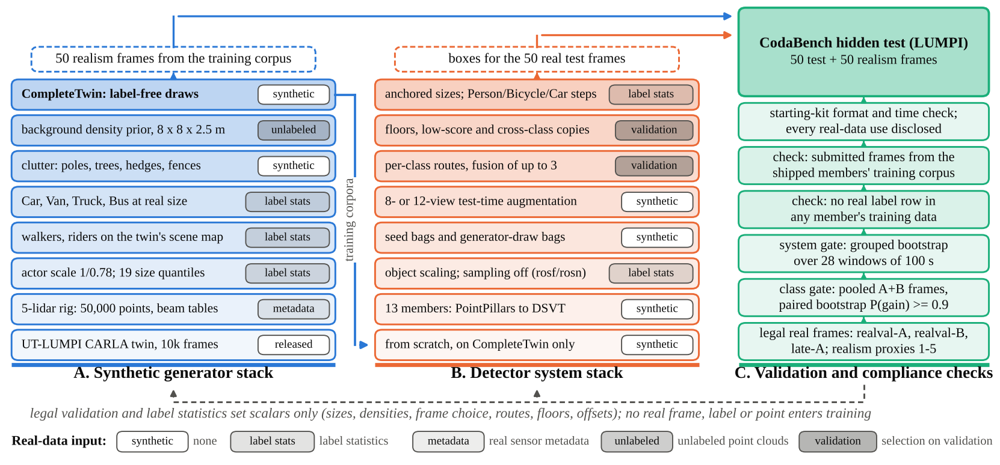
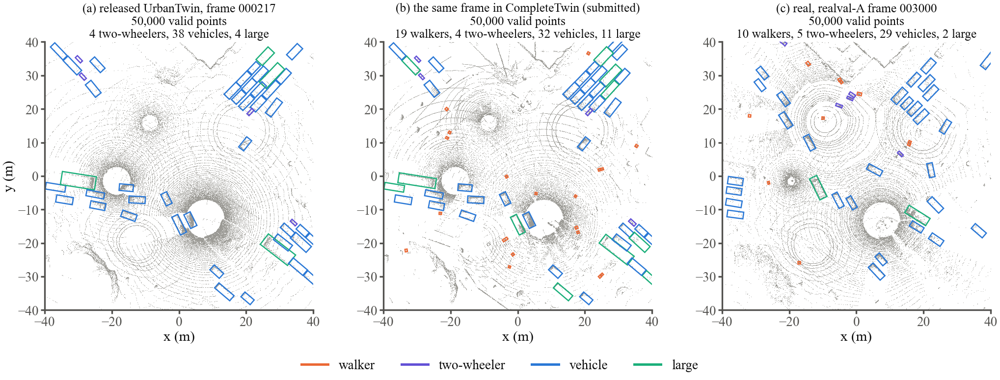
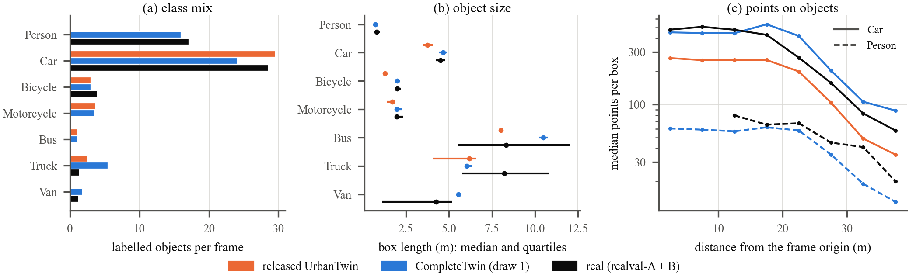
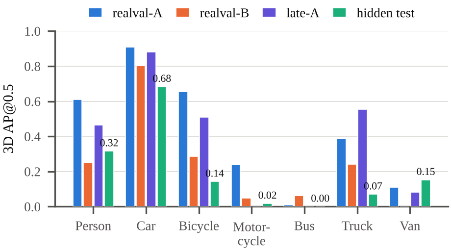
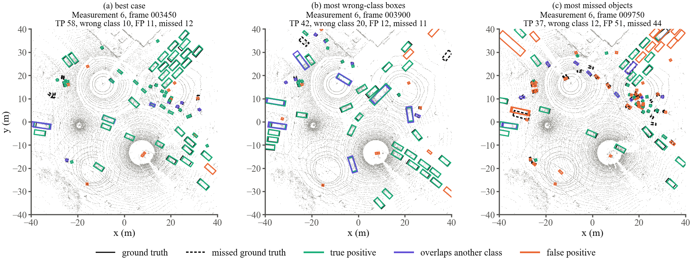
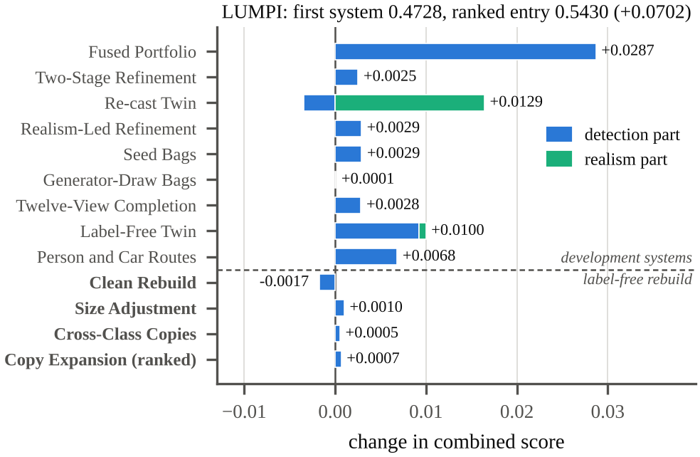

# Digital Twin Augmentation and Classwise Detector Fusion for Synthetic-Only Multi-LiDAR Detection on LUMPI
Rahul Vishwakarma
Hitachi America, Ltd. R&D
Santa Clara, CA, USA
rahul.vishwakarma@hal.hitachi.com

<!-- docx-skip -->
> Paper source for the IEEE BigData 2026 Cup (UCF UrbanTwin Sim2Real LiDAR Challenge, LUMPI track), rebuilt on 2026-11-18 from the final report of 2026-11-15 to follow the organizers' guidelines of 2026-11-17: the ranked entry only (CodaBench 1053789), a paper structure with an ablation section, a short real-data paragraph, no other teams' results, the public code link and the organizers' citation forms. Build: `python3 build_docx.py --pdf` in this folder. Every number comes from the official score files and records of https://github.com/karmarv/utsim2real-bdc26 (paper-bigdata2026/report_lumpi.md and the codabench_<id>.json files).
<!-- /docx-skip -->

**Abstract**- A digital twin of a roadside site can label LiDAR frames for free, but a detector trained on its frames must still transfer to the real sensors. We study this on the LUMPI track of the UCF UrbanTwin Sim2Real LiDAR Challenge: five merged lidars at an urban intersection, seven classes, a detector trained on synthetic data only, and 50 submitted synthetic frames scored for realism. Against legal real statistics, the released twin renders actors at 0.78 times their real size, has no pedestrians, gives cars and bicycles half and a quarter of the real points, and misses a third of the real static structure. We complete it without copying any real label: actors at real scale, ray-cast walkers placed on the twin's own scene map, vehicles re-cast at real size and density, seated riders and unlabeled clutter. An ensemble of thirteen detectors from five families, trained from scratch on these frames, is routed per class and fused over test-time views and generator-draw bags; label-free size steps and low-score copies ranked below the original boxes follow. Every change passed a validation gate fixed in advance. The ranked entry, our best submission ranked by the organizers, scores 0.5430 (3D mAP 0.198 at IoU 0.5, realism 0.934). Fusion was the largest single gain, and placing walkers on the twin's map raised Person AP for every architecture. The remaining error is class confusion between vehicle types, consistent with the real labels' size conventions and provenance and with our class mapping. Code: https://github.com/karmarv/utsim2real-bdc26.

**Keywords**- LiDAR 3D object detection, sim-to-real transfer, digital twin, synthetic data, roadside perception, LUMPI

## I. Introduction

Infrastructure LiDAR at urban intersections observes every road user from a fixed pose, which suits traffic monitoring and cooperative perception, yet each new site needs its own 3D labels, and labeling point clouds is slow. A digital twin removes the labeling step: a simulated copy of the site produces frames whose boxes are known by construction. The UCF UrbanTwin Sim2Real LiDAR Challenge of the IEEE BigData Cup 2026 [1] measures how far that promise holds. Its organizers built high-fidelity twins of two real intersections in CARLA [2], [3], [4] and released their simulated frames as the UrbanTwin datasets [5]: UT-LUMPI [6] for the LUMPI intersection in Hannover [7] and UT-V2X-Real-IC [8] for the infrastructure LiDAR of V2X-Real [9]. A participant generates its own synthetic data, trains a detector on it alone, detects objects in 50 real test frames and submits 50 synthetic frames whose realism is scored against 50 held-out real frames.

This paper covers the LUMPI track; a companion paper covers V2X-Real [10]. LUMPI is the harder of the two for three reasons. First, the twin differs from the real site in ways a detector notices: it renders actors at about 0.78 times their real size, omits pedestrians on purpose [5], and gives cars and two-wheelers a fraction of the real points. Second, the metric averages seven classes, three of which have only 25-79 test boxes, so no local split predicts their AP. Third, no real frame, label or point may enter training, while legal real frames may be used to validate, to select settings and to calibrate the generator with statistics. The organizers showed that SEED [11] trained on UT-LUMPI matches a real-trained detector for cars, as does SECOND [12] on UT-V2X [5]; the open question is what the twin must add for the other six classes.

We answer it with a completed twin and a routed ensemble of synthetic-only detectors, then read the residual error back to the real labels. Fig. 1 shows the resulting system: a generator stack, a detector stack and the checks between them. Our ranked entry, the best of our submissions ranked by the organizers [1], scores 0.5430 (3D mAP 0.198 at IoU 0.5, realism 0.934). Our contributions are:
- a measurement of what the released LUMPI twin lacks against legal real statistics, and CompleteTwin, a label-free generator that repairs scale, pedestrians, density and static structure with our own synthetic geometry (Sections III-C and IV-A);
- a synthetic-only detector system built with OpenPCDet [13]: thirteen members of five families routed per class, fused over test-time views and generator-draw bags, with post-processing that adds low-ranked alternative hypotheses (Sections IV-B to IV-D);
- a decision protocol for a seven-class, 50-frame hidden test, including a split matched to the test recording for Person (Section IV-E);
- a diagnosis of the remaining error down to the conventions and provenance of the real labels, and ablations of the generator, the ensemble and the post-processing (Sections V and VI).

The code, the fourteen checkpoints of the ranked entry and a script that reproduces it are released on GitHub (Section VII).

## II. Related Work

**Simulated LiDAR and digital twins.** Game-engine simulators such as CARLA [2] ray-cast LiDAR against hand-made assets, and LiDARsim [14] reduced the gap for vehicle-mounted sensors with real surfel maps and learned ray drop. The UrbanTwin pipeline [4] reconstructs a real site in CARLA from public geographic data and emulates each real sensor at its pose; the resulting twins narrow the sim-to-real gap of LiDAR-based perception for intelligent transportation systems (ITS) [3], and the UrbanTwin datasets [5], [6], [8] provide 10,000 automatically labeled frames per site. We take these frames as the starting point and quantify what they still miss.

**Cross-domain 3D detection.** Object-size statistics explain much of the gap between 3D detection datasets, which statistical normalization [15] corrects, and random object scaling [16] trains detectors to tolerate size shift. We use both only through scalar statistics. Self-training on unlabeled target frames [16], the usual route of unsupervised domain adaptation, is excluded by the rules, which makes the task one of domain generalization: robustness must come from the synthetic data and the training and test-time recipe.

**Detectors and ensembles.** Our members come from PointPillars [17], SECOND-style sparse backbones [12] with center-based heads [18], Voxel R-CNN [19], PV-RCNN++ [20], [21], VoxelNeXt [22] and DSVT [23] in OpenPCDet [13]; we also tested GBlobs inputs [24]. Variance is reduced with weighted box fusion [25], deep ensembles [26], weight averaging [27] and flip and rotation test-time augmentation [18], [28]. Solutions to the ECCV 2026 DriveX edition of this challenge combined complementary detectors with class-aware fusion [29] or used geometric refinement and distributional alignment [30]; we do not compare scores across editions.

**Metrics.** Realism is scored with the Chamfer distance (CD) and earth mover's distance (EMD) [31], the kernel maximum mean discrepancy (MMD) [32] and a Fréchet point distance (FPD) [33] between Gaussians fitted to the point sets, after the Fréchet inception distance [34]; detection uses KITTI-style [35] average precision (AP) over 40 recall points (R40) [36].

<!-- wide top -->

*Fig. 1. The LUMPI system: A, the synthetic generator stack, from the released twin to CompleteTwin, our label-free training corpora; B, the detector system stack, from synthetic-only training to the label-free post-processing; C, the validation data, gates and compliance checks before the hidden test. The tag on each layer names its real-data input: none (synthetic), scalar label statistics, real sensor metadata, unlabeled real point clouds, or selection on legal validation frames.*

## III. Problem Setup and Twin Gap Analysis

### A. Task and metric

Table: TABLE I. The LUMPI track (challenge kit and our measurements)

| Item | LUMPI |
|---|---|
| Real sensors | 5 merged lidars: Pandar64, HDL-64E S3, PandarQT, 2× VLP-16, 1.2-2.6 m above the ground |
| Classes and test boxes | Person 512, Car 1,258, Bicycle 82, Motorcycle 27, Bus 25, Truck 192, Van 79 |
| Range (m) | x, y within 40; z from -5 to 5 |
| Forbidden frames | 50 test (Measurement 4, frames 6497-8109) + 50 realism reference |
| Real frames | about 268k raw points (210k in range), resampled to 50,000 |
| Synthetic data | UT-LUMPI [6], 10,000 frames |

Table I summarizes the track. With mAP the mean 3D AP at an intersection over union (IoU) of 0.5 (R40) over the seven classes that have test boxes, the combined score is

$$ *S* = 0.6 clip(mAP/0.7) + 0.4 *R*, | (1)

$$ *R* = 1 − (*C* + *M* + *E* + *F*)/4, | (2)

where clip(·) limits a value to [0, 1], *C* = clip((CD − 2)/28), *M* = clip(MMD/0.5), *E* = clip(EMD/5) and *F* = clip(FPD/50), each computed between the 50 submitted and 50 reference frames after masking to the range and subsampling to 10,000 points. While mAP is below 0.7, +0.01 AP on one LUMPI class is worth only +0.0012 combined, against +0.0040 for +0.01 *R* and +0.0020 for 0.1 m less EMD; a rare class counts as much as Car.

### B. Real-data use and validation protocol

**Real-data use.** The detector weights were optimized only on synthetic point clouds and synthetic annotations: no real frame, label or point enters training. The 100 forbidden frames and their labels were excluded from training, generator calibration, validation and model selection, and the 50 released test point clouds were used only for inference with the frozen pipeline. Every other real-data reader goes through one guard that refuses the forbidden frames, excludes Measurement 4 frames 6400-8199 altogether, and logs each read with its purpose; we call the remaining frames legal. Legal frames serve four purposes, all allowed by the challenge rules and the organizers' clarifications of November 9 and 12, 2026: (i) validation and model selection, including the routes, the copy pairs and their fractions; (ii) scalar label statistics, in the generator (walker size mixture and distance histogram, 19 size quantiles per dimension, four class thresholds, per-class ray dropout matched to the real points per box) and at test time (object-scaling caps, anchored size offsets and the train-split median sizes); (iii) realism calibration: the sensor beam tables from the LUMPI metadata, a background density prior fitted on 400 unlabeled frames, and the choice of the 50 submitted frames from our own training corpus against three 50-frame proxies, accepted only if two held-out proxies improve; and (iv) test-time post-processing of the detector's own boxes. The calibration is part of the training corpus, so the submitted frames represent the detector's training data. Development corpora that placed walkers at real label positions, and a calibration applied to the submitted frames only, were withdrawn after the organizers' clarifications; the ranked entry uses neither.

**Validation splits.** realval-A holds 1,280 frames of Measurement 4 (frames 0-6399, every fifth), the recording of the test frames; its last 320 frames (late-A, frames 4800-6395) end about 100 frames before the first test frame (6497). realval-B holds 867 frames of Measurements 5 and 6. Five realism proxies of 50 legal frames (1-3 to fit, 4-5 held out) judge the frames. The splits differ from the test in class mix: the test has 10.2 persons per frame against 17.4 on realval-A, 3.7 times the trucks and 23 times the motorcycles. Late-A, with 10.8 persons per frame, is the closest; for Person, a gain on late-A and on B agreed in sign with the hidden test in 9 of 10 changes, while no split predicted Car, Bicycle or Truck.

<!-- wide top -->

*Fig. 2. Bird's-eye views of (a) a released UT-LUMPI frame in our training format (50,000 points, actors scaled by 1/0.78), (b) the same frame in CompleteTwin, one of our 50 submitted frames, and (c) a legal realval-A frame; boxes by group (walker: Person; two-wheeler: Bicycle, Motorcycle; vehicle: Car, Van; large: Truck, Bus). CompleteTwin adds walkers and riders, re-casts the vehicles at real size and density, and adds unlabeled clutter.*

### C. What the released twin lacks

**Sensor rig and frame.** The released twin already uses the real five-lidar rig (beam residual 0.03°), but its ground is flat at -2.152 m, while the real ground spans -2.37 to -1.95 m (5th to 75th percentile); two sensors stand only 1.5-2.4 m high, so nearby cars hide about 43,000 points per frame.

**Objects: class mix, size and density.** Table II lists the gaps and our fixes, and Figs. 2 and 3 show them. Before our scale fix, the twin's median car is 3.74 × 1.55 × 1.26 m against 4.51 × 1.98 × 1.68 m real. It has no Person and no Van, while real frames hold 17.0 persons per frame, and it overstates the rare classes: CompleteTwin keeps its 3.5 motorcycles and 1.1 buses per frame, against 0.13 and 0.22 in the legal real frames. After the re-cast, the point ratios of cars, bicycles and motorcycles rise to 0.83, 0.90 and 1.04, but cars beyond 25 m stay at about 0.6; at 10-20 m, cars carry 254 points in the twin, 481 in CompleteTwin and 463 in real frames (Fig. 3c). Our walkers match real persons up to 30 m (60 against 67 points at 10-20 m) but carry half the real points beyond 30 m.

**Label size conventions.** The size conventions of the real labels are the key observation for LUMPI (Fig. 3b). Real Truck and Bus boxes have the same median size (8.24 × 2.68 × 3.09 against 8.31 × 2.75 × 3.12 m), and real Vans are car-length (4.25 against 4.51 m) and differ from cars mainly in height (1.83 against 1.68 m). The twin does not follow them: its trucks are shorter (6.03 m, 0.72 times real), its buses longer (10.48 m, 1.26 times) and its vans longer (5.57 m, 1.31 times). Our class thresholds (Truck if at least 5.6 m long or 2.40 m high; Van if at least 4.6 m long and 2.00 m high) keep 97.7% of real trucks and 93.9% of real cars in their class, but only 37.5% of real vans. Real trucks have four length modes (5-6, 8-9, 12-14 and 14-20 m).

Table: TABLE II. Gaps of the released LUMPI twin (measured on synthetic data and legal real statistics) and the generator fix

| Gap and consequence | Fix in CompleteTwin |
|---|---|
| Actors at about 0.78× real size: a concentric, aligned box at that scale reaches only 0.78³ = 0.47 IoU | actors scaled by 1/0.78 |
| No pedestrians: Person is a seventh of the metric and 17.0 per real frame | articulated walkers ray-cast with each real sensor's beam table, placed on the twin's scene map (Poisson(16) per frame) |
| Cars, bicycles and motorcycles at 0.44, 0.25 and 0.52× the real points; riderless two-wheelers; few asset sizes | actors re-cast at real size and density with the real sensors; seated riders; 19 real size quantiles; class thresholds for Car, Van and Truck |
| No buildings, vegetation, poles or fences: 34.9% of the real above-ground static mass missing | Poisson(30) poles, trees, bollards, bins and barriers and Poisson(30) hedges, fences, walls and shelters, unlabeled |
| Raw twin frames score R 0.596 on a held-out proxy (FPD 61, EMD 2.8 m) | background density prior and frame selection: R 0.9342 on the server |
| The PandarQT near-field ring holds 3.6% of real points but 0.13% of ours | not in the ranked entry: a fix applied to the submitted frames only does not qualify |

**Label provenance.** The real labels change over time, which limits what any split can say. In Measurement 4 the share of manually corrected Person boxes falls from 0.99 (frames 0-1599) to 0.69 (4800-6399); automatic Person boxes are 1.20-1.25 m long against 0.75-0.80 m corrected, and on late-A our recall at IoU 0.5 is 0.72 on corrected and 0.49 on automatic boxes. Bus and Motorcycle labels after frame 3200 are all automatic, and the Van label changes meaning: person-sized before frame 3200, van-sized after it, and mostly person-sized in Measurements 5 and 6 (635 of the 854 Vans of realval-B), so every member scores about 0.001 Van AP on realval-B.

**Static structure.** 34.9% of the real above-ground static mass has no twin geometry, and 44-52% of the real objects of every class stand in cells that the twin's scene map, built from its own CARLA semantic tags, does not model. Before clutter was added, 50-69% of the unmatched confident Person boxes sat on static cells, and an oracle removing them would have raised Person AP on realval-A from 0.340 to 0.400; in an earlier system, test-time fusion cut them from 9.7 to 4.1 per frame. In the ranked entry, 2.8 unmatched Person boxes per realval-B frame scored at least 0.5 still lie on static structure.

<!-- wide top -->

*Fig. 3. The LUMPI data on legal frames: (a) labeled objects per frame, (b) box length (median and quartiles) and (c) median points per box (log scale) against distance from the frame origin, for the released twin (1,000 frames; sizes before the 1/0.78 fix), CompleteTwin draw 1 (1,000 frames) and realval-A and B (2,147 frames; panel c on a subset). Bins with fewer than 12 boxes are left out; the real Van quartiles include the person-sized Van labels.*

## IV. Method

### A. CompleteTwin: a label-free generator

CompleteTwin completes the UrbanTwin frames with what the real site has and the twin lacks, without copying any real label. Draws with different generator seeds give independent training sets of 10,000 frames; the entry uses draws 1 and 2 and their union. Each draw adds, in order:
- **Base fixes:** actors scaled by 1/0.78; resampling to 50,000 points.
- **Map-placed walkers:** a scene map is aggregated from the twin's own semantic tags and ground heights. Walkers are placed on its cells (0.45 road, 0.30 curb, 0.05 open, 0.20 beyond the twin's ground), in groups of 1-4, Poisson(16) per frame, with sizes and ranges drawn from scalar summaries of legal labels. No real position or label row is read.
- **Re-cast actors:** Car, Van, Truck and Bus are re-cast with the real sensors from mirrored convex hulls at real size, with per-class ray dropout matched to the real points per box. Two-wheelers get seated riders. Trucks, buses and two-wheelers draw their sizes from 19 real size quantiles per dimension, and the thresholds of Section III-C assign Car, Van and Truck.
- **Clutter:** Poisson(30) unlabeled poles, trees, bollards, bins and barriers anchored at curbside map cells, and Poisson(30) hedges, fences, walls and shelters.
- **Density prior:** keep probabilities of background points on 8 × 8 × 2.5 m cells, fitted on 400 legal unlabeled frames disjoint from the proxies.
- **Frames:** the 50 submitted frames are chosen from the training corpus by greedy EMD + FPD swaps against proxies 1-3 and accepted only if the held-out proxies 4-5 gain at least 0.003 R.

### B. Synthetic-only training

Every member is trained from scratch on synthetic frames for 40 epochs (Adam with a one-cycle schedule, learning rate 0.003, batch 4 per GPU on 4 GPUs). Augmentation uses ground-truth sampling [12], flips, rotation, global scaling, a small world tilt, and random object scaling capped at the real 99th-percentile sizes. The default configuration, ros (random object scaling), keeps ground-truth sampling; rosf switches it off for the final 5 epochs and rosn for all 40. Strong configurations are trained on two CompleteTwin draws and merged into bags by weighted box fusion of their predictions, or trained on the union of both draws. Nothing is pretrained, and no batch-norm statistic, pseudo-label or fine-tuning step touches real data.

### C. Inference: views, routes and fusion

Each member runs with 8 views (identity, three flips, yaw ±5°, height ±0.25 m) or 12 views (the 8 plus global scales 0.95 and 1.05 applied to the identity and to the x-y flip), fused by weighted box fusion, and has its own per-class score floor, non-maximum suppression (NMS) IoU, re-centering and size scale, tuned on realval-A and checked on realval-B. A per-class routing table then sends each class to one member or fuses up to three (Table III). The entry holds 13 member models (14 checkpoints), all trained on CompleteTwin draws; the rare classes (Motorcycle, Bus) and Van keep the best pooled candidate and were not tuned further, because no local split predicts them.

<!-- wide top -->
Table: TABLE III. Composition of the ranked entry (views 8v / 12v; draws: CompleteTwin seeds; union: both draws in one training set; IoU: fusion threshold; AP: 3D AP@0.5 of the system on realval-A / B / late-A and the hidden test)

| Class | Members (draws, views); fusion | Validation | Test |
|---|---|---|---|
| Person | Voxel R-CNN rosn (12v) + bag of Voxel R-CNN rosf (2 draws, 12v); IoU 0.7 | 0.610 / 0.250 / 0.466 | 0.316 |
| Car | Voxel R-CNN rosf (12v) + bag of Voxel R-CNN rosn (2 draws, 8v) + Voxel R-CNN rosf (union, 12v); IoU 0.7 | 0.909 / 0.803 / 0.880 | 0.683 |
| Bicycle | PointPillars (draw 2, 8v) + DSVT-Pillar rosf (12v) + PV-RCNN++ (union, 12v); IoU 0.5 | 0.654 / 0.287 / 0.510 | 0.143 |
| Motorcycle | VoxelNeXt rosn (12v) + VoxelNeXt rosf (draw 2, 8v); IoU 0.7 | 0.240 / 0.050 / 0.001 | 0.018 |
| Bus | PointPillars (8v) | 0.011 / 0.064 / 0.001 | 0.000 |
| Truck | bag of PV-RCNN++ (2 draws, 8v) + PV-RCNN++ (union, 8v); IoU 0.7 | 0.388 / 0.242 / 0.555 | 0.070 |
| Van | DSVT-Pillar rosf (12v) | 0.109 / 0.001 / 0.082 | 0.153 |
| mAP | | 0.417 / 0.243 / 0.356 | 0.198 |

### D. Label-free post-processing

After routing and fusion, a fixed sequence of stages edits the boxes. It uses only the detector's own output, point counts in the test frame and scalar label statistics, and no stage places a box where the detector placed none:
- **Score floors** of 0.01 per class, within the scorer's time limit.
- **Low-score copies:** for Person and Bus, each confident box gets four copies shifted by 0.2 m (Person) or 1.0 m (Bus) and scored below every original box of its class, so the original ranking is unchanged and the copies act as low-confidence alternative hypotheses.
- **Anchored size calibration:** Car length, width and height and Person height offsets, chosen on validation. The box end nearest a sensor stays fixed and the bottom is kept, because the observed near face is right and the inferred far face overshoots.
- **Final size adjustment:** Person height moves halfway to 1.90 m, and the Bicycle and Car footprints a quarter of the way to 2.00 × 0.85 m and 4.48 × 1.99 m, the median boxes of the organizers' train split, which ends before the test frames; the bottom is kept. Four more Person copies at 0.2 m with a 1.1 times footprint are added, scored below every Person box.
- **Cross-class copies:** because the real labels give Truck and Bus one median size and Van a car length (Section III-C), confusions between these classes are expected. Every Motorcycle box is therefore also given as a Bicycle at the Bicycle median size, every Truck box as a Bus, every Bus and Van box as a Truck, the upper half (by score) of the Bicycle boxes as Persons and the upper fifth of the Car boxes as Vans. Each copy is scored below every box of its new class, so the ranking of that class's original boxes is unchanged.

### E. Decision protocol

A change enters only if rules fixed before its results accept it:
- **Class gate:** a gain on the pooled realval-A and realval-B frames with a paired-bootstrap probability of gain, P(gain), of at least 0.9, and no loss above 0.005 on either split. A Person change must also gain on late-A.
- **System gate:** a complete system is submitted only if a grouped bootstrap (1,000 resamples of whole windows) over 28 time windows of 100 s gives P(gain) of at least 0.75 (0.8 near the close), no leave-one-group-out loss beyond 0.002, and less than half of the gain from rare classes.
- **Compliance checks in code:** no shipped member may have a real label row in its training data, and the 50 frames must come from a training corpus of the shipped checkpoints, with every calibration of that corpus in their training data.

Leaderboard scores never chose a frame set, a setting, a class route or a member. The decision to explore cross-class copies drew on per-class leaderboard results of an earlier submission; every pair, donor and fraction was then chosen on validation.

## V. Experiments and Results

### A. Implementation

All work ran on one server with 8 NVIDIA RTX A6000 GPUs in one pinned Python 3.10 environment (PyTorch 2.1.2, CUDA 12.1, spconv 2.3.8, Open3D 0.19 [37] for ray casting, POT 0.9.7 [38] for the EMD, OpenPCDet at commit 233f849). A 10k-frame corpus takes 5-20 CPU minutes; training one member for 40 epochs on 4 GPUs takes 1-7.5 h and tuning its post-processing about 3.7 h, which bounded the candidates per class.

Table: TABLE IV. Official results of the ranked entry on the hidden test (realism terms between the 50 submitted and 50 reference frames; real against real: two sets of legal real frames, local)

| Metric | Ranked entry | Real against real |
|---|---|---|
| Combined score | 0.5430 | |
| 3D mAP@0.5 (R40) | 0.1975 | |
| AP Person / Car / Bicycle | 0.316 / 0.683 / 0.143 | |
| AP Motorcycle / Bus | 0.018 / 0.000 | |
| AP Truck / Van | 0.070 / 0.153 | |
| 3D mAP@0.7 (unscored) | 0.102 | |
| Realism R | 0.9342 | 0.9498 |
| CD / MMD | 1.510 / 0.00010 | 0.64 / - |
| EMD / FPD | 1.272 / 0.430 | 0.980 / - |

### B. Official results

Table IV gives the official scores of the ranked entry. It scores 0.6 × 0.198/0.7 = 0.169 from detection and 0.4 × 0.934 = 0.374 from realism. Car supplies most of the mAP (0.683), Person reaches 0.316, Van 0.153 and Bicycle 0.143, while Motorcycle and Bus remain near zero although they are two sevenths of the metric. Fig. 4 compares validation with the hidden test: the entry's test mAP is 0.47 times its realval-A mAP and 0.81 times its realval-B mAP, and only late-A and realval-B predicted the sign of Person changes on the test (Section III-B). The unscored 3D mAP at IoU 0.7 is 0.102.

*Fig. 4. Per-class 3D AP at IoU 0.5 of the ranked entry on the legal validation splits and on the hidden test (official score file). Late-A is the end of realval-A, closest in time to the test frames.*

<!-- wide top -->

*Fig. 5. The ranked entry on legal realval-B frames (boxes scored at least 0.3; TP: matched at the official 3D IoU of 0.5; wrong class: overlaps an object of another class at IoU 0.5 or more; FP: neither): (a) cars and walkers found across the intersection; (b) confident boxes of the wrong class on real objects (Van and Truck on cars; Person on person-sized objects labeled Car or Van); (c) a crowd where 32 of 47 persons are missed and 19 of the 31 unmatched Person boxes overlap them below IoU 0.5.*

### C. Realism

EMD carries 97% of the remaining realism loss, and point-by-point attribution places 44% of its excess transport in the height band nearest the ground. Two sets of legal real frames reach R 0.9498 (EMD 0.980) against each other, a gap of about 0.006 combined to this empirical real-against-real reference. Small realism fixes transferred to the server at about 0.31 times their local gain. Across generator versions, the server realism rose from 0.891 for the calibrated twin to 0.932 after the re-cast of vehicles and riders and to 0.934 for CompleteTwin, against 0.596 for raw twin frames on a held-out proxy, where the density prior alone raised R to 0.88 and frame selection to 0.90. A re-cast of the PandarQT near-field ring reached 0.9355 on the server, but it was applied to the submitted frames only and therefore does not qualify (Table II).

### D. Observations

**Qualitative cases.** Fig. 5 shows three realval-B frames chosen by fixed rules over a third of the split. In the best case (Fig. 5a), 58 objects match (31 cars, 19 persons). In Fig. 5b, 20 confident boxes overlap a real object of another class: 7 Vans (5 on cars, 2 on trucks), 5 Trucks on cars, 2 Cars on trucks and 1 Bicycle on a car. The other 5 are Person boxes on person-sized objects that the labels call Car or Van, suspected annotation or taxonomy inconsistencies. In Fig. 5c, 19 of the 31 unmatched Person boxes overlap a missed person below IoU 0.5: near misses at the 0.5 IoU of a 0.8 m box, not false objects.

**Where the AP is lost.** Table V decomposes the AP loss on realval-B of a system identical to the ranked entry except for its last copy stage. Ranking dominates every class but Car and Van. The confident false positives are boxes of the wrong class on real objects: Truck on cars (76-83%), Van on cars and trucks (93-96%) and Bicycle on pedestrians (75-90%). Buses are found (recall of any class 0.94-0.97), but 60-91% of them are called Truck, and real trucks under 8 m are found at recall 0.15 (A) and 0.09 (B), half of them as Car. These boxes are sized like the true positives, and 73-100% of the other members make the same confusions, so neither a size rule nor another member separates them; this is consistent with the label conventions of Section III-C and with our class thresholds, which keep only 37.5% of real vans in their class. Nor are the rare classes short of examples: the training split of CompleteTwin draw 1 holds 10,093 buses, 33,431 motorcycles and 17,144 vans, yet across 118 single detectors of six families the best realval AP ((A+B)/2) is at most 0.13 for Motorcycle and 0.07 for Bus and Van; more nominal examples alone did not resolve these classes in the tested system.

Table: TABLE V. Where the AP is lost on realval-B (the ranked entry without its last copy stage; recall at 3D IoU 0.5; 1 - AP@0.5 split into localization = AP@0.25 - AP@0.5, ranking = oracle-ranked AP@0.25 - AP@0.25 and misses = 1 - oracle-ranked AP@0.25)

| Class | AP | Recall | Localization | Ranking | Misses |
|---|---|---|---|---|---|
| Person | 0.248 | 0.73 | 0.248 | 0.429 | 0.075 |
| Car | 0.803 | 0.88 | 0.052 | 0.044 | 0.100 |
| Bicycle | 0.287 | 0.89 | 0.032 | 0.632 | 0.050 |
| Motorcycle | 0.050 | 0.55 | 0.012 | 0.688 | 0.250 |
| Bus | 0.064 | 0.49 | 0.035 | 0.575 | 0.325 |
| Truck | 0.238 | 0.63 | 0.065 | 0.422 | 0.275 |
| Van | 0.001 | 0.18 | 0.000 | 0.174 | 0.825 |

**What each approach contributed.** Fig. 6 traces the official combined score through the named approaches, from the first system (0.4728) to the ranked entry (0.5430). The ensemble steps gave the largest detection gains: the fused portfolio of test-time views and cross-architecture fusion (+0.0287, Bicycle AP 0.053 to 0.224), then seed bags and twelve-view completion. The re-cast twin was the largest realism step (+0.0129, R 0.891 to 0.932), at a small Bicycle cost, and the label-free twin with walkers on the twin's own map added +0.0100 through Person AP. The rebuild on label-free corpora cost 0.0017, and the label-free size steps and copies then added 0.0022.

## VI. Ablation

### A. Post-processing stages on the hidden test

Table VI details the last four steps of Fig. 6 per class: it adds the stages of Section IV-D one at a time to a system whose members were all retrained on CompleteTwin; every row is an official score file, and the realism term is the same in all rows. The size adjustment with its extra Person copies adds 0.0081 Person AP (+0.0010 combined); the first cross-class copies (Motorcycle as Bicycle, Truck as Bus) add 0.0042 Bicycle AP (+0.0005), four times their validation gain; and the last stage, twelve views for the Person bag with copies into Truck, Person and Van, adds Truck +0.0035 and Person +0.0020 AP (+0.0007), as projected from validation, while the Van copies changed no test AP. The Car and Bicycle footprint steps changed no test AP. None of these stages needs retraining.

*Fig. 6. Change in combined score between successive named approaches on the hidden test, split into the detection part 0.6 Δclip(mAP/0.7) and the realism part 0.4 ΔR (official score files). The label-free rebuild (bold) retrained every member on CompleteTwin; earlier systems used corpora with walkers at legal label positions.*

Table: TABLE VI. Ablation of the post-processing stages on the hidden test (official score files; cumulative; score: combined; Car 0.683, Motorcycle 0.018, Bus 0.000, Van 0.153 and R 0.9342 in all rows)

| System | Person | Bicycle | Truck | mAP | Score |
|---|---|---|---|---|---|
| members retrained on CompleteTwin | 0.306 | 0.139 | 0.067 | 0.1950 | 0.5408 |
| + size adjustment and Person copies | 0.314 | 0.139 | 0.067 | 0.1961 | 0.5418 |
| + Motorcycle-Bicycle and Truck-Bus copies | 0.314 | 0.143 | 0.067 | 0.1968 | 0.5423 |
| + 12-view Person, Truck/Person/Van copies (ranked entry) | **0.316** | **0.143** | **0.070** | **0.1975** | **0.5430** |

### B. Generator: the corpus matters more than the family

Placing walkers on the twin's own scene map instead of at real label positions raised Person AP for every architecture (Voxel R-CNN +0.132 / +0.102, PV-RCNN++ +0.149 / +0.109, VoxelNeXt +0.171 / +0.078 on realval A / B), at a cost of 0.01-0.04 Car and 0.05-0.09 Van AP, the latter from the size thresholds; on the hidden test it raised Person AP from 0.188 to 0.262 in an earlier system. Label-free placement was therefore not only compliant but better. The re-cast of vehicles at real size and density raised the realism score from 0.891 to 0.932 in an earlier system, with a small loss of Bicycle AP.

Table VII crosses ground-truth sampling with architecture on one CompleteTwin draw. Switching sampling off helps the sparse-convolution models: rosn is the best Person configuration and lifts VoxelNeXt Motorcycle on realval-A from 0.045 to 0.224, but costs Voxel R-CNN 0.045-0.050 Bicycle AP.

Table: TABLE VII. Ground-truth sampling and architecture (mAP on realval-A / B with 8 views, CompleteTwin draw 1; rosf, rosn: sampling off for the last 5 / all epochs)

| Architecture | ros | rosf | rosn |
|---|---|---|---|
| Voxel R-CNN | 0.341 / 0.206 | 0.347 / 0.206 | 0.345 / 0.207 |
| PV-RCNN++ | 0.349 / 0.209 | 0.351 / 0.212 | **0.358 / 0.214** |
| VoxelNeXt | 0.327 / 0.190 | 0.342 / 0.201 | 0.348 / 0.200 |
| DSVT-Pillar | 0.340 / 0.199 | 0.334 / 0.194 | |
| PointPillars | 0.328 / 0.209 | 0.313 / 0.208 | |

### C. Views, fusion, bags and architectures

Over 91 members, eight test-time views added +0.0221 mAP on realval-A and +0.0108 on realval-B over plain inference, and twelve views a further +0.0040 and +0.0018. The fused system beats its best member by 0.024-0.037 mAP on A and by 0.079 on Bicycle. Seeds of one Voxel R-CNN configuration span 0.093-0.137 Person AP on B; two-draw bags gain 0.004-0.010 over their best draw, and bags saturate at five draws. The route table sorts by family: the top five Truck candidates are all PV-RCNN++ [21], the top five Motorcycle candidates VoxelNeXt [22] and the top five Bus candidates PointPillars [17]; Car and Person go to Voxel R-CNN [19], and DSVT-Pillar [23] holds three of the top five Van places. GBlobs inputs [24], which discard absolute position, lost Person: at a fixed intersection, position is real signal.

### D. Lessons for the gates

Local picks for Bicycle, Car and the rare classes repeatedly lost on the hidden test, which is why the class gate pools both splits and the rare classes were frozen. Retraining every member on a re-cast, density-redrawn corpus raised realism but lowered detection (three of three members, -0.004 to -0.012 mAP), so a realism gain has to be judged by the detector it trains.

## VII. Discussion and Conclusion

Four lessons generalize. First, the decisive gaps were content the twin lacked (scale, walkers, density), not detector capacity. Second, on a 50-frame test with seven classes the variance-reducing stages (views, fusion, low-ranked copies, a height step toward the median) transferred more reliably than selection on noisy splits, although none of them is guaranteed to help. Third, much of the remaining error coincides with the labels' conventions and with our synthetic class mapping: the confused classes differ little in size, and their meaning changes over the recording. Fourth, compliance is cheaper when it is checked in code before every submission.

LUMPI detection remains far from the metric's cap (mAP 0.198 against 0.7): Motorcycle and Bus are near zero despite thousands of synthetic examples, and class confusion between vehicle types cannot be fixed by post-processing. Realism is close to our empirical real-against-real reference (R 0.934 against 0.950), and 34.9% of the real static mass has no counterpart in the twin. Class decisions that follow the real labels' conventions, and twin geometry for the missing static mass and the sloped ground, are the clearest next steps.

**Reproducibility.** The code, the fourteen checkpoints of the ranked entry and a reproduction script are available at https://github.com/karmarv/utsim2real-bdc26. Re-merging the saved member predictions reproduces the submission exactly.

## Acknowledgment

We thank the organizers of the UCF UrbanTwin Sim2Real LiDAR Challenge, M. Shahbaz and S. Agarwal, for the UrbanTwin datasets, the starting kit and their timely answers; the creators of the LUMPI and V2X-Real datasets; and the OpenPCDet developers.

## References

[1] M. Shahbaz and S. Agarwal, "UCF UrbanTwin Sim2Real LiDAR Challenge," IEEE BigData 2026 Cup, Challenge 04, 2026. [Online]. Available: https://urbanity-lab.github.io/bdc2026-urbantwin-sim2real/ (accessed Nov. 18, 2026).
[2] A. Dosovitskiy et al., "CARLA: An open urban driving simulator," in Proc. 1st Conf. Robot Learn. (CoRL), PMLR vol. 78, 2017, pp. 1-16.
[3] M. Shahbaz and S. Agarwal, "High-fidelity digital twins for bridging the sim2real gap in LiDAR-based ITS perception," IEEE Trans. Intell. Transp. Syst., vol. 27, no. 7, pp. 8698-8709, 2026.
[4] M. Shahbaz and S. Agarwal, "UrbanTwin: Building high-fidelity digital twins for sim2real LiDAR perception and evaluation," arXiv:2509.02903, 2025.
[5] M. Shahbaz and S. Agarwal, "UrbanTwin: Synthetic roadside LiDAR datasets," IEEE Open J. Intell. Transp. Syst., vol. 7, pp. 353-364, 2026.
[6] M. Shahbaz and S. Agarwal, "UT-LUMPI," Harvard Dataverse, 2025. [Online]. Available: https://doi.org/10.7910/DVN/D9SSWD
[7] S. Busch et al., "LUMPI: The Leibniz University multi-perspective intersection dataset," in Proc. IEEE Intell. Veh. Symp. (IV), 2022, pp. 1127-1134.
[8] M. Shahbaz and S. Agarwal, "UT-V2X-Real-IC," Harvard Dataverse, 2025. [Online]. Available: https://doi.org/10.7910/DVN/N6N4UR
[9] H. Xiang et al., "V2X-Real: A large-scale dataset for vehicle-to-everything cooperative perception," in Proc. Eur. Conf. Comput. Vis. (ECCV), Springer, 2024, pp. 455-470.
[10] R. Vishwakarma, "Pedestrian synthesis and detector fusion for synthetic-only roadside LiDAR detection on V2X-Real," IEEE BigData 2026 Cup, companion paper, 2026.
[11] Z. Liu et al., "SEED: A simple and effective 3D DETR in point clouds," in Proc. Eur. Conf. Comput. Vis. (ECCV), Springer, 2024, pp. 110-126.
[12] Y. Yan, Y. Mao, and B. Li, "SECOND: Sparsely embedded convolutional detection," Sensors, vol. 18, no. 10, Art. no. 3337, 2018.
[13] OpenPCDet Development Team, "OpenPCDet: An open-source toolbox for 3D object detection from point clouds," 2020. [Online]. Available: https://github.com/open-mmlab/OpenPCDet
[14] S. Manivasagam et al., "LiDARsim: Realistic LiDAR simulation by leveraging the real world," in Proc. IEEE/CVF CVPR, 2020, pp. 11164-11173.
[15] Y. Wang et al., "Train in Germany, test in the USA: Making 3D object detectors generalize," in Proc. IEEE/CVF CVPR, 2020, pp. 11710-11720.
[16] J. Yang et al., "ST3D: Self-training for unsupervised domain adaptation on 3D object detection," in Proc. IEEE/CVF CVPR, 2021, pp. 10363-10373.
[17] A. H. Lang et al., "PointPillars: Fast encoders for object detection from point clouds," in Proc. IEEE/CVF CVPR, 2019, pp. 12689-12697.
[18] T. Yin, X. Zhou, and P. Krähenbühl, "Center-based 3D object detection and tracking," in Proc. IEEE/CVF CVPR, 2021, pp. 11779-11788.
[19] J. Deng et al., "Voxel R-CNN: Towards high performance voxel-based 3D object detection," in Proc. AAAI Conf. Artif. Intell., vol. 35, no. 2, 2021, pp. 1201-1209.
[20] S. Shi et al., "PV-RCNN: Point-voxel feature set abstraction for 3D object detection," in Proc. IEEE/CVF CVPR, 2020, pp. 10526-10535.
[21] S. Shi et al., "PV-RCNN++: Point-voxel feature set abstraction with local vector representation for 3D object detection," Int. J. Comput. Vis., vol. 131, no. 2, pp. 531-551, 2023.
[22] Y. Chen et al., "VoxelNeXt: Fully sparse VoxelNet for 3D object detection and tracking," in Proc. IEEE/CVF CVPR, 2023, pp. 21674-21683.
[23] H. Wang et al., "DSVT: Dynamic sparse voxel transformer with rotated sets," in Proc. IEEE/CVF CVPR, 2023, pp. 13520-13529.
[24] D. Malic et al., "GBlobs: Explicit local structure via Gaussian blobs for improved cross-domain LiDAR-based 3D object detection," in Proc. IEEE/CVF CVPR, 2025, pp. 27357-27367.
[25] R. Solovyev, W. Wang, and T. Gabruseva, "Weighted boxes fusion: Ensembling boxes from different object detection models," Image Vis. Comput., vol. 107, Art. no. 104117, 2021.
[26] B. Lakshminarayanan, A. Pritzel, and C. Blundell, "Simple and scalable predictive uncertainty estimation using deep ensembles," in Proc. Adv. Neural Inf. Process. Syst. (NIPS), vol. 30, 2017.
[27] P. Izmailov et al., "Averaging weights leads to wider optima and better generalization," in Proc. 34th Conf. Uncertainty Artif. Intell. (UAI), 2018, pp. 876-885.
[28] Z. Ding et al., "1st place solution for Waymo Open Dataset challenge: 3D detection and domain adaptation," arXiv:2006.15505, 2020.
[29] P. Luo, C. Xu, Y. Li, K. Zhang, L. Jiao, W. Ma, and L. Li, "Solution for UCF UrbanTwin LUMPI track: Sim-to-real urban LiDAR 3D object detection," arXiv:2609.07590, 2026.
[30] A. Upganlawar, "Geometric refinement and distributional alignment for Sim2Real roadside LiDAR detection," arXiv:2611.03936, 2026.
[31] H. Fan, H. Su, and L. Guibas, "A point set generation network for 3D object reconstruction from a single image," in Proc. IEEE CVPR, 2017, pp. 2463-2471.
[32] A. Gretton et al., "A kernel two-sample test," J. Mach. Learn. Res., vol. 13, no. 25, pp. 723-773, 2012.
[33] D. W. Shu, S. W. Park, and J. Kwon, "3D point cloud generative adversarial network based on tree structured graph convolutions," in Proc. IEEE/CVF ICCV, 2019, pp. 3858-3867.
[34] M. Heusel et al., "GANs trained by a two time-scale update rule converge to a local Nash equilibrium," in Proc. Adv. Neural Inf. Process. Syst. (NIPS), vol. 30, 2017.
[35] A. Geiger, P. Lenz, and R. Urtasun, "Are we ready for autonomous driving? The KITTI vision benchmark suite," in Proc. IEEE CVPR, 2012, pp. 3354-3361.
[36] A. Simonelli et al., "Disentangling monocular 3D object detection," in Proc. IEEE/CVF ICCV, 2019, pp. 1991-1999.
[37] Q.-Y. Zhou, J. Park, and V. Koltun, "Open3D: A modern library for 3D data processing," arXiv:1801.09847, 2018.
[38] R. Flamary et al., "POT: Python optimal transport," J. Mach. Learn. Res., vol. 22, no. 78, pp. 1-8, 2021.
