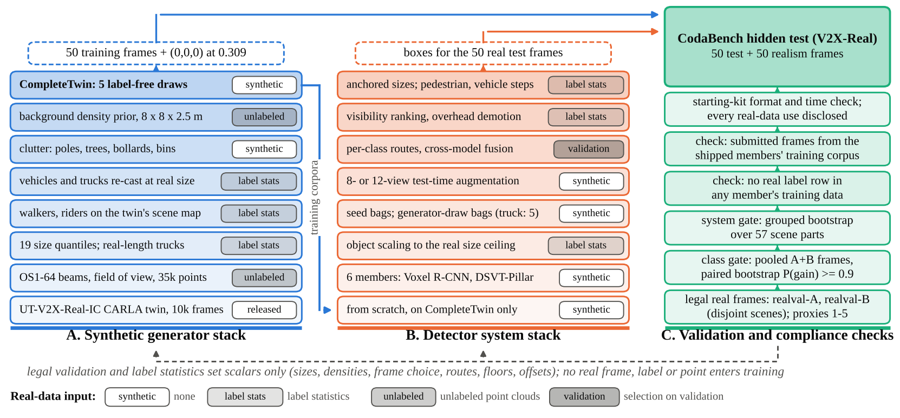
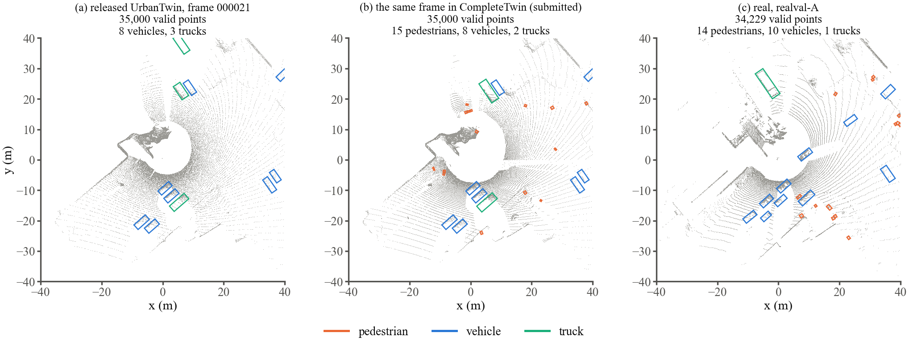
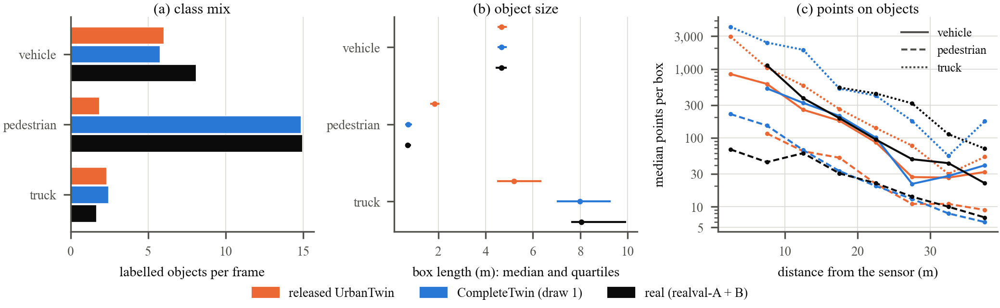
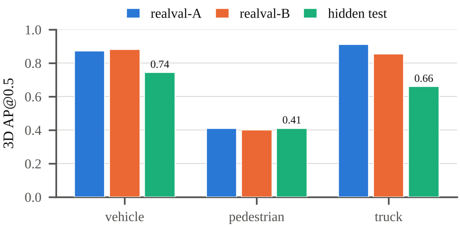
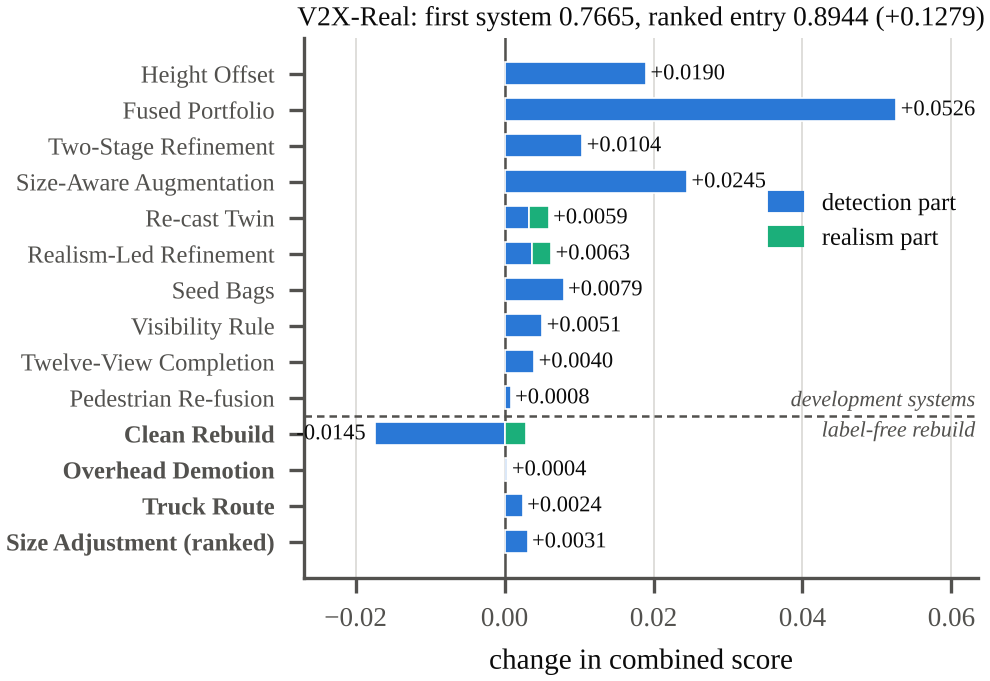
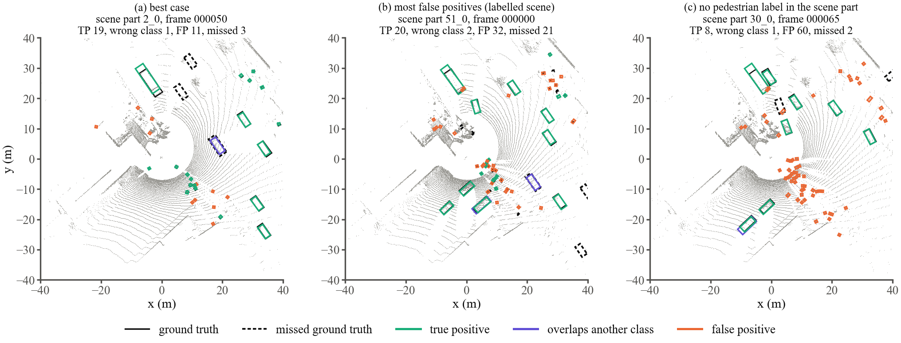

# Pedestrian Synthesis and Detector Fusion for Synthetic-Only Roadside LiDAR Detection on V2X‑Real
Rahul Vishwakarma
Hitachi America, Ltd. R&D
Santa Clara, CA, USA
rahul.vishwakarma@hal.hitachi.com

<!-- docx-skip -->
> Paper source for the IEEE BigData 2026 Cup (UCF UrbanTwin Sim2Real LiDAR Challenge, V2X-Real track), rebuilt on 2026-11-18 from the final report of 2026-11-15 to follow the organizers' guidelines of 2026-11-17: the ranked entry only (CodaBench 1051825), a paper structure with an ablation section, a short real-data paragraph, no other teams' results, the public code link and the organizers' citation forms. Build: `python3 build_docx.py --pdf` in this folder. Every number comes from the official score files and records of https://github.com/karmarv/utsim2real-bdc26 (paper-bigdata2026/report_v2x.md and the codabench_<id>.json files).
<!-- /docx-skip -->

**Abstract**- Roadside LiDAR perception needs site-specific 3D labels that are slow to produce. Digital twins promise them for free, but only if a detector trained on simulated frames transfers to the real sensor. We study this on the V2X-Real track of the UCF UrbanTwin Sim2Real LiDAR Challenge, where the detector is trained on synthetic data only and 50 submitted synthetic frames are scored for realism. Against legal real statistics, the released twin has no walkers although pedestrians are 62% of the test objects, renders trucks 3 m too short, and emulates a denser, wider sensor than the real Ouster OS1-64. We raycast what is missing without copying any real label: articulated walkers placed on the twin's own scene map and trucks at real size, both ray-cast with the measured beam table and field of view, plus unlabeled static clutter. Voxel R-CNN and DSVT-Pillar detectors trained from scratch on five generator draws are fused per class over test-time views and draw bags, and label-free post-processing encodes the annotators' conventions. Every change had to pass a validation gate fixed in advance. The ranked entry, our best submission ranked by the organizers, scores 0.8944 (3D mAP 0.605 at IoU 0.5, realism 0.941). Ablations show that test-time views, bags and fusion carry the largest detection gains, that the convention stages add detection without retraining, and that retraining on a realism-calibrated corpus raised realism by 0.011 but cost 0.059 mAP. Code: https://github.com/karmarv/utsim2real-bdc26.

**Keywords**- LiDAR 3D object detection, sim-to-real transfer, digital twin, synthetic data, roadside perception, V2X-Real

## I. Introduction

Roadside LiDAR sensors at intersections see every road user from a fixed viewpoint, which makes them valuable for traffic monitoring and cooperative driving, but labeling their point clouds in 3D is slow and specific to each site. Digital twins promise labels for free: a simulated copy of the site produces point clouds whose boxes are known by construction. The UCF UrbanTwin Sim2Real LiDAR Challenge of the IEEE BigData Cup 2026 [1] tests that promise. The organizers released the UrbanTwin datasets [2], simulated in CARLA [3] on high-fidelity digital twins of real intersections [4], [5], for two sites: the LUMPI intersection in Hannover [6] and the infrastructure LiDAR of V2X-Real at UCLA [7], as UT-V2X-Real-IC [8] and UT-LUMPI [9]. Participants train a detector only on synthetic data they generate, detect objects in 50 real test frames per site, and submit 50 synthetic frames that the scorer compares with 50 held-out real frames.

This paper covers the V2X-Real track; a companion paper covers LUMPI [10]. Three things make the track hard. First, the twin lacks content the real site has: it contains no walkers, while pedestrians (walkers, riders and scooters) are 62% of the test objects; its trucks are about 3 m shorter than the real ones; and it emulates a sensor with about twice the real number of valid points. Second, the hidden test is small (124 trucks), so local gains transfer noisily. Third, no real frame, label or point may enter training, while legal real frames may be used to validate, to select settings and to calibrate the generator with statistics. The organizers showed that a SEED detector [11] trained on UT-LUMPI matches a real-trained one for cars and that SECOND [12] trained on UT-V2X reaches 63.18 car AP [2], so the open question is what the twin must add for the remaining classes.

We treat the track as a problem of completing the twin by ray casting what it lacks, and of following the annotation conventions, rather than one of detector capacity. Fig. 1 shows the resulting system as a generator stack, a detector stack and the checks between them. Our ranked entry, the best of our submissions ranked by the organizers [1], scores 0.8944 (mAP 0.605, realism 0.941). Our contributions are:
- a measurement of what the released V2X twin lacks against legal real statistics, and CompleteTwin, a label-free generator that repairs each gap with our own synthetic geometry (Sections III-C and IV-A);
- a synthetic-only detector system built with OpenPCDet [13]: per-class routes over test-time views, generator-draw bags and box fusion, with post-processing stages that encode the real annotation conventions without any training (Sections IV-B to IV-D);
- a decision protocol for a 50-frame hidden test, with gates on two disjoint legal splits fixed before results (Section IV-E);
- ablations, including the calibrated-corpus path recommended by the organizers, which traded 0.059 mAP for 0.011 realism (Section VI).

The code, the seven checkpoints of the ranked entry and a script that reproduces it are released on GitHub (Section VII).

## II. Related Work

**Synthetic LiDAR and digital twins.** CARLA [3] renders LiDAR by ray casting against game assets, and LiDARsim [14] narrowed the gap for vehicle-mounted sensors with real surfel maps and learned ray drop. The UrbanTwin pipeline [5] builds a CARLA twin of a real site from public geographic data and emulates each real sensor at its real pose; the organizers showed that such twins narrow the sim-to-real gap of LiDAR-based perception for intelligent transportation systems (ITS) [4], and the UrbanTwin datasets [2], [8], [9] release 10,000 frames per site with automatic boxes. We start from these frames and measure what they still lack.

**Transfer.** Statistical normalization [15] showed that object-size statistics explain much of the cross-dataset gap of 3D detectors, and random object scaling [16] makes detectors robust to size shift. We use both only through scalar statistics. Unsupervised domain adaptation adapts to unlabeled target frames, for instance by self-training [16]; the challenge excludes it, so the setting is domain generalization: the detector never sees a real frame, and robustness must come from the synthetic data and from the training and test-time recipe.

**Detectors and ensembles.** We trained PointPillars [17], SECOND-style sparse backbones [12] with center-based heads [18], Voxel R-CNN [19], PV-RCNN++ [20], [21], VoxelNeXt [22] and DSVT [23] in OpenPCDet [13], and tried GBlobs inputs [24]. Weighted box fusion [25], deep ensembles [26], weight averaging [27] and flip and rotation test-time augmentation [18], [28] reduce variance. Solutions to the ECCV 2026 DriveX edition of this challenge combined complementary detectors with class-aware fusion [29] or recovered the coordinate frame with per-class suppression and null-return modeling [30]; we do not compare scores across editions.

**Metrics.** The realism score combines the Chamfer distance (CD) and earth mover's distance (EMD) [31], the kernel maximum mean discrepancy (MMD) [32] and a Fréchet point distance (FPD) [33] between Gaussians fitted to the point sets, as in the Fréchet inception distance [34]. Detection uses KITTI-style [35] average precision (AP) over 40 recall points (R40) [36].

<!-- wide top -->

*Fig. 1. The V2X-Real system: A, the synthetic generator stack, from the released twin to CompleteTwin, our label-free training corpora; B, the detector system stack, from synthetic-only training to the label-free post-processing; C, the validation data, gates and compliance checks before the hidden test. The tag on each layer names its real-data input: none (synthetic), scalar label statistics, unlabeled real point clouds, or selection on legal validation frames.*

## III. Problem Setup and Twin Gap Analysis

### A. Task and metric

Table I summarizes the track. With mAP the mean 3D AP at an intersection over union (IoU) of 0.5 (R40) over the three classes, the combined score is

$$ *S* = 0.6 clip(mAP/0.7) + 0.4 *R*, | (1)

$$ *R* = 1 − (*C* + *M* + *E* + *F*)/4, | (2)

where clip(·) limits a value to [0, 1], *C* = clip((CD − 2)/28), *M* = clip(MMD/0.5), *E* = clip(EMD/5) and *F* = clip(FPD/50), each computed between the 50 submitted and 50 reference frames after masking to the range and subsampling to 10,000 points. While mAP is below 0.7, +0.01 AP on one class is worth +0.0029 combined, +0.01 *R* +0.0040, and 0.1 m less EMD +0.0020. The CD term is zero below 2.0, so every frame change had to keep CD below that floor.

Table: TABLE I. The V2X-Real track (challenge kit and our measurements)

| Item | V2X-Real |
|---|---|
| Real sensor | 1 Ouster OS1-64 (64 × 1,024, 10 Hz) on the intersection's infrastructure pole |
| Classes and test boxes | vehicle 470, pedestrian 953 (with riders and scooters), truck 124 |
| Range (m) | x, y within 40; z from -8 to 2 |
| Forbidden frames | 50 test + 50 realism reference, over 32 scenes |
| Real frames | 49,405-50,000 points, 31% of them (0,0,0) no-returns |
| Synthetic data | UT-V2X-Real-IC [8], 10,000 frames |

### B. Real-data use and validation protocol

**Real-data use.** The detector weights were optimized only on synthetic point clouds and synthetic annotations: no real frame, label or point enters training. The 100 forbidden frames and their labels were excluded from training, generator calibration, validation and model selection, and the 50 released test point clouds were used only for inference with the frozen pipeline. Every other real-data reader goes through one guard that refuses the forbidden frames and the 20 frames on either side of each, and logs each read with its purpose; we call the remaining frames legal. Legal frames serve four purposes, all allowed by the challenge rules and the organizers' clarifications of November 9 and 12, 2026: (i) validation and model selection; (ii) scalar label statistics, in the generator (walker size mixture and distance histogram, 19 truck size quantiles, per-class ray dropout matched to the real points per box) and at test time (object-scaling caps, anchored size offsets, visibility counts and median sizes); (iii) realism calibration from unlabeled point clouds: the OS1-64 beam table from 23 frames, a background density prior from 400 frames, and the choice of the 50 submitted frames from our own training corpus against three 50-frame proxies, accepted only if two held-out proxies improve; and (iv) test-time post-processing of the detector's own boxes. The calibration is part of the training corpus, so the submitted frames represent the detector's training data. Development corpora that placed walkers at real label positions were withdrawn after the organizers' clarification; the ranked entry uses none.

**Validation splits.** realval-A (688 frames) and realval-B (298 frames) come from disjoint scenes of the public V2X-Real train, val and test splits (A: 424, 119 and 145 frames; B: 162, 27 and 109) and form 57 scene parts. Five realism proxies of 50 legal frames (1-3 to fit, 4-5 held out) judge the frames. The test frames are denser than realval-A (9.4 vehicles, 19.1 pedestrians and 2.5 trucks per frame against 8.1, 16.2 and 1.7), and one realval-B scene part (11 frames) has no pedestrian label although the other part of the same recording has 28 per frame, a suspected annotation-coverage gap that may affect measured pedestrian AP on B.

<!-- wide top -->

*Fig. 2. Bird's-eye views of (a) a released UT-V2X-Real-IC frame in our training format (resampled to 35,000 points), (b) the same frame in CompleteTwin, one of our 50 submitted frames, and (c) a legal realval-A frame, with boxes by class. CompleteTwin adds the walkers, re-casts the trucks at real size and adds unlabeled clutter.*

### C. What the released twin lacks

**Sensor and frame.** The real sensor's beam table, measured on 23 legal unlabeled frames, has 64 rows from +16.13° to -16.77° (median spacing 0.53°). The released twin emulates a different sensor: about 106,000 points per frame (69,000 valid in range against 35,000 real), elevations from -56° to +25°, and rings that vary with azimuth because a level CARLA lidar was rotated into the tilted sensor frame. The site slopes: walker box bottoms lie at -3.5 m near the pole, -2 to -1 m at 10-30 m and -4.7 m beyond 30 m. Below -16.8° there are no returns, so within about 10 m the real sensor sees only upper bodies (median hit height 1.41 m).

Table: TABLE II. Gaps of the released V2X twin (measured on synthetic data and legal real statistics) and the generator fix

| Gap and consequence | Fix in CompleteTwin |
|---|---|
| No walkers: the twin's pedestrian boxes are riders, 1.8 per frame against 14.9 real; pedestrians are 62% of the test objects | articulated walkers ray-cast with the real beam table, placed on the twin's scene map, Poisson(16) per frame in groups of 1-4 |
| A denser, wider sensor: 69k against 35k valid points, elevations -56° to +25° | measured OS1-64 beam table, field-of-view mask (+16.4° / -17.0°), 35,000 valid points |
| Trucks 5.20 m against 8.04 m long, at 0.42× the real density in the same place | trucks re-cast at real size with the real sensor: 7.99 m, 0.77× density |
| No buildings, vegetation, poles or fences; 38.1% of the real above-ground static mass missing | Poisson(30) unlabeled poles, trees, bollards, bins and barriers at curbside cells, as hard negatives |
| Raw twin frames score R about 0.83 against held-out real frames | sensor fixes, a background density prior and frame selection: R 0.9406 on the server |
| Real frames hold 31% (0,0,0) points | added at the real rate when the 50 frames are packaged; stripped by the detector's loader |

**Objects.** Table II lists the gaps and our fixes, and Figs. 2 and 3 show them. The twin's only pedestrian boxes are riders (1.8 per frame, median length 1.84 m), against 14.9 labeled pedestrians per legal real frame; CompleteTwin has 14.9 pedestrians per frame, walkers and riders. The twin's trucks are 5.20 m long against 8.04 m real; re-cast trucks reach 7.99 m. Vehicles match in length (4.67 against 4.68 m) but are 9% too low (1.52 against 1.67 m). The real pedestrian class has two size modes, walkers and riders, and the truck class includes refuse trucks (8.2 × 2.9 × 2.6 m). Points per box agree from 10 m outward (pedestrians 44 against 37 at 10-20 m), but within 10 m CompleteTwin walkers carry three times the real points (151 against 46), the near-field cut that our walkers do not reproduce.

**Static structure.** The twin's scene map, aggregated from its own CARLA semantic tags, holds road, terrain, sidewalk and road-line cells but no buildings, vegetation, poles or fences, and 38.1% of the real above-ground static mass has no twin geometry. That is where the detector errs: 65% of the unmatched pedestrian boxes scored at least 0.5 lie on static structure, and an oracle that removed them would add 0.082 AP. Points 0.2-2.0 m above a box top mark 13.9% of the false pedestrian boxes scored at least 0.3 but only 1.9% of the true ones (a tree, sign or canopy above the box), which motivates the overhead stage of Section IV-D.

<!-- wide top -->

*Fig. 3. The V2X data on legal frames: (a) labeled objects per frame, (b) box length (median and quartiles) and (c) median points per box (log scale) against distance from the sensor, for the released twin (1,000 frames; its pedestrian boxes are riders), CompleteTwin draw 1 (1,000 frames) and realval-A and B (986 frames; panel c on a subset of frames). Bins with fewer than 12 boxes are left out.*

## IV. Method

### A. CompleteTwin: a label-free generator

CompleteTwin completes the UrbanTwin frames with what the real site has and the twin lacks, without copying any real label. Five draws with different generator seeds give independent training sets of 10,000 frames each. Each draw adds, in order:
- **Sensor:** resampling to 35,000 valid points with the measured OS1-64 beam table and field-of-view mask.
- **Map-placed walkers:** walkers are placed on the cells of a scene map aggregated from the twin's own semantic tags and ground heights (0.45 road, 0.30 curb, 0.05 open, 0.20 beyond the twin's ground), in groups of 1-4, Poisson(16) per frame, with sizes and ranges drawn from scalar summaries of legal labels. No real position or label row is read.
- **Re-cast actors:** vehicles and trucks are re-cast with the real sensor from mirrored convex hulls at real size, with per-class ray dropout matched to the real points per box; trucks draw their sizes from 19 real size quantiles per dimension.
- **Clutter:** Poisson(30) unlabeled poles, trees, bollards, bins and barriers anchored at curbside map cells.
- **Density prior:** keep probabilities of background points on 8 × 8 × 2.5 m cells, fitted on 400 legal unlabeled frames disjoint from the proxies.
- **Frames:** the 50 submitted frames are chosen from the training corpus by greedy EMD + FPD swaps against proxies 1-3 and accepted only if the held-out proxies 4-5 gain at least 0.003 R. The packager adds (0,0,0) points at the real rate (0.309); the loader strips them in training and inference.

### B. Synthetic-only training

Every member is trained from scratch on synthetic frames for 40 epochs (Adam with a one-cycle schedule, learning rate 0.003, batch 4 per GPU on 4 GPUs). Augmentation uses ground-truth sampling [12], flips, rotation, global scaling, a small world tilt, and random object scaling capped at the real 99th-percentile sizes. The default configuration, ros (random object scaling), keeps ground-truth sampling; rosf switches it off for the final 5 epochs. Strong configurations are trained on up to five CompleteTwin draws and merged into bags by weighted box fusion of their predictions. Nothing is pretrained, and no batch-norm statistic, pseudo-label or fine-tuning step touches real data.

### C. Inference: views, routes and fusion

Each member runs with 8 views (identity, three flips, yaw ±5°, height ±0.25 m) or 12 views (the 8 plus global scales 0.95 and 1.05 applied to the identity and to the x-y flip), fused by weighted box fusion, and has its own per-class score floor, non-maximum suppression (NMS) IoU, range-dependent vertical re-centering and size scale, tuned on realval-A and checked on realval-B. A per-class routing table then sends each class to one member or fuses up to three (Table III). The entry uses seven checkpoints, all trained on CompleteTwin draws: Voxel R-CNN on five generator draws, one Voxel R-CNN rosf and one DSVT-Pillar.

Table: TABLE III. Composition of the ranked entry (views: 8v / 12v; draws: CompleteTwin seeds; IoU: fusion threshold; AP: 3D AP@0.5 of the system)

| Class | Members (draws, views); fusion | realval A / B | Test |
|---|---|---|---|
| vehicle | bag of Voxel R-CNN (2 draws, 12v) + DSVT-Pillar (8v); IoU 0.5 | 0.873 / 0.881 | 0.743 |
| pedestrian | Voxel R-CNN on draws 1 and 2 + Voxel R-CNN rosf (all 12v); IoU 0.5 | 0.409 / 0.401 | 0.411 |
| truck | bag of Voxel R-CNN (5 draws, 8v) + Voxel R-CNN rosf (12v); IoU 0.7 | 0.911 / 0.853 | 0.659 |

### D. Label-free post-processing: encoding the annotation conventions

After routing and fusion, a fixed sequence of stages edits the boxes. It uses only the detector's own output, point counts in the test frame and scalar label statistics, and no stage adds, removes or rescores a box at a place where the detector placed none:
- **Score floors** per class (vehicle 0.01, pedestrian and truck 0.05), which also keep the scorer within its time limit.
- **Low-score copies:** each confident pedestrian box gets four copies shifted by 0.15 m and scored below every original pedestrian box, so the original ranking is unchanged and the copies act as low-confidence alternative hypotheses.
- **Visibility ranking:** boxes with fewer than 6 (vehicle, pedestrian) or 8 (truck) points rank last. Real labels almost never fall below these counts (2nd percentile of points per box: pedestrian 6, vehicle 8, truck 18), while 16.3% of our synthetic pedestrians do, so a detector trained on them proposes boxes the annotators would not have drawn.
- **Overhead demotion:** a pedestrian box with 5 or more points 0.2-2.0 m above its top ranks last.
- **Anchored size calibration:** vehicle length -0.3 m and height +0.03 m, chosen on validation. The box end nearest the sensor stays fixed and the bottom is kept, because the observed near face is right and the inferred far face overshoots.
- **Final size adjustment:** pedestrian height moves halfway to 1.73 m and vehicle footprints a quarter of the way to 4.64 × 2.06 m, the realval-A medians, with the bottom kept.

### E. Decision protocol

A change enters only if rules fixed before its results accept it:
- **Class gate:** a gain on the pooled realval-A and realval-B frames with a paired-bootstrap probability of gain, P(gain), of at least 0.9, and no loss above 0.005 on either split.
- **System gate:** a complete system is submitted only if a grouped bootstrap (1,000 resamples of whole scene parts) over the 57 scene parts gives P(gain) of at least 0.75 (0.8 near the close) and no leave-one-group-out loss beyond 0.002.
- **Compliance checks in code:** no shipped member may have a real label row in its training data, and the 50 frames must come from a training corpus of the shipped checkpoints, with every calibration of that corpus in their training data.

Leaderboard scores never chose a frame set, a setting, a class route or a member.

## V. Experiments and Results

### A. Implementation

All work ran on one server with 8 NVIDIA RTX A6000 GPUs, in a single pinned Python 3.10 environment (PyTorch 2.1.2, CUDA 12.1, spconv 2.3.8, Open3D 0.19 [37] for ray casting, POT 0.9.7 [38] for the EMD) with OpenPCDet at commit 233f849. A 10k-frame corpus takes 5-20 CPU minutes on 96 workers; training one member for 40 epochs on 4 GPUs takes 1-2 h (PointPillars) to 3-7.5 h (two-stage and transformer models).

### B. Official results

Table IV gives the official scores of the ranked entry. It scores 0.6 × 0.605/0.7 = 0.518 from detection and 0.4 × 0.941 = 0.376 from realism. Vehicles supply the highest AP (0.743), trucks 0.659 and pedestrians 0.411. Fig. 4 compares validation with the hidden test: validation tracks the test closely for pedestrians (0.409 / 0.401 against 0.411) but overstates vehicles (0.87-0.88 against 0.74) and trucks (0.85-0.91 against 0.66), the class with 124 test boxes. The test frames are denser than realval-A (Section III-B), which is consistent with the vehicle gap.

Table: TABLE IV. Official results of the ranked entry on the hidden test (realism terms between the 50 submitted and 50 reference frames; real against real: two sets of legal real frames, local)

| Metric | Ranked entry | Real against real |
|---|---|---|
| Combined score | 0.8944 | |
| 3D mAP@0.5 (R40) | 0.6045 | |
| AP vehicle / pedestrian / truck | 0.743 / 0.411 / 0.659 | |
| 3D mAP@0.7 (unscored) | 0.150 | |
| Realism R | 0.9406 | 0.9617 |
| CD / MMD | 1.844 / 0.00034 | 0.33 / - |
| EMD / FPD | 1.110 / 0.748 | 0.751 / - |

### C. Realism

EMD carries 93% of the remaining realism loss of the entry, and CD stays below its 2.0 floor. The residual gap is horizontal, not vertical: the height bands of our frames match the real ones within 0.01, but 8% of the real mass lies in 2 m cells where we have less than a tenth of the real density, mostly the static structure that the twin does not model. A fixed sensor also repeats its points to the centimeter (median nearest-point distance between real frames 0.000-0.002 m, ours 0.22-0.33 m). Two sets of legal real frames reach R 0.9617 against each other, a gap of about 0.008 combined to this empirical real-against-real reference.

*Fig. 4. Per-class 3D AP at IoU 0.5 of the ranked entry on the two legal validation splits and on the hidden test (official score file).*

### D. Observations

**What each approach contributed.** Fig. 5 traces the official combined score through the named approaches, from the first system (0.7665) to the ranked entry (0.8944). Variance reduction gave the largest steps: the fused portfolio of test-time views and cross-architecture fusion (+0.0526), seed bags and twelve-view completion. Sizes and conventions followed: size-aware augmentation (+0.0245) and the range-dependent height offset (+0.0190), then the visibility rule. The ray-cast twin content raised realism, and the rebuild on label-free corpora cost 0.0145, almost all of it pedestrian AP, before the overhead demotion, the truck route and the size adjustment recovered 0.0059.

**Qualitative cases.** Fig. 6 shows the entry on three realval-B frames, chosen by fixed rules over a third of the split: the best case, the frame with the most false positives among scene parts that have pedestrian labels, and the frame with the most false positives overall. In Fig. 6a all 14 labeled pedestrians on the walkway in front of the sensor are found, and the fused trucks and vehicles match at IoU 0.5; the 11 unmatched pedestrian boxes lie away from every labeled pedestrian (median 5.8 m), where static structure stands. In Fig. 6b the crowds are found as crowds, but 13 of the 32 unmatched pedestrian boxes overlap a missed walker at IoU 0.1-0.5, a few decimeters off. Fig. 6c shows the scene part without pedestrian labels (Section III-B), where static structure and missing annotations may both contribute to the unmatched boxes.

*Fig. 5. What each named approach contributed on the hidden test: the change in combined score between successive systems, split into the detection part 0.6 Δclip(mAP/0.7) and the realism part 0.4 ΔR (official score files). Development systems placed walkers at legal label positions; the label-free rebuild (bold) retrained every member on CompleteTwin and leads to the ranked entry.*

<!-- wide top -->

*Fig. 6. The ranked entry on legal realval-B frames (boxes scored at least 0.3; TP: matched at the official 3D IoU of 0.5; wrong class: overlaps an object of another class at IoU 0.5 or more; FP: neither): (a) a crowded walkway where all 14 labeled pedestrians are found; (b) a crowd where 18 of 29 pedestrians are missed and 13 of the 32 unmatched pedestrian boxes overlap them below IoU 0.5; (c) a scene part without any pedestrian label, where the 60 pedestrian boxes count as false positives.*

**Error profile.** Pedestrian errors are therefore near misses in crowds. The vertical centers of the walker boxes scatter with an interquartile range of 0.12 m and their heights with 0.17 m, and heights read from points lose 0.021-0.040 AP, which makes the 0.5 IoU threshold demanding for a box only about 0.7 m long. Two-stage members reduced the vehicle localization loss from 0.140 (CenterPoint) to 0.103 (Voxel R-CNN), but the pedestrian localization loss stayed at 0.27-0.30, so their walker gain came from ranking (ranking loss 0.424 to 0.343).

## VI. Ablation

### A. Post-processing stages and routes on the hidden test

Table V details the last four steps of Fig. 5 per class: it adds the stages of Section IV-D and the truck route one at a time to a system whose members were all retrained on CompleteTwin; every row is an official score file, and the realism term is the same in all rows. The overhead demotion adds 0.0004, routing trucks to a five-draw bag fused with a rosf member adds 0.0073 truck AP and 0.0012 pedestrian AP (+0.0024 combined, about +0.0021 of it from trucks), and the final size adjustment adds 0.0108 pedestrian AP (+0.0031). The predicted pedestrian median height was already 1.74 m, so the size step narrowed the spread of heights rather than moving their center, and the vehicle footprint step changed no test AP to six digits. In earlier systems (Fig. 5), introducing the range-dependent height offset raised pedestrian 3D AP on the hidden test by 0.046 with BEV AP unchanged, a pure height convention of the real labels, and the visibility ranking raised pedestrian AP by 0.015. None of these stages needs retraining.

Table: TABLE V. Ablation of the post-processing stages and the truck route on the hidden test (official score files; cumulative; score: combined; R 0.9406 in all rows)

| System | Vehicle | Pedestrian | Truck | mAP | Score |
|---|---|---|---|---|---|
| members retrained on CompleteTwin | 0.743 | 0.398 | 0.652 | 0.5976 | 0.8885 |
| + overhead demotion | 0.743 | 0.399 | 0.652 | 0.5981 | 0.8889 |
| + truck route | 0.743 | 0.400 | 0.659 | 0.6009 | 0.8913 |
| + size adjustment (ranked entry) | 0.743 | **0.411** | 0.659 | **0.6045** | **0.8944** |

### B. Test-time views, bags and seeds

Table: TABLE VI. Members of the ranked entry on realval-A / realval-B (mAP with 8 and 12 views; pedestrian AP with 12 views)

| Member | 8 views | 12 views | Pedestrian |
|---|---|---|---|
| Voxel R-CNN, draw 1 | 0.666 / 0.667 | 0.670 / 0.666 | 0.372 / 0.376 |
| Voxel R-CNN, draw 2 | 0.690 / 0.658 | 0.696 / 0.672 | 0.382 / 0.367 |
| Voxel R-CNN rosf | 0.682 / 0.666 | 0.691 / 0.677 | 0.378 / 0.368 |
| DSVT-Pillar | 0.667 / 0.624 | 0.670 / 0.624 | 0.350 / 0.339 |
| Voxel R-CNN bag, 2 draws | 0.694 / 0.676 | 0.697 / 0.683 | 0.380 / 0.373 |
| Voxel R-CNN bag, 5 draws | **0.703 / 0.683** | **0.705 / 0.686** | **0.386 / 0.374** |

Table VI gives the members of the entry on both splits. Seeds of one configuration differ by up to 0.17 truck AP (0.636 against 0.803), which is why the truck class is a five-draw bag: the third draw adds vehicle +0.019, the fourth +0.0046 and the fifth truck +0.0155, after which bags saturate. Twelve views help walkers only. In earlier systems eight test-time views were the largest single gain: routing view-averaged members raised realval-B mAP from 0.537 to 0.617 (truck +0.114, vehicle +0.081), and cross-architecture fusion to 0.666, while cutting static false positives from 6.2 to 1.8 per frame. Switching ground-truth sampling off for the last 5 epochs (rosf) passed the class gate for pedestrian and truck, while switching it off throughout lost pedestrians.

### C. Architectures

The two-stage Voxel R-CNN [19] carries every class of the entry. DSVT-Pillar [23] is the strongest single CompleteTwin member for vehicles (8-view realval A / B 0.830 / 0.841) and sits in the vehicle fusion, but is weaker on pedestrians (Table VI). PointPillars [17] lost trucks under object scaling (realval-B truck 0.704 to 0.546) because its single 7.94 m truck anchor cannot follow a wide size range. Center-head models [18] cut the pedestrian gap between bird's-eye-view (BEV) and 3D AP from 0.158 to 0.112 but made 1.8 times more static false positives. VoxelNeXt [22] gained vehicles and trucks on CompleteTwin but lost 0.07-0.10 pedestrian AP, so it is not in the entry.

### D. Realism-calibrated training corpus

The organizers' recommended path for realism calibration is to apply it to the training data and retrain the detector. A range mapping fitted on the unlabeled proxies 1-3, which quantile-maps our ranges onto the real ones per azimuth and elevation bin and rebalances the point shares with background points from other synthetic frames, gained 0.0116 R at the realism gate; but every retrained member lost 0.032-0.084 mAP and the system lost 0.0586 mAP (grouped P(gain) 0.00), about -0.050 combined against +0.0045 from realism, so the ranked entry keeps the uncalibrated corpus. Our leading suspect is the copied background points, which can carry unlabeled objects that then train as background.

## VII. Discussion and Conclusion

Four lessons generalize. First, the decisive gaps were content and conventions the twin lacked (walkers, truck sizes, the label height convention, what annotators draw), not detector capacity. Second, on a 50-frame test the variance-reducing stages (views, fusion, low-ranked copies, demotions that only reorder) transferred more reliably than selection on noisy splits, although none of them is guaranteed to help. Third, realism and detection can pull apart: the calibrated corpus closed part of the EMD gap to real frames but cost about ten times its realism gain in detection, so a realism calibration has to be judged by the detector it trains, not by R alone. Fourth, compliance is cheaper when it is checked in code before every submission.

Limitations remain. Pedestrian AP is 0.411 and is bounded by localization in crowds; two-stage refinement did not fix walker boxes. Realism remains below our empirical real-against-real reference (R 0.941 against 0.962), and 38.1% of the real static mass has no counterpart in the twin. Truck AP rests on 124 test boxes and its validation scores overstate it by about 0.2. Walker localization in crowds and twin geometry for the missing static structure are the clearest next steps.

**Reproducibility.** The code, the seven checkpoints of the ranked entry and a reproduction script are available at https://github.com/karmarv/utsim2real-bdc26; re-merging the saved member predictions reproduces the submission exactly.

## Acknowledgment

We thank the organizers of the UCF UrbanTwin Sim2Real LiDAR Challenge, M. Shahbaz and S. Agarwal, for the UrbanTwin datasets, the starting kit and their timely answers; the creators of the V2X-Real and LUMPI datasets; and the OpenPCDet developers.

## References

[1] M. Shahbaz and S. Agarwal, "UCF UrbanTwin Sim2Real LiDAR Challenge," IEEE BigData 2026 Cup, Challenge 04, 2026. [Online]. Available: https://urbanity-lab.github.io/bdc2026-urbantwin-sim2real/ (accessed Nov. 18, 2026).
[2] M. Shahbaz and S. Agarwal, "UrbanTwin: Synthetic roadside LiDAR datasets," IEEE Open J. Intell. Transp. Syst., vol. 7, pp. 353-364, 2026.
[3] A. Dosovitskiy et al., "CARLA: An open urban driving simulator," in Proc. 1st Conf. Robot Learn. (CoRL), PMLR vol. 78, 2017, pp. 1-16.
[4] M. Shahbaz and S. Agarwal, "High-fidelity digital twins for bridging the sim2real gap in LiDAR-based ITS perception," IEEE Trans. Intell. Transp. Syst., vol. 27, no. 7, pp. 8698-8709, 2026.
[5] M. Shahbaz and S. Agarwal, "UrbanTwin: Building high-fidelity digital twins for sim2real LiDAR perception and evaluation," arXiv:2509.02903, 2025.
[6] S. Busch et al., "LUMPI: The Leibniz University multi-perspective intersection dataset," in Proc. IEEE Intell. Veh. Symp. (IV), 2022, pp. 1127-1134.
[7] H. Xiang et al., "V2X-Real: A large-scale dataset for vehicle-to-everything cooperative perception," in Proc. Eur. Conf. Comput. Vis. (ECCV), Springer, 2024, pp. 455-470.
[8] M. Shahbaz and S. Agarwal, "UT-V2X-Real-IC," Harvard Dataverse, 2025. [Online]. Available: https://doi.org/10.7910/DVN/N6N4UR
[9] M. Shahbaz and S. Agarwal, "UT-LUMPI," Harvard Dataverse, 2025. [Online]. Available: https://doi.org/10.7910/DVN/D9SSWD
[10] R. Vishwakarma, "Digital twin augmentation and classwise detector fusion for synthetic-only multi-LiDAR detection on LUMPI," IEEE BigData 2026 Cup, companion paper, 2026.
[11] Z. Liu et al., "SEED: A simple and effective 3D DETR in point clouds," in Proc. Eur. Conf. Comput. Vis. (ECCV), Springer, 2024, pp. 110-126.
[12] Y. Yan, Y. Mao, and B. Li, "SECOND: Sparsely embedded convolutional detection," Sensors, vol. 18, no. 10, Art. no. 3337, 2018.
[13] OpenPCDet Development Team, "OpenPCDet: An open-source toolbox for 3D object detection from point clouds," 2020. [Online]. Available: https://github.com/open-mmlab/OpenPCDet
[14] S. Manivasagam et al., "LiDARsim: Realistic LiDAR simulation by leveraging the real world," in Proc. IEEE/CVF CVPR, 2020, pp. 11164-11173.
[15] Y. Wang et al., "Train in Germany, test in the USA: Making 3D object detectors generalize," in Proc. IEEE/CVF CVPR, 2020, pp. 11710-11720.
[16] J. Yang et al., "ST3D: Self-training for unsupervised domain adaptation on 3D object detection," in Proc. IEEE/CVF CVPR, 2021, pp. 10363-10373.
[17] A. H. Lang et al., "PointPillars: Fast encoders for object detection from point clouds," in Proc. IEEE/CVF CVPR, 2019, pp. 12689-12697.
[18] T. Yin, X. Zhou, and P. Krähenbühl, "Center-based 3D object detection and tracking," in Proc. IEEE/CVF CVPR, 2021, pp. 11779-11788.
[19] J. Deng et al., "Voxel R-CNN: Towards high performance voxel-based 3D object detection," in Proc. AAAI Conf. Artif. Intell., vol. 35, no. 2, 2021, pp. 1201-1209.
[20] S. Shi et al., "PV-RCNN: Point-voxel feature set abstraction for 3D object detection," in Proc. IEEE/CVF CVPR, 2020, pp. 10526-10535.
[21] S. Shi et al., "PV-RCNN++: Point-voxel feature set abstraction with local vector representation for 3D object detection," Int. J. Comput. Vis., vol. 131, no. 2, pp. 531-551, 2023.
[22] Y. Chen et al., "VoxelNeXt: Fully sparse VoxelNet for 3D object detection and tracking," in Proc. IEEE/CVF CVPR, 2023, pp. 21674-21683.
[23] H. Wang et al., "DSVT: Dynamic sparse voxel transformer with rotated sets," in Proc. IEEE/CVF CVPR, 2023, pp. 13520-13529.
[24] D. Malic et al., "GBlobs: Explicit local structure via Gaussian blobs for improved cross-domain LiDAR-based 3D object detection," in Proc. IEEE/CVF CVPR, 2025, pp. 27357-27367.
[25] R. Solovyev, W. Wang, and T. Gabruseva, "Weighted boxes fusion: Ensembling boxes from different object detection models," Image Vis. Comput., vol. 107, Art. no. 104117, 2021.
[26] B. Lakshminarayanan, A. Pritzel, and C. Blundell, "Simple and scalable predictive uncertainty estimation using deep ensembles," in Proc. Adv. Neural Inf. Process. Syst. (NIPS), vol. 30, 2017.
[27] P. Izmailov et al., "Averaging weights leads to wider optima and better generalization," in Proc. 34th Conf. Uncertainty Artif. Intell. (UAI), 2018, pp. 876-885.
[28] Z. Ding et al., "1st place solution for Waymo Open Dataset challenge: 3D detection and domain adaptation," arXiv:2006.15505, 2020.
[29] P. Luo, C. Xu, Y. Li, K. Zhang, L. Jiao, W. Ma, and L. Li, "Solution for UCF UrbanTwin V2X-Real track: Sim-to-real urban LiDAR 3D object detection," arXiv:2609.07608, 2026.
[30] A. Upganlawar, "Coordinate frame recovery, per class NMS and null return modelling for Sim2Real V2X LiDAR detection," arXiv:2611.03940, 2026.
[31] H. Fan, H. Su, and L. Guibas, "A point set generation network for 3D object reconstruction from a single image," in Proc. IEEE CVPR, 2017, pp. 2463-2471.
[32] A. Gretton et al., "A kernel two-sample test," J. Mach. Learn. Res., vol. 13, no. 25, pp. 723-773, 2012.
[33] D. W. Shu, S. W. Park, and J. Kwon, "3D point cloud generative adversarial network based on tree structured graph convolutions," in Proc. IEEE/CVF ICCV, 2019, pp. 3858-3867.
[34] M. Heusel et al., "GANs trained by a two time-scale update rule converge to a local Nash equilibrium," in Proc. Adv. Neural Inf. Process. Syst. (NIPS), vol. 30, 2017.
[35] A. Geiger, P. Lenz, and R. Urtasun, "Are we ready for autonomous driving? The KITTI vision benchmark suite," in Proc. IEEE CVPR, 2012, pp. 3354-3361.
[36] A. Simonelli et al., "Disentangling monocular 3D object detection," in Proc. IEEE/CVF ICCV, 2019, pp. 1991-1999.
[37] Q.-Y. Zhou, J. Park, and V. Koltun, "Open3D: A modern library for 3D data processing," arXiv:1801.09847, 2018.
[38] R. Flamary et al., "POT: Python optimal transport," J. Mach. Learn. Res., vol. 22, no. 78, pp. 1-8, 2021.
