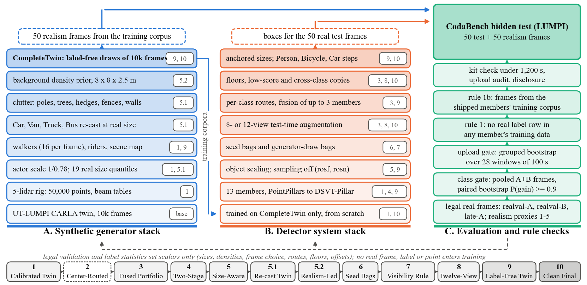
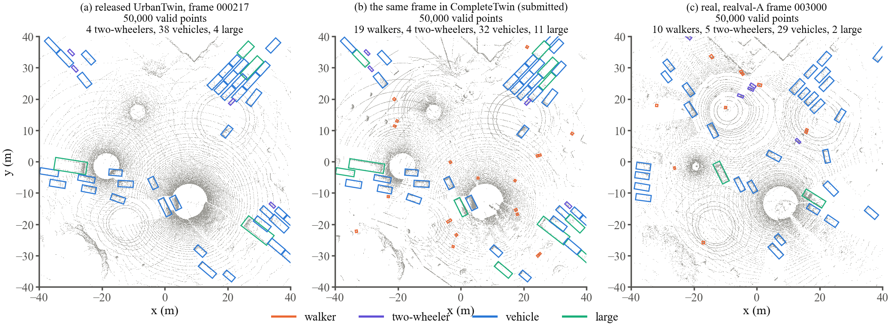
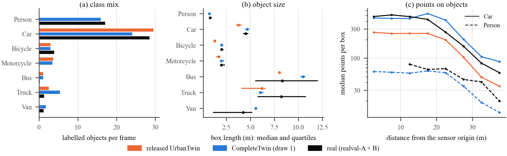
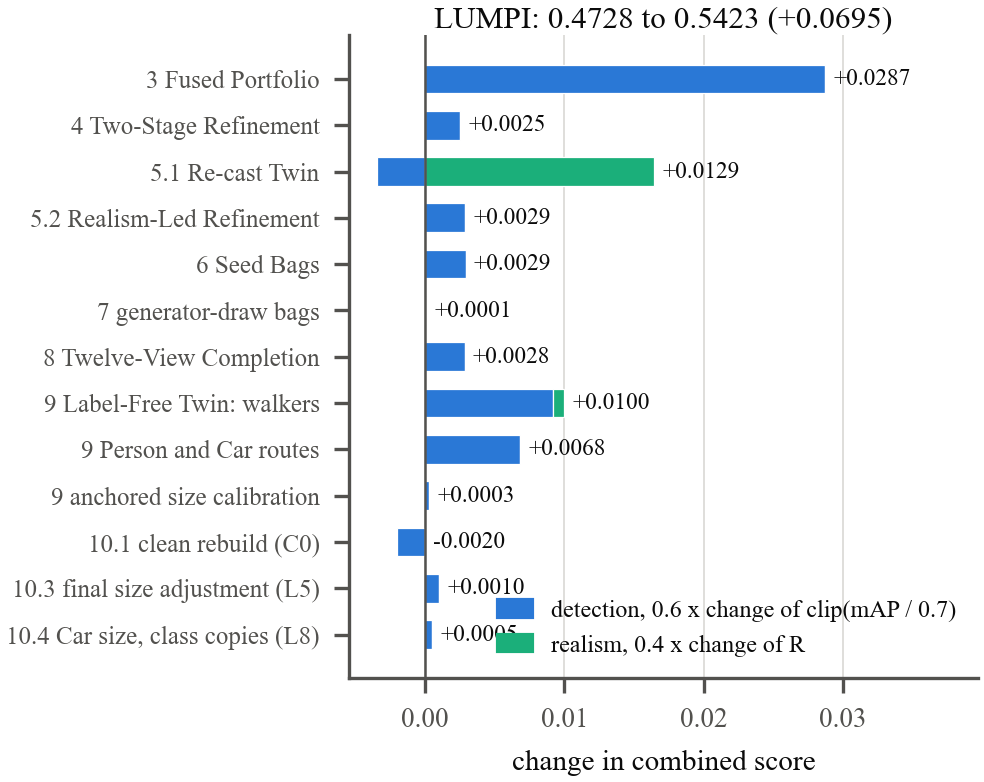
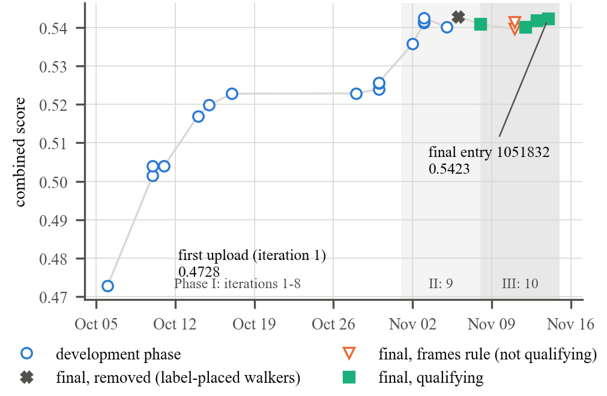
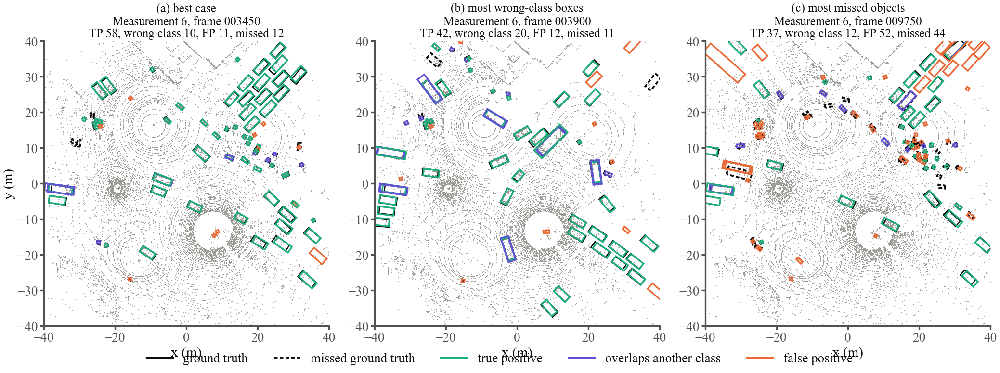
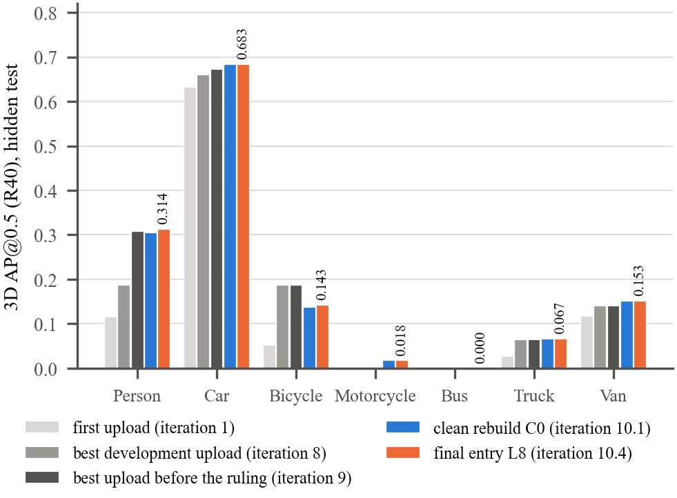

# Exploring UrbanTwin Sim2Real for Synthetic-Only Roadside LiDAR Detection: LUMPI Track, Team KarmaRV
Rahul Vishwakarma
Hitachi America, Ltd. R&D
rahul.vishwakarma@hal.hitachi.com

<!-- docx-skip -->
> Final report of team KarmaRV for the LUMPI track of the UCF UrbanTwin Sim2Real LiDAR Challenge, IEEE BigData Cup 2026 (up to 10 pages including references, IEEE two-column, US letter). The V2X-Real track has its own report with the same structure ([`report_v2x.md`](report_v2x.md)). The Word version is built from this file inside the IEEE conference template: [`Final_Report_IEEE_Big_Data_Cup_2026_LUMPI_Track_KarmaRV.docx`](Final_Report_IEEE_Big_Data_Cup_2026_LUMPI_Track_KarmaRV.docx) (`python paper-bigdata2026/build_docx.py --track lumpi --pdf`); the figures `figures/fig_lumpi_*.png` come from [`make_figures.py`](make_figures.py). Every number is copied from a record in this repository (the `codabench_<id>.json` score files, the model cards and scorecards, and the dated decision records in `docs/decisions/`) or measured by `make_figures.py` on legal frames (Figs. 2, 3 and 6); no model was re-run for the report. Written 2026-11-14, after release 10.5: L9 passed every gate and was held back (not uploaded), and the TransFusion-L member of L10 was in training (decision record of 10.5, Section 10).
<!-- /docx-skip -->

**Abstract**– The UrbanTwin Sim2Real LiDAR challenge asks for 3D object detectors trained only on synthetic data that transfer to real roadside sites, together with 50 synthetic frames whose point statistics resemble the real ones; the score weights a normalized 3D mAP by 0.6 and a realism score by 0.4. This report covers the LUMPI track: five merged lidars at a Hannover intersection and seven classes, three of them rare. The released twin renders actors at 0.78 times their real size, has no pedestrians, half the real points on cars and a quarter on bicycles. Our generator completes it without any real label row: real actor scale, walkers ray-cast and placed on the twin's own scene map, real-size re-cast vehicles with riders, and unlabeled static clutter. Thirteen detectors of five families, trained from scratch on these frames, are combined per class through test-time views, bags and fusion, followed by label-free size and copy stages. Over ten gated iterations the score rose from 0.4728 at our first upload to 0.5423 (submission 1051832: mAP 0.197, realism 0.934), first on the board from Oct 10 to the development close and fourth on the final-phase board of Nov 14. Label-free walker placement was our largest late gain (Person AP 0.188 to 0.262 on the hidden test). The remaining error is class confusion between vehicle types, which our measurements trace to the real labels: Truck and Bus share one median size, and Van is car-length.

**Keywords**– LiDAR 3D object detection, sim-to-real transfer, digital twin, synthetic data, roadside perception, LUMPI

## I. Introduction

Roadside LiDAR sensors at intersections see every road user from a fixed viewpoint, which makes them valuable for traffic monitoring and cooperative driving, but labelling their point clouds in 3D is slow and specific to each site. Digital twins promise labels for free: a simulated copy of the site produces point clouds whose boxes are known by construction. The UCF UrbanTwin Sim2Real LiDAR Challenge of the IEEE BigData Cup 2026 [1] tests that promise. The organizers released UrbanTwin datasets [2], simulated in CARLA [3] on digital twins of real intersections [4], for two real sites: the LUMPI intersection in Hannover [5] and the infrastructure LiDAR of V2X-Real at UCLA [6]. Participants train a detector only on synthetic data they generate, detect objects in 50 real test frames per site, and submit 50 synthetic frames that the scorer compares with 50 held-out real frames.

This report covers the LUMPI track. Three things make it hard. First, the twin differs from the real site in ways a detector notices: we measured that it renders actors at about 0.78 times their real size, so a perfectly placed box cannot reach the 0.5 IoU threshold (the dataset paper reports a smaller mean box volume, 10.13 against 12.17 m³ [2]); it omits pedestrians on purpose [2]; and its cars and two-wheelers carry a fraction of the real points. Second, the metric averages seven classes, and three of them have 25-79 test boxes, so their AP follows no local split. Third, no real frame, label or point may enter training, while legal real frames may be used to validate, to select settings and to calibrate the generator with statistics. The winners of the ECCV 2026 edition, on the same scorer and test data, reached combined scores of 0.4793 on LUMPI and 0.7457 on V2X [7], [8], and the organizers showed that a SEED detector [9] trained on UT-LUMPI matches a real-trained one for cars (44.74 against 42.70 AP), as does SECOND [10] on UT-V2X [2].

**Team and submission.** Team KarmaRV has one participant, the author. Our final LUMPI entry is CodaBench submission **1051832** (combined 0.5423, Table VII). Two later systems are described in Section VII-C: L9, which passed every gate and was held back, and L10, which adds a new detector family whose training had not finished when we wrote this report. A companion report with the same structure covers our V2X-Real entry.

Our contributions are:
- measurements of what the LUMPI twin lacks and a label-free generator that repairs each gap with our own synthetic geometry;
- a synthetic-only detector system built with OpenPCDet [11]: thirteen members of five families, chosen per class, with label-free post-processing;
- a decision protocol for a 50-frame hidden test and the history of the ten named iterations behind the entry, with measured local-to-server transfer;
- a diagnosis of the remaining error (class confusion between vehicle types) down to the real labels, a compliance record, and a ledger of what did not work.

Fig. 1 shows the system as two stacks and the checks between them.

<!-- wide top -->

*Fig. 1. The LUMPI system: A, the generator stack, from the released twin to CompleteTwin, our label-free training corpora; B, the detector stack; C, the validation data, gates and rule checks before the hidden test. Tags name the iterations (bottom row) that introduced or changed each layer; iteration 2 was not adopted.*

## II. Related Work

**Synthetic LiDAR and twins.** CARLA [3] renders LiDAR by ray casting against game assets, and LiDARsim [12] narrowed the gap for vehicle-mounted sensors with real surfel maps and learned ray drop. The organizers' twin method [4] builds CARLA maps from public geographic data and emulates each real sensor; the UrbanTwin datasets [2] release 10,000 such frames per site with automatic boxes.

**Transfer.** Statistical normalization [13] showed that object-size statistics explain much of the cross-dataset gap of 3D detectors, and random object scaling [14] makes detectors robust to size shift; we use both only through scalar statistics.

**Detectors and ensembles.** We trained PointPillars [15], SECOND-style sparse backbones [10] with center-based heads [16], Voxel R-CNN [17], PV-RCNN++ [18], [19], VoxelNeXt [20] and DSVT [21] in OpenPCDet [11], and tried GBlobs inputs [22]. Weighted box fusion [23], deep ensembles [24], weight averaging [25] and flip and rotation test-time augmentation [16], [26] reduce variance. Earlier solutions to this challenge [7], [8], [27], [28] used per-class non-maximum suppression (NMS), size calibration, null-return modelling and transformer ensembles.

**Metrics.** The realism score combines the Chamfer and earth mover's distances [29], the kernel maximum mean discrepancy [30] and a Frechet point distance [31] between Gaussians fitted to the point sets, as in the Frechet inception distance [32]. Detection uses KITTI-style [33] AP over 40 recall points [34].

## III. Track, Data and Protocol

### A. Track and metric

Table I summarizes the track. With mAP the mean 3D AP at IoU 0.5 (R40) over the seven classes that have test boxes, the score is

combined = 0.6 clip(mAP/0.7) + 0.4 R, (1)

R = 1 - (C + M + E + F)/4, (2)

with C = clip((CD-2)/28), M = clip(MMD/0.5), E = clip(EMD/5) and F = clip(FPD/50), each computed between the 50 submitted and 50 reference frames after masking to the range and subsampling to 10,000 points. While mAP is below 0.7, +0.01 AP on one LUMPI class is worth only +0.0012 combined, +0.01 R +0.0040, and 0.1 m less EMD +0.0020; a rare class counts as much as Car.

Table: TABLE I. The LUMPI track (challenge kit and our measurements)

| Item | LUMPI (Track 1) |
|---|---|
| Real sensors | 5 merged lidars: Pandar64, HDL-64E S3, PandarQT, 2x VLP-16, 1.2-2.6 m above the ground |
| Classes and test boxes | Person 512, Car 1,258, Bicycle 82, Motorcycle 27, Bus 25, Truck 192, Van 79 |
| Range (m) | x, y within 40; z from -5 to 5 |
| Forbidden frames | 50 test (Measurement 4, frames 6497-8109) + 50 realism reference |
| Real frames | about 268k raw points (210k in range), resampled to 50,000 |
| Synthetic data | UT-LUMPI [35], 10,000 frames |
| Real data licence | CC BY-NC 3.0 |

### B. The real-data boundary

The rules allow any simulator and any detector trained on the participant's synthetic data, and the use of real frames for validation and selection, provided no forbidden frame is touched; they forbid training on real labels and inferring the realism reference from the leaderboard. Three organizer clarifications shaped the final system: real labels and object points cut out with real boxes must not enter the training set (Nov 7); ranking starts at our clean rebuild, and validation, label statistics in the generator and at test time, realism calibration and test-time post-processing are allowed (Nov 9); a calibration may change the submitted frames only if it also changed the training data (Nov 12). Every real-data reader in our code goes through one guard that refuses forbidden frames, logs each read with its purpose, and excludes Measurement 4 frames 6400-8199 from validation. Section IX lists every real-data use.

### C. Validation splits

No real frame was ever trained on. realval-A holds 1,280 frames of Measurement 4 (frames 0-6399, every fifth), the recording of the test frames; its last 320 frames (late-A, 4800-6399) are the same measurement and season and end 100 frames before the test window; realval-B holds 867 frames of Measurements 5 and 6. Five realism proxies of 50 legal frames (1-3 fit, 4-5 held out) judge the frames. The splits differ from the test in class mix: the test has 10.2 persons per frame against 17.4 on realval-A, 3.7 times the trucks and 23 times the motorcycles. Late-A, with 10.8 persons per frame, is the closest; for Person, a gain on late-A and on B agreed in sign with the server in 9 of 10 changes, and no split predicted Car, Bicycle or Truck.

<!-- wide top -->

*Fig. 2. Bird's-eye views of (a) a released UT-LUMPI frame in our training format (50,000 points, actors scaled by 1/0.78), (b) the same frame in CompleteTwin, one of our 50 submitted frames, and (c) a legal realval-A frame. CompleteTwin adds walkers and riders, re-casts the vehicles at real size and density, and adds unlabeled clutter.*

### D. Environment

All work ran on one server with 8 NVIDIA RTX A6000 GPUs, in a single pinned Python 3.10 environment (PyTorch 2.1.2, CUDA 12.1, spconv 2.3.8, Open3D 0.19 [36] for ray casting, POT 0.9.7 [37] for the EMD) with OpenPCDet at commit 233f849. A 10k-frame corpus takes 5-20 CPU minutes on 96 workers; training one member for 40 epochs on 4 GPUs takes 1-2 h (PointPillars) to 3.7-7.5 h (two-stage and transformer models), and tuning its post-processing on both splits about 3.7 h, which bounded the candidates per iteration.

## IV. Data Observations

### A. Sensor rig and frame

A raw frame of the five lidars holds about 268,000 points, 210,000 in range, with sensor shares of 63/20/2/7/9%. The released twin already uses the real rig (beam residual 0.03 degrees, shares 61/23/7/4/5%), but its ground is flat at -2.152 m, while the real ground spans -2.37 to -1.95 m (5th to 75th percentile). Two sensors stand only 1.5-2.4 m high, so nearby full-size cars hide about 43,000 points per frame.

### B. Objects: class mix, size and density

Table II lists the gaps of the released twin and our fixes, and Figs. 2 and 3 show them. Before our scale fix, the twin's median car is 3.74 x 1.55 x 1.26 m against 4.51 x 1.98 x 1.68 m real. It has no Person and no Van, while real frames hold 17.0 persons per frame, and it overstates the rare classes: CompleteTwin keeps its 3.5 motorcycles and 1.1 buses per frame, against 0.13 and 0.22 in the legal real frames.

The size conventions of the real labels are the key observation for LUMPI (Fig. 3b). Real Truck and Bus boxes have the same median size (8.24 x 2.68 x 3.09 against 8.31 x 2.75 x 3.12 m), and real Vans are car-length (4.25 against 4.51 m) and differ from cars mainly in height (1.83 against 1.68 m). CompleteTwin does not follow them: its trucks are shorter (6.03 m, 0.72 times real), its buses longer (10.48 m, 1.26 times) and its vans longer (5.57 m, 1.31 times). Our class thresholds (Truck if at least 5.6 m long or 2.40 m high; Van if at least 4.6 m long and 2.00 m high) keep 97.7% of real trucks and 93.9% of real cars in their class, but only 37.5% of real vans. Real trucks have four length modes (5-6, 8-9, 12-14 and 14-20 m); those under 8 m are found at recall 0.15 (A) and 0.09 (B), half of them as Car.

At the same place, the twin's cars carry 0.44 times the real points, its bicycles 0.25 and its motorcycles 0.52; after the re-cast these ratios are 0.83, 0.90 and 1.04, but cars beyond 25 m stay at about 0.6. In Fig. 3c, cars at 10-20 m carry 254 points in the twin, 481 in CompleteTwin and 463 in real frames, and bicycles 38, 112 and 115. Our walkers match real persons up to 30 m (60 against 67 points at 10-20 m) but carry half the real points beyond 30 m (16 against 32).

Table: TABLE II. Gaps of the released LUMPI twin (measured on synthetic data and legal real statistics) and the generator fix

| Gap and consequence | Fix in our generator |
|---|---|
| Actors at about 0.78x real size: a perfect box reaches only 0.78³ = 0.47 IoU | actors scaled by 1/0.78 |
| No pedestrians: Person is a seventh of the metric and 17.0 per real frame | articulated walkers ray-cast with each real sensor's beam table, placed on the twin's scene map (Poisson(16) per frame) |
| Cars, bicycles and motorcycles at 0.44, 0.25 and 0.52x the real points; riderless two-wheelers; few asset sizes | re-cast actors at real size and density with the real sensors; seated riders; 19 real size quantiles; four size thresholds for Car, Van and Truck |
| No buildings, vegetation, poles or fences: 34.9% of the real above-ground static mass has no twin geometry | Poisson(30) poles, trees, bollards, bins and barriers and Poisson(30) hedges, fences, walls and shelters, unlabeled |
| Raw twin frames score R 0.596 on a held-out proxy (FPD 61, EMD 2.8 m) | background density prior and frame selection: R 0.9342 on the server |
| The PandarQT near-field ring (-52 to -30 degrees, 1.4-3.4 m out) holds 3.6% of real points but 0.13% of ours | re-cast flat ground within 7 m onto the real rings (shipped only in frames, so not qualifying; Section VII-C) |

### C. Label provenance

The real labels change over time, which limits what any split can say. In Measurement 4 the share of manually corrected Person boxes falls from 0.99 (frames 0-1599) to 0.69 (4800-6399); automatic Person boxes are 1.20-1.25 m long against 0.75-0.80 m corrected, and on late-A our recall at IoU 0.5 is 0.72 on corrected and 0.49 on automatic ones. Bus and Motorcycle labels after frame 3200 are all automatic, and the Van label (class id 6) changes meaning: person-sized before frame 3200, van-sized after it, and mostly person-sized in Measurements 5 and 6 (635 of the 854 Vans of realval-B), so every member scores about 0.001 Van AP on realval-B; in Measurement 6 some person-sized objects also carry the Car label (Fig. 6b). LUMPI also keeps boxes without points (0.5-1.8% of Person and Car).

<!-- wide top -->

*Fig. 3. The LUMPI data on legal frames: (a) labelled objects per frame, (b) box length (median and quartiles) and (c) median points per box against distance from the frame origin, for the released twin (1,000 frames; sizes before the 1/0.78 fix), CompleteTwin draw 1 (1,000 frames) and realval-A and B (2,147 frames; panel c on a subset). Bins with fewer than 12 boxes are left out.*

### D. Static structure

The twin's scene map, aggregated from its own CARLA semantic tags, has no buildings, vegetation, poles or fences, and 44-52% of the real objects of every class stand in cells the twin does not model. Before clutter, 50-69% of the unmatched confident Person boxes sat on static cells (an oracle removing them would have raised Person AP on realval-A from 0.340 to 0.400). Fusion cut them from 9.7 to 4.1 per frame at iteration 3; in the entry, 2.8 unmatched Person boxes per realval-B frame scored at least 0.5 lie on static structure. Long false trucks (1.7-1.9 per frame, 70% static) stand at two places where real frames have twice our returns between 1.5 and 5 m.

### E. Realism

Table III follows the realism terms of our frame versions on the server. EMD carries 96-97% of the remaining loss; 44% of its excess lies in the ground band, and the band at 0.3-0.5 m holds 18.5% of the real points against 7.4% of ours. Two real frame sets reach R 0.9498 (EMD 0.980), so about 0.006 combined of headroom was left; the realism leaders sit at EMD 1.10-1.12 against our 1.27. Fine realism fixes transferred at 0.31 times their local gain.

Table: TABLE III. Realism of our LUMPI frame versions (server terms of the scored uploads; local R on held-out proxies)

| Frames (iterations) | CD | MMD | EMD | FPD | R | R local |
|---|---|---|---|---|---|---|
| Calibrated Twin (1-5) | 1.690 | 0.00187 | 1.647 | 5.095 | 0.8912 | 0.9053 |
| Re-cast Twin (5.1-8) | 1.594 | 0.00003 | 1.302 | 0.519 | 0.9323 | 0.9337 |
| CompleteTwin (9-10) | 1.510 | 0.00010 | 1.272 | 0.430 | 0.9342 | 0.9399 |
| PandarQT re-cast, frames only | 1.467 | 0.00009 | 1.246 | 0.422 | 0.9355 | |
| real against real (local) | 0.64 | | 0.980 | | 0.9498 | |

## V. The Final System

### A. Label-free generator

We call the final corpora CompleteTwin: the UrbanTwin frames completed, without any real label row, with what the real site has and the twin lacks. Draws with different generator seeds give independent training sets of 10,000 frames; the entry uses draws 1 and 2 and their union. Each draw adds, in order:
- **Base fixes:** actors scaled by 1/0.78; resampling to 50,000 points.
- **Map-placed walkers:** a scene map is aggregated from the twin's own semantic tags and ground heights. Walkers are placed on its cells (0.45 road, 0.30 curb, 0.05 open, 0.20 beyond the twin's ground), in groups of 1-4, Poisson(16) per frame, with sizes and ranges drawn from scalar summaries of legal labels. No real position or label row is read.
- **Re-cast actors:** Car, Van, Truck and Bus are re-cast with the real sensors from mirrored convex hulls at real size, with per-class ray dropout matched to the real points per box. Two-wheelers get seated riders. Trucks, buses and two-wheelers draw their sizes from 19 real size quantiles per dimension, and the thresholds of Section IV-B assign Car, Van and Truck.
- **Clutter:** Poisson(30) unlabeled poles, trees, bollards, bins and barriers anchored at curbside map cells, and Poisson(30) hedges, fences, walls and shelters.
- **Density prior:** keep probabilities of background points on 8 x 8 x 2.5 m cells, fitted on 400 legal unlabeled frames disjoint from the proxies.
- **Frames:** the 50 frames are chosen from the training corpus by greedy EMD + FPD swaps against proxies 1-3 and accepted only if the held-out proxies 4-5 gain at least 0.003 R.

### B. Synthetic-only training

Every member is trained from scratch on synthetic frames for 40 epochs (Adam with a one-cycle schedule, learning rate 0.003, batch 4 per GPU on 4 GPUs). Augmentation uses ground-truth sampling, flips, rotation, global scaling, a small world tilt, and random object scaling capped at the real 99th-percentile sizes. Two variants switch ground-truth sampling off for the last 5 epochs (rosf) or for all 40 (rosn); the default keeps it (ros). Strong configurations are trained on two CompleteTwin draws and merged into bags by weighted box fusion of their predictions, or trained on the union of both draws. Nothing is pretrained, and no batch-norm statistic, pseudo-label or fine-tuning step touches real data.

### C. Inference: views, routes and fusion

Each member runs with 8 views (identity, three flips, yaw +/-5 degrees, height +/-0.25 m) or 12 views (plus global scale 0.95 and 1.05), fused by weighted box fusion, and has its own per-class score floor, NMS IoU, re-centring and size scale, tuned on realval-A and checked on realval-B. A per-class card then routes each class to one member or fuses up to three (Table IV). The entry holds 13 member models (14 checkpoints), all trained on CompleteTwin draws; the rare classes (Motorcycle, Bus) and Van keep the best pooled candidate and were not tuned further, because no local split predicts them.

Table: TABLE IV. Composition of the final entry L8 (views 8v / 12v; draws: CompleteTwin seeds; union: both draws in one training set; IoU: fusion threshold; AP: 3D AP@0.5 of the system on realval-A / B / late-A and the hidden test)

| Class | Members (draws, views); fusion | Validation | Test |
|---|---|---|---|
| Person | Voxel R-CNN rosn (12v) + bag of Voxel R-CNN rosf (2 draws, 8v); IoU 0.7 | 0.607 / 0.248 / 0.461 | 0.314 |
| Car | Voxel R-CNN rosf (12v) + bag of Voxel R-CNN rosn (2 draws, 8v) + Voxel R-CNN rosf (union, 12v); IoU 0.7 | 0.909 / 0.803 / 0.880 | 0.683 |
| Bicycle | PointPillars (draw 2, 8v) + DSVT-Pillar rosf (12v) + PV-RCNN++ (union, 12v); IoU 0.5 | 0.655 / 0.287 / 0.510 | 0.143 |
| Motorcycle | VoxelNeXt rosn (12v) + VoxelNeXt rosf (draw 2, 8v); IoU 0.7 | 0.240 / 0.050 / 0.001 | 0.018 |
| Bus | PointPillars (8v) | 0.011 / 0.065 / 0.001 | 0.000 |
| Truck | bag of PV-RCNN++ (2 draws, 8v) + PV-RCNN++ (union, 8v); IoU 0.7 | 0.387 / 0.238 / 0.555 | 0.067 |
| Van | DSVT-Pillar rosf (12v) | 0.108 / 0.001 / 0.082 | 0.153 |
| mAP | | 0.417 / 0.242 / 0.356 | 0.197 |

### D. Label-free post-processing

After routing and fusion, a fixed sequence of stages edits the boxes. It uses only the detector's own output, point counts in the test frame, and scalar label statistics:
- **Score floors** of 0.01 per class, within the scorer's time limit (a budget of 38,466 boxes; the entry holds 31,807 and its kit check takes 287 s of the 1,200 s allowed).
- **Low-score copies:** for Person and Bus, each confident box gets four copies shifted by 0.2 m (Person) or 1.0 m (Bus) and scored below every original box of its class, so they can only add matches.
- **Anchored size calibration:** Car length, width and height and Person height offsets, chosen on validation. The box end nearest a sensor stays fixed and the bottom is kept, because the observed near face is right and the inferred far face overshoots.
- **Final size adjustment:** Person height moves halfway to 1.90 m, and the Bicycle and Car footprints a quarter of the way to 2.00 x 0.85 m and 4.48 x 1.99 m, the median boxes of the organizers' train split, which ends before the test frames; the bottom is kept. Four more Person copies at 0.2 m with a 1.1 times footprint are added, scored below every Person box.
- **Cross-class copies:** every Motorcycle box is also given as a Bicycle at the Bicycle median size, and every Truck box as a Bus, each scored below every box of its new class, so they can only add matches. No stage places a box where the detector placed none.

### E. Decision protocol

A change enters only if rules fixed before its results accept it:
- **Class gate:** a gain on the pooled A+B frames (realval-A and realval-B together) with a paired-bootstrap probability of gain, P(gain), of at least 0.9, and no loss above 0.005 on either split. A Person change must also gain on late-A.
- **Upload gate:** a complete system is uploaded only if a grouped bootstrap over the 28 windows gives P(gain) of at least 0.75 (0.8 in the last days), no leave-one-group-out loss beyond 0.002, and less than half of the gain from rare classes.
- **Checks in code before packaging:** no shipped member may have a real label row in its training data (rule 1). The 50 frames must come from a training corpus of the shipped checkpoints, with every calibration of that corpus in every checkpoint's training data (rule 1b).

The gates grew with the LUMPI evidence (Section VII). After iteration 1 the ranking moved from realval-A, which overstated LUMPI, to realval-B and late-A; after iteration 5, whose local Bicycle and Car gains lost on the server, a class change had to gain on the pooled A+B frames (this agreed in sign with the server on 16 of 17 past class changes); from iteration 5.2 Person was ranked on late-A and the rare classes were frozen. In iteration 10 the grouped gate, back-tested on nine past LUMPI pairs, would have flagged the rare-class re-selection that lost 0.0025. No server number ever chose a frame set, a setting, a class route or a member.

## VI. Model Observations

**Architectures.** PointPillars [15] won Person in the first iterations and still carries Bus and part of Bicycle. CenterPoint [16] collapsed on Person (0.168 / 0.047 on A / B) because it proposed about 39 boxes per frame against 17 real ones. Two-stage members lifted Bicycle (realval A / B 0.444 / 0.173 to 0.525 / 0.202), but Persons lost 0.18-0.29 AP to localization noise. The final route table sorts by family: the top five Truck candidates are all PV-RCNN++ [19], the top five Motorcycle candidates VoxelNeXt [20] and the top five Bus candidates PointPillars; Car and Person go to Voxel R-CNN [17], and DSVT-Pillar [21] holds three of the top five Van places. GBlobs inputs [22] lost Person (A 0.189 to 0.098): at a fixed intersection, absolute position is real signal.

**The corpus matters more than the family.** The map-placed walkers of CompleteTwin raised Person AP for every architecture (Voxel R-CNN +0.132 / +0.102, PV-RCNN++ +0.149 / +0.109, VoxelNeXt +0.171 / +0.078 on realval A / B), at a cost of 0.01-0.04 Car and 0.05-0.09 Van AP, the latter from the size thresholds. Switching ground-truth sampling off helps the sparse-convolution models (Table V): rosn is the best Person configuration and lifts VoxelNeXt Motorcycle on realval-A from 0.045 to 0.224, but costs Voxel R-CNN 0.045-0.050 Bicycle AP.

Table: TABLE V. Ground-truth sampling and architecture (mAP on realval-A / B with 8 views, CompleteTwin draw 1; rosf, rosn: sampling off for the last 5 / all epochs)

| Architecture | ros | rosf | rosn |
|---|---|---|---|
| Voxel R-CNN | 0.341 / 0.206 | 0.347 / 0.206 | 0.345 / 0.207 |
| PV-RCNN++ | 0.349 / 0.209 | 0.351 / 0.212 | 0.358 / 0.214 |
| VoxelNeXt | 0.327 / 0.190 | 0.342 / 0.201 | 0.348 / 0.200 |
| DSVT-Pillar | 0.340 / 0.199 | 0.334 / 0.194 | |
| PointPillars | 0.328 / 0.209 | 0.313 / 0.208 | |

**Views, fusion, bags and seeds.** Over 91 members, eight views added +0.0221 mAP on A and +0.0108 on B over plain inference, and twelve views a further +0.0040 and +0.0018. The fused system beats its best member by 0.024-0.037 mAP on A and by 0.079 on Bicycle. Seeds of one Voxel R-CNN configuration span 0.093-0.137 Person AP on B; two-draw bags gain 0.004-0.010 over their best draw, and bags saturate at five draws.

**Where the AP is lost.** Table VI decomposes the entry's loss on realval-B: ranking dominates every class but Car and Van, and in the clean system about 0.37 mAP is lost to ranking on every split, against 0.16-0.33 to misses and 0.03-0.07 to localization. The confident false positives are boxes of the wrong class on real objects: Truck on cars (76-83%), Van on cars and trucks (93-96%) and Bicycle on pedestrians (75-90%). Buses are found (recall of any class 0.94-0.97), but 60-91% of them are called Truck. These boxes are sized like the true positives, and 73-100% of the other members make the same confusions, so neither a size rule nor another member separates them. Nor are the rare classes short of examples: the training split of CompleteTwin draw 1 holds 10,093 buses, 33,431 motorcycles and 17,144 vans, yet across 118 single detectors of six families the best realval AP ((A+B)/2) is at most 0.13 for Motorcycle and 0.07 for Bus and Van; their collapse is the sim-to-real gap of these objects, not their count. Given Section IV-B, this is what the real labels predict: Truck and Bus cannot be told apart by size, and Van from Car only by 0.15 m of height. Our boxes are tight: 3D AP at IoU 0.7 doubled from 0.050 to 0.101 on the server.

Table: TABLE VI. Where the entry L8 loses AP on realval-B (3D AP@0.5 and its loss parts: localization, ranking, misses)

| Class | AP | Recall | Localization | Ranking | Misses |
|---|---|---|---|---|---|
| Person | 0.248 | 0.73 | 0.248 | 0.429 | 0.075 |
| Car | 0.803 | 0.88 | 0.052 | 0.044 | 0.100 |
| Bicycle | 0.287 | 0.89 | 0.032 | 0.632 | 0.050 |
| Motorcycle | 0.050 | 0.55 | 0.012 | 0.688 | 0.250 |
| Bus | 0.064 | 0.49 | 0.035 | 0.575 | 0.325 |
| Truck | 0.238 | 0.63 | 0.065 | 0.422 | 0.275 |
| Van | 0.001 | 0.18 | 0.000 | 0.174 | 0.825 |

## VII. Strategy Evolution and Trade-offs

We developed the system in ten iterations, numbered by their release tags (with sub-steps 5.1, 5.2 and 10.1-10.5); each is a named approach that targeted one measured gap, passed a gate on legal validation and was confirmed by an upload. The approaches pull six kinds of lever: twin content, capacity, variance reduction (views, fusion, bags), sizes and conventions, selection (routes) and compliance. Table VII lists the LUMPI iterations, Table IX what did not work; Fig. 4 splits the change between successive entries into detection and realism parts, and Fig. 5 traces every scored upload.

### A. Phase I: completing the twin and averaging the detectors (iterations 1-8, Oct 5-30)

Twin content and variance reduction carried the early gains (Table VII, Fig. 4). The first pillars with walkers scored 0.4728, just below the ECCV winner's 0.4793 [7] and above the edition's DSVT ensemble (mAP 0.126 against our 0.136) [27]. The Fused Portfolio was the largest single step (+0.0287), mostly Bicycle. The Re-cast Twin raised R from 0.891 to 0.932 at a detection cost of 0.0035, almost all of it Bicycle, whose local gain did not transfer. Object scaling, which carried V2X, was flat on LUMPI (Truck gains cancelled by Bicycle and Car losses), and that result created the pooled gate.

<!-- wide top -->
Table: TABLE VII. The ten iterations on LUMPI (local: realval-A / B mAP; C0, L1, L5, L8, L9: Section VII-C)

| Iteration: approach (lever) | What changed | Decision evidence and gate | Trade-off | Server: upload, change |
|---|---|---|---|---|
| 1: Calibrated Twin (twin content) | scale fix; walkers at legal label positions; PointPillars | local 0.260 / 0.166; R 0.59 to 0.905 | label-placed walkers, replaced in 9 | 965614: 0.4728 |
| 3: Fused Portfolio (variance) | 8-view TTA; cross-architecture box fusion; score floors | local 0.301 / 0.184; static Person boxes 9.7 to 4.1 per frame | 8x inference time | 974348: +0.0287 (Bicycle 0.053 to 0.224) |
| 4: Two-Stage Refinement (capacity) | Voxel R-CNN and PV-RCNN++ in fusions | Bicycle 0.444 / 0.173 to 0.525 / 0.202; gate missed by 0.002 | Persons lose AP to localization | 975871: +0.0025 (Bicycle only) |
| 5: Size-Aware Augmentation (sizes) | random object scaling; GBlobs members | gate passed (0.541 against 0.528) | Bicycle -0.030, Car -0.010 on the server | 978931: -0.0001, not adopted |
| 5.1: Re-cast Twin (twin content) | re-cast vehicles, riders, size quantiles, clutter | local R 0.905 to 0.934; pooled A+B rule added | Bicycle 0.245 to 0.188 | 986489: +0.0129 (R +0.041) |
| 5.2: Realism-Led Refinement (selection) | Person route by late-A; seeds; rare classes frozen | Person B 1.58x transfer | a density refit below +0.003 R | 990245: +0.0029 (Person 0.157 to 0.180) |
| 6: Seed Bags (variance) | fused seeds; Van judged on van-labelled frames | judged estimate 0.586 against 0.585 | about 120 GPU-hours | 995869: +0.0029 (Van 0.117 to 0.141) |
| 7: generator-draw bags (variance) | bags over generator draws of the re-cast corpus | Truck pooled +0.017, Car +0.006; below the gate | Car fell 0.652 to 0.648 | 1014495: +0.0001 |
| 8: Twelve-View Completion (variance) | 12-view Person and Car bags; floors 0.01; Person and Bus copies | Person pooled +0.009; copies cannot lower AP | copies capped by the scorer's time | 1022492: +0.0028 (Car 0.648 to 0.661) |
| 9: Label-Free Twin (twin content) | walkers placed on the twin's scene map | Person +0.089 (A), +0.043 (B) | Car and Van lose 0.01-0.09 | 1028541: +0.0100 (Person 0.188 to 0.262) |
| 9: routes, anchored sizes (selection, sizes) | Person and Car routes; anchored size offsets | Person B +0.015; Car pooled +0.004 | 12-view Person pair lost 0.0004 | 1031132: +0.0068; 1038963: +0.0003 |
| 10.1: C0 (compliance) | every member retrained on CompleteTwin; rule 1 in code | organizers, Nov 7 and Nov 9; projected -0.0002 | Bicycle 0.188 to 0.139 (local B +0.022) | 1042287: -0.0020 |
| 10.1: PandarQT re-cast (realism) | near-field ground re-cast, frames only | local R +0.0019 | ruled out Nov 12 (frames rule) | 1047231: +0.0005, not qualifying |
| 10.2: L1 (selection) | Person route: fusion of rosf and GBlobs bags | Person +0.013 to +0.015 on A, B and late-A | the first late-A and B miss | 1050208: -0.0008 (Person -0.0064) |
| 10.3: L5 (sizes) | Person height and copies; Bicycle footprint | pooled +0.0027; grouped P 1.00 | the footprint changed no test AP | 1051465: +0.0010 (Person +0.0081) |
| 10.4: L8 (sizes, copies) | Car footprint; Motorcycle as Bicycle, Truck as Bus | pooled +0.0003; grouped P 1.00 | Truck-to-Bus relabelling rejected (B -0.039) | 1051832: +0.0005 (Bicycle +0.0042) |
| 10.5: L9 (variance) | Person bag on 12 views; other classes failed the class rule | Person pooled +0.0021 (P 1.00); grouped GO, +0.0003 | 0.5424-0.5426 projected | held, not uploaded |

*Fig. 4. What each iteration bought on the LUMPI hidden test: the combined-score change between successive entries, split into the detection part 0.6 x change of clip(mAP/0.7) and the realism part 0.4 x change of R (official score files). Labels give the iteration and its approach (Table VII); iteration 2 produced no entry and iteration 5 was not adopted.*

### B. Phase II: the label-free twin (iteration 9, Nov 2-7)

Placing walkers from the twin's own scene map instead of from real label rows raised Person AP on the hidden test from 0.188 to 0.262 (+0.0100 combined, +0.0092 of it detection), and new Person and Car routes added +0.0068: label-free placement was not only compliant but better. Anchored size calibration closed the iteration (+0.0003).

*Fig. 5. Combined score of every scored LUMPI upload, by status, over the three phases (shaded): I, development iterations 1-8; II, the label-free twin (iteration 9); III, the clean final (iteration 10). The final-phase upload made before the clean rebuild was removed by the organizers' Nov 9 ruling; the two uploads with re-cast frames do not qualify under the Nov 12 frames rule.*

### C. Phase III: the clean final (iteration 10, Nov 8-14)

On Nov 7 the organizers clarified that real labels must not enter training, which put most members of our best upload at risk. We retrained every member on CompleteTwin, added a code check (rule 1), and rebuilt the iteration-9 recipe from clean members only. We name the uploads of this iteration by step: **C0** (10.1) is the clean rebuild; **L1** (10.2) adds a Person route chosen on validation to C0; **L5** (10.3) adds the final size adjustment of Person and Bicycle and the Person copies to C0; **L8** (10.4) adds the Car footprint step and the cross-class copies to L5; **L9** (10.5) puts L8's Person bag on 12 views; **L10** (10.5) adds a member of a new family to L9.

<!-- wide top -->

*Fig. 6. The entry L8 on legal realval-B frames (boxes scored at least 0.3, matched at the official 3D IoU of 0.5): (a) cars and walkers found across the intersection; (b) confident boxes of the wrong class on real objects (Van and Truck on cars; Person on person-sized objects labelled Car or Van); (c) a crowd where 32 of 47 persons are missed and 16 of the 32 unmatched Person boxes overlap them below IoU 0.5.*

The rebuild lost 0.0020, all detection: Bicycle fell from 0.188 to 0.139 while it gained 0.022 on realval-B, and Car, Motorcycle and Van rose by 0.011-0.017. Two uploads then shipped a near-field re-cast of the PandarQT ground in the frames only (+0.0013 R); on Nov 12 the organizers ruled them out because no member had been trained on those frames, and rule 1b now checks this in code. Retraining the members on the re-cast lost detection in every member read (Table IX), so that line was stopped.

L1 was the clearest transfer failure: its Person route gained on realval-A, realval-B and late-A (+0.013 to +0.015 AP) and lost 0.0064 Person AP on the server; validation-chosen LUMPI route changes lost two of two in the final days, while V2X routes won two of two. Monotone stages kept transferring: L5's height step and copies gained 0.0081 Person AP (+0.0010 combined) and L8's cross-class copies 0.0042 Bicycle AP (+0.0005), while both footprint steps changed no test AP. For L9 the per-class 12-view rule passed Person only (pooled +0.0021, P 1.00; Truck -0.0114), and the system passed the grouped gate with +0.0003 (P 0.95); it was held back. Last, an architecture arm: TransFusion-L [38], a transformer head whose queries are matched jointly to all classes and which no LUMPI member used, trained on CompleteTwin with a Voxel R-CNN member's backbone, enters L10 only through the same fusion rules and gates; its result was not available when we wrote this report.

### D. Trade-offs

We traded detection for realism (iteration 5.1), gated the frequent classes locally while leaving the rare classes to the best pooled candidate, and accepted that bags and views stop helping once the remaining errors are shared by every member. The clean rebuild cost 0.0020 and was the right call: it is the only kind of entry the organizers rank.

## VIII. Results

### A. Final entry

Table VIII lists the final-phase uploads; the two with re-cast frames do not qualify, and the best qualifying one counts, so our entry is L8 (iteration 10.4). Fig. 7 shows per-class AP on the hidden test from our first upload to the entry.

The entry reaches mAP 0.197 and R 0.934 (CD 1.510, EMD 1.272, FPD 0.430). Car supplies most of the mAP (0.683); Person rose from 0.117 at iteration 1 to 0.314 and Bicycle from 0.053 to 0.143 (Fig. 7), while Motorcycle and Bus remain near zero although they are two sevenths of the metric. Since iteration 1 LUMPI rose by 0.0695 (detection +0.0524, realism +0.0172). Its server mAP is 0.47 times its realval-A mAP and 0.81 times its realval-B mAP.

Table: TABLE VIII. Final-phase LUMPI uploads (official score files; 3D AP@0.5; Motorcycle 0.018, Bus 0.000, Truck 0.067 and Van 0.153 in every clean upload; R 0.9342, or 0.9355 with f; removed: iteration 9, before the ruling; f: re-cast frames, not qualifying; +r: with a Person route; systems as in Section VII-C)

| Upload | Person | Car | Bicycle | mAP | Combined |
|---|---|---|---|---|---|
| 1038963, removed | 0.309 | 0.673 | 0.188 | 0.1973 | 0.5428 |
| 1042287 C0 | 0.306 | 0.683 | 0.139 | 0.1950 | 0.5408 |
| 1047204 C0+r, f | 0.291 | 0.683 | 0.139 | 0.1929 | 0.5396 |
| 1047231 C0, f | 0.306 | 0.683 | 0.139 | 0.1950 | 0.5413 |
| 1050208 L1 | 0.299 | 0.683 | 0.139 | 0.1941 | 0.5400 |
| 1051465 L5 | 0.314 | 0.683 | 0.139 | 0.1961 | 0.5418 |
| **1051832 L8, entry** | **0.314** | 0.683 | **0.143** | **0.1968** | **0.5423** |

**Leaderboard.** We led the development phase from Oct 10 to its close, and C0 ranked first on the final board of Nov 8 (0.5408 against 0.5342). On the board of Nov 14, L8 ranks fourth: the first team leads by 0.0363, all of it detection (mAP 0.241); the second, at 0.5541, by 0.0118 (detection 0.0068, realism 0.0050 with R 0.947); the third, at 0.5440, by 0.0017, all realism (R 0.942). Our boxes are the most precise on the board: 3D AP at IoU 0.7 is 0.101 against 0.043-0.066 for the three teams ahead. Against the ECCV edition's best per-class APs, L8 is below only on Bicycle, Motorcycle and Bus.

*Fig. 7. Per-class 3D AP at IoU 0.5 on the LUMPI hidden test: our first upload (iteration 1), the best development upload (iteration 8), the best upload before the ruling (iteration 9, removed), the clean rebuild C0 (iteration 10.1) and the final entry L8 (iteration 10.4).*

### B. Qualitative and quantitative cases

Fig. 6 shows three realval-B frames chosen by fixed rules over a third of the split: the best case, the most wrong-class boxes and the most missed objects.

**Positive case.** In Fig. 6a, 58 objects match (31 cars, 19 persons); the parked rows and the queues are found at IoU 0.5.

**Negative cases.** In Fig. 6b, 20 confident boxes overlap a real object of another class: 7 Vans (5 on cars, 2 on trucks), 5 Trucks on cars and 2 Cars on trucks. The other 5 are Person boxes on person-sized objects that the labels call Car or Van, label noise rather than detector error. In Fig. 6c, 19 of the 32 unmatched Person boxes lie within 1 m of a missed person: near misses at the 0.5 IoU of a 0.8 m box, not false objects.

## IX. What Did Not Work, and What the Rules Excluded

Table IX collects the main negative results on LUMPI; most were stopped by a rule before they reached the server.

<!-- wide bottom -->
Table: TABLE IX. Approaches that did not work or were excluded on LUMPI, with the evidence

| Approach | Evidence | Outcome |
|---|---|---|
| CenterPoint as a main member (iteration 2) | Person 0.168 / 0.047 from 39 boxes per frame against 17 real; Bicycle gain +0.0031, below the gate | routed nowhere |
| GBlobs inputs [22] | Person A 0.189 to 0.098 alone; L1's GBlobs Person fusion lost 0.0064 AP on the server | not in the entry |
| Local picks for Bicycle, Car and the rare classes | iteration 5: Bicycle -0.030, Car -0.010; 5.1: Bicycle -0.056; rare classes re-selected: projected +0.0101, server -0.0025 | pooled gate; rare classes frozen |
| A proxy re-weighted toward the test window | predicted Bicycle +0.025 and +0.070; the board lost 0.029 and 0.056 | dropped |
| The V2X visibility rule | LUMPI keeps empty boxes: Person +0.000-0.002, Car -0.004 to -0.014 | not used |
| Statistical normalization and range jitter in training | Person +0.012 and Bicycle +0.043, but Truck -0.016 and Car -0.013 | rejected |
| Completing missing static mass from unlabeled frames | allowed, but its frames lost 0.0041 R and its members lost in fusions | not shipped |
| PandarQT re-cast in the frames only | +0.0013 R on the server; organizers, Nov 12: the frames must represent the training data | two uploads do not qualify; rule 1b |
| Re-cast and density re-draw with all members retrained | 3 of 3 members lost 0.004-0.012 mAP; re-cast alone: Car -0.015, Person -0.009 | stopped; L5 kept, then L8 |
| Size or score rules for wrong-class boxes | Truck relabelled as Bus (realval-B -0.039), Car copies, box inflation, Person-to-Van copies | rejected |
| Further size steps; other cross-class copy pairs | size steps mixed or negative; other pairs 0 | not shipped |
| 12 views for Car, Bicycle, Truck and the rare classes (10.5) | Truck pooled -0.0114, Bus P 0.88, Car 0.0000 | Person only (L9) |
| Walkers placed from real label rows (earlier corpora, iterations 1-9) | organizers, Nov 7 and Nov 9: real labels must not enter training | upload removed; full clean rebuild |

**Real-data use (required by the organizers).** Every use was on legal frames, after removing the forbidden frames and our self-exclusion window:
- validation and selection on realval-A, realval-B and late-A (Measurements 4-6);
- label statistics in the generator: the walker box mixture and walker-distance histogram, 19 size quantiles, four class thresholds, per-class ray dropout from real points per box, and points per walker for the area shares;
- label statistics in training augmentation (the 99th-percentile size caps of object scaling) and at test time (the anchored size offsets and the train-split medians of the final size adjustment);
- realism calibration: the density prior from 400 unlabeled frames; the sensor beam tables from the LUMPI metadata; the choice of the 50 frames against proxies 1-3;
- test frames: inference only; all copies duplicate the detector's own boxes.

We disclosed the label-placed walkers and the frames-only re-cast to the organizers; the affected uploads were removed or are not ranked.

## X. Discussion and Limitations

Four lessons generalize. First, the decisive gaps were content the twin lacked (scale, walkers, density), not detector capacity. Second, a 50-frame test with seven classes rewards stages that cannot hurt (views, fusion, copies ranked below every box, a height step toward the median) and punishes selection on noisy splits: across the first five uploads the server gain was 0.38-1.52 times the projection, and local Bicycle and Car gains lost on the server in five iterations. Third, the remaining error lies in the labels' conventions more than in the points: the confused classes differ little in size, and their meaning changes over the recording. Fourth, compliance is cheaper in code: rules 1 and 1b would have prevented both removals.

The limitations are clear. LUMPI detection is far from its cap (mAP 0.197 against 0.7): Motorcycle and Bus are near zero, and class confusion between vehicle types cannot be fixed by post-processing. Our realism trails the second and third teams (R 0.934 against 0.947 and 0.942), and 34.9% of the real static mass has no counterpart in the twin.

**Reproducibility.** The entry is published as release 10.4 with every checkpoint and a reproduction script; re-merging the saved member predictions reproduces each submission exactly, and re-running all members reproduces L5 to GPU rounding.

## XI. Conclusion

Over ten gated iterations, a rule-clean, synthetic-only pipeline reached 0.5423 on LUMPI. It completes the organizers' twin with measured statistics, averages detector noise with views, fusion and bags, and admits only changes that rules fixed in advance accepted. The largest gains came from the data side; the late gains were small and transferred only when they could not hurt. Class decisions between Truck, Bus, Van and Car, guided by the real labels' conventions, and twin geometry for the missing static mass are the clearest next steps.

## Acknowledgment

We thank the organizers of the UrbanTwin Sim2Real Challenge, M. Shahbaz and S. Agarwal, for the UrbanTwin datasets, the starting kit and their timely answers; the creators of the LUMPI and V2X-Real datasets; and the OpenPCDet developers.

## References

[1] M. Shahbaz and S. Agarwal, "UCF UrbanTwin Sim2Real LiDAR Challenge," IEEE BigData 2026 Cup, Challenge 04, 2026. [Online]. Available: https://urbanity-lab.github.io/bdc2026-urbantwin-sim2real/
[2] M. Shahbaz and S. Agarwal, "UrbanTwin: Synthetic roadside LiDAR datasets," IEEE Open J. Intell. Transp. Syst., vol. 7, pp. 353-364, 2026, arXiv:2509.06781.
[3] A. Dosovitskiy, G. Ros, F. Codevilla, A. Lopez, and V. Koltun, "CARLA: An open urban driving simulator," in Proc. 1st Conf. Robot Learn. (CoRL), PMLR vol. 78, 2017, pp. 1-16.
[4] M. Shahbaz and S. Agarwal, "High-fidelity digital twins for bridging the Sim2Real gap in LiDAR-based ITS perception," IEEE Trans. Intell. Transp. Syst., vol. 27, no. 7, pp. 8698-8709, 2026.
[5] S. Busch, C. Koetsier, J. Axmann, and C. Brenner, "LUMPI: The Leibniz University multi-perspective intersection dataset," in Proc. IEEE Intell. Veh. Symp. (IV), 2022, pp. 1127-1134.
[6] H. Xiang et al., "V2X-Real: A large-scale dataset for vehicle-to-everything cooperative perception," in Proc. Eur. Conf. Comput. Vis. (ECCV), Springer, 2024, pp. 455-470.
[7] A. Upganlawar, "Geometric refinement and distributional alignment for Sim2Real roadside LiDAR detection," arXiv:2611.03936, 2026.
[8] A. Upganlawar, "Coordinate frame recovery, per class NMS and null return modelling for Sim2Real V2X LiDAR detection," arXiv:2611.03940, 2026.
[9] Z. Liu, J. Hou, X. Ye, T. Wang, J. Wang, and X. Bai, "SEED: A simple and effective 3D DETR in point clouds," in Proc. ECCV, Springer, 2024, pp. 110-126.
[10] Y. Yan, Y. Mao, and B. Li, "SECOND: Sparsely embedded convolutional detection," Sensors, vol. 18, no. 10, Art. no. 3337, 2018.
[11] OpenPCDet Development Team, "OpenPCDet: An open-source toolbox for 3D object detection from point clouds," 2020. [Online]. Available: https://github.com/open-mmlab/OpenPCDet
[12] S. Manivasagam et al., "LiDARsim: Realistic LiDAR simulation by leveraging the real world," in Proc. IEEE/CVF CVPR, 2020, pp. 11164-11173.
[13] Y. Wang et al., "Train in Germany, test in the USA: Making 3D object detectors generalize," in Proc. IEEE/CVF CVPR, 2020, pp. 11710-11720.
[14] J. Yang, S. Shi, Z. Wang, H. Li, and X. Qi, "ST3D: Self-training for unsupervised domain adaptation on 3D object detection," in Proc. IEEE/CVF CVPR, 2021, pp. 10363-10373.
[15] A. H. Lang, S. Vora, H. Caesar, L. Zhou, J. Yang, and O. Beijbom, "PointPillars: Fast encoders for object detection from point clouds," in Proc. IEEE/CVF CVPR, 2019, pp. 12689-12697.
[16] T. Yin, X. Zhou, and P. Krahenbuhl, "Center-based 3D object detection and tracking," in Proc. IEEE/CVF CVPR, 2021, pp. 11779-11788.
[17] J. Deng, S. Shi, P. Li, W. Zhou, Y. Zhang, and H. Li, "Voxel R-CNN: Towards high performance voxel-based 3D object detection," in Proc. AAAI Conf. Artif. Intell., vol. 35, no. 2, 2021, pp. 1201-1209.
[18] S. Shi et al., "PV-RCNN: Point-voxel feature set abstraction for 3D object detection," in Proc. IEEE/CVF CVPR, 2020, pp. 10526-10535.
[19] S. Shi et al., "PV-RCNN++: Point-voxel feature set abstraction with local vector representation for 3D object detection," Int. J. Comput. Vis., vol. 131, no. 2, pp. 531-551, 2023.
[20] Y. Chen, J. Liu, X. Zhang, X. Qi, and J. Jia, "VoxelNeXt: Fully sparse VoxelNet for 3D object detection and tracking," in Proc. IEEE/CVF CVPR, 2023, pp. 21674-21683.
[21] H. Wang et al., "DSVT: Dynamic sparse voxel transformer with rotated sets," in Proc. IEEE/CVF CVPR, 2023, arXiv:2301.06051.
[22] D. Malic, C. Fruhwirth-Reisinger, S. Schulter, and H. Possegger, "GBlobs: Explicit local structure via Gaussian blobs for improved cross-domain LiDAR-based 3D object detection," in Proc. IEEE/CVF CVPR, 2025, pp. 27357-27367.
[23] R. Solovyev, W. Wang, and T. Gabruseva, "Weighted boxes fusion: Ensembling boxes from different object detection models," Image Vis. Comput., vol. 107, Art. no. 104117, 2021.
[24] B. Lakshminarayanan, A. Pritzel, and C. Blundell, "Simple and scalable predictive uncertainty estimation using deep ensembles," in Proc. Adv. Neural Inf. Process. Syst. (NIPS), vol. 30, 2017.
[25] P. Izmailov, D. Podoprikhin, T. Garipov, D. Vetrov, and A. G. Wilson, "Averaging weights leads to wider optima and better generalization," in Proc. 34th Conf. Uncertainty Artif. Intell. (UAI), 2018, pp. 876-885.
[26] Z. Ding et al., "1st place solution for Waymo Open Dataset challenge: 3D detection and domain adaptation," arXiv:2006.15505, 2020.
[27] P. Luo et al., "Solution for UCF UrbanTwin LUMPI track: Sim-to-real urban LiDAR 3D object detection," arXiv:2609.07590, 2026.
[28] P. Luo et al., "Solution for UCF UrbanTwin V2X-Real track: Sim-to-real urban LiDAR 3D object detection," arXiv:2609.07608, 2026.
[29] H. Fan, H. Su, and L. Guibas, "A point set generation network for 3D object reconstruction from a single image," in Proc. IEEE CVPR, 2017, pp. 2463-2471.
[30] A. Gretton, K. M. Borgwardt, M. J. Rasch, B. Scholkopf, and A. Smola, "A kernel two-sample test," J. Mach. Learn. Res., vol. 13, no. 25, pp. 723-773, 2012.
[31] D. W. Shu, S. W. Park, and J. Kwon, "3D point cloud generative adversarial network based on tree structured graph convolutions," in Proc. IEEE/CVF ICCV, 2019, pp. 3858-3867.
[32] M. Heusel, H. Ramsauer, T. Unterthiner, B. Nessler, and S. Hochreiter, "GANs trained by a two time-scale update rule converge to a local Nash equilibrium," in Proc. Adv. Neural Inf. Process. Syst. (NIPS), vol. 30, 2017.
[33] A. Geiger, P. Lenz, and R. Urtasun, "Are we ready for autonomous driving? The KITTI vision benchmark suite," in Proc. IEEE CVPR, 2012, pp. 3354-3361.
[34] A. Simonelli, S. Rota Bulo, L. Porzi, M. Lopez-Antequera, and P. Kontschieder, "Disentangling monocular 3D object detection," in Proc. IEEE/CVF ICCV, 2019, pp. 1991-1999.
[35] M. Shahbaz and S. Agarwal, "UT-LUMPI," Harvard Dataverse, V1.1, 2025, doi: 10.7910/DVN/D9SSWD.
[36] Q.-Y. Zhou, J. Park, and V. Koltun, "Open3D: A modern library for 3D data processing," arXiv:1801.09847, 2018.
[37] R. Flamary et al., "POT: Python optimal transport," J. Mach. Learn. Res., vol. 22, no. 78, pp. 1-8, 2021.
[38] X. Bai et al., "TransFusion: Robust LiDAR-camera fusion for 3D object detection with transformers," in Proc. IEEE/CVF CVPR, 2022, pp. 1090-1099.
