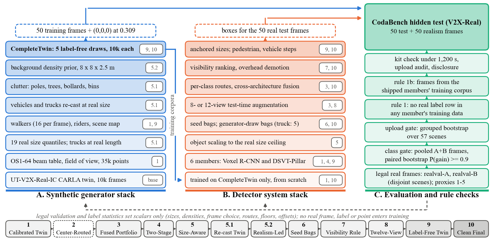
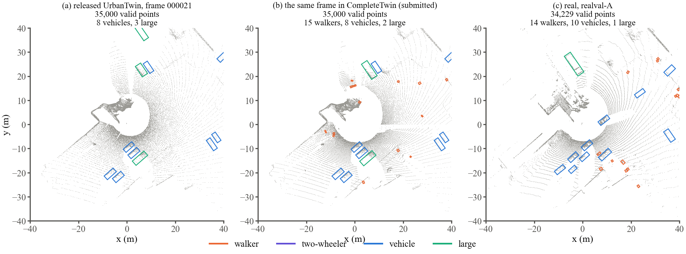
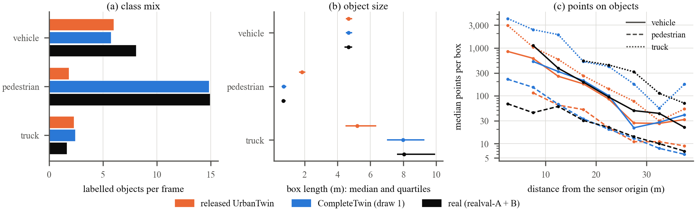
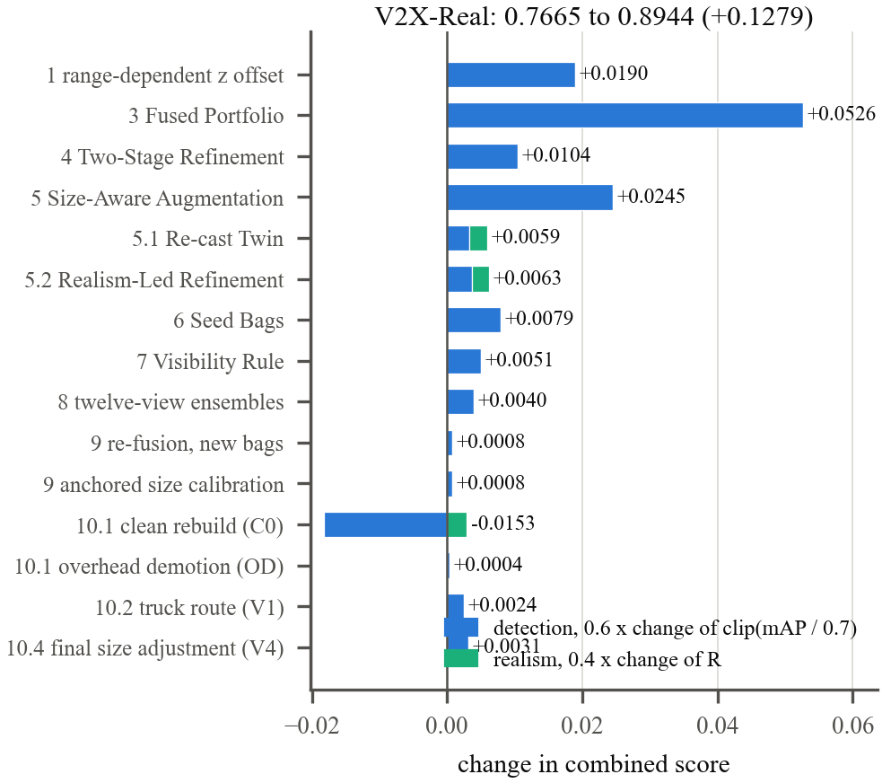
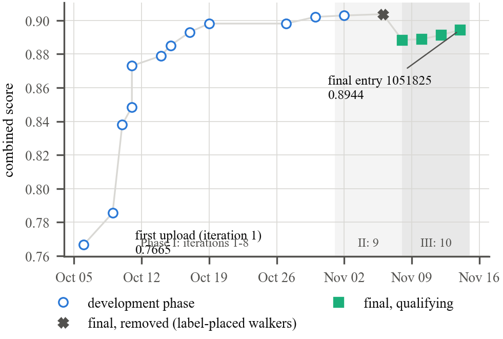
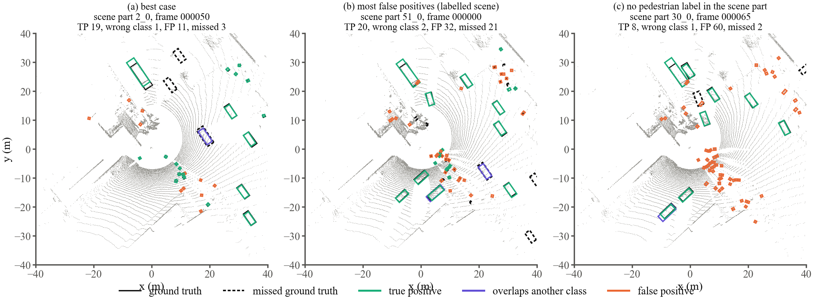
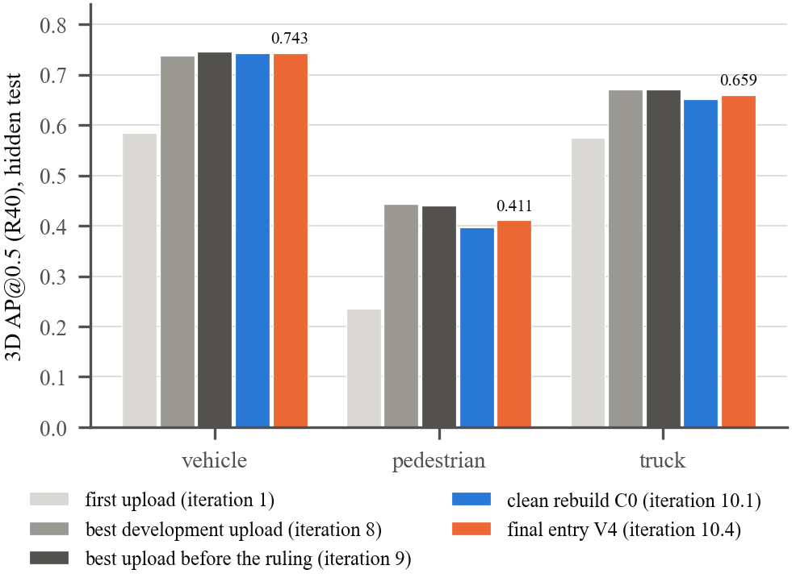

# Exploring UrbanTwin Sim2Real for Synthetic-Only Roadside LiDAR Detection: V2X-Real Track, Team KarmaRV
Rahul Vishwakarma
Hitachi America, Ltd. R&D
rahul.vishwakarma@hal.hitachi.com

<!-- docx-skip -->
> Final report of team KarmaRV for the V2X-Real track of the UCF UrbanTwin Sim2Real LiDAR Challenge, IEEE BigData Cup 2026 (up to 10 pages including references, IEEE two-column, US letter). The LUMPI track has its own report with the same structure ([`report_lumpi.md`](report_lumpi.md)). The Word version is built from this file inside the IEEE conference template: [`Final_Report_IEEE_Big_Data_Cup_2026_V2X-Real_Track_KarmaRV.docx`](Final_Report_IEEE_Big_Data_Cup_2026_V2X-Real_Track_KarmaRV.docx) (`python paper-bigdata2026/build_docx.py --track v2x --pdf`); the figures `figures/fig_v2x_*.png` come from [`make_figures.py`](make_figures.py). Every number is copied from a record in this repository (the `codabench_<id>.json` score files, the model cards, the member score files and the dated decision records in `docs/decisions/`) or measured by `make_figures.py` on legal frames (Figs. 2, 3 and 6); no model was re-run for the report. Written 2026-11-14, after release 10.5.
<!-- /docx-skip -->

**Abstract**– The UrbanTwin Sim2Real LiDAR challenge asks for 3D object detectors trained only on synthetic data that transfer to real roadside sites, together with 50 synthetic frames whose point statistics resemble the real ones; the score weights a normalized 3D mAP by 0.6 and a realism score by 0.4. This report covers the V2X-Real track: one Ouster OS1-64 at a UCLA intersection, three classes, and pedestrians as 62% of the test objects. The released twin had no walkers, trucks 3 m too short and a denser, wider sensor than the real one. Our generator completes it without any real label row: the real beam table and field of view, ray-cast walkers placed on the twin's own scene map, real-size re-cast trucks and unlabeled static clutter. Voxel R-CNN and DSVT-Pillar detectors trained from scratch on these frames are combined per class through test-time views, generator-draw bags and fusion, and label-free post-processing then ranks sparse and overhead-covered pedestrian boxes last and corrects box sizes. Over ten gated iterations the score rose from 0.7665 at our first upload to 0.8944 (submission 1051825: mAP 0.605, realism 0.941), first on the final-phase board of Nov 14, 0.0325 ahead of the next team. We report the measured gaps of the twin, which detectors and stages moved the hidden-test score, how local gains transferred, and a negative result: retraining every detector on a realism-calibrated corpus raised realism by 0.011 but cost 0.059 mAP.

**Keywords**– LiDAR 3D object detection, sim-to-real transfer, digital twin, synthetic data, roadside perception, V2X-Real

## I. Introduction

Roadside LiDAR sensors at intersections see every road user from a fixed viewpoint, which makes them valuable for traffic monitoring and cooperative driving, but labelling their point clouds in 3D is slow and specific to each site. Digital twins promise labels for free: a simulated copy of the site produces point clouds whose boxes are known by construction. The UCF UrbanTwin Sim2Real LiDAR Challenge of the IEEE BigData Cup 2026 [1] tests that promise. The organizers released UrbanTwin datasets [2], simulated in CARLA [3] on digital twins of real intersections [4], for two real sites: the LUMPI intersection in Hannover [5] and the infrastructure LiDAR of V2X-Real at UCLA [6]. Participants train a detector only on synthetic data they generate, detect objects in 50 real test frames per site, and submit 50 synthetic frames that the scorer compares with 50 held-out real frames.

This report covers the V2X-Real track. Three things make it hard. First, the twin contains no walkers, while pedestrians (walkers, riders and scooters) are 62% of the test objects; its trucks are about 3 m shorter than the real ones; and it emulates a sensor with about twice the real number of valid points. Second, the hidden test is small (124 trucks), so local gains transfer noisily. Third, no real frame, label or point may enter training, while legal real frames may be used to validate, to select settings and to calibrate the generator with statistics. The winners of the ECCV 2026 edition, on the same scorer and test data, reached combined scores of 0.4793 on LUMPI and 0.7457 on V2X [7], [8], and the organizers showed that a SEED detector [9] trained on UT-LUMPI matches a real-trained one for cars and that SECOND [10] trained on UT-V2X reaches 63.18 car AP [2].

**Team and submission.** Team KarmaRV has one participant, the author. Our final V2X-Real entry is CodaBench submission **1051825** (combined 0.8944, Table VII); Sections VII and VIII list every earlier upload. A companion report with the same structure covers our LUMPI entry.

Our contributions are:
- measurements of what the V2X twin lacks and a label-free generator that repairs each gap with our own synthetic geometry;
- a synthetic-only detector system built with OpenPCDet [11], with post-processing stages that encode the real annotation conventions;
- a decision protocol for a 50-frame hidden test and the history of the ten named iterations behind the entry, with measured local-to-server transfer;
- a compliance record and a ledger of what did not work, including the organizers' calibrated-generator path.

Fig. 1 shows the system as two stacks and the checks between them.

<!-- wide top -->

*Fig. 1. The V2X-Real system as two stacks and their checks: A, the generator stack, from the released twin to CompleteTwin, our label-free training corpora; B, the detector stack, from training to the final size steps; C, the validation data, gates and rule checks, bottom to top, before the hidden test. Tags name the iterations (bottom row, by release tag) that introduced or changed each layer; iteration 2 was not adopted.*

## II. Related Work

**Synthetic LiDAR and twins.** CARLA [3] renders LiDAR by ray casting against game assets, and LiDARsim [12] narrowed the gap for vehicle-mounted sensors with real surfel maps and learned ray drop. The organizers' twin method [4] builds CARLA maps from public geographic data and emulates each real sensor; the UrbanTwin datasets [2] release 10,000 such frames per site with automatic boxes.

**Transfer.** Statistical normalization [13] showed that object-size statistics explain much of the cross-dataset gap of 3D detectors, and random object scaling [14] makes detectors robust to size shift. We use both only through scalar statistics and never use self-training, which the rules exclude.

**Detectors and ensembles.** We trained PointPillars [15], SECOND-style sparse backbones [10] with center-based heads [16], Voxel R-CNN [17], PV-RCNN++ [18], [19], VoxelNeXt [20] and DSVT [21] in OpenPCDet [11], and tried GBlobs inputs [22]. Weighted box fusion [23], deep ensembles [24], weight averaging [25] and flip and rotation test-time augmentation [16], [26] reduce variance. Earlier solutions to this challenge [7], [8], [27], [28] used per-class non-maximum suppression (NMS), size calibration, null-return modelling and transformer ensembles; on V2X, the ECCV runner-up's DSVT ensemble reached mAP 0.452 [28].

**Metrics.** The realism score combines the Chamfer and earth mover's distances [29], the kernel maximum mean discrepancy [30] and a Frechet point distance [31] between Gaussians fitted to the point sets, as in the Frechet inception distance [32]. Detection uses KITTI-style [33] AP over 40 recall points [34].

## III. Track, Data and Protocol

### A. Track and metric

Table I summarizes the track. With mAP the mean 3D AP at IoU 0.5 (R40) over the three classes, the score is

combined = 0.6 clip(mAP/0.7) + 0.4 R, (1)

R = 1 - (C + M + E + F)/4, (2)

with C = clip((CD-2)/28), M = clip(MMD/0.5), E = clip(EMD/5) and F = clip(FPD/50), each computed between the 50 submitted and 50 reference frames after masking to the range and subsampling to 10,000 points. While mAP is below 0.7, +0.01 AP on one V2X class is worth +0.0029 combined, +0.01 R +0.0040, and 0.1 m less EMD +0.0020. The CD term is zero below 2.0, so every frame change had to keep CD below that floor.

Table: TABLE I. The V2X-Real track (challenge kit and our measurements)

| Item | V2X-Real (Track 2) |
|---|---|
| Real sensor | 1 Ouster OS1-64 (64 x 1,024, 10 Hz), infrastructure agent -1 |
| Classes and test boxes | vehicle 470, pedestrian 953 (with riders and scooters), truck 124 |
| Range (m) | x, y within 40; z from -8 to 2 |
| Forbidden frames | 50 test + 50 realism reference, over 32 scenes |
| Real frames | 49,405-50,000 points, 31% of them (0,0,0) no-returns |
| Synthetic data | UT-V2X-Real-IC [35], 10,000 frames |
| Real data licence | academic use |

### B. The real-data boundary

The rules allow any simulator and any detector trained on the participant's synthetic data, and the use of the real dataset's frames for validation and hyperparameter selection, provided no forbidden frame is touched. They forbid training on real labels, observing any of the 100 forbidden frames, and inferring the realism reference from the leaderboard. Three organizer clarifications shaped the final system: real labels and object points cut out with real boxes must not enter the training set (Nov 7); ranking starts at our clean rebuild, and validation, label statistics in the generator and at test time, realism calibration and test-time post-processing are allowed (Nov 9); a calibration may change the submitted frames only if it also changed the training data (Nov 12). Every real-data reader in our code goes through one guard that refuses forbidden frames, logs each read with its purpose, and excludes the 20 frames on either side of each forbidden frame. Section IX lists every real-data use.

### C. Validation splits

No real frame was ever trained on. realval-A holds 688 frames and realval-B 298, from disjoint scenes: A draws 424 frames from the V2X-Real train split, 119 from val and 145 from test, B 162, 27 and 109 (so 38% and 46% come from the val and test splits). Together they form 57 scene parts, the groups of the upload gate's bootstrap. Five realism proxies of 50 legal frames (1-3 fit, 4-5 held out) judge the frames. The test frames are denser than realval-A: 9.4 vehicles, 19.1 pedestrians and 2.5 trucks per frame against 8.1, 16.2 and 1.7.

<!-- wide top -->

*Fig. 2. Bird's-eye views of (a) a released UT-V2X-Real-IC frame in our training format (resampled to 35,000 points), (b) the same frame in CompleteTwin, one of our 50 submitted frames, and (c) a legal realval-A frame, with boxes by class group. CompleteTwin adds the walkers, re-casts the trucks at real size and adds unlabeled clutter.*

### D. Environment

All work ran on one server with 8 NVIDIA RTX A6000 GPUs, in a single pinned Python 3.10 environment (PyTorch 2.1.2, CUDA 12.1, spconv 2.3.8, Open3D 0.19 [36] for ray casting, POT 0.9.7 [37] for the EMD) with OpenPCDet at commit 233f849. A 10k-frame corpus takes 5-20 CPU minutes on 96 workers; training one member for 40 epochs on 4 GPUs takes 1-2 h (PointPillars) to 3-7.5 h (two-stage and transformer models), and tuning its post-processing on both splits about as long.

## IV. Data Observations

### A. Sensor and frame

The real sensor's beam table, measured on 23 legal unlabeled frames, has 64 rows from +16.13 to -16.77 degrees (median spacing 0.53 degrees). The released twin emulates a different sensor: about 106,000 points per frame (69,000 valid in range against 35,000 real), elevations from -56 to +25 degrees, and rings that vary with azimuth because a level CARLA lidar was rotated into the tilted sensor frame. The site slopes: walker box bottoms lie at -3.5 m near the pole, -2 to -1 m at 10-30 m and -4.7 m beyond 30 m. Below -16.8 degrees there are no returns, so within about 10 m the real sensor sees only upper bodies (median hit height 1.41 m). Real frames carry 31% (0,0,0) no-returns.

### B. Objects: class mix, size and density

Table II lists the gaps of the released twin and our fixes, and Figs. 2 and 3 show them. The twin's only pedestrian boxes are riders (1.8 per frame, median length 1.84 m), against 14.9 labelled pedestrians per legal real frame; CompleteTwin has 14.9 pedestrians per frame, walkers and riders. The twin's trucks are 5.20 m long against 8.04 m real; re-cast trucks reach 7.99 m. Vehicles match in length (4.67 against 4.68 m) but are 9% too low (1.52 against 1.67 m). The real pedestrian class has two size modes, walkers and riders, and the truck class includes refuse trucks labelled TrashCan (8.2 x 2.9 x 2.6 m).

Points per box agree from 10 m outward (pedestrians 44 against 37 at 10-20 m, 18 against 19 at 20-30 m), but within 10 m CompleteTwin walkers carry three times the real points (151 against 46), the near-field cut of Section IV-A that our walkers do not reproduce. Real vehicles near the sensor are denser than ours (1,114 against 488 points at 0-10 m), and our trucks are denser than real ones at 10-20 m (979 against 538), where real trucks are often occluded.

Table: TABLE II. Gaps of the released V2X twin (measured on synthetic data and legal real statistics) and the generator fix

| Gap and consequence | Fix in our generator |
|---|---|
| No walkers: the twin's pedestrian boxes are riders, 1.8 per frame against 14.9 real pedestrians; pedestrians are 62% of the test objects | articulated walkers ray-cast with the real beam table, placed on the twin's scene map, Poisson(16) per frame in groups of 1-4 |
| A denser, wider sensor: 69k against 35k valid points, elevations -56 to +25 degrees | measured OS1-64 beam table, field-of-view mask (+16.4 / -17.0 degrees), 35,000 valid points |
| Trucks 5.20 m against 8.04 m long, at 0.42x the real density in the same place | trucks re-cast at real size with the real sensor: 7.99 m, 0.77x density |
| No buildings, vegetation, poles or fences in the scene map; 38.1% of the real above-ground static mass has no twin geometry | Poisson(30) unlabeled poles, trees, bollards, bins and barriers at curbside cells, as hard negatives |
| Raw twin frames score R about 0.83 against held-out real frames | sensor fixes, a background density prior and frame selection: R 0.9406 on the server |
| Real frames hold 31% (0,0,0) points | added at the real rate when the 50 frames are packaged; stripped by the detector's loader |

### C. Static structure

The twin's scene map, aggregated from its own CARLA semantic tags, holds road, terrain, sidewalk and road-line cells but no buildings, vegetation, poles or fences. That missing structure is where the detector errs: at iteration 2, 72-77% of the unmatched confident pedestrian boxes repeated in the same 1 m cells across frames, and in the clean rebuild 65% of the unmatched pedestrian boxes scored at least 0.5 still lie on static structure. Points 0.2-2.0 m above a box top mark 13.9% of the false pedestrian boxes scored at least 0.3 but only 1.9% of the true ones (a tree, sign or canopy above the box), which became the overhead stage of Section V-D. An oracle that removes pedestrian boxes on static structure would add 0.082 AP.

<!-- wide top -->

*Fig. 3. The V2X data on legal frames: (a) labelled objects per frame, (b) box length (median and quartiles) and (c) median points per box against distance from the sensor, for the released twin (1,000 frames; its pedestrian boxes are riders), CompleteTwin draw 1 (1,000 frames) and realval-A and B (986 frames; panel c on a subset of frames). Bins with fewer than 12 boxes are left out.*

### D. Label coverage of the validation splits

One realval-B scene part (11 frames) has no pedestrian label, although the other part of the same recording has 28 labelled pedestrians per frame and our system places 31.7 pedestrian boxes per frame there at score 0.5 or more (349 boxes, all counted as false positives; Fig. 6c). realval-A has no such part. Local pedestrian AP on B is therefore a lower bound, and B-only gains in pedestrians were read with care.

### E. Realism

Table III follows the realism terms of our frame versions on the server. EMD carried 89% of the realism loss of the first frames. The density prior (iteration 5.2) lowered FPD locally but doubled it on the server (0.733 to 1.468); across frame versions the server moved 0.86 times the local held-out gain. The residual gap is horizontal, not vertical: the height bands match within 0.01, but 8% of the real mass lies in 2 m cells where we have less than a tenth of the real density. A fixed sensor also repeats its points to the centimetre (median nearest-point distance between real frames 0.000-0.002 m, ours 0.22-0.33 m), which a re-rendered twin cannot do; two real frame sets reach R 0.9617.

Table: TABLE III. Realism of our V2X frame versions (server terms of the scored uploads; local R on held-out proxies 4-5)

| Frames (iterations) | CD | MMD | EMD | FPD | R | R local |
|---|---|---|---|---|---|---|
| Calibrated Twin (1-5) | 2.215 | 0.00329 | 1.414 | 1.092 | 0.9203 | 0.9190 |
| Re-cast Twin (5.1) | 2.181 | 0.00146 | 1.345 | 0.733 | 0.9268 | 0.9254 |
| density prior (5.2-9) | 1.986 | 0.00063 | 1.182 | 1.468 | 0.9332 | 0.9366 |
| CompleteTwin (10) | 1.844 | 0.00034 | 1.110 | 0.748 | 0.9406 | 0.9426 |
| real against real (local) | 0.33 | | 0.751 | | 0.9617 | |

## V. The Final System

### A. Label-free generator

We call the final corpora CompleteTwin: the UrbanTwin frames completed, without any real label row, with what the real site has and the twin lacks. Five draws with different generator seeds (1234-5234) give independent training sets of 10,000 frames each. Each draw adds, in order:
- **Sensor:** resampling to 35,000 valid points with the measured OS1-64 beam table and field-of-view mask.
- **Map-placed walkers:** walkers are placed on the cells of a scene map aggregated from the twin's own semantic tags and ground heights (0.45 road, 0.30 curb, 0.05 open, 0.20 beyond the twin's ground), in groups of 1-4, Poisson(16) per frame, with sizes and ranges drawn from scalar summaries of legal labels. No real position or label row is read.
- **Re-cast actors:** vehicles and trucks are re-cast with the real sensor from mirrored convex hulls at real size, with per-class ray dropout matched to the real points per box; trucks draw their sizes from 19 real size quantiles per dimension.
- **Clutter:** Poisson(30) unlabeled poles, trees, bollards, bins and barriers anchored at curbside map cells. The hedges, fences, walls and shelters of the LUMPI generator lowered R on the V2X fit proxies (0.9279 against 0.9374) and are left out.
- **Density prior:** keep probabilities of background points on 8 x 8 x 2.5 m cells, fitted on 400 legal unlabeled frames disjoint from the proxies.
- **Frames:** the 50 frames are chosen from the training corpus by greedy EMD + FPD swaps against proxies 1-3 and accepted only if the held-out proxies 4-5 gain at least 0.003 R. The packager adds (0,0,0) points at the real rate (0.309); the loader strips them in training and inference.

### B. Synthetic-only training

Every member is trained from scratch on synthetic frames for 40 epochs (Adam with a one-cycle schedule, learning rate 0.003, batch 4 per GPU on 4 GPUs). Augmentation uses ground-truth sampling, flips, rotation, global scaling, a small world tilt, and random object scaling capped at the real 99th-percentile sizes. A variant switches ground-truth sampling off for the last 5 epochs (rosf); the default keeps it (ros). Strong configurations are trained on up to five CompleteTwin draws and merged into bags by weighted box fusion of their predictions. Nothing is pretrained, and no batch-norm statistic, pseudo-label or fine-tuning step touches real data.

### C. Inference: views, routes and fusion

Each member runs with 8 views (identity, three flips, yaw +/-5 degrees, height +/-0.25 m) or 12 views (plus global scale 0.95 and 1.05), fused by weighted box fusion, and has its own per-class score floor, NMS IoU, re-centring and size scale, tuned on realval-A and checked on realval-B. A per-class card then routes each class to one member or fuses up to three (Table IV). The entry holds six member models (seven checkpoints), all trained on CompleteTwin draws, and Table V gives the members' own scores.

Table: TABLE IV. Composition of the final entry (views: 8v / 12v; draws: CompleteTwin seeds; IoU: fusion threshold; AP: 3D AP@0.5 of the system)

| Class | Members (draws, views); fusion | realval A / B | Test |
|---|---|---|---|
| vehicle | bag of Voxel R-CNN (2 draws, 12v) + DSVT-Pillar (8v); IoU 0.5 | 0.873 / 0.881 | 0.743 |
| pedestrian | Voxel R-CNN on draws 1 and 2 + Voxel R-CNN rosf (all 12v); IoU 0.5 | 0.409 / 0.401 | 0.411 |
| truck | bag of Voxel R-CNN (5 draws, 8v) + Voxel R-CNN rosf (12v); IoU 0.7 | 0.911 / 0.853 | 0.659 |

Table: TABLE V. Members of the final entry on realval-A / realval-B (mAP with 8 and 12 views; pedestrian AP with 12 views)

| Member | 8 views | 12 views | Pedestrian |
|---|---|---|---|
| Voxel R-CNN, draw 1 | 0.666 / 0.667 | 0.670 / 0.666 | 0.372 / 0.376 |
| Voxel R-CNN, draw 2 | 0.690 / 0.658 | 0.696 / 0.672 | 0.382 / 0.367 |
| Voxel R-CNN rosf | 0.682 / 0.666 | 0.691 / 0.677 | 0.378 / 0.368 |
| DSVT-Pillar | 0.667 / 0.624 | 0.670 / 0.624 | 0.350 / 0.339 |
| Voxel R-CNN bag, 2 draws | 0.694 / 0.676 | 0.697 / 0.683 | 0.380 / 0.373 |
| Voxel R-CNN bag, 5 draws | 0.703 / 0.683 | 0.705 / 0.686 | 0.386 / 0.374 |

### D. Label-free post-processing

After routing and fusion, a fixed sequence of stages edits the boxes. It uses only the detector's own output, point counts in the test frame, and scalar label statistics:
- **Score floors** per class (vehicle 0.01, pedestrian and truck 0.05), which also keep the scorer within its time limit (the entry holds 41,252 boxes, 36,010 of them pedestrians; the kit check takes 283 s of the 1,200 s allowed).
- **Low-score copies:** each confident pedestrian box gets four copies shifted by 0.15 m and scored below every original pedestrian box, so they can only add matches.
- **Visibility ranking:** boxes with fewer than 6 (vehicle, pedestrian) or 8 (truck) points rank last. Real labels almost never fall below these counts (2nd percentile of points per box: pedestrian 6, vehicle 8, truck 18), while 16.3% of our synthetic pedestrians do, so a detector trained on them proposes boxes the annotators would not have drawn.
- **Overhead demotion:** a pedestrian box with 5 or more points 0.2-2.0 m above its top ranks last.
- **Anchored size calibration:** vehicle length -0.3 m and height +0.03 m, chosen on validation. The box end nearest the sensor stays fixed and the bottom is kept, because the observed near face is right and the inferred far face overshoots.
- **Final size adjustment:** pedestrian height moves halfway to 1.73 m and vehicle footprints a quarter of the way to 4.64 x 2.06 m, the realval-A medians, with the bottom kept. No stage adds, removes or rescores a box at a place where the detector placed none.

### E. Decision protocol

A change enters only if rules fixed before its results accept it:
- **Class gate:** a gain on the pooled A+B frames (realval-A and realval-B together) with a paired-bootstrap probability of gain, P(gain), of at least 0.9, and no loss above 0.005 on either split.
- **Upload gate:** a complete system is uploaded only if a grouped bootstrap over the 57 scene parts gives P(gain) of at least 0.75 (0.8 in the last days) and no leave-one-group-out loss beyond 0.002.
- **Checks in code before packaging:** no shipped member may have a real label row in its training data (rule 1). The 50 frames must come from a training corpus of the shipped checkpoints, with every calibration of that corpus in every checkpoint's training data (rule 1b).

The gates grew with the V2X evidence (Section VII): after iterations 3 and 4 the projection of a local gain to the server was refit to 0.6 times the mean of the A and B gains; at iteration 6 the bar of +0.01 AP on B gave way to the pooled rule, because it had rejected vehicle and truck fusions that then gained 0.014 AP each on the server; in iteration 10 the grouped gate's threshold of 0.75 was set from an upload that scored +0.0008 at P 0.79. No server number ever chose a frame set, a setting, a class route or a member.

## VI. Model Observations

**Architectures.** PointPillars [15] carried the first upload, but lost trucks under object scaling (realval-B truck 0.704 to 0.546) because its single 7.94 m truck anchor cannot follow a wide size range, and on CompleteTwin it passed no class. Center-head models (iteration 2) cut the pedestrian gap between bird's-eye-view (BEV) and 3D AP from 0.158 to 0.112 but made 1.8 times more static false positives. The two-stage Voxel R-CNN [17] carries every final class: it reduced the vehicle localization loss from 0.140 (CenterPoint) to 0.103, and PV-RCNN++ [19] to 0.058, while the pedestrian localization loss stayed at 0.27-0.30, so the walker gain of two-stage models came from ranking (ranking loss 0.424 to 0.343). DSVT-Pillar [21] is the strongest single CompleteTwin member for vehicles (8-view realval A / B 0.830 / 0.841) and sits in the vehicle fusion; it is weaker on pedestrians (Table V). VoxelNeXt [20] gained vehicles and trucks on CompleteTwin but lost 0.07-0.10 pedestrian AP, and PV-RCNN++ retrained on CompleteTwin lost every class against its earlier corpus, so neither is in the entry.

**Views, bags and seeds.** Eight views were the largest single gain: routing the view-averaged members raised realval-B from 0.537 to 0.617 (truck +0.114, vehicle +0.081) and fusion to 0.666. Twelve views help walkers only, and on the server the 12-view pedestrians gained 0.0139 against 0.0070-0.0103 locally. Seeds of one configuration differ by up to 0.17 AP (truck 0.636 against 0.803), which is why the truck class is a 5-draw bag: the third draw adds vehicle +0.019, the fourth +0.0046 and the fifth truck +0.0155, after which bags saturate. Ground-truth sampling off for the last 5 epochs (rosf) passed pedestrian and truck and is in both fusions, while sampling off throughout lost pedestrians.

**Localization at IoU 0.7.** The unscored 3D AP at IoU 0.7 tracks box quality: it rose from 0.056 (iteration 1) to 0.112 with two-stage members and to 0.196 with object scaling, then fell to 0.165 in the clean rebuild and to 0.149 with V1's truck route, while the scored AP at 0.5 rose. Two teams beat us at IoU 0.7 on Nov 12 (0.174 and 0.210).

**The clean rebuild.** Retraining every member on CompleteTwin (iteration 10.1) cost pedestrian AP 0.441 to 0.398 on the server, and validation had shown the whole clean gap in pedestrians (-0.06 on B): the walkers placed at legal label positions in the earlier corpora had mattered most there, and the label-free walkers that carried LUMPI did not help V2X pedestrians. Later members found only 2-7% of the clean system's pedestrian misses.

**Error profile.** Fig. 6 shows the three typical cases on realval-B. Pedestrian errors are near misses in crowds: in Fig. 6b, 18 of 29 labelled pedestrians are missed while 13 of the 32 unmatched pedestrian boxes overlap one of them at IoU 0.1-0.5. The vertical centres of the walker boxes scatter with an interquartile range of 0.12 m and their heights with 0.17 m, and heights read from points lose 0.021-0.040 AP, so the 0.5 IoU of a 0.7 m box is the limit.

## VII. Strategy Evolution and Trade-offs

We developed the system in ten iterations, numbered by their release tags (with sub-steps 5.1, 5.2 and 10.1-10.5). Each is a named approach that targeted one measured gap, was judged by a gate on legal validation and was confirmed by an upload; the approaches pull six kinds of lever: twin content, capacity, variance reduction (views, fusion, bags), sizes and conventions, selection (routes) and compliance. Table VI lists the V2X iterations, Table VIII what did not work; Fig. 4 splits the change between successive entries into detection and realism parts, and Fig. 5 traces every scored upload.

### A. Phase I: completing the twin and averaging the detectors (iterations 1-8, Oct 5-30)

Twin content and variance reduction carried the early gains, then sizes and conventions (Table VI, Fig. 4). The first pillars with walkers already scored 0.7665, above the ECCV winner's 0.7457 [8]. The z calibration added 0.0190 while leaving BEV AP unchanged, a pure height convention of the real labels; the Fused Portfolio added 0.0526, the largest single step; and object scaling added 0.0245 because real trucks and vehicles span sizes the twin's few assets never showed. The Visibility Rule encoded what the annotators label and added the largest CPU-only gain (pedestrian +0.0154). By the development close the entry stood at 0.9022, mAP 0.617.

*Fig. 4. What each iteration bought on the V2X hidden test: the combined-score change between successive entries, split into the detection part 0.6 x change of clip(mAP/0.7) and the realism part 0.4 x change of R (official score files). Labels give the iteration and its approach (Table VI); iteration 2 produced no entry.*

### B. Phase II: the label-free twin (iteration 9, Nov 2-7)

Placing walkers from the twin's own scene map instead of from real label rows carried LUMPI, but on V2X no member trained on the new corpus entered a fusion before the development close; the iteration added a pedestrian re-fusion of existing members and anchored size calibration (+0.0008 each). The anchored vehicle length gained 0.0078 vehicle AP on the server, while its pedestrian height part lost 0.0050 and was later removed.

<!-- wide top -->
Table: TABLE VI. The ten iterations on V2X-Real (local: realval-A / B mAP; transfer: server gain over projected gain; C0, OD, V1, V4: Section VII-C)

| Iteration: approach (lever) | What changed | Decision evidence and gate | Trade-off | Server: upload, change |
|---|---|---|---|---|
| 1: Calibrated Twin (twin content) | walkers ray-cast at legal label positions; field-of-view mask; 3 PointPillars members | local 0.572 / 0.520; pedestrian 0 to 0.266 on realval-A | label-placed walkers, replaced in 9 | 965633: 0.7665 |
| 1: z calibration (conventions) | box z offset growing with range (vehicle -0.15 m + 0.005 m per m; pedestrian -0.175 m + 0.0075) | local 0.585 / 0.537 | truck left uncorrected | 972563: +0.0190 (pedestrian +0.046, BEV unchanged) |
| 3: Fused Portfolio (variance) | 8-view TTA; cross-architecture box fusion; score floors | B 0.537 to 0.666; static false positives 6.2 to 1.8 per frame | 8x inference time | 974400: +0.0526 (0.48-0.80x) |
| 4: Two-Stage Refinement (capacity) | Voxel R-CNN and PV-RCNN++ in fusions | vehicle localization loss 0.140 to 0.058 | 4-5x training cost | 975938: +0.0104 (0.53-0.80x) |
| 5: Size-Aware Augmentation (sizes) | random object scaling toward the real size ranges | local 0.694 / 0.699; 3D AP@0.7 0.112 to 0.196 | pillars lose trucks; needs a ceiling | 978945: +0.0245 (pedestrian +0.046) |
| 5.1: Re-cast Twin (twin content) | real-size trucks (7.97 m); clutter; scaling capped after 19.7 m false trucks | passed by 0.0006; R +0.0065 | truck density 0.77x real | 986496: +0.0059 |
| 5.2: Realism-Led Refinement (twin content) | density prior; two-stage seeds; low-score pedestrian copies | local 0.714 / 0.710; copies cannot lower AP | server FPD 0.733 to 1.468 | 990255: +0.0063 (copies 1.07x) |
| 6: Seed Bags (variance) | fused bags of seeds; pooled rule replaces the +0.01 bar | truck seed spread 0.135 AP; old bar rejected two gains | about 120 GPU-hours | 995877: +0.0079 (vehicle, truck +0.014) |
| 7: Visibility Rule (conventions) | boxes below 6 points (vehicle 5) rank last | pooled pedestrian +0.0197; projected +0.0040 | matched-label retraining below the gate | 1001919: +0.0051 (pedestrian +0.0154) |
| 8: Twelve-View Completion (variance) | 12 views for the pedestrian members | B +0.0073; projected +0.0015 | walkers only; pillars lose vehicles | 1022246: +0.0040 (2.65x) |
| 9: Label-Free Twin (selection, sizes) | pedestrian re-fusion; anchored vehicle length -0.3 m | +0.0007; +0.0015 | no member on the new corpus yet | 1028491: +0.0008; 1038966: +0.0008 |
| 10.1: C0 (compliance) | every member retrained on CompleteTwin; rule 1 in code | organizers, Nov 7 and Nov 9; projected detection -0.0090 | pedestrian 0.441 to 0.398 AP | 1042294: -0.0153 |
| 10.1: OD (conventions) | overhead demotion of pedestrian boxes | pooled +0.0009; grouped gate GO | demoted true boxes under trees | 1046758: +0.0004 |
| 10.2: V1 (selection) | truck route: 5-draw bag + rosf member | +0.0007; route rule 14b | 3D AP@0.7 0.1655 to 0.1491 | 1050253: +0.0024 (truck +0.0073) |
| 10.4: V4 (sizes) | pedestrian height, vehicle footprint toward the realval-A median | A +0.0010, B +0.0040; grouped P 0.95 | footprint step changed no test AP | 1051825: +0.0031 (pedestrian +0.0108) |
| 10.5: calibrated corpus (twin content) | range mapping fitted on proxies 1-3; all 7 checkpoints retrained | realism gate +0.0116 R; detection -0.0586 mAP, NO-GO | the organizers' path, measured | not uploaded |

### C. Phase III: the clean final (iteration 10, Nov 8-14)

On Nov 7 the organizers clarified that real labels must not enter training, which put every V2X member at risk. We retrained every member on CompleteTwin, added a code check (rule 1), and rebuilt the iteration-9 recipe from clean members only. We name the uploads of this iteration by step: **C0** (10.1) is the clean rebuild; **OD** (10.1) adds overhead demotion to C0; **V1** (10.2) adds a truck route to OD; **V4** (10.4) adds the final size adjustment of pedestrians and vehicles to V1. Iteration 10.3 kept V1 on V2X.

The rebuild cost 0.0153 (detection -0.0183, realism +0.0029), twice its projection and almost all of it pedestrians. Every later step was small and validated: OD +0.0004, V1 +0.0024 and V4 +0.0031. V4's gain came from the pedestrian height step (+0.0108 pedestrian AP); our predicted pedestrian median height was already 1.74 m, so the step narrowed the spread of heights rather than moving their centre. The footprint step left every test AP unchanged to six digits.

Iteration 10.5 tested the organizers' recommended path for calibration: apply it to the training data and retrain the detector. A range mapping fitted on the unlabeled proxies 1-3 quantile-maps our ranges onto the real ones in each 10 x 2.125 degree bin and rebalances the point shares with background donor points (about 2,450 per frame), leaving points inside labelled boxes untouched. It gained 0.0116 R at the realism gate (all four judges) and 0.0112 on the kit, with EMD -0.18 and CD -1.07. But the retrained checkpoints lost detection against their parents: all twelve member-split reads at 8 views were negative (-0.032 to -0.084 mAP), with trucks down 0.045-0.203 and pedestrians 0.033-0.075 AP, although training converged to the parents' loss (5.46 against 5.48). The system's detection change was -0.0586 mAP (A -0.0597, B -0.0512, P(gain) 0.00 in all 57 groups), about -0.050 combined against +0.0045 from realism, so it was stopped. Our leading suspect is the donor background points: they can carry unlabeled objects, which then train as background. The view-set swap of the same iteration, 12 views for the truck bag and the DSVT vehicle member, failed its class rule (truck pooled -0.0009, vehicle -0.0040), so no V2X system was uploaded in 10.5.

### D. Trade-offs

We gave up 3D AP at IoU 0.7, which the challenge does not score, for AP at 0.5; accepted 8-12 times the inference cost for views; and spent about 120 GPU-hours on seed bags for gains of 0.014 AP per class. Both routes chosen on validation transferred, unlike on LUMPI. The clean rebuild cost 0.0153 and was the right call: it is the only kind of entry the organizers rank. The calibrated corpus traded detection for realism and lost by a factor of ten.

*Fig. 5. Combined score of every scored V2X upload, by status, over the three phases (shaded): I, development iterations 1-8; II, the label-free twin (iteration 9); III, the clean final (iteration 10). The final-phase upload made before the clean rebuild was removed by the organizers' Nov 9 ruling.*

<!-- wide top -->

*Fig. 6. The final entry on legal realval-B frames (boxes scored at least 0.3, matched at the official 3D IoU of 0.5): (a) a crowded walkway detected completely; (b) a crowd where 18 of 29 pedestrians are missed and 13 of the 32 unmatched pedestrian boxes overlap them below IoU 0.5; (c) a scene part without any pedestrian label, where the 60 pedestrian boxes count as false positives.*

## VIII. Results

### A. Final entry

Table VII lists the final-phase uploads; the best qualifying one counts, so our entry is V4 (iteration 10.4). Fig. 7 shows per-class AP on the hidden test from our first upload to the entry.

The entry reaches mAP 0.605 (vehicle 0.743, pedestrian 0.411, truck 0.659) and R 0.941 (CD 1.844, below the 2.0 floor; EMD 1.110; FPD 0.748). Since our first upload V2X rose by 0.1279, of which 0.1198 is detection: pedestrian AP rose from 0.235 to 0.411, vehicle from 0.585 to 0.743 and truck from 0.574 to 0.659. Validation tracks the test closely for pedestrians (0.409 / 0.401 against 0.411), but overstates vehicles (0.87-0.88 against 0.74) and trucks (0.85-0.91 against 0.66), the class with 124 test boxes.

Table: TABLE VII. Final-phase V2X uploads (official score files; 3D AP@0.5 per class; R 0.9406 for every clean upload and 0.9332 for 1038966, the removed iteration-9 upload; systems as in Section VII-C)

| Upload | Vehicle | Pedestrian | Truck | mAP | 3D@0.7 | Combined |
|---|---|---|---|---|---|---|
| 1038966, removed | 0.745 | 0.441 | 0.671 | 0.6189 | 0.1983 | 0.9038 |
| 1042294 C0 | 0.743 | 0.398 | 0.652 | 0.5976 | 0.1654 | 0.8885 |
| 1046758 OD | 0.743 | 0.399 | 0.652 | 0.5981 | 0.1655 | 0.8889 |
| 1050253 V1 | 0.743 | 0.400 | 0.660 | 0.6009 | 0.1491 | 0.8913 |
| **1051825 V4, entry** | 0.743 | **0.411** | 0.660 | **0.6045** | 0.1503 | **0.8944** |

*Fig. 7. Per-class 3D AP at IoU 0.5 on the V2X hidden test: our first upload (iteration 1), the best development upload (iteration 8), the best upload before the ruling (iteration 9, removed), the clean rebuild C0 (iteration 10.1) and the final entry V4 (iteration 10.4).*

**Leaderboard.** V1 was first on the final-phase board of Nov 12, 0.0294 ahead of the next team (0.8619: mAP 0.563, R 0.949), which led us on realism by 0.008 while we led on mAP by 0.038; V4 widens the gap to 0.0325 and was first on the board of Nov 14. The two next teams also beat us on the unscored 3D AP at IoU 0.7. For scale, our first upload was already above every entry of the ECCV edition [8], [28], and the development leader on Oct 2 stood at 0.6114.

### B. Qualitative and quantitative cases

Fig. 6 shows the entry on three realval-B frames, chosen by fixed rules over a third of the split: the best case, the frame with the most false positives among scene parts that have pedestrian labels, and the frame with the most false positives overall.

**Positive case.** In Fig. 6a all 14 labelled pedestrians on the walkway in front of the sensor are found, and the fused trucks and vehicles match at IoU 0.5; the 11 unmatched pedestrian boxes lie away from every labelled pedestrian (median 5.8 m), where static structure stands.

**Negative case.** In Fig. 6b the crowd near the sensor and the group at the far corner are found as crowds, but half of the boxes miss the 0.5 IoU of a 0.7 m walker by a few decimetres, the localization limit of Section VI. Fig. 6c is not a detector failure: it is the unlabelled scene part of Section IV-D.

**Transfer.** Projections and server changes mostly agreed in sign, with a wide spread: views and fusion transferred at 0.5-0.8 times the projection, bags and the visibility rule above 1 (2.1 and 1.27 times), routes at up to 6 times, and the clean rebuild at twice its projected loss.

## IX. What Did Not Work, and What the Rules Excluded

Table VIII collects the main negative results on V2X; most were stopped by a rule before they reached the server.

<!-- wide bottom -->
Table: TABLE VIII. Approaches that did not work or were excluded on V2X-Real, with the evidence

| Approach | Evidence | Outcome |
|---|---|---|
| CenterPoint as a main member (iteration 2) | 1.8x more static false positives; no class passed | not adopted |
| PointPillars, PV-RCNN++, VoxelNeXt on CompleteTwin | pillars fail every class; PV-RCNN++ loses every class against its earlier corpus; VoxelNeXt pedestrian -0.07 to -0.10 | not in the entry |
| GBlobs inputs [22] | 3-draw bags gain vehicle +0.0128 but lose pedestrian 0.046-0.051 | not in the entry |
| Statistical normalization and range jitter in training | normalization: truck -0.093 (it raises synthetic vehicle heights by about 10%); range jitter passes no class | rejected |
| Visibility-matched training labels (iteration 7) | +0.0014 projected, below the +0.003 bar | not uploaded |
| Low-score completion copies with the visibility rule | demoted true boxes are outranked by the copies | not used on V2X |
| LUMPI-style structures (hedges, fences, walls) | fit-proxy R 0.9279 against 0.9374 | left out |
| Ground bowl, per-cell ground fix, point thinning | R -0.0022; +0.0000; thinning raises CD to 2.02-2.07, above the floor | rejected |
| Completing missing static mass from unlabeled frames | +0.0022 R, below the 0.003 gate; CD 1.85 to 1.95 | no completion frame shipped |
| Calibrated corpus with all detectors retrained (10.5) | R +0.0112 on the kit, detection -0.0586 mAP; all 12 member-split reads negative | stopped |
| 12 views for the truck bag and DSVT vehicle member (10.5) | truck pooled -0.0009 (P 0.18), vehicle -0.0040 (P 0.00) | not built |
| Walkers placed from real label rows (iterations 1-9) | organizers, Nov 7 and Nov 9: real labels must not enter training | upload removed; full clean rebuild |

**Real-data use (required by the organizers).** Every use was on legal frames, after removing the forbidden frames and our self-exclusion windows:
- validation and selection on realval-A and realval-B (V2X-Real train, val and test scenes);
- label statistics in the generator: the walker box mixture and distance histogram, 19 size quantiles, per-class ray dropout from real points per box, and points per walker;
- label statistics in training augmentation (the 99th-percentile size caps of object scaling) and at test time (the anchored size offsets, the visibility counts and the realval-A medians of the final size adjustment);
- realism calibration: the density prior from 400 unlabeled frames; the OS1-64 beam table from 23 unlabeled frames of the val and test splits; the choice of the 50 frames against proxies 1-3; the null rate; in iteration 10.5 only (not shipped), the range mapping fitted on proxies 1-3;
- test frames: inference only, plus point counts inside predicted boxes for the visibility and overhead stages; the copies duplicate the detector's own boxes.

We disclosed the label-placed walkers of our earlier corpora to the organizers; the affected upload was removed. One literal point remains open: the no-returns of the 50 frames are added at packaging rather than stored in the training corpora, although the detector strips them either way; the calibrated corpus of iteration 10.5 would have stored them, and it did not ship.

## X. Discussion and Limitations

Four lessons generalize. First, the decisive gaps were content and conventions the twin lacked (walkers, truck sizes, the label height convention, what annotators draw), not detector capacity: our first pillars already beat the edition's transformer ensemble [28]. Second, a 50-frame test rewards variance reduction that cannot hurt (views, fusion, copies ranked below every box, demotions that only reorder) and punishes selection on noisy splits. Third, realism and detection can pull apart: the calibrated corpus closed half of the EMD gap to real frames but cost about ten times its realism gain in detection, so a realism calibration has to be judged by the detector it trains, not by R alone. Fourth, compliance is cheaper when built into the code: rules 1 and 1b would have prevented the removal.

The limitations are clear. Pedestrian AP is 0.411 and is bounded by localization in crowds; two-stage refinement did not fix walker boxes. Our realism (R 0.941) trails the next teams (0.949 and 0.955), and 38.1% of the real static mass has no counterpart in the twin. Truck AP rests on 124 test boxes and its validation scores overstate it by 0.2. Our boxes at IoU 0.7 are worse than at our best development upload.

**Reproducibility.** The entry is published as release 10.4 with its seven checkpoints and a reproduction script; re-merging the saved member predictions reproduces the submission exactly.

## XI. Conclusion

Over ten gated iterations, a rule-clean, synthetic-only pipeline reached 0.8944 on V2X-Real, first on the last final-phase board we saw. It completes the organizers' twin with measured statistics, averages detector noise with views, fusion and bags, encodes the annotators' conventions in label-free stages, and admits only changes that rules fixed in advance accepted. The largest gains came early and from the data side; the late gains were small and transferred when they could not hurt. Walker localization in crowds and twin geometry for the missing static structure are the clearest next steps.

## Acknowledgment

We thank the organizers of the UrbanTwin Sim2Real Challenge, M. Shahbaz and S. Agarwal, for the UrbanTwin datasets, the starting kit and their timely answers; the creators of the V2X-Real and LUMPI datasets; and the OpenPCDet developers.

## References

[1] M. Shahbaz and S. Agarwal, "UCF UrbanTwin Sim2Real LiDAR Challenge," IEEE BigData 2026 Cup, Challenge 04, 2026. [Online]. Available: https://urbanity-lab.github.io/bdc2026-urbantwin-sim2real/
[2] M. Shahbaz and S. Agarwal, "UrbanTwin: Synthetic roadside LiDAR datasets," IEEE Open J. Intell. Transp. Syst., vol. 7, pp. 353-364, 2026, arXiv:2509.06781.
[3] A. Dosovitskiy, G. Ros, F. Codevilla, A. Lopez, and V. Koltun, "CARLA: An open urban driving simulator," in Proc. 1st Conf. Robot Learn. (CoRL), PMLR vol. 78, 2017, pp. 1-16.
[4] M. Shahbaz and S. Agarwal, "High-fidelity digital twins for bridging the Sim2Real gap in LiDAR-based ITS perception," IEEE Trans. Intell. Transp. Syst., vol. 27, no. 7, pp. 8698-8709, 2026.
[5] S. Busch, C. Koetsier, J. Axmann, and C. Brenner, "LUMPI: The Leibniz University multi-perspective intersection dataset," in Proc. IEEE Intell. Veh. Symp. (IV), 2022, pp. 1127-1134.
[6] H. Xiang et al., "V2X-Real: A large-scale dataset for vehicle-to-everything cooperative perception," in Proc. Eur. Conf. Comput. Vis. (ECCV), Springer, 2024, pp. 455-470.
[7] A. Upganlawar, "Geometric refinement and distributional alignment for Sim2Real roadside LiDAR detection," arXiv:2611.03936, 2026.
[8] A. Upganlawar, "Coordinate frame recovery, per class NMS and null return modelling for Sim2Real V2X LiDAR detection," arXiv:2611.03940, 2026.
[9] Z. Liu, J. Hou, X. Ye, T. Wang, J. Wang, and X. Bai, "SEED: A simple and effective 3D DETR in point clouds," in Proc. ECCV, Springer, 2024, pp. 110-126.
[10] Y. Yan, Y. Mao, and B. Li, "SECOND: Sparsely embedded convolutional detection," Sensors, vol. 18, no. 10, Art. no. 3337, 2018.
[11] OpenPCDet Development Team, "OpenPCDet: An open-source toolbox for 3D object detection from point clouds," 2020. [Online]. Available: https://github.com/open-mmlab/OpenPCDet
[12] S. Manivasagam et al., "LiDARsim: Realistic LiDAR simulation by leveraging the real world," in Proc. IEEE/CVF CVPR, 2020, pp. 11164-11173.
[13] Y. Wang et al., "Train in Germany, test in the USA: Making 3D object detectors generalize," in Proc. IEEE/CVF CVPR, 2020, pp. 11710-11720.
[14] J. Yang, S. Shi, Z. Wang, H. Li, and X. Qi, "ST3D: Self-training for unsupervised domain adaptation on 3D object detection," in Proc. IEEE/CVF CVPR, 2021, pp. 10363-10373.
[15] A. H. Lang, S. Vora, H. Caesar, L. Zhou, J. Yang, and O. Beijbom, "PointPillars: Fast encoders for object detection from point clouds," in Proc. IEEE/CVF CVPR, 2019, pp. 12689-12697.
[16] T. Yin, X. Zhou, and P. Krahenbuhl, "Center-based 3D object detection and tracking," in Proc. IEEE/CVF CVPR, 2021, pp. 11779-11788.
[17] J. Deng, S. Shi, P. Li, W. Zhou, Y. Zhang, and H. Li, "Voxel R-CNN: Towards high performance voxel-based 3D object detection," in Proc. AAAI Conf. Artif. Intell., vol. 35, no. 2, 2021, pp. 1201-1209.
[18] S. Shi et al., "PV-RCNN: Point-voxel feature set abstraction for 3D object detection," in Proc. IEEE/CVF CVPR, 2020, pp. 10526-10535.
[19] S. Shi et al., "PV-RCNN++: Point-voxel feature set abstraction with local vector representation for 3D object detection," Int. J. Comput. Vis., vol. 131, no. 2, pp. 531-551, 2023.
[20] Y. Chen, J. Liu, X. Zhang, X. Qi, and J. Jia, "VoxelNeXt: Fully sparse VoxelNet for 3D object detection and tracking," in Proc. IEEE/CVF CVPR, 2023, pp. 21674-21683.
[21] H. Wang et al., "DSVT: Dynamic sparse voxel transformer with rotated sets," in Proc. IEEE/CVF CVPR, 2023, arXiv:2301.06051.
[22] D. Malic, C. Fruhwirth-Reisinger, S. Schulter, and H. Possegger, "GBlobs: Explicit local structure via Gaussian blobs for improved cross-domain LiDAR-based 3D object detection," in Proc. IEEE/CVF CVPR, 2025, pp. 27357-27367.
[23] R. Solovyev, W. Wang, and T. Gabruseva, "Weighted boxes fusion: Ensembling boxes from different object detection models," Image Vis. Comput., vol. 107, Art. no. 104117, 2021.
[24] B. Lakshminarayanan, A. Pritzel, and C. Blundell, "Simple and scalable predictive uncertainty estimation using deep ensembles," in Proc. Adv. Neural Inf. Process. Syst. (NIPS), vol. 30, 2017.
[25] P. Izmailov, D. Podoprikhin, T. Garipov, D. Vetrov, and A. G. Wilson, "Averaging weights leads to wider optima and better generalization," in Proc. 34th Conf. Uncertainty Artif. Intell. (UAI), 2018, pp. 876-885.
[26] Z. Ding et al., "1st place solution for Waymo Open Dataset challenge: 3D detection and domain adaptation," arXiv:2006.15505, 2020.
[27] P. Luo et al., "Solution for UCF UrbanTwin LUMPI track: Sim-to-real urban LiDAR 3D object detection," arXiv:2609.07590, 2026.
[28] P. Luo et al., "Solution for UCF UrbanTwin V2X-Real track: Sim-to-real urban LiDAR 3D object detection," arXiv:2609.07608, 2026.
[29] H. Fan, H. Su, and L. Guibas, "A point set generation network for 3D object reconstruction from a single image," in Proc. IEEE CVPR, 2017, pp. 2463-2471.
[30] A. Gretton, K. M. Borgwardt, M. J. Rasch, B. Scholkopf, and A. Smola, "A kernel two-sample test," J. Mach. Learn. Res., vol. 13, no. 25, pp. 723-773, 2012.
[31] D. W. Shu, S. W. Park, and J. Kwon, "3D point cloud generative adversarial network based on tree structured graph convolutions," in Proc. IEEE/CVF ICCV, 2019, pp. 3858-3867.
[32] M. Heusel, H. Ramsauer, T. Unterthiner, B. Nessler, and S. Hochreiter, "GANs trained by a two time-scale update rule converge to a local Nash equilibrium," in Proc. Adv. Neural Inf. Process. Syst. (NIPS), vol. 30, 2017.
[33] A. Geiger, P. Lenz, and R. Urtasun, "Are we ready for autonomous driving? The KITTI vision benchmark suite," in Proc. IEEE CVPR, 2012, pp. 3354-3361.
[34] A. Simonelli, S. Rota Bulo, L. Porzi, M. Lopez-Antequera, and P. Kontschieder, "Disentangling monocular 3D object detection," in Proc. IEEE/CVF ICCV, 2019, pp. 1991-1999.
[35] M. Shahbaz and S. Agarwal, "UT-V2X-Real-IC," Harvard Dataverse, V2.1, 2025, doi: 10.7910/DVN/N6N4UR.
[36] Q.-Y. Zhou, J. Park, and V. Koltun, "Open3D: A modern library for 3D data processing," arXiv:1801.09847, 2018.
[37] R. Flamary et al., "POT: Python optimal transport," J. Mach. Learn. Res., vol. 22, no. 78, pp. 1-8, 2021.
