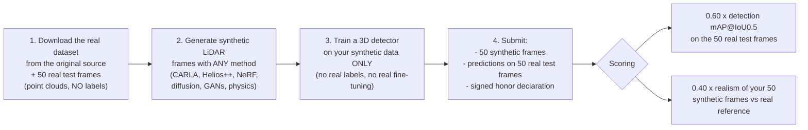
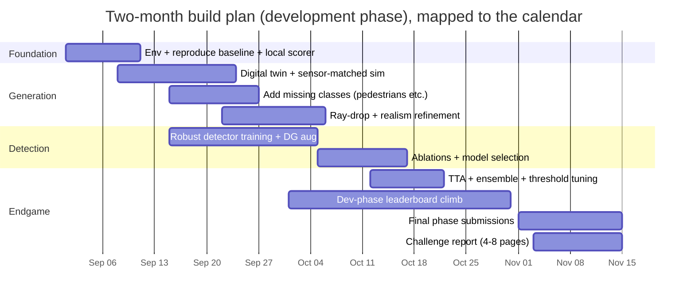
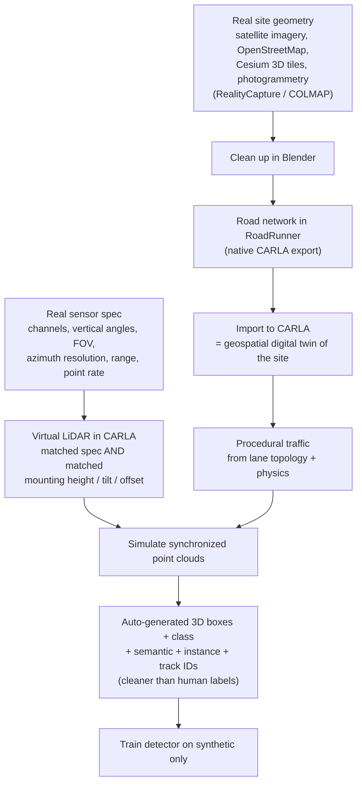
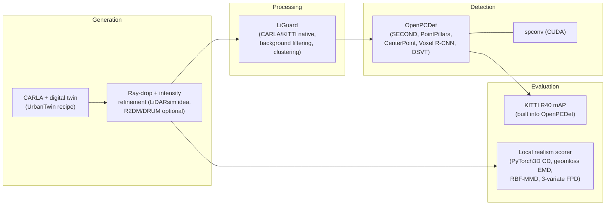

# RESEARCH OVERVIEW: UCF UrbanTwin Sim2Real LiDAR Challenge (IEEE BigData Cup 2026)

> Shared research and literature-review companion for `PLAN-V2X-Real.md`, `PLAN-LUMPI.md`, and `SETUP-AND-STACK.md` (server, environment, pipeline, scorer).
> Status: facts below are confirmed from the live CodaBench pages and the four UrbanTwin/LiGuard papers in `reference/papers/` (reviewed Aug 31, 2026).
> Author context: prepared for a solo entrant with multi-GPU compute, hands-on ML, roughly a two-month build window (late Aug to late Oct 2026 development phase; final phase to Nov 15, 2026).
> Purpose: learn the problem deeply, understand the state of the art, and lock a competitive strategy for both tracks.

---

## 0. TL;DR (the winning thesis in one page)

This challenge is not a normal 3D-detection leaderboard. You must **generate your own synthetic LiDAR, train a detector on synthetic data only, and then be scored on real held-out frames**. Your final score is:

```
score = 0.60 * norm(3D mAP @ IoU 0.5)              # detection quality
      + 0.40 * mean( norm(CD), norm(MMD), norm(EMD), norm(FPD) )   # realism of your synthetic frames vs real
```

Six facts drive the entire strategy:

1. **This is the first edition of this exact challenge**, so there are no "previous winners" to copy. The closest thing to a published solution is the organizers' own **UrbanTwin** work (Shahbaz and Agarwal, UCF), which is effectively the baseline you must beat. Read those papers first.
2. **The organizers proved synthetic-only can match or beat real-trained detectors** on these exact datasets, and they attribute the win to **geospatial digital-twin fidelity plus exact sensor-spec-and-placement matching**, not to a clever loss function.
3. **Realism is 40% of the score and it is measured against a specific real sensor.** This means broad domain randomization (good for generic robustness) actively hurts you. **Faithful replication of the target sensor's beam pattern, density, and ray-drop is the single highest-leverage move**, because it improves detection and realism at the same time.
4. **The organizers' released synthetic datasets have no pedestrians** (a stated CARLA limitation), yet both tracks score pedestrians/persons. **Generating good pedestrians is a concrete, high-value gap to exploit.**
5. **"Synthetic-only" most likely rules out training or self-training on real point clouds.** That puts you in a **domain-generalization + faithful-simulation** regime, not a classic unsupervised-domain-adaptation regime. Confirm the exact rule wording, because it decides whether an entire class of methods is legal.
6. **The detection half is a "boring, robust detector" game, not an exotic-architecture game.** On roadside and infrastructure data, simple strong detectors (SECOND, PointPillars, CenterPoint, Voxel R-CNN) and heavy inference-time tricks (test-time augmentation, ensembling, per-class thresholds) repeatedly beat heavy transformers.

The recommended winning formula, identical in spirit across both tracks:

> Build a **high-fidelity digital twin** of the real site in CARLA, configure a **virtual LiDAR that exactly matches the real sensor and its mounting pose**, **add the missing classes (pedestrians, and for LUMPI also Van and Unknown)**, apply a **learned ray-drop plus intensity/density refinement** so the synthetic frames match the real sensor statistics (this wins the 40% realism term), train a **robust anchor-free voxel detector** (CenterPoint or Voxel R-CNN) with **domain-generalization augmentation** (Random Object Scaling, density resampling, optionally GBlobs features), and finish with **test-time augmentation plus a multi-seed ensemble with weighted box fusion and per-class threshold tuning** to squeeze the 60% detection term.

The rest of this document explains every piece of that sentence, the theory behind it, the alternatives, and the evidence.

---

## 1. The challenge, decoded

### 1.1 The task and the mandatory workflow

You train on synthetic and prove on real. The organizers define four mandatory steps:



The intellectual point of the challenge: **can a detector learn only from simulation and still work on a real sensor it has never seen labeled?** Your two levers are (a) make the synthetic data realistic and correctly labeled, and (b) make the detector robust to any residual gap.

### 1.2 The two tracks at a glance

| Attribute | Track V2X-Real (CodaBench 16685) | Track LUMPI (CodaBench 16684) |
|---|---|---|
| Real dataset | V2X-Real, UCLA Mobility Lab, Los Angeles | LUMPI, Leibniz University Hannover, Germany |
| Sub-set used | Infrastructure-centric (V2X-Real-IC) | Multi-perspective intersection |
| Viewpoint | Roadside / infrastructure unit (elevated, fixed) | Multiple roadside LiDARs at one intersection |
| Scored classes | vehicle, pedestrian, truck (3) | Person, Car, Bicycle, Motorcycle, Bus, Truck, Van, Unknown (8) |
| Detection range [xmin,ymin,zmin,xmax,ymax,zmax] | [-40, -40, -8, 40, 40, 2] | [-40, -40, -5, 40, 40, 5] |
| Real sensor(s) | Ouster OS1-128 and OS1-64 at the roadside unit | Up to five 360-degree LiDARs, 16 to 64 layers, 20 to 200 m range (exact models to confirm) |
| Provided synthetic set | UT-V2X-Real-IC, ~50k points/frame, ~14 road users/frame, DOI 10.7910/DVN/N6N4UR | UT-LUMPI, ~220k points/frame, ~8 road users/frame, DOI 10.7910/DVN/D9SSWD |
| Organizer baseline detector | SECOND | SEED |
| Organizer headline result | Car AP 63.18 @ 3D IoU 0.5 (synthetic-trained) | SEED synthetic-trained beat the real-trained model |

Ranges are as listed on the challenge site. Confirm them against `config.json` in the starting kit before you build, because the organizers' papers used slightly different z-bounds for LUMPI.

### 1.3 What is different and hard about each track

- **V2X-Real-IC** is a single elevated infrastructure LiDAR (Ouster). Only 3 broad classes, but they are collapsed super-classes (the raw dataset has 10 categories folded into vehicle/pedestrian/truck), so your class mapping must be exactly right. Roadside geometry means far objects are very sparse.
- **LUMPI** is harder in taxonomy (8 classes including the awkward "Unknown"), has **multiple heterogeneous LiDARs** that can be registered into one dense cloud (~220k points/frame in the provided synthetic set), and has almost no public detection leaderboard history, so there is less prior art to lean on. That is both a risk (few reference points) and an opportunity (fewer strong competitors with a template).

---

## 2. Scoring, in precise detail (this is where the strategy comes from)

Your combined score is `0.60 * detection + 0.40 * realism`. Both halves are normalized to a common scale using endpoints shipped in `config.json`, and the exact scorer is `local_eval.py` in the starting kit, so **you can reproduce scoring locally**. Do that on day one.

### 2.1 The detection term (60%)

- Metric: **3D mAP at IoU 0.5**, averaged over the track's classes, using **KITTI 40-recall-point interpolation (R40)**.
- Computed on your detector's predictions for the **50 real test frames** (whose labels are held out).
- IoU 0.5 in 3D is a moderately strict overlap threshold. Getting box size and heading right matters as much as centroid.
- Practical consequence: this is exactly the metric OpenPCDet's built-in KITTI evaluator produces, so your local validation can mirror the leaderboard precisely.

### 2.2 The realism term (40%)

Four distances between your **50 submitted synthetic frames** and a **held-out set of real reference frames**, each side pooled and subsampled to **10,000 points, fixed seed 1234**, then each distance normalized and averaged. Lower distance is better (more realistic). The challenge site describes them precisely:

| Metric | Challenge definition | What it actually measures | Cheapest way to move it |
|---|---|---|---|
| **CD** Chamfer Distance | Symmetric squared-L2 nearest-neighbor cost between point sets | Global coverage and gross shape; ignores local density; sensitive to stray outlier points | Match spatial extent and range crop; remove outliers; leave no empty regions the real cloud fills |
| **MMD** Maximum Mean Discrepancy | Gaussian-kernel two-sample statistic, median-heuristic bandwidth | Whether the two point distributions are statistically the same under an RBF kernel | Match the overall 3D density distribution (radial and height histograms), and per-frame variability |
| **EMD** Earth Mover's Distance | Exact Wasserstein-1 with Euclidean cost via network simplex | Strict one-to-one optimal-transport match; the harshest on density and point-count mismatch | Match point count and the density profile so mass sits where real mass sits |
| **FPD** Frechet Point-cloud Distance | FID-style 2-Wasserstein between fitted **3-variate** Gaussians | The gross spatial distribution: centroid (mean) and spread (3x3 covariance) of the point coordinates | Match the point cloud's overall centroid and spatial covariance (extent and orientation of the spread) |

Two important clarifications that resolve ambiguities in the general literature:

1. This challenge's **MMD is the kernel two-sample statistic (Maximum Mean Discrepancy)**, not the "Minimum Matching Distance" that some point-cloud GAN papers call MMD. The challenge text says "Gaussian-kernel two-sample statistic, median-heuristic bandwidth," which is unambiguous.
2. This challenge's **FPD is a Frechet distance on 3-variate Gaussians**, i.e. Gaussians fitted directly to the x,y,z coordinates (mean in R^3, covariance 3x3). It is **not** the PointNet-feature FID (~1808-dim) used in TreeGAN. That is good news: the challenge FPD is stable and easy to reason about. It rewards matching the overall spatial spread of your points to the real sensor's.

### 2.3 The single most important strategic reading of the scoring

Every realism metric here operates on **raw geometry and density**, and FPD is only about spatial spread. There is nothing rewarding exotic per-point feature realism. This means:

> The realism term is won by making your synthetic point **distribution** (extent, radial/height density, sparsity, outlier profile, overall spread) statistically identical to the real sensor's. That is achieved by **matching the sensor model and adding realistic ray-drop**, which is the exact same thing that makes the detector transfer well. Detection and realism are optimized by the same core action.

The two most common ways to lose the realism term are (a) submitting "too clean" simulator frames (no ray-drop, uniform density, unrealistic completeness), and (b) collapsing diversity across your 50 frames to chase one metric, which hurts the others and hurts detection. Avoid both.

---

## 3. Timeline, rules, and prizes

### 3.1 Timeline (development phase is your two-month window)

| Date (2026) | Milestone |
|---|---|
| Jul 1 | Development phase opens: public leaderboard, up to 5 submissions/day, 100 total per participant |
| Aug 15 (now extended) | Letter of intent deadline; the organizers extended LOI acceptance through Oct 30, 2026, aligned with the dev-phase close. (Already submitted and registered for both tracks.) |
| Oct 31 | Development phase closes |
| Nov 1 | Final phase opens: hidden leaderboard, 5 total submissions per participant |
| Nov 15 | Final submissions and a 4 to 8 page challenge report due |
| Nov 25 | Winners announced |
| Dec 14 to 17 | IEEE BigData 2026 conference, Phoenix, Arizona; presentations |



The critical discipline for a solo entrant: **the public dev-phase leaderboard is your feedback loop.** Get a legal end-to-end submission in early (even a weak one), then improve. Do not spend six weeks building the perfect simulator before your first submission.

### 3.2 Rules and constraints that shape the approach

- **Train on synthetic only.** No real data for training, validation, or fine-tuning. Any detector must be trained on your synthetic data only.
- **Forbidden frames.** A `forbidden_frames.txt` lists 100 frame IDs per track (the 50 detection-test frames plus the 50 realism-reference frames). You must never observe labels for, train on, validate on, or tune on these.
- **Submission bundle.** 50 synthetic frames, predictions on the 50 real test frames, and a signed declaration of honor.
- **Anti-gaming.** No multiple accounts, no sub-team coordination, no "probing" submissions designed to reverse-engineer the hidden realism reference set. Violations mean disqualification.
- **The regime is confirmed: domain generalization, not UDA.** The CodaBench rule reads verbatim: "Using real data for training, including fine-tuning" is forbidden, and "The detector must be trained on your synthetic data only." So self-training or pseudo-labeling on real frames is **not allowed**. What you may still do: use published sensor datasheets and the digital-twin method to match the sensor, and build a **realism proxy** from public non-forbidden real frames (this measures your generator, it does not train the detector). The detector never sees real data; the forbidden frames are never touched.

### 3.3 Prizes and the paper track

- Per-track prizes: 1st 500 USD, 2nd 300 USD, 3rd 200 USD. (Sources disagree on whether the total pool is 1,000 or 2,000 USD, which is consistent with per-track pools across two tracks; verify.)
- **Top-3 teams per track are invited to submit a full paper to the IEEE BigData 2026 proceedings.** For a Hitachi researcher this is arguably the real prize: a peer-reviewed publication and a defensible, novel Sim2Real result. Design your experiments from day one to be paper-worthy (clean ablations, reproducibility, honest baselines).

---

## 4. The most important prior work: the organizers' own UrbanTwin pipeline

Because this is the first edition, **there are no past winners of this challenge.** The nearest published "solution" is the work by the challenge organizers themselves, Muhammad Shahbaz and Shaurya Agarwal of the UCF Urbanity Lab. They built synthetic replicas of your exact target datasets and showed synthetic-only training works. Treat their pipeline as the baseline to reproduce and then beat.

### 4.1 The UrbanTwin papers and tools (read these first)

| Work | What it gives you | Reference |
|---|---|---|
| UrbanTwin: Building High-Fidelity Digital Twins for Sim2Real LiDAR Perception and Evaluation | The construction pipeline and the realism validation | arXiv:2509.02903 |
| UrbanTwin: Synthetic LiDAR Datasets (LUMPI, V2X-Real-IC, TUMTraf-I) | The three released synthetic datasets, classes, and headline detection results | arXiv:2509.06781 |
| High-Fidelity Digital Twins for Bridging the Sim2Real Gap in LiDAR-Based ITS Perception | The detection-results companion | arXiv:2509.02904 |
| LiGuard | An MIT-licensed, GUI-driven point-cloud/image pipeline framework by the organizer, reads CARLA and KITTI natively | arXiv:2509.02902; JOSS 2024/2025; github.com/m-shahbaz-kharal/LiGuard-2.x |
| M. Shahbaz, UCF thesis "From Failure To Fidelity" | The long-form rationale for digital-twin-based Sim2Real | stars.library.ucf.edu/etd2024/373 |

### 4.2 The UrbanTwin recipe (what actually closes the gap)



The controlled finding they report is the crux of this whole competition: holding the simulator, tools, and traffic constant and only toggling whether the scene replicates the real location, **the advantage comes from the digital twin's geospatial fidelity to the target site, not from the simulator itself.** Generic CARSim/CARLA scenes do not transfer; a twin of the actual intersection does.

### 4.3 Their headline results (the bar to clear)

| Track | Detector | Result (as reported) |
|---|---|---|
| V2X-Real-IC | SECOND, trained on ~8,000 synthetic frames | Car AP = **63.18** @ 3D IoU 0.5, surpassing most baselines in the original V2X-Real paper |
| LUMPI (real test = "Measurement4") | SEED | Synthetic-trained **outperformed** the real-trained model; companion paper reports Car AP approx 44.7 (synthetic) vs approx 42.7 (real) at IoU 0.5 |
| Realism alignment | CD / MMD / EMD / Frechet | The synthetic set is closest to its own target across all four (e.g., CD 0.32 vs LUMPI, far below vs V2X-Real or A9), confirming per-site alignment (detection paper Fig. 8) |

Confirmed detector configs to reproduce (from the papers): **SECOND**, 56 epochs on 8,000 synthetic V2X frames; **SEED** with a **VoxelNeXt 5-stage (256-channel) backbone**, AdamW + OneCycle, LR 0.002, 12 epochs, for LUMPI. Note the papers computed CD in point space but MMD/EMD/Frechet in the detector's **feature** space, whereas the challenge computes all four on **raw point geometry** (FPD = 3-variate Gaussians = xyz only). So reproducing their pipeline gets you a strong detector, but you must additionally engineer the raw point distribution (ray-drop, density, extent) to win the 40%. The exact LUMPI 5-LiDAR rig and the full CARLA pipeline are tabulated in `SETUP-AND-STACK.md`.

### 4.4 The gaps in the provided data (your opportunities)

The organizers ship ready-to-use synthetic datasets (UT-LUMPI, UT-V2X-Real-IC) on Harvard Dataverse. Using them, you can train and submit on day one. But they have exploitable weaknesses:

1. **No pedestrians / persons.** The UT datasets contain six classes (Car, Van, Bicycle, Motorcycle, Bus, Truck) and explicitly omit pedestrians and VRUs because CARLA pedestrian models did not conform well to real data. **Both tracks score pedestrians/persons.** Generating good pedestrians (CARLA walker actors, better human assets, or generative augmentation) is likely the biggest single mAP lever available, because most competitors relying on the provided data will score zero on that class. The organizers themselves state they plan to add pedestrians via Unreal MetaHuman assets plus AMASS motion capture; you can preempt that gap now.
2. **Taxonomy mismatch.** LUMPI's real classes include **Van** and **Unknown**; V2X-Real collapses 10 raw categories into 3. Get the mapping exactly right, and decide a principled policy for "Unknown."
3. **Realism metrics not yet optimized.** The UT data was validated on different metrics, so there is headroom to make frames score better on CD/MMD/EMD/FPD via ray-drop and density matching.

---

## 5. Foundations (a fast, practical primer)

This section builds the mental model you need. If you already know 3D detection, skim to Section 6.

### 5.1 LiDAR point clouds in 90 seconds

A spinning LiDAR fires laser beams arranged in vertical "channels" (for example 64) while rotating 360 degrees. Each return gives a 3D point (x, y, z) plus an **intensity/reflectance** value. Key properties that matter for this challenge:

- **Density falls off with range.** Because beams diverge, far objects get very few points. Roadside sensors see distant road users as a handful of points.
- **The scan pattern is structured.** Points lie on rings (one per channel). This structure is captured perfectly by a **range image**: an equirectangular 2D image where rows are channels, columns are azimuth angles, and the pixel value is range (and optionally intensity). Range images are the natural representation for realistic generation, because they preserve the sensor's exact beam pattern.
- **Ray-drop.** Real sensors fail to get a return for many rays (low reflectance, grazing angles, absorbing surfaces, beyond range). Real clouds are therefore sparse and stochastic. Simulators produce "too complete" clouds unless you model ray-drop.
- **Mounting pose reshapes everything.** For roadside/infrastructure LiDAR, the height, tilt, and lateral offset of the unit determine the entire density field over the scene. This is why matching placement matters as much as matching the sensor model.

### 5.2 3D object detection in 2 minutes

The detector consumes a point cloud and outputs oriented 3D boxes (center x,y,z; size l,w,h; heading yaw; class; score). The main design axes:

| Axis | Options | Practical Sim2Real implication |
|---|---|---|
| Point representation | Voxels, pillars (2D BEV columns), or raw points | Voxel/pillar methods abstract away exact per-point density, so they **transfer better** across sim and real. Raw-point methods (PointRCNN) are the most density-sensitive and transfer worst. |
| Stages | One-stage (dense head) vs two-stage (proposals then refine) | Two-stage (Voxel R-CNN, PV-RCNN) is more accurate; one-stage (SECOND, PointPillars, CenterPoint) is faster and often robust enough. |
| Head | Anchor-based vs anchor-free/center-based | Anchor-based bakes in dataset-specific box priors; **anchor-free/center-based (CenterPoint) generalizes better across classes and unknown sizes**, which matters for the 8-class LUMPI track. |
| Feature backbone | 3D sparse conv (spconv), 2D BEV conv, transformer | Large voxels and larger receptive fields are more density-robust; very high-capacity transformers (DSVT) can overfit the synthetic sampling pattern unless heavily regularized. |

The evaluation metric, **mAP at IoU 0.5 with KITTI R40**: for each class, sort predictions by score, sweep a precision-recall curve, and average precision at 40 recall points; a prediction counts as correct if its 3D IoU with a ground-truth box exceeds 0.5. Averaging over classes gives mAP. Getting **box size and heading** right is as important as position, because IoU punishes both.

### 5.3 Why the Sim2Real gap exists (the causes, ranked)

Understanding the causes tells you where to spend effort. The literature converges on this ordering:

| Rank | Gap source | Why it hurts | Your lever in this challenge |
|---|---|---|---|
| 1 | **Point density / beam pattern mismatch** | A detector tuned to dense clean sim fails on sparse real returns; high-to-low density transfer is the hard direction | Emit the exact real beam count, vertical angles, azimuth resolution; add ray-drop; train with density resampling |
| 2 | **Object size / geometric priors** | The regression head memorizes sim box sizes; if real objects differ, boxes are wrong | Set synthetic object dimensions to the real class-size statistics (free, generation-time equivalent of Statistical Normalization); add Random Object Scaling |
| 3 | **Sensor mounting height / placement / viewpoint** | Roadside oblique top-down geometry is unlike ego-vehicle scans; changes the whole density field | Match the real mounting pose exactly in the twin |
| 4 | **Missing / incomplete points** (occlusion, low reflectance, range) | Sparse far and occluded objects are hard | Model realistic sparsity; use synthetic copy-paste to add hard examples; consider point completion (SPG) |
| 5 | **Intensity / reflectance realism** | Sim intensity is crude (CARLA uses a distance-only falloff), real intensity depends on material and incidence | Train geometry-only for robustness, or model intensity with a learned prior if it helps detection |
| 6 | **Scene content / traffic distribution** | Object placement and scene layout differ from real | Procedural traffic matched to real lane topology and behavior |

This table is the backbone of both track plans: nearly every recommendation maps to closing one of these rows.

---

## 6. Literature review

This is organized into seven strands. For each method: the key idea, why it matters here, and a reference. Quantitative gains are "as reported by the source" and are not cross-comparable across papers unless noted.

### 6.A Unsupervised domain adaptation (UDA) for 3D detection

UDA assumes access to **unlabeled real target data** to adapt on. This is now **confirmed disallowed** here (Section 3.2: the detector must train on synthetic only, no real data even unlabeled). This subsection is therefore background; in practice work in 6.B (domain generalization). The rule-safe ideas from these methods still transfer, applied at generation time: object-size matching to real statistics, Random Object Scaling, density resampling.

| Method | Key idea | Reported gain (as reported) | Fit here | Reference |
|---|---|---|---|---|
| **ST3D / ST3D++** | Self-training with Random Object Scaling, a quality-aware pseudo-label memory bank, and curriculum augmentation; ST3D++ adds pseudo-label denoising | nuScenes to KITTI Car AP3D approx 18 to 62+; among the strongest UDA baselines | The de-facto UDA baseline; its ROS and curriculum aug are reusable even without target data | CVPR 2021 / T-PAMI 2022, arXiv:2103.05346, arXiv:2108.06682 |
| **Statistical Normalization (SN)** | Rescale source boxes so mean size matches the target class-mean size; removes the size prior mismatch | Explains most of the large nuScenes/Waymo to KITTI jumps | You get this "for free" by setting synthetic object sizes to real statistics at generation time | "Train in Germany, Test in the USA," CVPR 2020, arXiv:2005.08139 |
| **LiDAR Distillation** | Downsample dense source to synthesize low-beam "pseudo-target" clouds, then teacher-student distillation for beam-density robustness | Waymo to nuScenes PV-RCNN BEV 34.5 to 43.3 | Directly attacks the density gap, your dominant gap; cheap at inference | ECCV 2022, arXiv:2203.14956 |
| **DTS** | Random Beam Re-Sampling (both up and down) plus mean-teacher with object-graph alignment for density-agnostic detection | nuScenes to KITTI closes ~88 to 94% of the gap | Bidirectional density robustness; RBRS augmentation reusable in pure DG | CVPR 2023, arXiv:2304.09446 |
| **ReDB** | Reliable, diverse, class-balanced pseudo-labeling with a cross-domain examination and class-balanced sampling | nuScenes to KITTI ~+23% mAP | Class-balanced pseudo-labeling suits the multi-class LUMPI track | ICCV 2023, arXiv:2307.07944 |
| **MS3D / MS3D++** | Fuse boxes from multiple pre-trained source detectors via KDE Box Fusion, then self-train; multi-frame accumulation for distant objects | Waymo to nuScenes AP3D 42.2 vs ST3D 35.9 | Very relevant if you train several synthetic-source detectors; excels at long-range roadside objects | IROS 2023 / T-IV 2024, arXiv:2304.02431, arXiv:2308.05988 |
| **SPG** | A network generates semantic points to fill occluded/low-reflectance object parts before detection | SOTA when combined with PV-RCNN | Attacks the "missing points" cause; helps sparse/occluded roadside objects | ICCV 2021, arXiv:2108.06709 |
| **CTS** | Purpose-built **sim-to-real** UDA: fixed-size anchor head, RoI random scaling, corner encoding with per-corner uncertainty, noise-aware mean-teacher | CARLA3D to KITTI AP3D +41 over source-only | The best-matched design if unlabeled real self-training is allowed; the fixed-anchor and RoI-scaling tricks are reusable regardless | 2024, arXiv:2406.18129 |

### 6.B Domain generalization (DG): train on synthetic, no real access

This is the regime you are in if unlabeled real is not usable. Goal: train once and generalize to an unseen sensor with no target data.

| Method | Key idea | Reported gain (as reported) | Fit here | Reference |
|---|---|---|---|---|
| **GBlobs** | Encode each local neighborhood by its Gaussian blob (mean + covariance) instead of absolute coordinates, making features position-invariant and sensor-transferable | Waymo to KITTI +21 mAP, nuScenes to KITTI +12 mAP over prior DG SOTA, target-free, no extra hyperparameters | Arguably the strongest, simplest pure-DG method; roadside viewpoints shift global coordinates a lot, exactly where this helps | CVPR 2025, arXiv:2503.08639 |
| **3D-VField** | Learn adversarial vector fields that slide points along sensor rays (physically plausible) as augmentation for OOD robustness | KITTI to Waymo PointPillars 40.9 to 44.6 AP | Physically-constrained augmentation; stacks with size normalization | CVPR 2022, arXiv:2112.04764 |
| **Density-Resampling DG** | Physics-aware up/down-sampling to simulate many densities from one source, plus a generalization loss | Cheap, target-free density robustness | Direct insurance against residual density mismatch | arXiv:2311.10845 |
| **"Single source as multiple density domains"** | Treat one source as a family of density sub-domains to generalize across sensors | Strong cross-sensor DG | Same theme; complements the above | ECCV 2024 |
| **Empirical study of LiDAR DG** | Systematic analysis of what causes cross-domain failure and cheap fixes (anchor/size adjustment, larger voxel height, line downsampling) | Line downsampling ~+3 to +7 mAP on resolution shifts | The best "what matters and why" reference; informs config choices | CVPR 2024, arXiv:2402.17562 |

### 6.C Synthetic data generation and sensor simulation

| Tool / method | What it produces | Realism | Labeled boxes? | Fit here | Reference / license |
|---|---|---|---|---|---|
| **CARLA (ray_cast LiDAR)** | Dynamic driving scenes, x,y,z + crude intensity | Medium geometry, low intensity/ray-drop unless refined | Yes, from actor bounding boxes | Primary generator; matches the UrbanTwin recipe | carla.org, MIT |
| **UrbanTwin pipeline** | Full labeled frames from a site-specific CARLA digital twin | High (geospatially grounded) | Yes | Your strongest starting point; ready datasets on Dataverse | arXiv:2509.02903 |
| **LiDARsim** | Real-asset clouds plus a **learned ray-drop** network to match real return statistics | Very high | Yes | The canonical "learned ray-drop closes the gap" result; reimplement the idea on CARLA output | CVPR 2020, arXiv:2006.09348, closed source |
| **Helios++** | Physics ray-tracing with reflectance/waveform for survey scanning | High geometry and physical intensity | Yes (static scenes) | Niche: use for physically-grounded intensity; more work for dynamic traffic | github.com/3dgeo-heidelberg/helios, GPL/LGPL |
| **Blender scanning** | Custom ray-cast over hand-built scenes | Medium, full control | Yes | Supplementary, for rare-asset synthesis | GPL |
| **NeRF-LiDAR / LiDAR-NeRF / NFL / UniSim** | Neural reconstruction of real scenes re-rendered as LiDAR, with intensity and ray-drop | Very high (inherits real statistics) | Partial to yes | Advanced; needs real logs of the target scene, which are withheld at train time; treat as stretch | AAAI 2024 / ACM MM 2024 / ICCV 2023 / CVPR 2023 |

### 6.D Generative LiDAR models (relevant to the 40% realism term)

These learn a distribution over real scans and can generate or refine frames to look real. Most work on range images and do not natively emit labeled boxes, so use them to **refine or densify** simulator output, or as **layout-conditioned** generators.

| Method | Key idea | Notes | Reference |
|---|---|---|---|
| **LiDARGen** | Score-based diffusion on the range+intensity image; introduced the BEV-MMD and BEV-JSD evaluation | Foundational but slow (~1160 steps); superseded on quality | ECCV 2022, arXiv:2209.03954 |
| **R2DM** | DDPM on a range + reflectance image; models intensity explicitly; supports inpainting/densification | Strong all-round diffusion baseline; can refine CARLA toward realism | ICRA 2024, arXiv:2309.09256 |
| **LiDMs (LiDAR Diffusion Models)** | Latent diffusion with curve-wise, patch-wise, and point-wise LiDAR priors; conditionable on semantic maps/camera/text | Fast and controllable; introduced FRID/FSVD/FPVD metrics | CVPR 2024, arXiv:2404.00815 |
| **RangeLDM / R2Flow** | Fast latent diffusion / rectified flows for few-step generation with projection correction | For scale and speed if you generate many frames | ECCV 2024, arXiv:2403.10094; arXiv:2412.02241 |
| **LidarDM** | Layout-conditioned 4D generation with a learned stochastic ray-drop; boosts detector mAP as augmentation | Controllable, generative, labeled, with ray-drop | ICRA 2025, arXiv:2404.02903 |
| **DRUM** | Diffusion-based raydrop-aware sim-to-real translation (reproduces reflectance and ray-drop) | Translate crude CARLA output to "pseudo-real" before submitting | ICRA 2026, arXiv:2603.26263 |

### 6.E Cooperative / V2X perception (context for the V2X-Real track)

The V2X-Real dataset comes from the cooperative-perception community. You will train a **single-sensor** detector (the challenge is not a cooperative-fusion task), but this context explains the dataset and a useful lesson.

| Method | Fusion type | Note | Reference |
|---|---|---|---|
| **OPV2V / AttFuse** | Intermediate | The foundational benchmark and codebase (OpenCOOD); simple attentive fusion; often wins on infrastructure-centric data | ICRA 2022, arXiv:2109.07644 |
| **V2X-ViT** | Intermediate | Heterogeneous multi-agent transformer robust to delay and pose error | ECCV 2022, arXiv:2203.10638 |
| **CoAlign** | Intermediate + pose graph | Best-in-class robustness to pose error; strong on real V2I | ICRA 2023, arXiv:2211.07214 |
| **HEAL** | Intermediate | Extensible heterogeneous collaborative perception; current go-to framework | ICLR 2024, arXiv:2401.13964 |

The transferable lesson: on the **infrastructure-centric** V2X-Real subset, the simple AttFuse beat the heavier V2X-ViT, and early/late fusion were strong. On a single elevated sensor, do not assume heavy architectures win.

### 6.F Roadside / infrastructure perception (directly relevant to both tracks)

| Dataset / method | Note | Reference |
|---|---|---|
| **DAIR-V2X** | First large real vehicle-infrastructure cooperative dataset; roadside LiDAR is high-beam, vehicle LiDAR lower-beam | CVPR 2022, arXiv:2204.05575 |
| **Rope3D** | Canonical statement of roadside challenges (non-horizontal optical axis, top-down oblique geometry); its winning solutions respected sensor geometry and dropped tiny/far objects | CVPR 2022, arXiv:2203.13608 |
| **RCooper** | Real roadside-cooperative dataset; again simple early/late fusion beat transformers on heterogeneous roadside data | CVPR 2024, arXiv:2403.10145 |
| **TUMTraf-I / A9 (InfraDet3D, CoopDet3D)** | Roadside dual-LiDAR early fusion; the third dataset UrbanTwin mirrors, so the pipeline generalizes | ITSC 2023 / CVPR 2024 |

Recurring roadside lessons: elevated fixed viewpoint reduces occlusion but is unlike ego-vehicle data; far objects are extremely sparse; each site is its own domain (hence per-site digital twins); simple robust detectors and geometry-respecting augmentation win.

### 6.G Realism metrics deep-dive and how to optimize each (the 40%)

Recap of Section 2.2 with actionable guidance. All four operate on geometry (x,y,z), pooled to 10,000 points per side, seed 1234, at dataset level.

- **CD (Chamfer):** cheap; sensitive to global coverage and outliers, insensitive to local density. Win it by matching spatial extent and removing stray points. Beware: adding small noise can even reduce CD, so it is not a monotone realism signal on its own.
- **EMD (exact Wasserstein-1 via network simplex):** the strictest and most expensive; punishes point-count and density mismatch. Win it by matching point count and the radial/height density profile so mass sits where real mass sits.
- **MMD (Gaussian-kernel two-sample, median bandwidth):** distributional; win it by matching the overall 3D density distribution and preserving per-frame variability. Do not collapse all frames toward one "average."
- **FPD (Frechet on 3-variate Gaussians):** matches the point cloud's centroid and 3x3 spatial covariance. Win it by matching overall spatial spread and orientation of the point distribution. Because it is only 3-variate, it is stable and easy to target.

The unifying insight: **all four are won by matching the real sensor's point distribution**, which is exactly what "match the sensor model plus realistic ray-drop plus correct range crop" produces. Build a **local proxy scorer** (implement CD/EMD/MMD/FPD, calibrate against the organizers' `local_eval.py`) and iterate your generator against it. You cannot see the hidden reference, so estimate against public non-forbidden real frames of the same sensor.

---

## 7. State of the art, synthesized: what matters most here (tiered)

Given `0.60 * detection + 0.40 * realism`, train-on-synthetic-only, and roadside targets, here is where to spend effort, highest-leverage first. Both track plans are built on this ordering.

**Tier 1: do these first; they move both scores at once.**
1. Build a **geospatial digital twin** of the real site and **replicate the exact sensor spec and mounting pose** (beam count, vertical angles, azimuth resolution, FOV, range, frame rate, and for roadside the height/tilt/offset). This is the UrbanTwin result and the biggest lever for detection and for CD/EMD/MMD/FPD.
2. **Set synthetic object dimensions to the real class-size statistics.** Near-free accuracy; fixes the second-biggest detection gap.
3. **Model ray-drop and match density** so synthetic frames have realistic sparsity. Highest-leverage realism refinement; also improves transfer.

**Tier 2: strong detection gains, low risk.**
4. **Add the missing classes**, above all **pedestrians/persons** (and for LUMPI, Van and a policy for Unknown). Likely the biggest class-level mAP win because the provided data omits them.
5. **Density-robust training:** DTS-style bidirectional beam resampling, line-downsampling augmentation, Random Object Scaling, synthetic copy-paste GT-sampling for rare classes.
6. **Position-invariant features (GBlobs)** as the backbone front-end for roadside viewpoints; large target-free gains.

**Tier 3: not available (confirmed).**
7. Self-training or pseudo-labeling on real frames is **disallowed** by the rules. Do not go there. Redirect that effort into Tier 1-2 and the position-invariant features below; that is where the rule-compliant gains are.

**Tier 4: realism-score polish (the 40%).**
8. **Optimize submitted frames against the four metrics** via a local proxy scorer; consider a diffusion/GAN refinement pass (R2DM/DRUM) to nudge frames toward real statistics, constrained so it does not degrade label geometry.

**Anti-patterns to avoid.**
- Broad domain randomization (helps generic robustness, hurts realism against a specific sensor, and is unnecessary because you know the target).
- Adding weather/noise the real frames do not contain (hurts realism).
- Collapsing frame diversity to chase one metric (hurts FPD covariance and detection).
- Submitting real or near-copy frames as synthetic (rule violation and the reference is hidden anyway).

---

## 8. Tools and frameworks (the working stack)

### 8.1 Recommended default stack for a solo entrant with multi-GPU compute



### 8.2 Framework and detector comparison

| Framework | Use it for | Strengths | Watch out for | License |
|---|---|---|---|---|
| **OpenPCDet** | Primary detector training | Easiest custom-dataset path, big model zoo, native KITTI R40 eval that matches the scorer, multi-GPU | Terse docs, outdoor-only | Apache 2.0 |
| **MMDetection3D** | Alternative / multimodal | Very general, good docs | Heavier dependency pinning (mmcv/mmengine) | Apache 2.0 |
| **OpenCOOD / HEAL** | Optional, LUMPI multi-LiDAR fusion | Reference cooperative-perception code | Built around simulated V2X geometry; heavier than needed for single-sensor | MIT / verify |
| **LiGuard** | Format conversion, roadside preprocessing | Reads CARLA and KITTI, background subtraction, clustering, by the organizers | Pipeline/inspection tool, not a trainer or generator | MIT |

| Detector | Type | Sim2Real transfer | Why / when | In OpenPCDet |
|---|---|---|---|---|
| PointPillars | 1-stage, anchor | Good, robust | Fast baseline; coarse pillars are density-tolerant; weaker on small classes | Yes |
| SECOND | 1-stage, anchor | Good | Proven on this challenge (63.18 on UT-V2X-Real); solid baseline | Yes |
| **CenterPoint** | 1-stage, anchor-free | Very good | **Best default for the 8-class LUMPI track**; anchor-free head generalizes across sizes | Yes |
| **Voxel R-CNN** | 2-stage, anchor | Very good | High accuracy at voxel cost; robust receptive field; strong for V2X-Real | Yes |
| PV-RCNN / ++ | 2-stage hybrid | Good, higher variance | Top accuracy but the point branch adds density sensitivity; heavier | Yes |
| DSVT | 1-stage transformer | Moderate, watch overfit | SOTA capacity; can memorize the synthetic sampling pattern; needs heavy aug | Yes |
| SEED | transformer (3D DETR) | Challenge-proven | Organizers used it on LUMPI; heavier to train | Separate repo |

### 8.3 Supporting libraries

- **spconv** (Apache 2.0): sparse conv backend for SECOND/Voxel-RCNN/PV-RCNN/CenterPoint. Install the CUDA-matched wheel.
- **Open3D** (MIT): point-cloud I/O, visualization, and **ICP registration** to merge LUMPI's multiple LiDARs into one cloud.
- **PyTorch3D** (BSD-3): differentiable Chamfer and other ops for implementing/optimizing the realism metrics.
- **geomloss / POT**: Sinkhorn and optimal-transport for EMD (note the challenge uses exact network-simplex EMD; use exact for final scoring, Sinkhorn only for fast iteration).
- **CARLA Python API**: sensor configuration and actor bounding-box export for labels; the semantic LiDAR sensor for label/segmentation validation.

### 8.4 How to wire a custom dataset into OpenPCDet (both tracks)

1. Convert frames to a KITTI-style layout: `points/*.bin` as float32 N x 4 (x,y,z,intensity), plus per-frame label files or a `.pkl` info file. LiGuard helps here.
2. Copy the `custom_dataset.py` template and a matching dataset YAML; set `POINT_CLOUD_RANGE` (use the track's exact range), `VOXEL_SIZE`, `CLASS_NAMES` (3 for V2X-Real, 8 for LUMPI), and the point feature list (drop intensity to train geometry-only for robustness).
3. Generate the `gt_database` for copy-paste GT-sampling and the `*_infos_train/val.pkl` via the dataset's `create_infos`.
4. Point a model config (for example `centerpoint.yaml`) at your dataset config; train with `dist_train.sh` for multi-GPU.
5. Evaluate with the built-in KITTI R40 metric to mirror the leaderboard.

---

## 9. Analogous challenge winners and transferable tactics

Since this challenge is new, lessons come from adjacent competitions. The consistent, transferable playbook:

| Source competition | Winning tactics that transfer | Takeaway |
|---|---|---|
| **Waymo Open Dataset Challenge 2020, 1st in both 3D detection and domain adaptation** (Horizon Robotics, AFDet) | Multi-frame densification (+4.8 mAP), point painting (+2.2), test-time augmentation (+2.6), multi-model ensemble with Weighted Box Fusion and per-class threshold search (+1.6); for domain adaptation they did **not** fine-tune, arguing a robust anchor-free model generalizes better | Robust training plus heavy TTA and ensembling beats fragile adaptation; anchor-free helps |
| **Roadside Monocular 3D Detection Competition (Rope3D, 2023)** | Respect sensor geometry, use only physics-consistent augmentation, drop tiny/far objects | Do not over-augment away the roadside viewpoint; filter hopeless returns |
| **UDA for LiDAR (ST3D line)** | Object-size normalization and Random Object Scaling are the largest single levers; curriculum, conservative augmentation | Match object size and density to the real sensor; you can do this at generation time |

Distilled winning pattern for this challenge (rule-compliant): a strong robust detector, trained on faithfully-simulated synthetic data with correct object sizes and densities, finished with TTA plus a multi-seed ensemble plus per-class threshold tuning. No real-data self-training (disallowed); the equivalent gains come from generation-time size/density matching and position-invariant features.

---

## 10. Evaluation and experiment methodology (how to run this like a paper)

Because a top-3 finish earns an IEEE BigData paper invitation, run disciplined experiments from the start.

1. **Reproduce scoring locally.** Wire `local_eval.py` and `config.json` so a local score equals the leaderboard score. Never guess.
2. **Hold out a synthetic validation split.** You cannot validate on real, so keep a synthetic val set that mirrors the real class and range distribution as closely as you can. Track detection there.
3. **Build a realism proxy.** Assemble public non-forbidden real frames of the same sensor, subsample to 10,000 points seed 1234, and compute CD/MMD/EMD/FPD against your synthetic frames. This is your realism dashboard.
4. **Change one thing at a time.** Every design choice (sensor match, ray-drop on/off, ROS on/off, class set, detector, TTA) gets a logged ablation with the combined score. This table becomes the paper.
5. **Submit early and often** in the dev phase (up to 5/day). Use the public leaderboard to calibrate your proxy, not to probe the hidden set.
6. **Version everything.** Seeds, configs, dataset builds, and submission bundles. Reproducibility is both a rule (top-3 must release code) and a scientific asset.

A suggested core ablation grid (run per track):

| Factor | Levels to test |
|---|---|
| Sensor fidelity | generic CARLA sensor vs exact-matched sensor + pose |
| Ray-drop | none vs learned/empirical ray-drop |
| Object sizes | CARLA defaults vs real class-size-matched |
| Classes | 6-class (provided) vs full track taxonomy incl. pedestrians |
| Detector | SECOND vs CenterPoint vs Voxel R-CNN |
| DG aug | none vs ROS + density resampling (+ GBlobs) |
| Inference | single model vs TTA vs TTA + ensemble + per-class thresholds |

---

## 11. Open questions to confirm with the organizers or the starting kit

Most of the original open questions are now **resolved** (from the live CodaBench pages and the papers, Aug 31, 2026):

1. Real-data usage: **Resolved.** Detector trains on synthetic only; no real data even unlabeled. Simulator calibration and a realism proxy from public non-forbidden frames are fine (they do not train the detector).
2. Detection ranges: **Resolved.** V2X-Real [-40,-40,-8,40,40,2]; LUMPI [-40,-40,-5,40,40,5] (challenge). The UrbanTwin papers trained LUMPI at z [-8,2]; keep that as an ablation.
3. Point representation for realism: **Resolved (inferred with high confidence).** FPD is a 3-variate Gaussian, so the four metrics are xyz-geometry only; intensity does not affect the 40%.
4. LUMPI sensor rig: **Resolved.** Five units: Hesai Pandar64, Velodyne HDL-64E, Hesai PandarQT, 2x Velodyne VLP-16 (specs in `SETUP-AND-STACK.md` Section 1.4).
5. Which CodaBench instance: **Resolved.** IEEE BigData tracks 16685 (V2X-Real) and 16684 (LUMPI). The ECCV Workshop instance (16048) is a separate venue; not participating.
6. Letter of intent: **Resolved.** Extended through Oct 30, 2026; already submitted and registered.

Still to read out of the starting kit once (not on the public site):

7. **`config.json` normalization endpoints** per metric (how CD/MMD/EMD/FPD are scaled), so you know which term dominates after normalization.
8. **Exact submission folder structure** (the 50-synthetic-frames layout, prediction format, honor-declaration file).
9. **How the LUMPI "Unknown" class is scored** (whether it is a real evaluated category or an ignore label).

---

## 12. Consolidated references

Challenge and organizer work:
- IEEE Big Data Cup 2026: https://bigdataieee.org/BigData2026/cup/
- Challenge site: https://urbanity-lab.github.io/bdc2026-urbantwin-sim2real/
- CodaBench: V2X-Real 16685, LUMPI 16684 (IEEE BigData); ECCV instance https://www.codabench.org/competitions/16048/
- UrbanTwin (digital twins): arXiv:2509.02903
- UrbanTwin (synthetic datasets): arXiv:2509.06781
- UrbanTwin (detection companion): arXiv:2509.02904
- LiGuard: arXiv:2509.02902; https://github.com/m-shahbaz-kharal/LiGuard-2.x
- UT-LUMPI DOI 10.7910/DVN/D9SSWD; UT-V2X-Real-IC DOI 10.7910/DVN/N6N4UR

Datasets:
- V2X-Real: Xiang et al., ECCV 2024, arXiv:2403.16034; https://github.com/ucla-mobility/V2X-Real
- LUMPI: Busch et al., IEEE IV 2022, DOI 10.1109/IV51971.2022.9827157; https://data.uni-hannover.de/dataset/lumpi

Domain adaptation / generalization:
- ST3D (CVPR 2021, arXiv:2103.05346); ST3D++ (T-PAMI 2022, arXiv:2108.06682)
- SN "Train in Germany, Test in the USA" (CVPR 2020, arXiv:2005.08139)
- LiDAR Distillation (ECCV 2022, arXiv:2203.14956); DTS (CVPR 2023, arXiv:2304.09446)
- ReDB (ICCV 2023, arXiv:2307.07944); MS3D/MS3D++ (arXiv:2304.02431, arXiv:2308.05988)
- SPG (ICCV 2021, arXiv:2108.06709); CTS (arXiv:2406.18129)
- GBlobs (CVPR 2025, arXiv:2503.08639); 3D-VField (CVPR 2022, arXiv:2112.04764)
- Density-Resampling DG (arXiv:2311.10845); LiDAR DG empirical study (CVPR 2024, arXiv:2402.17562)

Simulation / generation / metrics:
- LiDARsim (CVPR 2020, arXiv:2006.09348)
- LiDARGen (ECCV 2022, arXiv:2209.03954); R2DM (ICRA 2024, arXiv:2309.09256)
- LiDMs (CVPR 2024, arXiv:2404.00815); RangeLDM (ECCV 2024, arXiv:2403.10094); R2Flow (arXiv:2412.02241)
- LidarDM (ICRA 2025, arXiv:2404.02903); DRUM (arXiv:2603.26263)
- NeRF-LiDAR (AAAI 2024, arXiv:2304.14811); LiDAR-NeRF (arXiv:2304.10406); NFL (ICCV 2023, arXiv:2305.01643); UniSim (CVPR 2023, arXiv:2308.01898)
- FPD origin / point-cloud metrics: TreeGAN (ICCV 2019, arXiv:1905.06292); Achlioptas et al. (ICML 2018, arXiv:1707.02392); MMD kernel test: Gretton et al. (JMLR 2012)

Cooperative / roadside:
- OPV2V/OpenCOOD (ICRA 2022, arXiv:2109.07644); V2X-ViT (ECCV 2022, arXiv:2203.10638); CoAlign (ICRA 2023, arXiv:2211.07214); HEAL (ICLR 2024, arXiv:2401.13964)
- DAIR-V2X (CVPR 2022, arXiv:2204.05575); Rope3D (CVPR 2022, arXiv:2203.13608); RCooper (CVPR 2024, arXiv:2403.10145)

Frameworks:
- OpenPCDet: https://github.com/open-mmlab/OpenPCDet
- MMDetection3D: https://github.com/open-mmlab/mmdetection3d
- OpenCOOD: https://github.com/DerrickXuNu/OpenCOOD; HEAL: https://github.com/yifanlu0227/HEAL
- CARLA sensors: https://carla.readthedocs.io/en/latest/ref_sensors/
- Open3D: https://github.com/isl-org/Open3D; PyTorch3D: https://github.com/facebookresearch/pytorch3d

> Accuracy note: quantitative figures are as reported by the cited sources and are not cross-comparable across papers. Items flagged in Section 11 (ranges, sensor models, rule interpretations, prize total, CodaBench instance) should be confirmed against the live starting kit before you rely on them.


