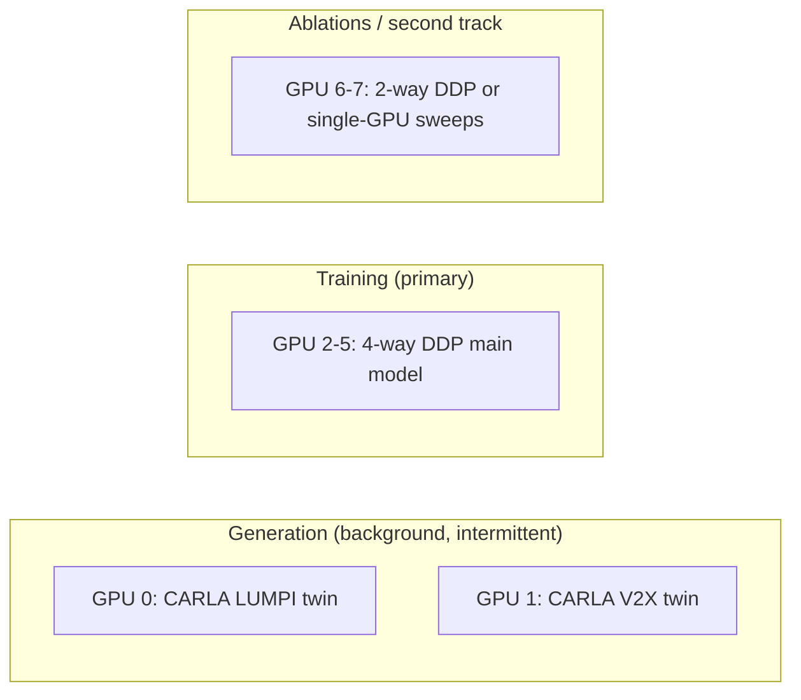
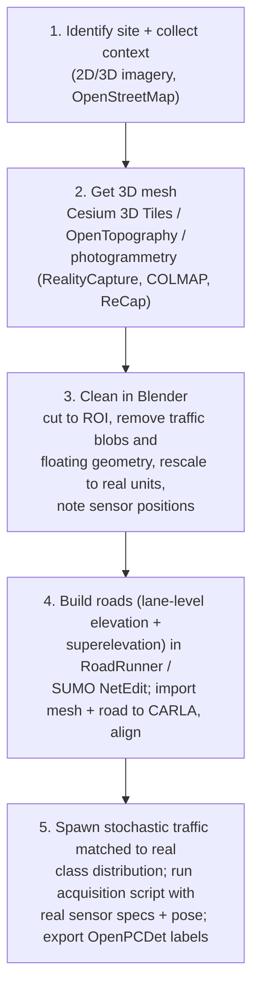

# SETUP AND STACK: concrete engineering base for both tracks

> The shared, reviewed technical foundation for `PLAN-V2X-Real.md` and `PLAN-LUMPI.md`. Tuned to the `bdasl-gpu-server` (8x NVIDIA RTX A6000, 48 GB each). Read this once, stand it up once, reuse for both tracks.
> Every fact in Section 1 is confirmed from the live CodaBench pages (read Aug 31, 2026) and the four UrbanTwin/LiGuard papers in `reference/papers/`.

---

## 1. Confirmed ground truth (verified, not inferred)

### 1.1 Rules that decide the whole approach

| Item | Confirmed wording / value | Source |
|---|---|---|
| Training data | "Using real data for training, including fine-tuning" is forbidden. "The detector must be trained on your synthetic data only." | CodaBench Rules |
| Forbidden frames | "Training, validating, tuning on, or observing ground truth from any frame in `forbidden_frames.txt`" = union of the 50 detection-test + 50 realism-reference frames. | CodaBench Rules |
| Regime | This is **domain generalization**, not unsupervised domain adaptation. Self-training / pseudo-labeling on real frames is **not allowed**. Plan accordingly. | Derived from the rule above |
| What you may still do | Use published sensor datasheets and the digital-twin method to match the sensor; download the public real datasets to understand the sensor and build a realism proxy from non-forbidden frames. The detector never sees real data. | Rule is scoped to "the detector ... trained on synthetic only" |

### 1.2 Scoring (both halves reproducible locally with `local_eval.py` + `config.json`)

```
score_combined = 0.6 * norm(3D mAP @ IoU 0.5)             # KITTI 40-point interpolation
               + 0.4 * mean( norm(CD), norm(MMD), norm(EMD), norm(FPD) )
```

- Realism metrics compare submitted synthetic frames vs a hidden real reference set, **10,000 points per side, seed 1234**.
- **CD**: Chamfer, symmetric squared-L2 nearest-neighbor. **MMD**: Gaussian-kernel two-sample, median-heuristic bandwidth. **EMD**: exact Wasserstein-1, Euclidean cost, network simplex. **FPD**: Frechet, FID-style 2-Wasserstein between fitted **3-variate** Gaussians.
- **Consequence (important):** FPD is 3-variate, so the realism metrics are computed on **xyz geometry only**. Point intensity does not affect the 40% term. Spend intensity effort only where it helps detection.

### 1.3 Tracks (confirmed)

| | V2X-Real (comp 16685) | LUMPI (comp 16684) |
|---|---|---|
| Classes | vehicle, pedestrian, truck (3) | Person, Car, Bicycle, Motorcycle, Bus, Truck, Van, Unknown (8) |
| Range [x,y,z min/max] | [-40,-40,-8,40,40,2] | [-40,-40,-5,40,40,5] |
| Site | SE corner, Westwood Plaza x Charles E. Young Dr South, UCLA, LA | Konigsworther Platz intersection, Hannover |
| Provided synthetic | UT-V2X-Real-IC, ~53.6k pts/frame, ~13.9 obj/frame, DOI 10.7910/DVN/N6N4UR | UT-LUMPI, ~220.3k pts/frame, ~44.2 obj/frame, DOI 10.7910/DVN/D9SSWD |
| Organizer detector + result | SECOND, 56 epochs, 8,000 synth frames, Car AP 63.18 @ IoU 0.5 | SEED (VoxelNeXt backbone), 12 epochs, Car AP 44.74 (synth) vs 42.70 (real) |

Note the LUMPI z-range: the challenge uses **[-5, 5]**, while the UrbanTwin papers trained with **[-8, 2]**. Use the challenge range for scoring; keep the paper's as a training-time ablation.

### 1.4 The LUMPI real sensor rig (exact, from the detection paper Table I)

LUMPI is captured by **five** roadside LiDARs. Match each in CARLA:

| Unit | Channels | Upper FOV | Lower FOV | Points/sec | Max range |
|---|---|---|---|---|---|
| Hesai Pandar64 | 64 | +15.0 | -25.0 | 2.60 M | 200 m |
| Velodyne HDL-64E | 64 | +1.9 | -24.6 | 4.97 M | 120 m |
| Hesai PandarQT | 64 | +52.1 | -52.1 | 0.87 M | 20 m |
| Velodyne VLP-16 (x2) | 16 | +15.0 | -15.0 | 0.68 M | 100 m |

The provided UT-LUMPI aggregate is ~220k points/frame, consistent with registering these five into one cloud.

### 1.5 V2X-Real-IC sensor

The infrastructure ego unit is an **Ouster OS1-128** (a 64-beam OS1 is also present). Typical OS1-128: 128 channels, vertical FOV about 45 degrees (+/-22.5), 512/1024/2048 azimuth columns, up to ~120 m, 10-20 Hz. Confirm exact beam-angle table and mounting pose from a real V2X-Real-IC frame (the UrbanTwin method estimates pose from ground-ring geometry in a single frame).

### 1.6 Competitive landscape

First edition, so no prior winners. As of Aug 31, 2026 the LUMPI track shows **8 participants, few or no submissions**. Your explicit research targets are the organizer baselines in the table above (63.18 V2X-Real Car AP; 44.74 LUMPI Car AP), which are single-class Car numbers, so the multi-class mAP bar (with pedestrians and, for LUMPI, 8 classes) is wide open.

---

## 2. The server: bdasl-gpu-server (8x RTX A6000)

| Property | Value | Implication |
|---|---|---|
| GPUs | 8x RTX A6000, 48 GB GDDR6 each, 384 GB total | Train large detectors at big batch; run CARLA generation and training concurrently |
| Arch | Ampere, compute capability sm_86 | CUDA 11.8+ or 12.x; prebuilt spconv wheels available |
| Recommended driver/CUDA | Driver >= 535, CUDA 12.1 (or 11.8) | Matches PyTorch 2.1/2.2 cu121 and spconv-cu120 |
| Interconnect | Check `nvidia-smi topo -m` | A6000 pairs may have NVLink; DDP uses NCCL either way |

Sanity checks before anything else:

```bash
nvidia-smi                          # 8 GPUs visible, driver >= 535
nvidia-smi topo -m                  # interconnect map (NVLink/PCIe)
nvcc --version                      # CUDA toolkit (or rely on conda cudatoolkit)
df -h /  &&  df -h /scratch 2>/dev/null   # ensure 300-500 GB free for datasets
```

**GPU allocation strategy (solo, both tracks).** You have three workloads: CARLA generation, detector training, and ablations. A workable split on 8 GPUs:



CARLA generation is bursty: generate a corpus, free the GPUs, then use all 8 for training. During a big generation run, use `CUDA_VISIBLE_DEVICES` to pin each CARLA server to one GPU and launch several in parallel (each CARLA instance renders on one GPU). During training, give DDP all free GPUs.

---

## 3. Software environment (exact, reproducible)

Two conda environments: one for CARLA generation (Python 3.8, CARLA client constraints), one for training/eval (Python 3.10). Keeping them separate avoids CARLA's older dependency pins polluting the training stack.

### 3.1 Training/eval env (`bdc-train`)

```bash
conda create -n bdc-train python=3.10 -y && conda activate bdc-train
# PyTorch 2.1.2 + CUDA 12.1 (A6000 sm_86)
pip install torch==2.1.2 torchvision==0.16.2 --index-url https://download.pytorch.org/whl/cu121
# Sparse conv backend (match CUDA 12.x)
pip install spconv-cu120
# 3D detection toolbox
git clone https://github.com/open-mmlab/OpenPCDet.git && cd OpenPCDet
pip install -r requirements.txt
python setup.py develop            # builds CUDA ops for sm_86
# Point-cloud + realism-metric libraries
pip install open3d==0.18.0 geomloss pykeops scipy numpy==1.26.4
pip install "git+https://github.com/facebookresearch/pytorch3d.git@stable"
# LiGuard (organizers' pipeline framework)
pip install LiGuard
```

Verify the build:

```bash
python -c "import torch,spconv,pcdet; print(torch.__version__, torch.cuda.device_count())"
# expect: 2.1.2+cu121 8
```

If `python setup.py develop` compiles for the wrong arch, force it: `TORCH_CUDA_ARCH_LIST=8.6 python setup.py develop`.

### 3.2 CARLA generation env (`bdc-carla`)

```bash
conda create -n bdc-carla python=3.8 -y && conda activate bdc-carla
# CARLA 0.9.15 server (UE4, headless-capable, stable, best community support)
#   download the packaged build (CARLA_0.9.15.tar.gz) to /opt/carla-0.9.15
pip install carla==0.9.15 numpy open3d
```

Launch CARLA headless on one GPU (no display needed on the server):

```bash
CUDA_VISIBLE_DEVICES=0 /opt/carla-0.9.15/CarlaUE4.sh \
  -RenderOffScreen -nosound -quality-level=Epic -world-port=2000 &
# second instance on another GPU + port for parallel generation:
CUDA_VISIBLE_DEVICES=1 /opt/carla-0.9.15/CarlaUE4.sh \
  -RenderOffScreen -nosound -quality-level=Epic -world-port=2010 &
```

`-RenderOffScreen` renders with the GPU but needs no X server, which is exactly right for a headless compute node. If Vulkan is unavailable, add `-opengl`.

> Note: the user has the CARLA "Running on NVIDIA" docs open; on a multi-GPU node set `CUDA_VISIBLE_DEVICES` per instance (CARLA uses the first visible device). Do not run all CARLA instances on GPU 0.

---

## 4. Distributed training on 8x A6000

OpenPCDet ships DDP launchers. Multi-GPU on one node:

```bash
cd OpenPCDet/tools
# 6-GPU DDP training (leave GPU0-1 for CARLA if generating concurrently)
CUDA_VISIBLE_DEVICES=2,3,4,5,6,7 bash scripts/dist_train.sh 6 \
  --cfg_file cfgs/custom_models/centerpoint_lumpi.yaml \
  --extra_tag lumpi_cp_v1 --sync_bn --fix_random_seed
```

Per-GPU batch guidance on 48 GB A6000 (start here, tune up until ~80% memory):

| Detector | Per-GPU batch | Notes |
|---|---|---|
| PointPillars / SECOND | 12-16 | Fast; use for day-1 baseline and quick ablations |
| CenterPoint | 6-8 | Anchor-free; primary for the 8-class LUMPI track |
| Voxel R-CNN | 4-6 | Strong accuracy; primary for V2X-Real |
| PV-RCNN++ | 2-4 | Heavier; ensemble member |
| SEED (VoxelNeXt backbone) | 2-4 | Organizer baseline for LUMPI; transformer, slower |

Enable mixed precision and sync-BN for multi-GPU stability. In the OpenPCDet config `OPTIMIZATION`:

```yaml
OPTIMIZATION:
  BATCH_SIZE_PER_GPU: 6
  NUM_EPOCHS: 30           # organizer used 12 (SEED) / 56 (SECOND); tune per model
  OPTIMIZER: adam_onecycle
  LR: 0.003               # scale ~linearly with total batch; organizer used 0.002
  WEIGHT_DECAY: 0.01
  MOMENTUM: 0.9
  PCT_START: 0.4
  GRAD_NORM_CLIP: 10
  LOSS_SCALE_FP16: 4.0    # if enabling AMP
```

Throughput intuition (A6000, order-of-magnitude, tune): SECOND on 8k frames for 56 epochs is a few hours on 6 GPUs; SEED 12 epochs on 10k frames is longer (transformer). Budget generation and training so the leaderboard loop stays daily.

**Parallelization plan for a solo entrant with 8 GPUs:**
1. Generate both digital-twin corpora once (2-4 GPUs, background), store to disk.
2. Train the two tracks' primary models on disjoint GPU groups simultaneously (for example LUMPI CenterPoint on GPU 0-3, V2X Voxel R-CNN on GPU 4-7).
3. Run ablations (Section E1-E9 in each plan) as single-GPU jobs fanned across idle GPUs with `CUDA_VISIBLE_DEVICES`.
4. Reserve the last week for ensembles and the realism-frame selection sweep.

---

## 5. Storage and data layout

Rough footprint (float32 x,y,z,intensity = 16 bytes/point):

| Dataset | Pts/frame | Frames | Size |
|---|---|---|---|
| UT-LUMPI aggregate | ~220k | 10k | ~140 GB |
| UT-V2X-Real-IC | ~54k | 10k | ~34 GB |
| Your regenerated variants (x2-3) | | | plan 300-500 GB total |

Keep a clean tree on fast local disk (not a network mount, for training I/O):

```
/scratch/bdc26/
  carla_raw/{lumpi,v2x}/         # raw CARLA dumps (npy + labels)
  datasets/{lumpi,v2x}/          # OpenPCDet-format custom datasets
    points/*.bin  labels/*.txt  ImageSets/{train,val}.txt  gt_database/
  real_ref/{lumpi,v2x}/          # public non-forbidden real frames for the realism proxy
  starting_kit/{lumpi,v2x}/      # local_eval.py, config.json, 50 real test frames, forbidden_frames.txt
  runs/                          # OpenPCDet output (ckpts, logs, eval)
  submissions/{lumpi,v2x}/       # packaged submission bundles
```

---

## 6. The shared digital-twin generation pipeline (the UrbanTwin recipe, reproduced)

This is the organizers' own five-stage method (from `reference/papers/UrbanTwin_Building_HiFi_DT...pdf`). Build it once as a parameterized pipeline; the only per-track differences are the site geometry, the sensor rig, and the class set.



Stage notes that matter in practice:
- **CARLA scale is 100 units = 1 m.** Convert every real-world measurement accordingly.
- **Sensor pose without labels:** the organizers estimate each LiDAR's position from a single real frame using the concentric ground-ring pattern. You can do the same from one public LUMPI/V2X frame (this is inspecting the sensor, not training on real data).
- **Mesh cleanup is the labor step:** satellite meshes carry "traffic blobs" (baked-in cars) and floating shards; remove them in Blender or they corrupt both realism and labels.
- **Roads carry elevation and superelevation;** flat roads visibly break the point distribution on cambered intersections.
- **Labels are free and exact:** query CARLA actor bounding boxes each frame; the semantic LiDAR sensor validates class/instance. This is why synthetic labels beat human ones (the 44.74 vs 42.70 LUMPI result).

### 6.1 Sensor emulation in CARLA (concrete)

CARLA's `sensor.lidar.ray_cast` exposes the parameters you need. Emulate each real unit by its confirmed spec. Example for two of the LUMPI units (repeat for all five, then register):

```python
def make_lidar(bp_lib, channels, up_fov, low_fov, pts_per_sec, rng, rot_hz=10):
    bp = bp_lib.find('sensor.lidar.ray_cast')
    bp.set_attribute('channels', str(channels))
    bp.set_attribute('upper_fov', str(up_fov))
    bp.set_attribute('lower_fov', str(low_fov))
    bp.set_attribute('points_per_second', str(int(pts_per_sec)))
    bp.set_attribute('range', str(rng))
    bp.set_attribute('rotation_frequency', str(rot_hz))
    # ray-drop + noise: start crude, then calibrate to real (Section 6.2)
    bp.set_attribute('dropoff_general_rate', '0.10')
    bp.set_attribute('dropoff_intensity_limit', '0.8')
    bp.set_attribute('dropoff_zero_intensity', '0.4')
    bp.set_attribute('noise_stddev', '0.01')
    return bp

# LUMPI units (confirmed Table I):
pandar64  = make_lidar(bp_lib, 64, +15.0, -25.0, 2.60e6, 200)
hdl64e    = make_lidar(bp_lib, 64, +1.9,  -24.6, 4.97e6, 120)
pandarqt  = make_lidar(bp_lib, 64, +52.1, -52.1, 0.87e6, 20)
vlp16_a   = make_lidar(bp_lib, 16, +15.0, -15.0, 0.68e6, 100)
vlp16_b   = make_lidar(bp_lib, 16, +15.0, -15.0, 0.68e6, 100)
# place each at its real pose (center + height + tilt), then register into one cloud
```

For V2X-Real-IC, configure a single OS1-128-style unit at the infrastructure pose (128 channels, +/-22.5 vertical, ~120 m). Confirm exact vertical beam angles from the Ouster OS1 datasheet before final runs.

### 6.2 Ray-drop, noise, and intensity (what moves which score)

- **Density and ray-drop drive the 40% realism term** (CD/EMD/MMD/FPD are geometric). Start from CARLA's built-in dropoff, then calibrate the drop rate so the synthetic per-range and per-height point-count histograms match the real reference (your proxy in `real_ref/`). The organizers note that "adding simple Gaussian noise" generalizes the data; use `noise_stddev` in the 0.005-0.02 m range and tune.
- **Match points-per-frame explicitly:** target ~220k (LUMPI) and ~54k (V2X) so EMD and MMD see the right mass.
- **Intensity does not affect realism scoring** (FPD is 3-variate = xyz). Keep intensity for the detector if it helps, but the safest robust default is to **train geometry-only** (drop intensity), consistent with the Sim2Real literature.

### 6.3 Convert to an OpenPCDet custom dataset (via LiGuard or directly)

The UT datasets already ship in OpenPCDet-friendly form: `.npy` point clouds and `lbl` files with `x y z dx dy dz yaw track_id`. For your own CARLA output, LiGuard (organizers' framework) reads CARLA natively and does background filtering, clustering, calibration, and format conversion through a GUI pipeline. Target layout:

```
datasets/lumpi/
  points/000000.bin        # float32 [N,4] x,y,z,intensity (or [N,3] if geometry-only)
  labels/000000.txt        # per line: x y z dx dy dz yaw class_name
  ImageSets/train.txt val.txt
```

Then subclass OpenPCDet's `custom_dataset.py`, set `CLASS_NAMES`, `POINT_CLOUD_RANGE`, `VOXEL_SIZE`, and generate the `gt_database` for copy-paste augmentation:

```bash
python -m pcdet.datasets.custom.custom_dataset create_custom_infos \
  tools/cfgs/dataset_configs/lumpi_dataset.yaml
```

---

## 7. The local scorer (reproduce the 40% and 60% exactly)

You cannot see the hidden reference, but you can (a) run the organizers' `local_eval.py` on your own held-out synthetic frames to mirror the pipeline, and (b) build a **realism proxy**: score your submitted synthetic frames against public non-forbidden real frames of the same sensor, pooled and subsampled to 10,000 points, seed 1234, matching each metric's definition.

```python
# realism_proxy.py  (match the challenge definitions in Section 1.2)
import numpy as np, torch
from pytorch3d.loss import chamfer_distance          # CD (symmetric)
from geomloss import SamplesLoss                      # EMD (Sinkhorn for speed; use exact OT for final)
import ot                                             # POT: exact network-simplex EMD for final checks

def subsample(pc, n=10000, seed=1234):
    g = np.random.default_rng(seed); idx = g.choice(len(pc), n, replace=len(pc)<n)
    return pc[idx, :3].astype(np.float32)             # xyz only (FPD is 3-variate)

def cd(a, b):
    A = torch.tensor(a)[None].cuda(); B = torch.tensor(b)[None].cuda()
    return chamfer_distance(A, B)[0].item()

def mmd_rbf(a, b):                                    # Gaussian-kernel two-sample, median bandwidth
    A = torch.tensor(a).cuda(); B = torch.tensor(b).cuda()
    d = torch.cdist(torch.cat([A,B]), torch.cat([A,B]))
    sigma = d[d>0].median()
    k = lambda X,Y: torch.exp(-torch.cdist(X,Y)**2/(2*sigma**2))
    return (k(A,A).mean()+k(B,B).mean()-2*k(A,B).mean()).item()

def emd_exact(a, b):                                  # exact Wasserstein-1, network simplex
    M = ot.dist(a, b, metric='euclidean')
    return ot.emd2(np.ones(len(a))/len(a), np.ones(len(b))/len(b), M)

def fpd_3variate(a, b):                               # Frechet between 3-variate Gaussians of xyz
    mu1, mu2 = a.mean(0), b.mean(0)
    C1, C2 = np.cov(a.T), np.cov(b.T)
    from scipy.linalg import sqrtm
    covmean = sqrtm(C1 @ C2).real
    return float(((mu1-mu2)**2).sum() + np.trace(C1+C2-2*covmean))
```

Calibrate this proxy against `local_eval.py` so the two agree in ranking. Then iterate the generator (ray-drop, density, extent) to minimize the four metrics **without collapsing frame diversity** (that would raise FPD covariance and MMD).

---

## 8. Day-1 target: reproduce the organizer baselines

Before any innovation, reproduce the published numbers so you have a trusted pipeline and a floor.

| Track | Reproduce | Config anchor |
|---|---|---|
| V2X-Real | SECOND on 8,000 UT-V2X-Real-IC frames, 56 epochs, eval on the 50 real test frames | Car AP target ~63 @ IoU 0.5 |
| LUMPI | SEED (VoxelNeXt 5-stage, 256 out ch), AdamW + OneCycle, LR 0.002, 12 epochs, range [-40,40]/[-40,40]/[-8,2] | Car AP target ~44-45 @ IoU 0.5 |

Reproducing these confirms the environment, the data conversion, the scorer, and the submission format end to end. Only then do you layer on the pedestrian class, the realism refinement, the stronger detectors, and the inference stack described in the two track plans.

---

## 9. One-screen checklist

- [ ] Driver >= 535, CUDA 12.1, `nvidia-smi` shows 8 A6000; 300-500 GB scratch free
- [ ] `bdc-train` (py3.10, torch 2.1.2+cu121, spconv-cu120, OpenPCDet built for sm_86, pytorch3d, geomloss, POT, LiGuard)
- [ ] `bdc-carla` (py3.8, carla 0.9.15) launching headless with `-RenderOffScreen` per-GPU
- [ ] Starting kits for both tracks downloaded; `config.json`, `local_eval.py`, `forbidden_frames.txt`, 50 real test frames in place
- [ ] UT-LUMPI and UT-V2X-Real-IC downloaded from Harvard Dataverse; converted to OpenPCDet custom datasets
- [ ] `realism_proxy.py` calibrated against `local_eval.py`
- [ ] SECOND (V2X) and SEED (LUMPI) baselines reproduced; two legal submissions on the leaderboard
- [ ] GPU allocation plan in use (generation vs training vs ablation)

> Open items to read out of the starting kit once (not answerable from the public site): the `config.json` normalization endpoints per metric, and the exact submission folder structure. Everything else in Section 1 is confirmed.

